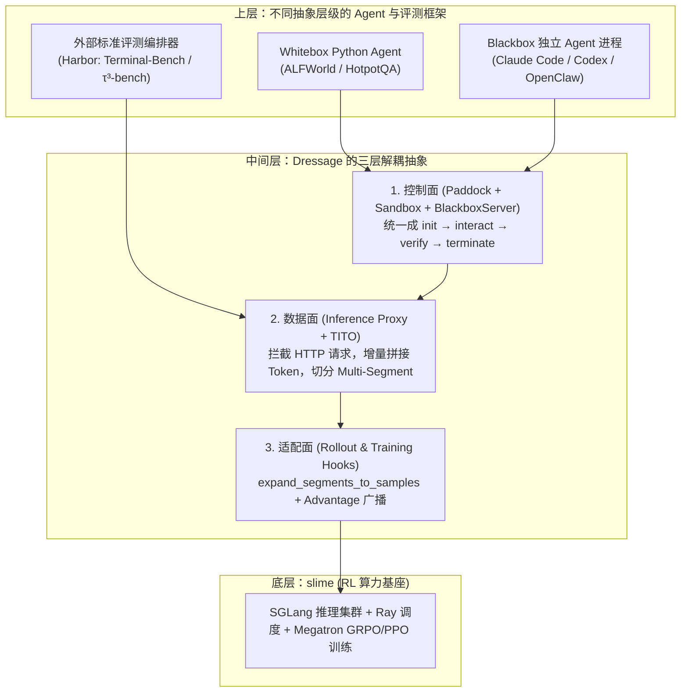

# 混元岗位需求对齐与 Slime / Dressage / Harbor 评测抽象分析

记录日期：2026-10-24。

> 2026-10-25 复核说明：下文关于“覆盖岗位 60%–70%”及面试必考/不考内容的判断没有可核验依据，不作为当前结论。本文保留为当时的分析记录；当前按[官方岗位逐项对照与一个月安排](../../../../slime_photo/code-reading/job-alignment.md#next-month-job-plan-20261025)确定优先级，不将框架阅读量换算为岗位能力比例。

本文围绕以下三个问题，完整保存基于本地 `slime` 与 `Dressage` 源码的校对结论、岗位对照与评测抽象改进方案，并在文末完整收录触发本次讨论的《Slime、Dressage 与 Harbor 边界及 Dressage 评测抽象分析》原文：

1. **腾讯混元“Agent 强化学习框架工程师”岗位到底要求什么？当前研究“多框架抽象层级与评测方式”是否正中岗位要求？**
2. **如何结合本地最新源码客观看待 `Slime vs. Dressage vs. Harbor` 的边界与 `Dressage` 原生评测抽象的 4 个硬伤？**
3. **当前框架是否支持接入评测体系？在架构上怎样能够做得更好？**

[返回 Slime 后续阅读顺序](README.md) · [返回 Slime 阅读入口](../README.md) · [岗位对照 (`job-alignment.md`)](../../../../slime_photo/code-reading/job-alignment.md) · [切入 Dressage：提炼抽象层级与评测方式](dressage-abstraction-and-evaluation-route.md)

- 本地源码路径与版本基准：
  - Slime：`/home/fredkeira/projects/slime`（HEAD `18868a79b0b083a093798a94ed0f8cb4f71b9c14`）
  - Dressage：`/home/fredkeira/projects/Dressage`（HEAD `3e3142fe8ea07e4504c3b20a936a4c201a3de44c`）
- 说明：本文记录架构对照与选读规划；实际阅读进度与掌握状态继续以 [唯一阅读路线](../../../../slime_photo/code-reading/repo-reading-route.md#当前接续) 为准。

---

## 直接结论

**你现在思考的这个问题——“怎么把紧耦合的 Agent Rollout 拆开、怎么在不同抽象层级的 Agent/评测框架与底层 RL 引擎之间划出清晰边界、怎么无痛接入不同评测体系”——不仅没有偏题，而且正好命中了混元这个岗位最核心的 60%~70% 职责。**

---

## 一、混元“Agent 强化学习框架工程师”到底要求什么？你在解决它的哪一部分？

回到 [岗位对照记录 (`job-alignment.md`)](../../../../slime_photo/code-reading/job-alignment.md#L19-L56) 记录的腾讯混元 JD（`postId=2061654749727600640`），为什么这个岗位叫 **“Agent 强化学习框架工程师”** 而不是“预训练/Megatron 算子工程师”或“纯应用 Agent 开发”？

因为大模型团队在训练 Coding / Search / Computer-Use Agent 时，卡脖子的问题正是：**底层的 RL 引擎（如 Slime/verl）只认识对齐好的 Token/Logprob/Mask/Reward 张量；而外部的 Agent 框架（Claude Code、Codex、OpenClaw）和评测基准（SWE-bench、Terminal-Bench、τ-bench、Harbor）只认识 HTTP API、CLI 和容器沙箱。**

混元这个岗位的 5 条核心职责，本质上就是造中间这座桥：

| 混元 JD 原文职责与要求（见 [job-alignment.md](../../../../slime_photo/code-reading/job-alignment.md#L21-L55)） | 翻译成你正在研究的代码问题 | 你现在的思考是否命中？ |
| :--- | :--- | :--- |
| **职责 2 + 要求 2 + 加分项 2**：设计和维护核心基础组件，对**模型调用、工具调用、任务环境和上下文管理进行统一封装**，提升复用性与可扩展性 | 怎么把 [coding_agent_rl/generate.py](/home/fredkeira/projects/slime/examples/coding_agent_rl/generate.py#L223-L343) 里揉成一团的 `Sandbox + Harness + Adapter + Task` 拆成正交接口？ | **完全命中**（这就是你问的“如何提炼合适的抽象层级”） |
| **职责 3 + 要求 5/6**：结合具体研究任务（Coding、Deep Research 等），支持**新 Agent 策略、评测方法与验证机制的快速接入**与迭代 | 怎么避免每换一个评测集（SWE-bench、SWE-Gym、Claw、Harbor）就重写一套 400 行的 `generate/dispatch`？ | **完全命中**（这就是你问的“如何构建合适的评测方式并测试不同场景”） |
| **职责 1 + 职责 5 + 要求 4**：负责 **数据生成、自动化评估（评测）与实验复现**；从**训练视角**理解多轮交互数据链路，与 RL 训练流程衔接 | 外部黑盒 Agent 跑完多轮对话（甚至触发上下文压缩）后，怎么通过 Proxy + Token 拼接（TITO / `_session_prompt_ids`）零失真地变成 `Sample(tokens, loss_mask, rollout_log_probs, reward)`？ | **完全命中**（这就是你刚读完的 `Adapter + TrajectoryManager` 与 `Dressage Proxy + multi_segment`） |
| **职责 4 + 要求 1/3**：掌握 **Python 异步/并发**，处理高并发任务调度、慢任务治理、超时控制、失败恢复、Docker/K8s 沙箱管理 | 几百个沙箱和评测容器同时跑时，`asyncio.Semaphore`、超时取消、`atexit` 清理、沙箱池回收怎么写才不死锁、不漏容器？ | **部分命中**（你在 `generate.py` 里已经看到了 `finally` 回收和异常分支，深水区在批量调度与容错） |

**一句话总结你在混元岗位里的定位**：
如果去面试或入职这个岗位，别人不会考你手推 Megatron 3D 并行通信算子，**核心考题和日常工作就是你现在在想的事：给你一个底层的 RL 引擎（类似 Slime），面对五花八门的 Agent（Claude Code / OpenCode / 自研 Agent）和五花八门的 Benchmark（SWE / Terminal-Bench / GUI / Web），你怎么设计一套统一的中间层框架，既能一行配置跑通评测（Eval），又能零 Token 漂移地把轨迹喂给 RL 训练（Train）？**

---

## 二、怎么客观看待 `Slime vs. Dressage vs. Harbor` 分析？（结合本地最新源码校对）

核对本地两个仓库版本——`slime`（HEAD `18868a79`）和 `Dressage`（HEAD `3e3142fe`）——有一处**版本演进的事实补充**和三处**完全属实的痛点印证**：

### 1. 补充一个关键事实：新版 `slime` 已经吸收了 `Dressage` 的部分“网关与轨迹底座”

`Dressage` 锁定的 `slime` 子模块还是早期的 `v0.3.0`（那时的 `slime` 确实完全没有黑盒 Agent 拦截能力）。但你本地刚读过的上游新版 `slime`（`18868a79`）其实已经把“HTTP 代理拦截 + 前缀 Token 拼接 + 分支合并”内置到了 [`slime/agent/`](/home/fredkeira/projects/slime/slime/agent) 目录里：

- **协议拦截层**：[`AnthropicAdapter`](/home/fredkeira/projects/slime/slime/agent/adapters/anthropic.py)、[`OpenAIAdapter`](/home/fredkeira/projects/slime/slime/agent/adapters/openai.py)、[`ResponsesAdapter`](/home/fredkeira/projects/slime/slime/agent/adapters/responses.py) 加上 [`AdapterServer`](/home/fredkeira/projects/slime/slime/agent/adapters/server.py)，做的就是 `Dressage` 里 `LitellmProxy + Gateway` 的事。
- **防重分词漂移与多段轨迹层**：在 [`BaseAdapter`](/home/fredkeira/projects/slime/slime/agent/adapters/base.py) 和 [`TrajectoryManager.finish_session`](/home/fredkeira/projects/slime/slime/agent/trajectory.py) 看到的 `_session_prompt_ids` 增量拼接与 `merge_branches=True` 树状轨迹拆多条 `Sample`，对应的就是 `Dressage` 里的 `TITO` 和 `expand_segments_to_samples`。
- **Eval 模式支持**：新版 [`examples/coding_agent_rl/generate.py`](/home/fredkeira/projects/slime/examples/coding_agent_rl/generate.py#L308-L323) 已经支持了 `evaluation=True`（评测时跳过 `finish_session` 分支展开，直接返回带 `reward` 的单条 `Sample`）。

### 2. 完全属实的痛点：无论 `slime` 还是 `Dressage`，原生的“任务与评测层（Verifier）”抽象依然是半成品

`Dressage` 原生评测的 4 个缺陷，在本地源码里每一条都有铁证：

1. **原生 `blackbox_dispatch` 直接拒绝 `evaluation=True`**：
   看 [`dressage/rollout/generate/blackbox_dispatch.py`](/home/fredkeira/projects/Dressage/dressage/rollout/generate/blackbox_dispatch.py#L140-L141)：
   ```python
   if evaluation:
       raise ValueError("blackbox_dispatch does not support evaluation mode")
   ```
2. **没有独立的 `Verifier / Evaluator` 生命周期对象，导致每加一种复杂评测就复制粘贴 400 行主流程**：
   - 常规同沙箱命令钩子：[`blackbox_dispatch.py`](/home/fredkeira/projects/Dressage/dressage/rollout/generate/blackbox_dispatch.py#L120-L412)（412 行）
   - 为了加 SWE-Gym 的“新开干净沙箱打 Patch 评测”：复制了一份 [`blackbox_dispatch_swegym.py`](/home/fredkeira/projects/Dressage/dressage/rollout/generate/blackbox_dispatch_swegym.py#L46-L327)（327 行），只为了在 [`L246-L254`](/home/fredkeira/projects/Dressage/dressage/rollout/generate/blackbox_dispatch_swegym.py#L246-L254) 插入 [`execute_fresh_swegym_eval`](/home/fredkeira/projects/Dressage/dressage/recipes/swegym/evaluator.py#L18-L157)。
   - 为了加 Claw 的“Agent 跑完后再把 `after_agent_files` Grader 脚本和对话历史塞进沙箱防作弊”：又复制了一份 [`dressage/recipes/dressage_claw/dispatch.py`](/home/fredkeira/projects/Dressage/dressage/recipes/dressage_claw/dispatch.py#L317-L398)（498 行）。
3. **一旦遇到标准第三方评测框架（如 `Harbor`），`Dressage` 干脆绕开了自己的 `Paddock` 沙箱层**：
   看 [`dressage/integrations/harbor/rollout.py`](/home/fredkeira/projects/Dressage/dressage/integrations/harbor/rollout.py#L1-L165)：因为 `Harbor` 自己管 Docker/E2B 容器、自己调 Agent、自己跑 Verifier 容器打分，如果硬塞进 `Paddock` 会发生双重沙箱冲突。所以 `harbor/rollout.py` 直接接管了 Slime 的批量级接口 `--rollout-function-path`，**只留了 Dressage 的 `Gateway + Proxy + expand_segments_to_samples` 来录 Token 轨迹**，把环境与评测完全交还给 `Harbor`。

---

## 三、当前的框架是否支持接入评测体系？怎么能够做得更好？

### 1. 当前框架支持接入评测体系吗？—— 支持，而且底层留了两个粒度的接入点

在 `slime` 的调度核心 [`slime/rollout/sglang_rollout.py`](/home/fredkeira/projects/slime/slime/rollout/sglang_rollout.py) 里，其实已经为评测体系留好了两层扩展口：

- **粒度 A：单样本级接入（`--custom-generate-function-path` + `--eval-config`）**
  - 在 [`sglang_rollout.py:296-306`](/home/fredkeira/projects/slime/slime/rollout/sglang_rollout.py#L296-L306) 和 [`eval_rollout_single_dataset` (`L616-L660`)](/home/fredkeira/projects/slime/slime/rollout/sglang_rollout.py#L616-L660) 中，训练时调 `custom_generate_fn(..., evaluation=False)`，定期评测时自动对 `EvalDatasetConfig` 里的各个数据集调同一个 `custom_generate_fn(..., evaluation=True)`。
  - **适用场景**：任务环境由你自己的框架（如 `slime` 的 `Sandbox` 或 `Dressage` 的 `Paddock`）管理。
- **粒度 B：整批 Job 级接入（`--rollout-function-path`）**
  - 在 [`slime/rollout/base_types.py`](/home/fredkeira/projects/slime/slime/rollout/base_types.py) 与 [`dressage/integrations/harbor/rollout.py:58-100`](/home/fredkeira/projects/Dressage/dressage/integrations/harbor/rollout.py#L58-L100) 中，可以直接替换整个 `rollout(args, rollout_id, data_source, evaluation=...)` 函数，返回 `RolloutFnTrainOutput` 或 `RolloutFnEvalOutput`。
  - **适用场景**：接入像 **Harbor、SWE-bench 官方 Docker Harness、τ-bench、OSWorld** 这种“自带整套环境编排、Agent 启动器与 Verifier 评测器”的外部成熟评测框架。

### 2. 怎么能够做得更好？（架构设计上的“一底座 + 双模式”方案）

把 `slime` 和 `Dressage` 的优缺点结合起来，要设计一套真正优秀的 **Agent RL 评测与训练统一抽象**（直接对应混元 JD 的架构设计要求），可以提炼为**“一个底座 + 两种接入模式”**：

```
┌──────────────────────────────────────────────────────────────────────────────┐
│                统一底座：Trajectory Gateway / Adapter Layer                   │
│  职责：暴露 OpenAI / Anthropic / Responses HTTP 端点 -> 转发 SGLang            │
│        维护 _session_prompt_ids (TITO) -> 导出 List[Sample(tokens, mask)]    │
│  （对应 slime/agent/adapters + trajectory.py 或 dressage/proxy + gateway）   │
└───────────────────┬──────────────────────────────────────┬───────────────────┘
                    │                                      │
     模式一：内建轻量沙箱 + 插件化 Verifier       模式二：Proxy 桥接外部完整评测框架
    （适合自建任务：SWE / 单机 CLI / 自定义题）   （适合标准榜单：Harbor / τ-bench / OSWorld）
                    ▼                                      ▼
┌─────────────────────────────────────────┐  ┌─────────────────────────────────┐
│ 统一 Orchestrator（不再复制 400 行函数） │  │ 外部 Benchmark Orchestrator      │
│  1. Sandbox (E2B / Bwrap / Docker / K8s)│  │  - 由 Harbor 等自己拉起环境与评测│
│  2. Harness (ClaudeCode / Codex / ...)  │  │  - 仅通过环境变量注入：          │
│  3. TaskLifecycle / Verifier 协议（核心）│  │    OPENAI_BASE_URL=Gateway/sid  │
│     ├─ setup_workspace(sandbox, sample) │  │  - 跑完后从外部取 verifier.reward│
│     ├─ stage_grader(sandbox, history)   │  │    与 Gateway 里的 Sample 合并   │
│     ├─ collect_artifacts(sandbox)       │  └─────────────────────────────────┘
│     └─ evaluate(artifacts, sandbox_pool)│
└─────────────────────────────────────────┘
```

相比现在的 `slime` 和 `Dressage`，**“做得更好”的三个核心改进点**：

1. **改进点 1（解决 `slime/coding_agent_rl` 和 `Dressage` 复制粘贴 `dispatch.py` 的问题）：把 `TaskVerifier` 从主流程里抽成一等公民接口**
   不要在 `generate.py` 里硬编码 `swe.prepare_workspace -> swe.git_diff -> swe.run_evaluation`，也不要像 `Dressage` 那样只有字典配置 `before_agent / after_agent` 命令列表。
   而是定义一个清晰的 `TaskVerifier`（或 `TaskEnvironment`）协议，只管 4 个钩子：
   - `prepare(sandbox, sample) -> TaskContext`：负责任务前置准备（如切 commit、写题目文件）。
   - `before_grade(sandbox, sample, trajectory)`：负责**防泄漏分阶段注入**（把 `dressage_claw` 那种“等 Agent 停了再把测试脚本和 `agent_messages.json` 写进沙箱”变成标准钩子，不用复制整个 `dispatch.py`）。
   - `collect_artifacts(sandbox, sample) -> dict`：负责提取产物（如 `git diff`、文件快照、命令输出）。
   - `grade(artifacts, sample, sandbox_factory) -> GradeResult(reward, metrics)`：负责打分——既可以在原沙箱跑命令，也可以调用 `sandbox_factory` 拉起一个**全新的干净评测容器**（原生支持 `swegym` 的 `execute_fresh_swegym_eval` 模式），还可以直接跑纯 Python 规则校验。

2. **改进点 2（统一 Train 与 Eval 的生命周期）：一套 `generate` 同时跑通 RL 训练与 Benchmark 评测**
   修掉 `Dressage` 里 `if evaluation: raise ValueError(...)` 的断层，吸收新版 [`slime/examples/coding_agent_rl/generate.py:308-323`](/home/fredkeira/projects/slime/examples/coding_agent_rl/generate.py#L308-L323) 的做法：
   - **前面的 `prepare -> harness.run -> before_grade -> collect_artifacts -> grade` 在训练和评测时 100% 共用**，保证训练时的 Verifier 和评测时的 Verifier 完全一致（零 Train-Eval Skew）。
   - 只有最后一步根据 `evaluation: bool` 分流：
     - `evaluation=True`：直接返回 `Sample(reward=grade.reward, metrics=grade.metrics)` 用于榜单统计；
     - `evaluation=False`：调用 `adapter.finish_session(reward=grade.reward, merge_branches=...)` 展开成带 `tokens / loss_mask / rollout_log_probs` 的单条或多段 RL 训练样本。

3. **改进点 3（对外兼容像 `Harbor` 这样的生态标准）：保留“Proxy 寄生模式”**
   就像 [`dressage/integrations/harbor/rollout.py`](/home/fredkeira/projects/Dressage/dressage/integrations/harbor/rollout.py#L103-L165) 做的那样：当团队想接入社区现成的重型评测框架（Harbor、SWE-bench Docker、OSWorld）时，不强迫别人把评测器重写进你的 `Sandbox` 接口，而是直接把你的 `Adapter / Gateway` 作为一个“带 `session_id` 路由的透明录制代理”注入给外部评测框架，外部框架管沙箱和打分，你的框架只管录制 Token 和回填 `reward`。

---

## 四、后续阅读的切入选择

1. **切面 A（看“模式二：怎么零侵入接入外部评测框架 Harbor”）**：
   阅读 [`dressage/integrations/harbor/rollout.py`](/home/fredkeira/projects/Dressage/dressage/integrations/harbor/rollout.py)，看它怎样只用 `Gateway + Proxy + expand_segments_to_samples` 桥接 Harbor 的评测与训练。
2. **切面 B（看“模式一：怎么把 `_generate` 拆成 Paddock + Stage Hooks + Fresh Sandbox Eval”）**：
   对照阅读 [`dressage/rollout/generate/blackbox_dispatch.py`](/home/fredkeira/projects/Dressage/dressage/rollout/generate/blackbox_dispatch.py) 与 [`dressage/recipes/swegym/evaluator.py`](/home/fredkeira/projects/Dressage/dressage/recipes/swegym/evaluator.py)。

---

## 附：本次讨论引用的《Slime、Dressage 与 Harbor 边界及评测抽象分析》原文存档

<details>
<summary>点击展开完整参考原文（保存供后续对比查阅）</summary>

### Parte 1：为什么只看 slime 解决不了多框架抽象的问题？

直接给结论：只看 slime 解决不了“不同 Agent 框架采用不同抽象层级”的问题；而 Dressage 的本质，正是在 slime（只懂 Token Tensor）和“五花八门的外部 Agent/评测框架”（只懂 HTTP API、CLI 和沙箱环境）之间，造了一层“协议与生命周期转换器”。

slime 的抽象层级太低了，它是一个纯粹的“Post-Training 算力与 RL 引擎层”。

在 slime 的世界观里（见 `rollout.md:13-23`）：
- 它的核心职责是调度 Megatron-LM（训模型）、SGLang（推理生成）和 Ray（分布式进程）。
- 它留给外部的扩展点只有 7 个裸 Python 函数钩子（`--custom-generate-function-path`、`--custom-rm-path` 等），且它要求最终喂给它的必须是对齐好的 `Sample(tokens, loss_mask, logprobs, reward)`。

当你面对真实世界里不同抽象层级的 Agent 框架时，只靠 slime 会立刻撞上三堵墙：
1. **黑盒 Agent 根本不归 Python 管**：像 Claude Code、Codex、OpenCode、OpenClaw 都是独立运行的 Node.js/Rust/二进制进程，它们有自己的循环、自己的 Compaction（上下文压缩）、甚至自己的 Subagent 派生。slime 的 `generate(sample)` 函数根本不知道怎么去拦截一个外部二进制进程内部发出的几十次 LLM 请求。
2. **多轮对话的 Retokenization Drift（重分词漂移）与上下文切分**：外部 Agent 框架每一轮发来的是 OpenAI/Anthropic 格式的 messages JSON。如果事后把对话历史重新 tokenize 喂给 slime，BPE 分词边界一变，推理时的 logprob 和训练时的 token_id 就错位了；而且一旦 Agent 触发上下文压缩（历史重写），一条轨迹变成多段，slime 原生只认单条 `Sample`。
3. **没有环境与沙箱生命周期概念**：slime 不关心 Docker、Bubblewrap、E2B，也不知道什么叫“先注入任务文件 -> 跑 Agent -> 再注入 Grader 防作弊评测”。

### Parte 2：你到底应该怎么看这里的 Dressage？

不要把 Dressage 看成一个“写 Agent 的框架”或者“评测数据集仓库”，应该把它看作一个三层的“Agentic RL 中间件（Bridge）”：



具体来看，Dressage 真正在做的事情只有三件：
1. **用 Proxy 在“HTTP 协议层”抹平所有 Agent 框架的差异（最核心的价值）**：不管上层是几行代码的 Python 循环、复杂的 LangGraph、Claude Code 二进制，还是 Harbor 调度器，只要它最终调的是 OpenAI / Anthropic 兼容的 HTTP 接口，走一趟 Dressage Proxy，就能通过 TITO 录制下零漂移的 Token 级证据（`token_id`, `logprob`, `loss_mask`），并在 Agent 压缩历史或改 System Prompt 时自动切分成多个 Segment（`multi_segment.py`）。
2. **用 Paddock + BlackboxServer 抹平“执行环境与生命周期”的差异**：把各种异构 Agent 统一收口成 `init(拿沙箱) → register/call_agent(跑任务) → execute_cmd(环境校验/跑 Grader) → terminate(销毁)`。
3. **用 Harbor Integration 演示了“当外部评测框架自带全套编排时，Dressage 如何退居幕后”**：在 Harbor 模式下，Dressage 甚至放弃了自己的 Paddock 和 BlackboxServer，把任务分发、Agent 启动、沙箱环境、Verifier 评测全部交给 Harbor，自己只保留 `Gateway + Proxy`（录 Token 轨迹）+ `Multi-Segment` 转换（喂给 slime）。

### Parte 3：Dressage 在“评测框架（Evaluation Framework）”抽象层级上的 4 个硬伤

在“评测框架（Evaluation Framework）”这个抽象层级上，Dressage 原生设计存在 4 个明显短板：

1. **没有“评测器（Verifier / Evaluator）”这一层一等公民抽象**：
   - 环境内动作降格成了 JSONL 数据里 `metadata["blackbox_execute_cmds"]["after_agent"]` 的一串 bash 脚本字符串（见 `execute_hooks.py:18`）。
   - 结果解析降格成了 `registry.py:59-71` 里只接收 `Sample`、强制返回单一 `float(result)` 的 `@register_reward` 函数。
2. **每接入一个复杂 Benchmark，就得复制粘贴重写一遍 `dispatch.py`**：
   - 基础黑盒生成逻辑在 `blackbox_dispatch.py`（412 行）。
   - 接入 SWE-Gym 时复制改写成 `blackbox_dispatch_swegym.py`（327 行）。
   - 接入 Dressage Claw 时又复制改写成 `dressage/recipes/dressage_claw/dispatch.py`（498 行）。
   - 3 个评测场景 = 3 份高度重复的 400 行 Rollout 主干代码。
3. **原生模式缺失 Benchmark 级别的独立 Eval 调度与统计能力**：
   - `blackbox_dispatch.py`、`whitebox_agent.py` 和 `sync_rollout.py` 均在 `if evaluation:` 时抛出 `ValueError("... does not support evaluation mode")`。
4. **引入 Harbor 说明标准评测能力外包给了 Harbor**：
   - 支持 Terminal-Bench 2.0、τ³-bench 时，绕开了 `Paddock`、`BlackboxServer` 和 `dressage/reward/`，直接用 Harbor 承担 `Dataset / Environment / Agent / Verifier` 四元抽象，只在 Harbor 集成层实现了 `_eval_output`。

| 抽象层级 | Dressage 做得好不好 | 真实状态评估 |
|---|---|---|
| 1. 轨迹录制与 Token 对齐层 (`Proxy + TITO + Multi-Segment`) | ⭐⭐⭐⭐⭐ 极好 | 真正的核心资产。解决了多轮黑盒 Agent、上下文压缩、子 Agent 的 RL 梯度对齐难题。 |
| 2. 算力与 RL 引擎对接层 (`slime Hooks + TransferQueue`) | ⭐⭐⭐⭐ 很好 | 零侵入挂载 slime，支持同步/全异步/部分异步与 Step 负载均衡。 |
| 3. 沙箱与黑盒进程桥接层 (`Paddock + BlackboxServer`) | ⭐⭐⭐ 及格但偏科 | 统一了租约生命周期，但深度耦合于 POSIX Shell/文件操作和 4 个特定 CLI Agent。 |
| 4. 评测框架抽象层 (`Verifier / Benchmark / Eval`) | ⭐⭐ 没做好（分裂） | 原生层只有简陋的 `after_agent` 脚本 + 标量 `reward_fn`，复杂评测靠复制 `dispatch.py` 硬写；标准评测能力完全外包给了 Harbor。 |

</details>
