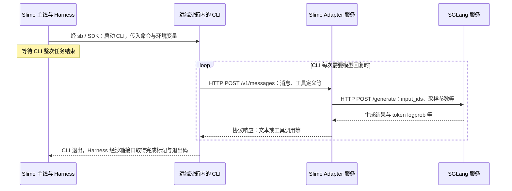

# 从 Harness 启动到模型回复：信息经过哪些地方

> 2026-10-23：本页保留 Step 7 当时的通信解释。CLI 启动与等待已收拢在 [task flow](../05-task-flow.md)；HTTP 接收的后续阅读见 [Step 8](../../step-009-adapter-request-entry/01-scope.md)。

承接 [原始追问](../04-flow.md#run-cross-process-communication)与[独立成步的确认](../04-flow.md#separate-communication-step)，本说明现属于 Step 7。沿用 Claude Code / Anthropic Adapter / E2B 场景，源码固定于 `2f2318653f6f794dddd321eff7c9d4b7b174643f`。以下说明正常路径和默认环境配置；它是助手核对后的解释，没有实际运行 CLI、沙箱或模型服务。

## 1. 先把运行位置分开

| 组件 | 在哪里运行 | 此刻的职责 |
| --- | --- | --- |
| `generate`、`BaseHarness.run`、`ClaudeCodeHarness.launch_and_wait` | Slime 这一侧的 Python 进程 | 准备启动命令，通过沙箱接口启动 CLI，等待它整次运行结束 |
| `sb` / `sb._sb` | 同一侧的本地对象 / SDK 客户端 | 操作已关联的远端沙箱；Python 对象本身不会搬到沙箱里 |
| Claude Code CLI 与题目工作目录 | 远端执行沙箱 | CLI 执行任务，需要模型时发出请求 |
| Adapter HTTP 服务 | Slime 进程中的独立服务线程 | 接收 CLI 请求，调用模型服务，组织协议回复并记录轨迹 |
| SGLang 模型服务 | 单独的服务端点，本例通过 Router 地址访问 | 根据 token 输入与采样参数生成结果 |

所以，`generate → run → launch_and_wait` 仍是本地 Python 调用。继续走到沙箱 SDK 操作时，才把命令、文件内容或环境参数送往远端。

## 2. 三条通信路径与返回方向

图中折叠 SDK 内部通信和命令轮询，只保留本轮需要的交接；CLI 发出 HTTP 的内部函数尚未检查。



| 路径 | 实际发起位置 | 目标由什么确定 | 主要交付内容 |
| --- | --- | --- | --- |
| Slime → 执行沙箱 | `run_agent → exec_and_wait → sb.exec`，E2B 实现调用 `self._sb.commands.run` | `sb` 内保存的、已关联该沙箱的 SDK 客户端 | 启动脚本与命令、执行用户、环境变量；工作目录由启动脚本中的 `cd` 设置 |
| 沙箱 CLI → Adapter | 已启动的 CLI 内部 HTTP 客户端 | `ANTHROPIC_BASE_URL`，由 `ctx.adapter_url` 填入 | Anthropic 格式的消息、工具定义等；请求头还带上本次会话标识 |
| Adapter → SGLang | `call_sglang_generate` 中的 `sess.post` | `adapter.sglang_url`，来自 `args.sglang_router_ip` 与端口 | `input_ids`、`sampling_params`、`rid`、`return_logprob=True` |

返回的两次模型响应分别对应各自的 HTTP 请求。Adapter 接到 SGLang 结果后，先完成解码、解析和协议组装，再回应 CLI；SGLang 不直接把这份结果发给沙箱。一次模型请求完成时，外层 `HARNESS_CLS().run` 通常仍在等待 CLI 整次运行结束。

## 3. 地址与会话标识怎样接起来

`BaseHarness.run` 先把输入放进 `HarnessContext`，再调用具体实现的 `launch_and_wait`。当前类是 `ClaudeCodeHarness`，其 `run` 继承自 `BaseHarness`。

`harness/claude_code.py:58、62–67` 中，CLI 命令和本次相关环境字段是下面这些。摘录省略其他环境字段与额外覆盖配置；此时只是在本地构造字符串和字典：

```python
cmd = f"/usr/local/bin/claude -p {shlex.quote(prompt)} {self.launch_flags}"
env = {
    "ANTHROPIC_BASE_URL": ctx.adapter_url,
    "ANTHROPIC_AUTH_TOKEN": ctx.session_id,
    "ANTHROPIC_MODEL": ctx.model_label,
    # 其余环境字段省略
}
```

- **`cmd` 决定启动什么**：运行 `claude`，把 `prompt` 作为 `-p` 的参数。这里传的是 `swe.SWE_PROMPT`，它要求读取工作目录中的 `PROBLEM_STATEMENT.md`；题目文件已经通过前面的写文件操作放入沙箱。
- **`env` 决定 CLI 请求谁**：它经 `run_agent`、`exec_and_wait` 传到 `sb.exec`，再作为 `envs` 交给 SDK，成为远端启动进程的环境变量。CLI 读取 API 地址并向该地址发起请求。
- **地址和编号分工不同**：`adapter_url` 指向服务；`session_id` 经 `ANTHROPIC_AUTH_TOKEN` 进入 `Authorization: Bearer ...` 请求头，Adapter 从请求头提取它，再关联 `store` 中的会话配置。编号本身不是网络地址。
- **两个服务地址分别保存**：沙箱内 CLI 使用 `adapter_url`；Adapter 使用自己的 `sglang_url` 请求模型。`ADAPTER_PUBLIC_HOST` 必须是沙箱能访问的主机地址，这一点在 `_AdapterService` 初始化处明确检查是否配置。

CLI 的地址、认证头与 Messages 路径依据官方[环境变量说明](https://code.claude.com/docs/en/env-vars)和[网关接口说明](https://code.claude.com/docs/en/llm-gateway-protocol#api-formats)核对；`-p` 的用途见[CLI 参数说明](https://code.claude.com/docs/en/cli-reference)。这里核对的是外部接口约定，没有追踪当前安装包内部的 HTTP 发送函数。`SLIME_AGENT_CC_EXTRA_ENVS` 可覆盖上面的环境值，使用覆盖配置时需要重新核对实际目标。

<a id="adapter-request-entry"></a>

## 4. 请求怎样进入 Adapter，再接到 _run_turn

Step 1 主体以“HTTP 请求已经交给处理器”为起点，已有 `body = await request.json()`。旧 [task flow 的 HTTP 来路说明](../../step-001-harness-to-adapter/05-task-flow.md)也包含监听与路由，但保存在折叠区；材料存在不代表这段关系已经理解。本次从启动链接回这个入口。

### 4.1 启动 CLI 之前：先登记处理规则并开始监听

1. `BaseAdapter.__init__` 在 `adapters/common.py:159` 创建 `web.Application`，第 175 行调用 `self._register_routes(self.app)`。
2. 当前 `self` 是 `AnthropicAdapter`，执行 `adapters/anthropic.py:48–50`。下面一行将 HTTP 方法和路径绑定到处理函数：

   ```python
   app.router.add_post("/v1/messages", self._run_turn)
   ```

   此时传入的是处理函数，没有调用它。`/v1/messages/count_tokens` 另有 `_count_tokens` 处理器，不进入模型生成链。
3. `_AdapterService.__init__` 在 `generate.py:161–170` 把同一个 `self.adapter.app` 交给 `run_app_in_thread`。后者在服务线程里建立 `AppRunner` 和 `TCPSite`，执行 `site.start()` 后持续运行事件循环（`aiohttp_threaded.py:65–88`）。至此才有接收网络请求的监听服务。
4. 第 171 行保存沙箱可访问的 `adapter_url`；随后它经 `ctx.adapter_url → env["ANTHROPIC_BASE_URL"]` 交给 CLI。绑定监听用的主机地址与提供给沙箱访问的地址分别配置。

这里先理解“登记路由 + 启动监听”两项配合即可，线程和事件循环的内部机制仍可留待专门问题。

### 4.2 CLI 运行期间：一次请求触发一次处理

```text
沙箱内 Claude CLI
    │ HTTP POST <adapter_url>/v1/messages，携带 JSON 正文
    ▼
已经监听的 aiohttp 服务
    │ 按 POST + /v1/messages 找到已登记的处理函数
    ▼
adapters/common.py:318  BaseAdapter._run_turn(request)
    │ 325：body = await request.json()
    ▼
Python 字典 body
    │ 341–342：转换消息和工具定义，再渲染为 prompt_ids
    ▼
344：call_sglang_generate(...)
    │ 475–482：向 SGLang 的 /generate 发起另一份 HTTP 请求
    ▼
SGLang Router / 模型服务
```

- **`request`** 是 aiohttp 交给处理器的请求对象，包含本次请求头及读取正文的接口。
- **`body`** 是 `_run_turn` 读取并解析请求体 JSON 后得到的字典；网络上传递的是序列化数据，不是 CLI 与 Adapter 共享的 Python 对象。
- **发给 SGLang 的请求** 在转换与编码之后另行构造，包含 `input_ids`、`sampling_params`、`rid`、`return_logprob`，不是将 CLI 的原始 JSON 原样转发。
- **响应方向** 仍沿这两次请求分别返回：SGLang → Adapter → CLI；期间 `run_agent` 这一侧继续等待 CLI 整次运行结束。

当前可直接回看[本步调取的 _run_turn 卡片](../02-short-term-memory/functions/slime/agent/adapters/common.py/BaseAdapter._run_turn.md)。接收入口的最小阅读点是 `AnthropicAdapter._register_routes:48–50`；若卡在“服务怎样开始接请求”，再回查 `run_app_in_thread:65–88`。本次只补齐交接，没有预建这些函数的独立卡片。

### 4.3 当前两种协议在哪里分开

| 当前场景 | 路由登记位置 | 模型请求路径 | 处理函数 |
| --- | --- | --- | --- |
| Claude Code / AnthropicAdapter | `adapters/anthropic.py:49` | `POST /v1/messages` | 该实例继承的 `BaseAdapter._run_turn` |
| 仓库中的 Codex / OpenAIAdapter 配对 | `adapters/openai.py:48` | `POST /v1/chat/completions` | 该实例继承的 `BaseAdapter._run_turn` |

这张表限定为当前固定版本的实现。该 OpenAIAdapter 未实现 `/v1/responses`；不据此推断任意版本 Codex 的默认协议。两种 Adapter 分别把各自路由登记到自身应用，进入相同的共同流程后再调用各自的转换与响应方法。

## 源码定位与边界

| 要核对的关系 | 固定版本源码 |
| --- | --- |
| 哪个 Harness 与 Adapter；服务地址来源和监听启动 | [generate.py:45–52、137–171](https://github.com/THUDM/slime/blob/2f2318653f6f794dddd321eff7c9d4b7b174643f/examples/coding_agent_rl/generate.py#L137-L171) |
| 远端 CLI 启动前的实际参数 | [generate.py:203–212](https://github.com/THUDM/slime/blob/2f2318653f6f794dddd321eff7c9d4b7b174643f/examples/coding_agent_rl/generate.py#L203-L212) |
| 共同 run、上下文与调用交接 | [harness/common.py:81–122](https://github.com/THUDM/slime/blob/2f2318653f6f794dddd321eff7c9d4b7b174643f/slime/agent/harness/common.py#L81-L122) |
| 具体 CLI 命令、环境变量及覆盖配置 | [harness/claude_code.py:57–71](https://github.com/THUDM/slime/blob/2f2318653f6f794dddd321eff7c9d4b7b174643f/slime/agent/harness/claude_code.py#L57-L71) |
| 写启动脚本、启动命令、等待完成标记 | [sandbox.py:107–145](https://github.com/THUDM/slime/blob/2f2318653f6f794dddd321eff7c9d4b7b174643f/slime/agent/sandbox.py#L107-L145) |
| 命令与环境字典交给 SDK | [sandbox.py:309–340](https://github.com/THUDM/slime/blob/2f2318653f6f794dddd321eff7c9d4b7b174643f/slime/agent/sandbox.py#L309-L340) |
| 独立线程监听 HTTP | [aiohttp_threaded.py:65–88](https://github.com/THUDM/slime/blob/2f2318653f6f794dddd321eff7c9d4b7b174643f/slime/agent/aiohttp_threaded.py#L65-L88) |
| 应用创建与路由注册调用 | [adapters/common.py:159–175](https://github.com/THUDM/slime/blob/2f2318653f6f794dddd321eff7c9d4b7b174643f/slime/agent/adapters/common.py#L159-L175) |
| 当前 OpenAI 路由 | [adapters/openai.py:38–51](https://github.com/THUDM/slime/blob/2f2318653f6f794dddd321eff7c9d4b7b174643f/slime/agent/adapters/openai.py#L38-L51) |
| HTTP 路由；从请求头取 sid | [anthropic.py:48–53](https://github.com/THUDM/slime/blob/2f2318653f6f794dddd321eff7c9d4b7b174643f/slime/agent/adapters/anthropic.py#L48-L53)、[192–195](https://github.com/THUDM/slime/blob/2f2318653f6f794dddd321eff7c9d4b7b174643f/slime/agent/adapters/anthropic.py#L192-L195) |
| 请求读取、模型调用与响应组装 | [adapters/common.py:318–393](https://github.com/THUDM/slime/blob/2f2318653f6f794dddd321eff7c9d4b7b174643f/slime/agent/adapters/common.py#L318-L393) |
| 向 SGLang 发起 HTTP 请求并读取结果 | [adapters/common.py:470–514](https://github.com/THUDM/slime/blob/2f2318653f6f794dddd321eff7c9d4b7b174643f/slime/agent/adapters/common.py#L470-L514) |

本轮静态核对配置和调用，并查阅 CLI 官方接口文档；没有抓取实际网络报文、启动服务或检验网络可达性。SGLang Router 内部如何选 worker、CLI 工具执行的内部机制、SDK 请求编码和网络重试均未在本页展开。此参考属于跨组件解释，配合 [Step 7 scope](../01-scope.md)与本步函数卡片使用，不表示本步已完成。
