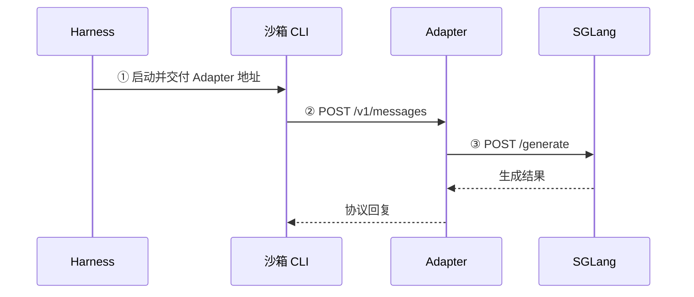

# 01 · 阅读范围：沙箱中的 CLI 怎样经 Adapter 请求 SGLang

[步骤入口](README.md) · [本步函数记录](02-short-term-memory/overview.md) · [前一步任务总结](../step-008-harness-communication/05-task-flow.md)

沿“地址交付 → 请求接入 → 模型往返”阅读，先跟关键调用，再用要点归纳关系、结果和下一处。

## 1. 阅读目标

- **整体目标**：理解 Coding Agent / Coding RL 的运行流程。
- **本步问题**：CLI 怎样经 Adapter 请求 SGLang，并收到模型回复？
- **阅读范围**：沿 Claude Code / Anthropic 的正常路径，接清地址交付、请求接入、模型往返。

## 2. 指挥官函数

- **整体位置**：本步发生在 `_generate` 等待 `harness.run(...)` 的期间。
- **请求处理入口**：[BaseAdapter._run_turn](../step-001-harness-to-adapter/02-short-term-memory/functions/slime/agent/adapters/common.py/BaseAdapter._run_turn.md) 组织一次请求的输入、生成与回复。
- **必要回查**：`_AdapterService.endpoint` 负责取得 Adapter 与服务地址；从它的构造和启动调用，找回请求入口的来路。

## 3. 给出真正干活的核心骨架

### 3.1 整体骨架：本步发生在哪里

以下为 `evaluation=False` 正常路径的教学裁剪，省略多数参数、检查、日志、追踪及异常包装。

```python
state = _AdapterService(...)  # Step 005：准备服务依赖
adapter, adapter_url, _ = state.endpoint(...)  # 取得端点
adapter.open_session(...)  # Step 005：登记会话
async with boot_agent_sandbox(...) as sb:  # Step 006：沙箱与 CLI 就绪
    baseline = await swe.prepare_workspace(...)  # Step 007：准备工作区
    agent_exit_code = await harness.run(...)  # Step 008：启动与等待
    # 本步：等待期间，CLI 经 Adapter 请求模型
    agent_metrics = await harness.collect_metrics(...)  # Step 002：统计
    diff_text = await swe.git_diff(...)  # Step 002：提取改动

reward, applied_cleanly = await swe.run_evaluation(...)  # Step 003：评测
samples = await adapter.finish_session(...)  # Step 004：导出样本
...  # 结果处理及最终会话清理
return samples
```

- **本步位置**：模型请求发生在 `harness.run(...)` 等待 CLI 的期间，可以重复多次。
- **先后关系**：服务在 CLI 启动前准备好；步骤编号表示阅读顺序。

### 3.2 局部关系：本步接清哪几次交接



- **地址分工**：CLI 使用 `adapter_url`，Adapter 使用 `sglang_url`。
- **阅读顺序**：先看①地址交付，再看②服务接入，最后接回③模型往返。

<a id="adapter-entry-navigation"></a>

### 3.3 分段阅读：先跟调用，再归纳要点

<a id="breadcrumb-cli-address"></a>

**① 地址怎样交给 CLI？简要回看 [launch_and_wait](02-short-term-memory/functions/slime/agent/harness/claude_code.py/ClaudeCodeHarness.launch_and_wait.md)。**

```text
launch_and_wait:92  ctx.adapter_url → env["ANTHROPIC_BASE_URL"]
  → run_agent(env=env)
  → exec_and_wait(env=env)
  → sb.exec(env=env)
```

- **关键交接**：地址先进入 Python 字典，再作为环境参数交给沙箱进程；CLI 由此取得请求目标。
- **阅读深度**：本段只追 `env`，命令组装、PID 和等待机制按需回看卡片。
- **返回与继续**：到 CLI 获得地址处停止，转到②，回查对应服务怎样准备好并接收请求。

<a id="breadcrumb-adapter-entry"></a>

**② 请求怎样进入 Adapter？按构造、启动、请求到达三个时机展开。**

**构造时：从 [endpoint:188](https://github.com/THUDM/slime/blob/18868a79b0b083a093798a94ed0f8cb4f71b9c14/examples/coding_agent_rl/generate.py#L184-L209) 进入，登记完成后返回。**

```text
_AdapterService.endpoint                         generate.py:184
├─ 188: adapter = adapter_cls(...)
│  └─ BaseAdapter.__init__                       adapters/common.py:204
│     ├─ 224: self.app = web.Application(...)
│     └─ 240: self._register_routes(self.app)
│        └─ AnthropicAdapter._register_routes    adapters/anthropic.py:48
└─ 200: app_handle = run_app_in_thread(adapter.app, ...)
```

- **关键关系**：Claude 分支选中 AnthropicAdapter；它继承 `BaseAdapter.__init__`，而 `self` 仍是 AnthropicAdapter 实例，所以调用子类的注册方法。
- **得到的结果**：`app` 中登记好 `POST /v1/messages → self._run_turn`。具体语句与原解释见[路由卡](02-short-term-memory/functions/slime/agent/adapters/anthropic.py/AnthropicAdapter._register_routes.md)。
- **返回与继续**：第 `188` 行构造调用完成后，才继续第 `200` 行启动服务。

**启动时：把同一个 app 交给服务，接好请求回调。**

```python
# run_app_in_thread 的后台 _run：aiohttp_threaded.py:69–72
runner = web.AppRunner(app, **(runner_kwargs or {}))
loop.run_until_complete(runner.setup())
site = web.TCPSite(runner, host, port)
loop.run_until_complete(site.start())
```

- **关键连接**：传入的仍是 `adapter.app`；`setup()` 在库内部创建保存 `app._handle` 的 Server，`start()` 将它接到监听端口。
- **返回与继续**：调用方取得 `AppHandle`，`endpoint` 继续组成访问地址；后台保持运行，之后才接收 CLI 请求。
- **按需回查**：两层回调的保存和调用位置见 [run_app_in_thread 第 3 段](02-short-term-memory/functions/slime/agent/aiohttp_threaded.py/run_app_in_thread.md#listener-handler-binding)。

**请求到达后：调用应用入口，匹配路由，再进入 Adapter。**

```python
# aiohttp Application._handle 的正常路径节选
match_info = await self._router.resolve(request)
handler = match_info.handler
return await handler(request)
```

- **关键交接**：网络层调用先前保存的 `app._handle`；匹配 `POST /v1/messages` 后，`handler` 就是绑定当前 Adapter 的 `_run_turn`。
- **边界**：其他路径使用各自的处理器；未登记路径返回 404。框架源码与版本见[服务端衔接说明](references/http-request-dispatch.md#listener-to-adapter)。
- **返回与继续**：进入 `_run_turn:394` 取得 `body`，再沿已读处理走到 `423` 的模型调用，接回③。

<a id="breadcrumb-sglang-request"></a>

**③ Adapter 怎样完成模型往返？接回 [call_sglang_generate](../step-001-harness-to-adapter/02-short-term-memory/functions/slime/agent/adapters/common.py/call_sglang_generate.md)。**

```text
BaseAdapter._run_turn                            adapters/common.py
├─ 423: turn = await call_sglang_generate(...)
│  └─ 610: HTTP POST <sglang_url>/generate
└─ 425 起: 解析生成结果 → 组织回复 → await self._respond(...)
```

- **关键交接**：Adapter 使用自己的 `sglang_url` 发出第二次 HTTP 请求，得到 `turn` 后回到 `_run_turn`。
- **阅读深度**：只接清生成结果与协议回复；输入转换、token 预算、续生成和轨迹算法按需回查已有记录。
- **收束位置**：回复交回 CLI 后结束本步通信主线；单次模型请求完成时，Harness 通常仍在等待整个 CLI 任务结束。

## 版本说明

- **Slime**：`18868a79b0b083a093798a94ed0f8cb4f71b9c14`。具体函数、文件与行号由各段链接定位。
- **框架参考**：`app._handle` 的内部关系来自已有 aiohttp `v3.12.15` 说明，未核验为实际运行环境版本。
- **采用记录**：2026-10-25 按用户确认，以第三版作为正式 scope；[第一版](references/archive/scope-v1.md)与[第二版](references/archive/scope-v2.md)已归档。[确认与迁移记录](04-flow.md#scope-v3-adopted)。
