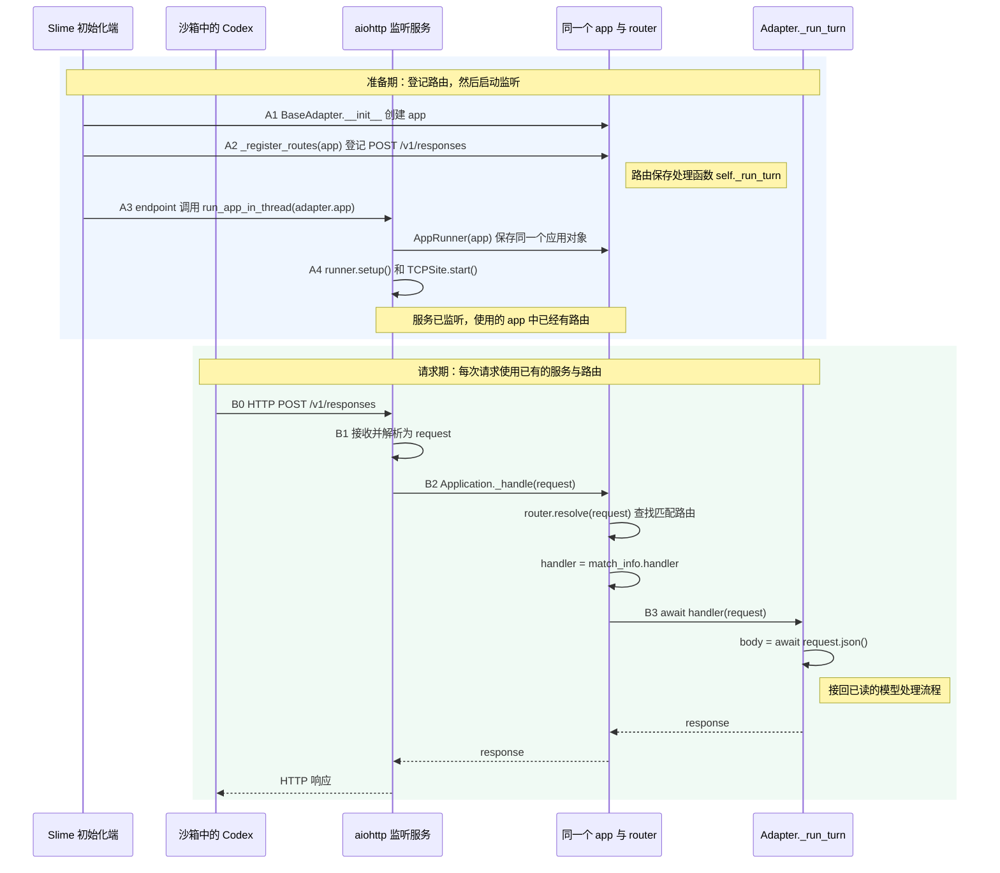

# 04 · 问题、依据与理解过程

[本步 scope](01-scope.md) · [前一步的完整复述](../step-008-harness-communication/04-flow.md#launch-restatement-and-http-entry)

## 1. 2026-10-23：把 HTTP 接收入口独立成步

前一轮用户已串起 Harness 启动链，并明确留下这个问题（节选）：

> run_turn里面有一个简单的拿到了请求之后具体怎么做的一个图但是没有写清楚adapter是怎么做到接受到这里的来自于claude或者codex本身发过来的请求的部分？
> 之前在第一部直接默认的是这里已经有了这个请求的body？

随后用户提出：

> 我觉得我们是否适合先把之前的step007的部分先吧这里的task flow写完？
> 然后在step08这里把这个内容讲清楚呢？

**本次确认的范围**：Step 7 先总结 CLI 启动与等待；本步补清监听、路由、`request → body`，并接回既有模型处理流程。短期记忆先调取 `_AdapterService.__init__` 与 `_run_turn` 两张旧卡，新增函数记录随实际阅读建立。

**助手提供的定位**：第一个补读点是 `AnthropicAdapter._register_routes:48–50`，其中 `POST /v1/messages` 绑定 `self._run_turn`。登记发生在应用初始化期，实际请求随后到达；监听准备与模型请求处理是两个时机。scope 已分开画出，并标明接收发生在 Step 7 等待 CLI 期间。

**已有材料与认识状态**：

- [通信参考](references/run-communication-path.md#adapter-request-entry)从 Step 7 复制，作为本步带读材料；其监听、路由和 Request/body 解释仍属于助手说明。
- `03` 按前一步 `03 + 02` 合并为 43 份记录，保留原话、未知、来源与认识时间。`02` 中的调取不表示新掌握。
- 用户尚未对本步接收机制给出新的复述。当前只确认主题并建立导航，后续实际追问继续追加于本文件。
- 源码绑定 `2f2318653f6f794dddd321eff7c9d4b7b174643f`；本次静态核对了入口与行号，没有新增真实 HTTP、CLI、沙箱或模型运行。

## 2. 2026-10-23：补回 scope 中 Step 1 的位置

用户指出：

> 这里的scope中的step1怎么不见了呢

**问题定位**：整体骨架标注了 Step 2–8，却没有明确标出 Step 1；局部路径把对应处理写成了“已读链”。`_run_turn` 旧卡仍在本步 `02`，遗漏的是阅读导航中的步骤归属。

**本次修正**：

- 在 scope 导航中补上 Step 1 原范围入口。
- 在 `HARNESS_CLS().run(...)` 的等待位置，补清“CLI 经 HTTP 请求 → Step 8 接收与路由 → Step 1 模型处理与回复 → CLI”。这是运行期间的请求交互，不新增 `generate` 的直接函数调用。
- 将局部 `_run_turn` 路径中的“已读链”明确标为“接回 Step 1”，并链接本步已有卡片。

本次仅修复 scope 的定位遗漏；阅读范围、函数卡片与长期记忆保持原样，没有新增接收机制的掌握或运行记录。

## 3. 2026-10-25：围绕沙箱 CLI 到 SGLang 的交接校准范围

用户提出：

> 好的那么来ikanyixia这里的step009的部分吧
> 首先看这里的有没有更新scope
>
> 其实我比较想要知道的内容更多的在与这里的
> 当前sb执行的部分是如何通过sb传向当前的sglang的部分?

**原有状态**：Step 009 的 scope 仍绑定 `2f231865`，保留旧服务初始化方式和行号。Step 005 的服务准备、Step 008 的 CLI 启动以及 Step 001 的模型处理已有 `18868a79` 记录，可直接回看必要交接。

**助手核对与解释**：

- `sb` 是 Slime 操作沙箱的接口。启动命令和环境变量经 `run_agent → exec_and_wait → sb.exec` 交入沙箱；CLI 运行起来后发出模型请求。
- `ClaudeCodeHarness.launch_and_wait:91–96` 将 `ctx.adapter_url` 放入 `ANTHROPIC_BASE_URL`，将 `ctx.session_id` 放入 `ANTHROPIC_AUTH_TOKEN`。这里确定 CLI 使用的服务地址和会话身份。
- `AnthropicAdapter._register_routes:49` 在应用准备时登记 `POST /v1/messages → self._run_turn`；请求到达后由 aiohttp 进入处理器，`_run_turn:394` 读取 JSON，`423` 调用 `call_sglang_generate`。
- `_AdapterService.__init__:174` 组成 `sglang_url`，`endpoint:190` 将它交给 Adapter；`call_sglang_generate:570` 取出该地址，`610` 向 `/generate` 发出另一份 HTTP 请求，`624` 读取结果。它的 payload 包含 token 输入和采样参数，与 CLI 发来的消息请求不同。
- 生成结果经 `_run_turn` 解析、封装，交给 `_respond` 回复 CLI。CLI 可继续任务并再次请求模型；这些交互发生在外层 Harness 等待期间。

**本次范围调整**：

- 已更新 [scope](01-scope.md)，将问题聚焦到 CLI → Adapter → SGLang 的通信边界，保留完整任务骨架。
- 首个观察点仍为三行路由登记，再接 `_run_turn` 和发送 `/generate` 的位置；服务初始化与监听复用已读记录，SGLang 内部分发和 CLI HTTP 客户端暂不深入。
- [旧版 scope](references/scope-at-2f231865.md)全文归档，仅重算相对链接；两张旧函数卡、`03` 和原通信参考保留。本轮未新增函数卡或刷新长期记忆。

**证据与认识边界**：以上为助手对 `18868a79` 静态源码的核对和解释；没有运行真实 CLI、沙箱或模型服务。用户表达的是当前疑问，尚未对这条通信关系给出新的理解反馈；范围校准不记为掌握。

## 4. 2026-10-25：从地址交付开始，采用三段面包屑

用户先表达当前理解，并要求先讨论方案：

> 我对于这里大概的理解是首先把anthropic adapter部分 这里先加上register routes部分
>
> 这一个章节的重点是为什么sandbox内部的能够知道把这里的信息传输到adapter
> 然后adapter怎么把这里的sgalng的部分传输到这里的sglang的部分对吗?
> 这是我的理解
>
> 那么这里重点的部分部分是否应该是
> 1.adapter怎么处理请求的
> 2.以及我的理解是harness在写入配置的时候就把这里的url部分处理了 知道会给什么adapter发送请求
> 3.然后这里的adapter在接受请求的时候就会发给这里的sglang
>
> 这是我的理解
> 那么考虑当前的这个调用关系很清楚的情况下
> 如何使用面包屑的方式
> 来找到这里到底是如何传导的呢?
> 也就是调用关系到底应该怎么看这件事情
>
> 先不用修改 告诉我方案

**助手的校准与方案**：

- 用户已提出 CLI → Adapter → SGLang 的总体关系；地址交给 CLI 的具体位置是 `ClaudeCodeHarness.launch_and_wait:92`，它设置启动环境变量，`write_config` 处理其他 CLI 配置。
- 路由登记发生在 Adapter 初始化期；请求到达后，aiohttp 才调用 `_run_turn`。Adapter 随后准备模型输入、组装 payload，再向 SGLang 发请求。
- 阅读顺序采用用户列出的 2 → 1 → 3：先追 `adapter_url → env → CLI`，再追 `POST /v1/messages → _run_turn → body`，最后追 `adapter.sglang_url → POST /generate → 回复`。
- 每段保留当前追踪对象、源码证据、按需回查和返回点。参数传递、进程环境与 HTTP 边界分别标明；具体协议转换继续引用 Step 001 卡片。

用户随后确认：

> 好的 那么就按照这样子来做吧

**本次落实**：[scope 3.2](01-scope.md)在实际交接图中补上启动环境；[3.3](01-scope.md#adapter-entry-navigation)采用三段面包屑，首个入口改为 `launch_and_wait:92`。README 与唯一路线同步入口；[重排前 scope](references/scope-before-breadcrumb-navigation.md)完整归档。本次整理的是跨函数导航，已有函数卡片和长期快照继续沿用。

**证据与认识边界**：依据 `18868a79` 的静态源码核对赋值、参数、路由与 HTTP 请求位置。上面的原话保存用户已经表达的总体关系；确认采用导航方案不等于独立确认全部机制已掌握。本轮没有运行真实 CLI、沙箱或模型请求。

## 5. 2026-10-25：复用已读 launch_and_wait，只回看 env 的交接

用户提出：

> 好的那么现在看一下这里的这个launch and wait 吧
> 我感觉之前大概率已经看过了
> 所谓以我大概清楚就是这里的env的部分对吧

**历史与当前观察点**：[Step 008 的现行卡片](../step-008-harness-communication/02-short-term-memory/functions/slime/agent/harness/claude_code.py/ClaudeCodeHarness.launch_and_wait.md)已经记录“组装启动材料 → 补充运行控制 → 委派并等待”三段模型。本轮复用这份记录，聚焦第一段的 `env`，不将回顾视为重新开始整个函数。

**助手核对与说明**：`launch_and_wait:92–94` 将 Adapter 地址、会话编号和模型标识放入字典；其中 `ANTHROPIC_BASE_URL` 直接回答 CLI 的请求目标从哪里来。`109` 将 `env` 传给 `run_agent`，后者在 `harness/common.py:119` 继续传给 `exec_and_wait`，再由 `sandbox.py:151` 的 `sb.exec(env=env)` 交入沙箱进程。当前函数里创建的是 Python 字典，经过启动接口传入后，CLI 才能作为环境变量读取。

**接回导航**：这一小段的阅读结论是 `ctx.adapter_url → env → 沙箱 CLI`；下一观察点是 [② HTTP 路由](01-scope.md#breadcrumb-adapter-entry)，接清 `/v1/messages` 怎样进入 `_run_turn`。用户表达了对 `env` 片段大概清楚；具体参数传递与进程环境的区别仍是本轮助手说明，未额外认定全部机制已掌握。依据为 `18868a79` 静态源码，无新增真实运行。

## 6. 2026-10-25：将已读 launch_and_wait 完整调入本步

用户先表示 `launch_and_wait` 已看完，希望继续 Adapter，随后要求：

> 是否适合把这里的launch and wait的部分绑在这里的short term里面呢?
> 但是不需要单独重写
> 只是放在这里的short term memory部分

按此要求，将 Step 008 的现行完整卡片复制到 [本步短期记忆](02-short-term-memory/functions/slime/agent/harness/claude_code.py/ClaudeCodeHarness.launch_and_wait.md)。正文、整体大图、原话、未知和认识时间保留，只新增调取来源并重算相对链接；本步索引、scope 与 README 指向该卡。

这是已读材料的归入，没有新增函数讲解、源码变化或运行证据。下一阅读点仍为 Adapter 的路由入口，尚未在本轮展开。

## 7. 2026-10-25：回查已有 AdapterService 类卡

用户询问：

> 好的那么现在是否应该看一下下一个函数了呢?
> 也就是这里的adapterservice 之前我记得好像有class的部分专门处理这个?

已定位到 [Step 005 的 _AdapterService 类卡](../step-005-agent-preparation/02-short-term-memory/classes/examples/coding_agent_rl/generate.py/_AdapterService.md)及 [endpoint 方法卡](../step-005-agent-preparation/02-short-term-memory/functions/examples/coding_agent_rl/generate.py/_AdapterService.endpoint.md)。本轮先借已有记录回顾：服务对象保存共用依赖，`endpoint` 提供 `(adapter, adapter_url, app_handle)`，分别连接请求处理对象、CLI 使用的地址和后台服务句柄。

助手建议把这作为对象来源的短回查，再返回 [scope 的请求接收段](01-scope.md#breadcrumb-adapter-entry)：`AnthropicAdapter._register_routes` 登记路径与处理函数，HTTP 到达后才进入 `BaseAdapter._run_turn`。本轮仅定位已有材料并澄清阅读位置，没有重读整套服务初始化或新增类卡；用户尚未对这项职责区分给出新的反馈。

## 8. 2026-10-25：将已有 AdapterService 类卡放入本步短期记忆

用户要求：

> 那么是否应该放在这里的short term memory里面呢?

已将 Step 005 的完整 [_AdapterService 类卡](02-short-term-memory/classes/examples/coding_agent_rl/generate.py/_AdapterService.md)调入本步 `02/classes/`，保留字段表、原话、未知、来源与认识时间，只增加调取说明并重算相对链接。本步索引、README 和 scope 的回查入口已接到这份卡片。

这是已有记录的调取，没有新增类实现的讲解或掌握结论。下一阅读点仍为 Adapter 的路由入口。

## 9. 2026-10-25：补清初始化时的路由登记

用户提出：

> 也就是说这里在init的时候有一个adapter
> 还有这里的url
> 但是这里是否还需要看一下这里的add router呢?

**助手定位与解释**：`_AdapterService.__init__:182` 经 `endpoint` 取得默认 Adapter、URL 和服务句柄。创建具体 Adapter 时，继承的 `BaseAdapter.__init__` 创建 `self.app`，在 `240` 调用 `self._register_routes(self.app)`；当前对象是 AnthropicAdapter，因此进入它的实现。`add_post("/v1/messages", self._run_turn)` 登记 POST 路径与处理函数。登记发生在服务准备期；CLI 后续请求该地址时，aiohttp 才将请求交给 `_run_turn`，由 `request.json()` 读取正文。

本轮围绕已有 scope 的请求入口建立 [_register_routes 卡片](02-short-term-memory/functions/slime/agent/adapters/anthropic.py/AnthropicAdapter._register_routes.md)，保留两条真实路由，主读 `/v1/messages`。用户表达了需要补看路由的疑问；初始化与请求处理的时机区别仍为助手说明，尚待反馈。源码按 `18868a79` 静态核对，无新增真实请求或运行。

## 10. 2026-10-25：发送请求的是谁，完整 URL 从哪里来

用户指出缺失的发送端关系：

> 但是也有一个问题cli部分发来的请求都是/v1/messages吗?
> 这是在哪里调用的呢?
> 我知道他会发请求
> 也就是从codex或者claude中发送的请求
> 但是到底发到哪一个网络请求的部分这里是否需要单独说清楚呢?

**助手核对与补充**：

- Slime 的 `launch_and_wait` 启动的是外部 `claude` 或 `codex exec`。发模型 HTTP 请求的调用位于对应 CLI 的客户端实现；`add_post` 是接收端的路由登记，不是客户端发送调用。
- Claude Code 场景由 `claude_code.py:92` 配置 `ANTHROPIC_BASE_URL = ctx.adapter_url`。Messages 接口约定路径为 `/v1/messages`，两者确定目标；还可能有计数等其他请求，不能概括为所有流量都去同一条路径。
- 当前 `generate.py:50–53` 将 Codex 与 ResponsesAdapter 配对。`codex.py:89` 在 `write_config` 中填写 `<adapter_url>/v1`，模板的 `wire_api = "responses"` 选择 Responses；接收端在 `responses.py:182` 登记 `/v1/responses`。此前“URL 写在 launch_and_wait 的 env”针对 Claude 分支，不能直接套到 Codex。
- 已在 [scope 发送端补充](references/archive/scope-v1.md#client-request-target)并列这两种配置，把函数卡接回该段；旧通信参考保留历史正文并增加现行版本入口。没有另建 Codex 函数卡或扩大本步主读分支。

**外部依据与边界**：本轮实际读取了 [Claude Code 网关协议](https://code.claude.com/docs/en/llm-gateway-protocol#api-formats)与 [OpenAI Docs 配置参考](https://learn.chatgpt.com/docs/config-file/config-reference)，核对了基础地址、协议与路径约定；[Codex 的官方 Responses provider 示例](https://developers.openai.com/siwc/token-sharing-open-source/codex-app-server)也展示了 `/v1/responses`。当前文档可能描述比本地安装包更新的版本，例如 Claude 文档中的 `?beta=true`；尚未查看本次 CLI 安装包的内部发送函数、抓包或运行真实请求。用户表达的是待解释的问题，不将补充说明记作已经掌握。

## 11. 2026-10-25：问题收回服务端——监听服务怎样接到路由

用户澄清：

> 我清楚cli会发送http请求
> 但是问题是这里的codex吧
>
> 假设这里发欻来的信息到了这个aiohttp这个如果我没有记错在init的时候开始监听的http服务
> 那么这个http服务是怎么和这个add router相关的内容连在一起的呢?
> 这里我会比较想要知道
> 这里网络的这些步骤
>
> 应该怎么单独拆函数卡片画着什么的吗?

**当前问题的调整**：用户明确知道 CLI 会发 HTTP，请求发送方的 URL 配置不是这次主要缺口。现在要看同一个 `web.Application` 如何连接路由登记、监听服务与收到请求后的分派。Codex 作为本次例子，路径为 `/v1/responses`；这项服务端机制也用于 Claude 分支。

**Slime 中可直接核对的对象交接**：

1. `BaseAdapter.__init__:224` 创建 `self.app`，`240` 将这个应用交给具体 `_register_routes`。Codex 的 `ResponsesAdapter._register_routes:182` 在其 router 上登记 `POST /v1/responses → self._run_turn`。
2. `_AdapterService.endpoint:200–201` 把同一个 `adapter.app` 传给 `run_app_in_thread`。
3. `run_app_in_thread:69–72` 依次用它构造 `AppRunner(app)`、`TCPSite(runner, host, port)` 并启动监听。路由配置和监听服务由这条对象传递连接起来。

**aiohttp 内部桥接的参考证据**：本机系统 Python 未安装 aiohttp，Slime checkout 中也没有 `.venv`；本轮另读取固定版本 [aiohttp v3.12.15 的 web_runner.py](https://github.com/aio-libs/aiohttp/blob/v3.12.15/aiohttp/web_runner.py)与 [web_app.py](https://github.com/aio-libs/aiohttp/blob/v3.12.15/aiohttp/web_app.py)，作为机制阅读参考，不冒充本次 Slime 运行环境的版本核验。

- `AppRunner.__init__:380` 保存 `self._app = app`；`_make_server:396` 使用该 app 建立请求处理服务器。`Application._make_handler:442–446` 将 `self._handle` 和请求对象工厂交给 Server；`TCPSite.start:119–124` 用 runner 的 Server 建立监听。
- 正常请求进入 `Application._handle` 后，`530` 调用 `self._router.resolve(request)`；`549` 取得 `match_info.handler`，`569` 执行 `await handler(request)`。这里省略中间件、Expect 和检查分支，核心是“查已有路由 → 取处理函数 → 传入请求并等待结果”。

**卡片与图的建议，尚待采用**：路由登记卡解释路径与 handler；已有 `run_app_in_thread` 卡解释如何把同一个 app 接到 runner/site；若仍需源码级追踪，再增加短的 `Application._handle` 框架函数卡。整体图在 scope 中分开表示准备期的对象绑定与运行期的请求分派，HTTP 解析层先折叠。Codex 的具体路由使用 ResponsesAdapter 的源码，保留已有 Anthropic 卡；不把两种实现的路径混写。此轮只记录方案与源码证据，没有新增这批函数卡或改写已有卡片。

没有发出实际 HTTP 请求；用户对上述桥接模型尚未给出新的理解反馈。

## 12. 2026-10-25：先集中一页说明完整流程，再链接函数卡

用户进一步询问记录方式：

> 那么这个流程是否做成一个单独的函数卡片呢?
> 我比较想要知道我到底应该怎么处理
> 或者怎么改才会比较方便呢?

**助手建议**：当前需要的是一个能连续读通服务端交接的入口。拟在 `references/http-request-dispatch.md` 集中保存“HTTP 请求如何从监听进入处理函数”，用一张图和三段关键代码说明：同一个 app 登记路由 → 交给 AppRunner/TCPSite 并启动监听 → 请求进入 app 的分派逻辑，再按路由调用 handler。每段链接真实函数，标明初始化和请求到达的不同时间。

该流程横跨多个函数和执行时机，因此作为跨函数说明保存；单函数卡继续对应真实源码符号。已有 `run_app_in_thread` 可完整调入本步后引用，路由卡链接该说明。`Application._handle` 先在说明中保留关键代码和固定版本出处，之后有独立深入需要时再建函数卡；不因流程涉及它就立刻增加多张完整卡片。

scope 的第②段作为该页的入口，函数卡各自保留职责和前后跳转。此轮保存的是组织方案，尚未创建该说明页或改写已有卡片，亦未把方案认可等同于理解机制。

## 13. 2026-10-25：落实独立流程说明、图与函数位置表

用户确认：

> 好的那么就这样子处理吧
> 图需要画好
> 同时也需要给出哪些函数在哪里这件事情

已建立 [HTTP 请求怎样从监听进入处理函数](references/http-request-dispatch.md)。主图分准备期与请求期，标出创建应用、路由登记、交出同一个 app、监听启动、框架分派和进入 `_run_turn`；蓝色虚线表达同一份路由表的复用。图中编号与函数位置表对应，正文分三段展示关键源码，底层 runner/server 绑定关系单独折叠。

`run_app_in_thread` 从 Step 005 完整调入本步 `02`，原 Claude 场景、图示、原话、未知和认识日期保留，只补来源与重算链接。新说明以 Codex `/v1/responses` 举例，明确区分原卡场景。scope 第②段、步骤 README、路由卡与调入卡提供相互入口；本次没有建立更多框架函数卡。

源码定位仍使用 Slime `18868a79`；aiohttp `v3.12.15` 只作为已读取的固定机制参考，未冒认为运行环境版本。图用可编辑 DOT 生成 SVG，并检查其布局；这些文档验证不表示用户已掌握该机制，也不表示已运行真实 HTTP/CLI/模型请求。

## 14. 2026-10-25：将图片改为 Markdown 原生 Mermaid 图

用户纠正图示格式：

> 产出的不是这种图
> 而是类似于面包屑或者泳道或者其他能够在md中直接渲染不需要安度生成image在jpeg这种类型的图

已将流程说明中的 SVG 图片引用替换为直接写在 Markdown 中的 Mermaid 泳道图，保留准备期/请求期、同一个 app、路由查找与处理函数调用这些关系。图中 A1–A4、B0–B3 继续对应正文的函数位置表；三段源码与文件、行号、跳转链接保留。本轮创建的 DOT、SVG 文件已移除。

用户取消了截图检查；本轮不再运行浏览器截图或生成外部图片。验证范围为 Markdown 与 Mermaid 结构、链接及文档构建，不将它们记作真实 HTTP 请求或用户已掌握机制。

## 15. 2026-10-25：把整体泳道图改为对象关系与请求主线

用户反馈：

> 第一张整体图我感觉还是不太好 不是这种的图啊
> 请你从资深程序员和认知学家的角度生成这个图吧

**工程上的调整**：旧图把初始化端、app/router、监听服务和处理方法平铺成泳道，难以看出对象包含关系，也容易把逻辑关联读成直接调用。新图以同一个 app 的边框包含请求处理入口与 router；Adapter 的业务方法放在框外。实线追踪请求传递和函数调用，虚线说明启动时建立的关系及请求处理时的路由查询。

**阅读上的调整**：先沿“CLI → 监听端口 → app 的处理入口 → Adapter 业务方法”看到请求主线，再沿查表支线理解 handler 的来源。准备动作位于主线之外，函数文件和行号仍在图下表格中对应。这样组织是为了减少同时追踪的关系，不将版式调整视为学习效果已验证。

[当前图与函数定位](references/http-request-dispatch.md)保持 Markdown 内嵌 Mermaid，没有恢复外部图片。下方保留被替换的原生泳道图作为修改历史。

本次替换前的整体图

## 16. 2026-10-25：把监听与 Adapter 的两层回调连接放到当前卡片

用户明确表示仍未理解，并复述了当前认识：

> 我目前还是不是特别请清楚
> 我简单说以ixia我的理解
> 首先呢当前情况下的第一步是harness 本身在run的时候
> cli为什么知道adapter的地址
> 那么是在harness部分的launch and wait内部
> 我可以理解为是这里在claude code harness launch 里面安装的
>
> 然后呢
> 这里的cli的请求是怎么进入adater的部分
> 是一位adapter在初始化的时候的内容
> 这一例有一个run app in thread
> 简单可以理解为是
> 创建一个新的事件循环专门来接受这里的new event的loop
> 然后让这个部分来确保能够接受到特定http的监听地址和端口
>
> 但是这里没有说明白的事情是为什么这里监听了之后就能够做到
> 就是是怎么挂在在adapter上面
> 并且能够做到任何发往adapter的请求都会走register的路线的?
> 能不能找一下这个方向上解释呢?
>
> 当前的第二部分只是说明了有一个aiohttp服务起来了
> 我没有看到在run app in thread里面这里是如何解释这个第二步的
> 有没有比较好的办法来处理这个问题呢?
>
> 也就是这里而 ② CLI 的请求怎样进入 Adapter？改追 HTTP 的方法与路径。

**问题定位**：当前缺口是创建监听服务时绑定了什么回调，以及请求到达后谁调用这个回调。仅说“同一个 app”或画监听到分派的箭头仍不足以解释这一层。用户在第一部分说的“安装”需校准为在 `launch_and_wait` 配置启动环境；CLI 安装属于此前的 `install_cli`。

**本轮依据与说明**：继续按 aiohttp v3.12.15 参考源码检查 `Server` 与 `RequestHandler`：应用构造 `Server(self._handle, ...)`；Server 保存 `request_handler`，连接协议对象沿用它，最后在 `RequestHandler._handle_request:510` 执行 `await request_handler(request)`，进入 `app._handle`。应用再查询路由，取得已经绑定当前 Adapter 实例的 `self._run_turn` 并调用。网络服务到应用、应用到 Adapter 是两层不同的回调连接。

**请求范围校准**：匹配 `POST /v1/messages` 才进入 AnthropicAdapter 的 `_run_turn`；计数路径有独立处理器，未登记路径返回 404，路径存在但方法不匹配可返回 405。依据包括 `UrlDispatcher.resolve:1067–1070`，不能写成任何到达该服务的请求都会运行模型处理。

**记录调整**：在 [run_app_in_thread 第 3 段](02-short-term-memory/functions/slime/agent/aiohttp_threaded.py/run_app_in_thread.md#listener-handler-binding)直接显示两层连接及关键库代码；scope 第②段从这里进入。[流程说明](references/http-request-dispatch.md#listener-to-adapter)给出保存、传递与最终调用的源码位置，细追链条可展开查看。已有图只校准回调与匹配标注，本轮重点补解释而非继续更换图形。

以上为助手补充，用户的明确未知继续保留；未核验实际 aiohttp 安装版本、未运行真实请求，也未把此前“整体大概理解”升级为掌握当前机制。

## 17. 2026-10-25：从 generate.py 的构造调用找到路由登记

用户反馈并追问：

> 好的我大概明白了
> 那么下一个问题 变成了
> 这里的的adapter init的时候是在哪里register了这个部分
> 因为我目前完全没有在generate中看出来这个register的部分是在哪一个部分被写上去的这件事情

**助手定位**：`_AdapterService.__init__:182` 调用 `self.endpoint(AGENT_NAME)`。在端点尚未缓存的路径中，`endpoint:187` 按名称取出 Adapter 类，`188` 执行 `adapter = adapter_cls(...)`。当前 Claude 分支选择 AnthropicAdapter；它没有自定义 `__init__`，所以执行继承的 `BaseAdapter.__init__`。

基类初始化在 `common.py:224` 创建应用，在 `240` 执行 `self._register_routes(self.app)`。`self` 仍是 AnthropicAdapter 实例，方法查找因此进入 `anthropic.py:48–50` 的覆盖实现。Codex 分支通过继承链进入相同初始化，但使用 ResponsesAdapter 的注册实现。

**返回位置**：注册在 `adapter_cls(...)` 返回前完成，随后 `generate.py:200` 才执行 `run_app_in_thread(adapter.app, ...)`。因此 `generate.py` 中可见的是构造调用，注册语句位于被调用的初始化链中。

已把这段入口补进路由卡、流程说明第 1 段及 scope 的回查导航。用户对前一轮两层回调说明反馈“大概明白”，本轮构造与方法查找的解释尚待反馈；依据为 `18868a79` 静态源码，没有新增真实服务运行。

## 18. 2026-10-25：认可构造链解释，讨论 scope 瘦身与教学顺序

用户表示：

> 好的那么这样子我算是理清楚了

随后转贴并认可前轮助手解释。以下为用户转贴的文本，保存的是获认可的讲解，不作为用户独立推导的复述：

用户认可的完整构造链讲解

> 入口就在 generate.py 第 188 行 (/home/fredkeira/projects/slime/examples/coding_agent_rl/generate.py:188)：adapter = adapter_cls(...)。注册发生在这次创建对象的过程中。
>
> 沿当前 Claude 分支看：
>
> _, adapter_cls = _AGENTS[agent_name]  # 得到 AnthropicAdapter
> adapter = adapter_cls(...)          # 创建 AnthropicAdapter 对象
>
> AnthropicAdapter 没有定义自己的 __init__，所以会执行继承来的 BaseAdapter.__init__。其中有这两处代码：
>
> self.app = web.Application(...)      # common.py:224
> self._register_routes(self.app)      # common.py:240
>
> 关键在这里：虽然代码写在基类里，self 仍然是正在创建的 AnthropicAdapter 对象。 所以 self._register_routes(...) 找到的是子类的实现：
>
> # anthropic.py:49
> app.router.add_post("/v1/messages", self._run_turn)
>
> 完整面包屑就是：
>
> generate.py:188  adapter_cls(...)
>   → BaseAdapter.__init__
>     → common.py:240  self._register_routes(self.app)
>       → AnthropicAdapter._register_routes
>         → anthropic.py:49  app.router.add_post(...)
>
> 等第 188 行创建对象完成时，路由已经登记好了。 然后 generate.py:200 才继续调用 run_app_in_thread(adapter.app, ...) 启动服务。
>
> 因此你在 generate.py 中看到的是“创建 Adapter”这一句；需要从这句进入构造过程，才能看到真正的注册代码

用户继续提出：

> 我觉得这里讲述的十分正确和详细
> 我在想的问题是
> 这一部分的内容是放在那里的呢?
>
> 你写在scope里了吗?
> 我感觉这里的scope其实内容很多了
> 你打算怎么修改呢?
>
> 主要是一个比较清晰的教学顺序 符合人类认知科学

**现状核对**：scope 第②段保存了一条构造入口摘要；路由卡的“调用代码”保存较完整的继承与注册说明；流程说明第 1 段也有构造关系，但仍以 Codex 为主。三处各自增加内容，导致导航和教学正文混杂，获认可的 Claude 讲解尚未按原顺序集中为主读段落。

**拟议调整，尚未改写正文**：

- scope 保留现有目标、指挥官、完整任务骨架、三段阅读导航和停止位置。第②段只标入口、当前问题、教学链接与返回位置；协议对照、继承细节和回调解释交给正文或函数卡。
- 沿用 `references/http-request-dispatch.md` 作为第②段唯一完整教学入口。主例建议统一为已认可的 Claude 分支，Codex 保留为末尾对照。
- 教学依次回答四个问题：`generate.py:188` 如何在构造时完成注册；返回 `200` 后如何用同一个 app 启动监听并绑定回调；请求到达后如何查路由并调用绑定方法；进入 `_run_turn:394` 后如何取得 body 并返回原主线。每段用局部代码和面包屑连接下一段。
- 获认可的构造链保留为第一段完整讲解；整体关系图与总函数位置表作为读完后的回顾，各段源码位置仍就近可见。详细框架传递链与协议比较按需展开。
- 函数卡继续保存单函数说明、原话与来源，跨函数教学集中在上述正文。`05-task-flow` 待本步读完后总结，不提前将阶段性讲解写成已完成的任务总结。

这样组织旨在让前一段形成的对象和关系直接成为下一段的前提，并减少在多个文件、两种协议和不同时间阶段间切换。当前确认的是用户认可原解释；新排版仍是待采用方案，没有声明学习效果已验证或新增真实运行。

## 19. 2026-10-25：将总分式理解方案放在 scope 旁边试读

用户纠正上一轮方案的重点：

> 我觉得可以作为一个总结方式
> 找到关键步骤这一点是没有问题的
> 问题是这里尝试塞入了特别多的部分
> 那么金额信息会过载
> 应该是总分的方式
> 当前的scope应该是一个比较凝练的部分
> 但是整体我是喜欢这里的分段和总结的方式的
>
> 请考虑一个新的方案放在这个scope旁边作为一个理解方式

已在同目录新增 [01-understanding-proposal.md](references/archive/scope-v2.md)。试稿先用三阶段总览给出本步位置与展开入口，再只展开“generate.py 哪里触发路由登记”，沿用户认可的构造链给代码、面包屑和小结；段末回到第②阶段，指出下一问，而不同时展开所有网络与框架细节。

这次交付的是并排试读方案，现行 scope、完整通信正文与已有函数卡没有据此重排。用户喜欢的分段与总结方式得到保留；是否将这个方案应用到原稿，仍以试读反馈为准，没有新增学习完成或运行结论。

## 20. 2026-10-25：采用第三版为正式 scope，前两版归档

用户在比较版本后确认：

> 好的我觉得这里的第三版更好一点
> 那么请把这里的第三版中欧为最终的scope吧
> 另外两个作为archive的内容吧

已将第三版提升为 [01-scope.md](01-scope.md)，保留用户认可的正文：采用第二版的讲解顺序与调用层级，在各段关键代码之后用第一版的 `-` 形式归纳要点。只调整正式标题、入口和采用记录，并补回已有导航锚点。

原 [第一版 scope](references/archive/scope-v1.md)与[第二版对照稿](references/archive/scope-v2.md)完整移入 `references/archive/`，正文和来源保留，链接按新位置重算。根目录的两个提案文件完成迁移；旧的协议对照链接指向第一版归档的对应段落，避免将该长段重新塞回正式 scope。

这次确认的是文档版本与呈现方式，未改变函数理解记录、源码基准或实际运行状态；Step 009 不因采用 scope 而标记完成。

## 21. 2026-10-25：复述通信主线，校准路由范围与请求—响应

用户复述：

> 那么这里其实我差不多也理解了
> 简单来说是harness在启动的时候交给adapter地址
> 然后通过过这里的cli实现post
> 具体post的部分 adapter一开始就在adapter的部分做好了
> 一开始adapter在初始化的时候 这里的http服务就起好了
> 以及如果接收到任何请求都会发送到对应的run turn
> 然后run turn这里在call sglang gnerate的步骤把内容发送到sglang的服务部分
>
> 整个流程就是这样子的
> 我可以这么理解吗?
> 别的部分应该是没有了?
>
> http服务都是双向的

**助手核对与校准**：

- 主线已覆盖 Harness 交付地址、CLI 发请求、Adapter 处理并请求 SGLang。补上返回方向后，是两段 HTTP 请求与各自的响应。
- Adapter 构造时登记 POST 的处理规则；`endpoint` 随后用 `run_app_in_thread` 启动监听。实际 POST 请求由运行中的 CLI 发出。
- 并非任何请求都进入 `_run_turn`。当前 Claude 场景中，匹配 `POST /v1/messages` 才进入它；计数请求有独立处理器，未登记路径返回 404。
- “HTTP 双向”在当前流程里应理解为客户端发送请求、服务端返回响应。Adapter 对 CLI 是服务端，对 SGLang 是客户端；回响应不意味着自动支持反向发起新的独立请求。

按现行 scope，正常通信交接已覆盖到回复 CLI，可以在这个深度收束；[任务总结](05-task-flow.md)据此整理。用户的主线复述、上述局部校准和真实运行证据分开记录：本轮校准尚待后续反馈，没有新增网络部署或请求验证，也不因整理总结而将全部细节记作掌握。

## 22. 2026-10-25：核对 Coding Agent RL 的本轮覆盖与剩余边界

用户询问：

> 好的我觉得这里的内容差不多了?
> 当前对于coding agent rl 部分的拆解应该就到这里了吧?
> 还有什么我们没有覆盖的吗?
> 我感觉主题知识差不多都结束了?

**核对结论**：Step 009 在当前正常通信范围内收束；整组步骤已覆盖“单题准备 → Agent 运行与模型请求 → 代码改动 → 评测奖励 → Sample 导出”的正常主线。以下是本轮覆盖核对，完整机制掌握与实际运行仍按原记录区分。

| 已覆盖的主线职责 | 对应步骤 |
| --- | --- |
| 服务、Adapter、会话与执行编号准备 | Step 005 |
| 执行沙箱与工作区准备 | Step 006、007 |
| CLI 配置、启动、等待与结果返回 | Step 008 |
| HTTP 接入、模型调用、协议回复与轨迹记录 | Step 001、009 |
| 运行统计、代码补丁与独立评测 | Step 002、003 |
| 轨迹、奖励与基础数据交成训练样本 | Step 004 |

**仍需单独区分的三类内容**：

1. **单题生命周期的外层收尾**：`_generate` 中导出后的结果检查与截断标记（`generate.py:337–349`）、沙箱终止与超时等失败结果（`369–410`）、`finally` 中的 `drop_session`（`411–413`）。这些此前被明确后置；尤其最后的清理在正常返回时也会执行。若要把整次单题生命周期一并收束，建议最后集中回看这一小段。[早先的生命周期约定](../../../../slime后续阅读顺序/generate-lifecycle-reading-conclusion.md)中的 05.7 仍是对应边界。
2. **已有模块的深入机制与其他路径**：分叉、拼接、mask、续生成、复杂取消/重试、其他 CLI 与评测分支等，已有职责定位或局部阅读，不能统称完全没接触，也未认定全部实现已读。它们继续按具体问题深入。
3. **更外层的 RL 闭环**：自定义 Agent 如何接入 `generate_and_rm`，怎样批量生成、筛选和调度，Sample 如何进入训练批次、优势/损失计算，以及权重更新如何交回生成侧。这些不属于本组单题正常主线已经覆盖的范围；真实端到端运行也未在本轮完成。

**建议的收束方式**：当前可以结束这轮主体阅读。若要补齐目录内最重要的最后一项，优先选 `_generate` 的结果状态、失败与最终清理；随后再按[已保存的后续阅读顺序](../../../../slime后续阅读顺序/README.md)讨论框架接入、批量运行与训练消费。此处仅给出候选，没有新建下一步或认定其已确认。

**证据**：Slime `18868a79` 的 `_generate` 主体及各步 task flow；本轮只核对覆盖和边界，未新增运行或长期继承。项目入口中“Step 6–9 待校准”等过时表述已同步为材料现状，实际进度仍由唯一路线维护。

## 23. 2026-10-25：按腾讯岗位和一个月时限讨论下一步

用户要求：

> 目标是对其腾讯的那个岗位请针对的看一下这个岗位的具体要求 然后再和我讨论这里我们到底应该怎么继续

本轮再次从腾讯官方接口读取 `postId=2061654749727600640`，岗位标题一致，返回 `Code=200`，更新日期为 2026 年 10 月 20 日。具体职责、要求、加分项及来源已归纳到[岗位对照](../../../../../../../slime_photo/code-reading/job-alignment.md#next-month-job-plan-20261025)。

为确定优先级，助手询问投递时限与 Kubernetes 实践程度。用户分别回答：

> 一个月内

> 用过 kubectl，部署过简单服务

据此建议围绕同一项小型策略/评测接入，逐步补契约测试、并发故障验证、Kubernetes 部署排障和训练数据交接。推荐下一入口是 `generate_and_rm` 的自定义生成调用与 reward 分派，把单题 `_generate` 的外层失败/清理作为接口契约的必要回查；已有插件契约测试作为配套。Dressage 保留为遇到具体抽象问题时的定点对照。

本轮是在讨论下一阶段，未新建下一步 scope 或函数卡，也未开始实施测试、部署或训练。新计划是助手建议，不把用户提供的时间和实践背景扩展为对所有计划项的确认。

## 24. 2026-10-25：逐项评估后续 README 与岗位要求

用户要求：

> 主要是考虑一下这里的readme的后续阅读顺序
> 和这里的混元强化学习岗位真的对的上吗?
> 请确定地评估一下

已将四项阅读主题、测试与 Kubernetes 部分同官方 JD 逐项对照，结论为选题直接相关、第一入口合理，但要补准实际调度模式与实践完成标准。当前示例脚本使用 fully-async 入口，需接上其后台 worker 的关键路径；Trace 和测试应贯穿接入与并发阅读，Kubernetes 已在原计划中但需具体案例。

完整依据与有限调整建议见[岗位对照中的 README 审核](../../../../../../../slime_photo/code-reading/job-alignment.md#reading-order-jd-audit-20261025)。本次只做评估，未改写原 README 主顺序、创建下一步或运行新测试。
