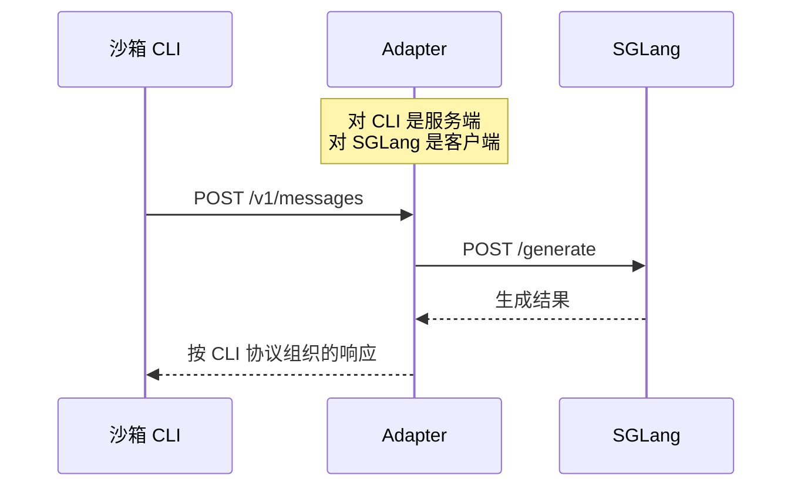

# 05 · 任务总结：CLI 经 Adapter 完成一次模型请求

> 服务准备时登记路由并启动监听；Harness 把服务地址交给 CLI。CLI 请求到达后，Adapter 匹配路由、准备模型输入并请求 SGLang，再把生成结果组织为 HTTP 响应交回 CLI。

[本步 scope](01-scope.md) · [函数记录](02-short-term-memory/overview.md) · [本轮复述与校准](04-flow.md#communication-restatement-and-response)

## 1. 本步在任务中的位置

- 本步发生在 `_generate` 等待 `harness.run(...)` 的期间，沿 Claude Code / Anthropic 路径。
- 在 CLI 启动前，`endpoint` 已取得可用的 Adapter 与 `adapter_url`；首次创建时先在构造过程中登记路由，再由 `run_app_in_thread` 启动监听。
- 这一页整理一次模型请求怎样往返。CLI 在一次任务中可以重复这个过程。

## 2. 已读部分怎样完成交接

| 环节 | 函数与交接 | 留下或交出什么 |
| --- | --- | --- |
| 准备服务 | `endpoint:188` 构造 Adapter，经基类初始化调用[路由登记](02-short-term-memory/functions/slime/agent/adapters/anthropic.py/AnthropicAdapter._register_routes.md)；`200` 调用 [run_app_in_thread](02-short-term-memory/functions/slime/agent/aiohttp_threaded.py/run_app_in_thread.md) | 带路由的 `app`、监听服务与访问地址 |
| 交付地址 | [launch_and_wait:92](02-short-term-memory/functions/slime/agent/harness/claude_code.py/ClaudeCodeHarness.launch_and_wait.md) 把 `adapter_url` 写入环境，经执行链交给 CLI | CLI 使用 `ANTHROPIC_BASE_URL` 找到服务 |
| 接收请求 | aiohttp 调用 `app._handle` 匹配方法与路径，再进入 [BaseAdapter._run_turn:394](../step-001-harness-to-adapter/02-short-term-memory/functions/slime/agent/adapters/common.py/BaseAdapter._run_turn.md) | `request` 被读取为 `body`，接回既有会话和输入准备 |
| 请求模型 | `_run_turn:423` 调用 [call_sglang_generate](../step-001-harness-to-adapter/02-short-term-memory/functions/slime/agent/adapters/common.py/call_sglang_generate.md)，后者在 `610` 向 `/generate` 发请求 | 模型格式的 payload 交给 SGLang，生成结果整理为 `turn` |
| 回复 CLI | `_run_turn` 解码、解析并构造回复，`442` 调用 [AnthropicAdapter._respond](../step-001-harness-to-adapter/02-short-term-memory/functions/slime/agent/adapters/anthropic.py/AnthropicAdapter._respond.md) | 协议响应沿 CLI 发起的那次 HTTP 请求返回 |

- **初始化阶段准备的是处理规则**；CLI 的实际 POST 在它运行时发出。
- **只有匹配的请求进入相应处理器**：`POST /v1/messages` 进入 `_run_turn`，计数路径使用 `_count_tokens`，未登记路径返回 404。
- 同一个 app 与两层回调的具体连接见[服务端说明](references/http-request-dispatch.md#listener-to-adapter)。

## 3. 返回结果及其含义

- SGLang 的响应先交回 Adapter；Adapter 将其整理为 CLI 能使用的协议响应。两段 HTTP 请求有各自的请求方和响应方。
- CLI 取得模型回复后继续任务；本轮也会留下轨迹记录，后续导出仍属于既有 Step 004 的职责。
- 单次 HTTP 响应完成，与整个 `harness.run` 返回执行结果是两个时机。此时 Harness 通常仍在等待 CLI。

这里的“有来有回”指**客户端发起请求、服务端返回响应**。它不表示服务端因此就能向该客户端任意发起新的独立 HTTP 请求。

## 4. 本步的收束与边界

现行 scope 中的正常通信主线已覆盖到“模型回复交回 CLI”，本步按这个深度收束。用户随后表示本步内容已差不多，并要求核对整组 Coding Agent RL 的剩余范围，见[覆盖核对](04-flow.md#coding-agent-coverage-check)。

- 用户已经形成整体流程的复述。本轮对路由匹配、初始化时机和 HTTP 请求—响应关系的校准仍属于助手说明，尚未收到后续确认。
- 实际部署、抓包、断连恢复、超时与流式传输细节不计为本步已验证或已掌握内容。
- 后续若继续按整体任务执行，CLI 完成后回到结果收集；读取哪些新内容仍按具体问题选择。

源码、来源与验证边界

- Slime 固定版本：`18868a79b0b083a093798a94ed0f8cb4f71b9c14`。
- 服务准备：[generate.py:184–222](https://github.com/THUDM/slime/blob/18868a79b0b083a093798a94ed0f8cb4f71b9c14/examples/coding_agent_rl/generate.py#L184-L222)；运行位置：[283–298](https://github.com/THUDM/slime/blob/18868a79b0b083a093798a94ed0f8cb4f71b9c14/examples/coding_agent_rl/generate.py#L283-L298)。
- 请求处理：[adapters/common.py:387–475](https://github.com/THUDM/slime/blob/18868a79b0b083a093798a94ed0f8cb4f71b9c14/slime/agent/adapters/common.py#L387-L475)；SGLang HTTP 调用：[610–624](https://github.com/THUDM/slime/blob/18868a79b0b083a093798a94ed0f8cb4f71b9c14/slime/agent/adapters/common.py#L610-L624)。
- aiohttp `v3.12.15` 仅作为前述内部回调的固定参考，未确认是实际运行环境的版本。
- 本页根据已有阅读与本轮复述整理；没有新增真实 CLI、沙箱或模型服务运行。

