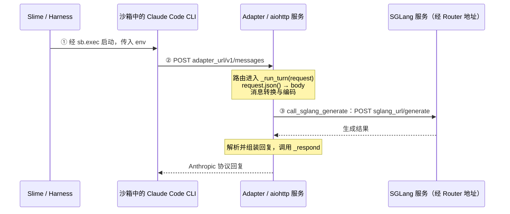

> 2026-10-25 归档：用户选择第三版作为正式 scope，第一版 scope完整保留，仅重算相对链接。当前入口见 [正式 scope](../../01-scope.md)。

---

# 01 · 阅读范围：沙箱中的 CLI 怎样请求 SGLang

[步骤入口](../../README.md) · [本步记录](../../02-short-term-memory/overview.md) · [前一步任务总结](../../../step-008-harness-communication/05-task-flow.md) · [旧版 scope](../scope-at-2f231865.md)

## 1. 阅读目标

- **整体目标**：理解 Coding Agent / Coding RL 的运行流程。
- **本步问题**：沙箱中的 CLI 怎样把模型请求送到 Adapter，再由 Adapter 请求 SGLang，并把回复交回 CLI？
- **阅读范围**：沿 Claude Code / Anthropic 的正常路径，接清请求地址、HTTP 路由、`request → body` 与两次 HTTP 往返；前面已读的启动和模型处理只回顾必要交接。

## 2. 指挥官函数

- **整体位置**：`generate → _generate` 组织一次任务；本步发生在 [_generate:287](https://github.com/THUDM/slime/blob/18868a79b0b083a093798a94ed0f8cb4f71b9c14/examples/coding_agent_rl/generate.py#L283-L298) 等待 `harness.run(...)` 的期间。
- **本步指挥官**：[BaseAdapter._run_turn:387–475](https://github.com/THUDM/slime/blob/18868a79b0b083a093798a94ed0f8cb4f71b9c14/slime/agent/adapters/common.py#L387-L475)，它接住 HTTP 请求，串联模型输入准备、SGLang 调用与回复。
- **进入方式**：aiohttp 根据 [AnthropicAdapter._register_routes:48–50](https://github.com/THUDM/slime/blob/18868a79b0b083a093798a94ed0f8cb4f71b9c14/slime/agent/adapters/anthropic.py#L48-L50) 登记的关系调用它；服务创建与监听复用 Step 005，CLI 启动复用 Step 008。

## 3. 给出真正干活的核心骨架

### 3.1 继承整体骨架，定位等待期间的请求

沿用 `evaluation=False` 的正常路径。以下为教学裁剪：省略多数参数、配置解析、检查、日志、追踪、超时与失败包装，保留真实顺序和沙箱使用边界。

```python
state = _AdapterService(...)  # Step 005：准备服务依赖
adapter, adapter_url, _ = state.endpoint(...)  # 取得本次 Agent 的服务端点
adapter.open_session(...)  # Step 005：登记会话
async with boot_agent_sandbox(...) as sb:  # Step 006：沙箱与 CLI 就绪
    baseline = await swe.prepare_workspace(...)  # Step 007：准备工作区和初始基准
    agent_exit_code = await harness.run(...)  # Step 008：启动 CLI，等待执行结果
    # 等待期间：CLI → HTTP → Adapter → HTTP → SGLang → Adapter → CLI
    # 本步补齐请求入口；Adapter 内部的模型处理接回 Step 001
    agent_metrics = await harness.collect_metrics(...)  # Step 002：收集统计
    diff_text = await swe.git_diff(...)  # Step 002：用 baseline 提取补丁

reward, applied_cleanly = await swe.run_evaluation(...)  # Step 003：独立评测
samples = await adapter.finish_session(...)  # Step 004：导出训练样本
...  # 返回前的结果处理及最终会话清理
return samples
```

步骤编号表示阅读顺序。模型请求发生在 CLI 运行期间，可以重复多次；`harness.run` 等 CLI 整体结束后才交回执行结果。

### 3.2 局部骨架：启动环境与两次 HTTP 请求

`sb` 是 Slime 操作沙箱的接口。Harness 经它启动 CLI，并传入包含 Adapter 地址的环境变量；运行中的 CLI 再发出模型请求。Adapter 的路由登记和监听已在服务准备期完成。

下面按实际交接画出关系；①②③也是下一节的阅读顺序。Python 内部调用在各段面包屑中定位。



CLI 请求包含消息等 JSON 数据；Adapter 重新组装含 `input_ids`、`sampling_params` 的模型请求。CLI 得到回复后继续任务；`_run_turn` 在发送回复后记录本轮轨迹。转换、解析和轨迹算法按需回看 [Step 001](../../../step-001-harness-to-adapter/01-scope.md)。

<a id="client-request-target"></a>

**发送端补充：完整 URL 由基础地址与 CLI 的 API 路径共同确定。** 当前 `18868a79` 的两种配对由 [_AGENTS:50–53](https://github.com/THUDM/slime/blob/18868a79b0b083a093798a94ed0f8cb4f71b9c14/examples/coding_agent_rl/generate.py#L50-L53)选择；下表只比较模型生成请求，本步主线仍沿 Claude Code。

| CLI | Slime 提供的地址与协议配置 | 对应的模型请求与接收方 |
| --- | --- | --- |
| Claude Code | [launch_and_wait:92](https://github.com/THUDM/slime/blob/18868a79b0b083a093798a94ed0f8cb4f71b9c14/slime/agent/harness/claude_code.py#L86-L109)：`ANTHROPIC_BASE_URL = ctx.adapter_url` | `POST <adapter_url>/v1/messages` → AnthropicAdapter |
| Codex | [write_config:89](https://github.com/THUDM/slime/blob/18868a79b0b083a093798a94ed0f8cb4f71b9c14/slime/agent/harness/codex.py#L42-L105) 使用 `base_url = ctx.adapter_url + "/v1"`、`wire_api = "responses"`，写入 `config.toml` | `POST <adapter_url>/v1/responses` → [ResponsesAdapter:182](https://github.com/THUDM/slime/blob/18868a79b0b083a093798a94ed0f8cb4f71b9c14/slime/agent/adapters/responses.py#L171-L182) |

Slime 在 Harness 中启动外部 [`claude`](https://github.com/THUDM/slime/blob/18868a79b0b083a093798a94ed0f8cb4f71b9c14/slime/agent/harness/claude_code.py#L86-L87) 或 [`codex exec`](https://github.com/THUDM/slime/blob/18868a79b0b083a093798a94ed0f8cb4f71b9c14/slime/agent/harness/codex.py#L126-L128)。真正发送 HTTP 的调用发生在 CLI 内部客户端；本轮没有检查本次安装包的内部发送函数。`add_post` 定义的是接收端匹配规则，两端靠约定的 URL 与协议接上。

接口依据：[Claude Code 网关协议](https://code.claude.com/docs/en/llm-gateway-protocol#api-formats)说明 Messages 路径；[OpenAI Docs 配置参考](https://learn.chatgpt.com/docs/config-file/config-reference)说明 `base_url` 与 `wire_api`。这不代表 CLI 的所有请求都是生成请求：Claude 还可能请求 token 计数等端点。真实 URL 也可能带查询参数，例如当前官方文档中的 `?beta=true`；这里展示供路由匹配的路径，不冒充本次运行抓包。

<a id="adapter-entry-navigation"></a>

### 3.3 三段面包屑：追踪对象、证据与返回位置

每段只追一个值或请求。箭头分别表示参数传递、进程环境交付、HTTP 往返或路由调用；遇到来源不清楚的值，再进入回查支线，查完返回原位置。

<a id="breadcrumb-cli-address"></a>

**① CLI 为什么知道 Adapter 地址？先看 [launch_and_wait](../../02-short-term-memory/functions/slime/agent/harness/claude_code.py/ClaudeCodeHarness.launch_and_wait.md)。**

整体位置是 `_generate → BaseHarness.run → ClaudeCodeHarness.launch_and_wait`；当前只追 `adapter_url`。

```text
ctx.adapter_url
  -> env["ANTHROPIC_BASE_URL"]
  -> run_agent(env=...) -> exec_and_wait(env=...) -> sb.exec(env=...)
  -> CLI process environment
```

- **证据**：[launch_and_wait:92](https://github.com/THUDM/slime/blob/18868a79b0b083a093798a94ed0f8cb4f71b9c14/slime/agent/harness/claude_code.py#L91-L109) 把 URL 放入 `env`；[run_agent:119](https://github.com/THUDM/slime/blob/18868a79b0b083a093798a94ed0f8cb4f71b9c14/slime/agent/harness/common.py#L115-L126) 与 [exec_and_wait:151](https://github.com/THUDM/slime/blob/18868a79b0b083a093798a94ed0f8cb4f71b9c14/slime/agent/sandbox.py#L146-L155) 继续传递它。前半是 Python 参数，末端是交给沙箱进程的环境；这里只检查这些行。
- **按需回查**：若 `ctx.adapter_url` 来路不清楚，先用本步的 [_AdapterService 类卡](../../02-short-term-memory/classes/examples/coding_agent_rl/generate.py/_AdapterService.md)定位服务对象，再沿 [endpoint](../../../step-005-agent-preparation/02-short-term-memory/functions/examples/coding_agent_rl/generate.py/_AdapterService.endpoint.md) → [\_generate:259、291](https://github.com/THUDM/slime/blob/18868a79b0b083a093798a94ed0f8cb4f71b9c14/examples/coding_agent_rl/generate.py#L254-L294) → [BaseHarness.run:98–104](https://github.com/THUDM/slime/blob/18868a79b0b083a093798a94ed0f8cb4f71b9c14/slime/agent/harness/common.py#L98-L104) 找到写入 `ctx` 的位置。
- **返回与继续**：回查后回到 `launch_and_wait:92`，沿 `env` 跟到 CLI 获得地址，再进入②。URL 在这里配置到启动环境；`write_config` 负责其他 CLI 配置。

<a id="breadcrumb-adapter-entry"></a>

**② 监听服务怎样回调 app，并进入匹配的 Adapter 方法？**

**先读 [HTTP 请求怎样从监听进入处理函数](../http-request-dispatch.md)**：用以同一个 `app` 为中心的关系图、三段代码和函数位置表，接清路由登记、监听与请求分派；先跟请求主线，再回看配置与查表关系。该页用 Codex `/v1/responses` 举例，本段仍保留 Claude Code `/v1/messages` 的主线路径；两者的服务端连接机制相同。

```text
CLI -- HTTP POST <adapter_url>/v1/messages --> aiohttp
Server / RequestHandler -- saved callback --> app._handle(request)
app._handle -- router.resolve(request) --> matched handler
matched handler -- await handler(request) --> adapter._run_turn(request)
```

- **证据**：[\_register_routes:49 的本步卡片](../../02-short-term-memory/functions/slime/agent/adapters/anthropic.py/AnthropicAdapter._register_routes.md)中，`app.router.add_post("/v1/messages", self._run_turn)` 登记处理器；[\_run_turn:394](https://github.com/THUDM/slime/blob/18868a79b0b083a093798a94ed0f8cb4f71b9c14/slime/agent/adapters/common.py#L387-L423) 读取 JSON。登记发生在初始化期，请求到达后由 aiohttp 调用。
- **当前重点**：从 [run_app_in_thread 第 3 段的回调绑定](../../02-short-term-memory/functions/slime/agent/aiohttp_threaded.py/run_app_in_thread.md#listener-handler-binding)看 `runner.setup()` 和 `site.start()` 怎样接好 `app._handle`。路由还保存了当前 Adapter 的绑定方法；只有匹配的方法和路径才会进入该方法，未登记的路径返回 404。
- **按需回查**：登记由 [BaseAdapter.__init__:240](https://github.com/THUDM/slime/blob/18868a79b0b083a093798a94ed0f8cb4f71b9c14/slime/agent/adapters/common.py#L238-L240) 触发；两层回调的保存和调用位置见[源码衔接表](../http-request-dispatch.md#listener-to-adapter)。
- **在 generate 中找注册入口**：从 [endpoint:188 的 adapter_cls(...)](https://github.com/THUDM/slime/blob/18868a79b0b083a093798a94ed0f8cb4f71b9c14/examples/coding_agent_rl/generate.py#L187-L200) 进入继承的 `BaseAdapter.__init__`，再到具体 `_register_routes`；登记完返回构造调用，随后才启动 HTTP 服务。
- **返回与继续**：回到 `_run_turn:394`，接住 `body`；输入转换按需看[现行卡片](../../../step-001-harness-to-adapter/02-short-term-memory/functions/slime/agent/adapters/common.py/BaseAdapter._run_turn.md)，到 `423` 的生成调用进入③。HTTP 两端靠 URL 与协议相接，跨过此处就切换到了服务端处理流程。

<a id="breadcrumb-sglang-request"></a>

**③ Adapter 怎样请求 SGLang？进入 [call_sglang_generate](../../../step-001-harness-to-adapter/02-short-term-memory/functions/slime/agent/adapters/common.py/call_sglang_generate.md)，追目标地址与请求。**

```text
_run_turn:423 -> call_sglang_generate
call_sglang_generate -- HTTP POST <sglang_url>/generate --> SGLang
SGLang -- HTTP response --> call_sglang_generate -> _run_turn:425
```

- **证据**：[570–624](https://github.com/THUDM/slime/blob/18868a79b0b083a093798a94ed0f8cb4f71b9c14/slime/agent/adapters/common.py#L570-L624) 中，`sglang_url = adapter.sglang_url` 取得地址，`610` 的 `sess.post(..., json=payload, ...)` 发请求，`624` 读取结果。
- **按需回查**：沿 [\_AdapterService.__init__:174](https://github.com/THUDM/slime/blob/18868a79b0b083a093798a94ed0f8cb4f71b9c14/examples/coding_agent_rl/generate.py#L168-L174) → [endpoint:190](https://github.com/THUDM/slime/blob/18868a79b0b083a093798a94ed0f8cb4f71b9c14/examples/coding_agent_rl/generate.py#L184-L195) → [BaseAdapter.__init__:218](https://github.com/THUDM/slime/blob/18868a79b0b083a093798a94ed0f8cb4f71b9c14/slime/agent/adapters/common.py#L204-L218)，只看地址的组成、传入和保存。
- **返回与收束**：回查后回到 `call_sglang_generate:570、610`。生成结果交回 `_run_turn:425`，经已读解析和 [AnthropicAdapter._respond](../../../step-001-harness-to-adapter/02-short-term-memory/functions/slime/agent/adapters/anthropic.py/AnthropicAdapter._respond.md) 回复 CLI，到这里收束本步通信链。

**停止条件**：能沿①地址交付、②请求接收、③模型请求说明两份请求如何往返。每轮最多向下追两层，传参包装只定位交接行；CLI 内部 HTTP 客户端、服务线程、SGLang Router 内部分发、续生成和异常恢复按需另读。

## 版本说明

- **源码基准**：`18868a79b0b083a093798a94ed0f8cb4f71b9c14`，本机 checkout 为 `/home/fredkeira/projects/slime`。
- **本次校准**：旧版 scope 绑定 `2f231865`，现按当前 `_AdapterService.endpoint`、`harness` 实例及 `_run_turn` 的位置重接导航，将重点放在 CLI → Adapter → SGLang 的通信交接。
- **导航重排**：2026-10-25 按用户确认采用①地址交付 → ②请求接收 → ③模型请求的面包屑；[重排前 scope](../scope-before-breadcrumb-navigation.md)完整保留，见[本轮讨论](../../04-flow.md#breadcrumb-navigation-confirmed)。
- **材料边界**：[旧版 scope](../scope-at-2f231865.md)完整保留；本步 `02` 内原先调入的两张旧卡、`03` 快照和[通信参考](../run-communication-path.md)仍保留原版本。本页优先链接 Step 005、008、001 的现行记录，未据此刷新历史快照或认定用户已掌握接收机制。
- **证据范围**：本轮只核对静态源码，没有启动真实 CLI、沙箱、Adapter 或 SGLang 请求。
