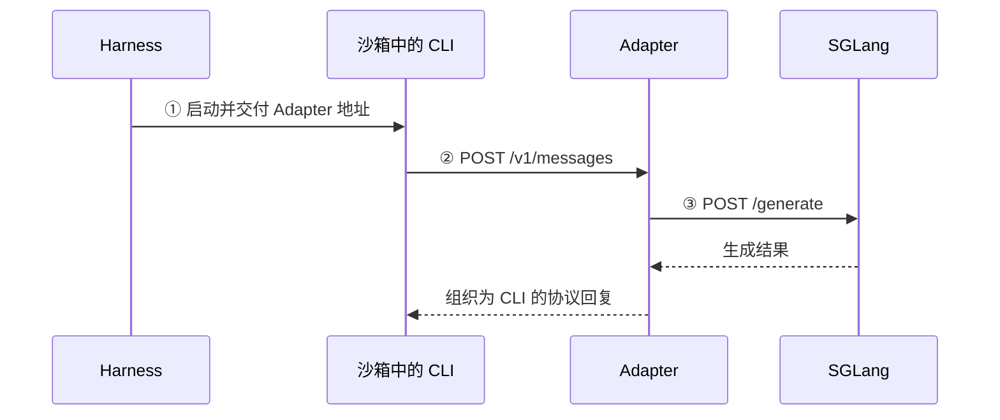

> 2026-10-25 归档：用户选择第三版作为正式 scope，第二版详略对照稿完整保留，仅重算相对链接。当前入口见 [正式 scope](../../01-scope.md)。

---

# Step 009 · 理解方式对照稿：保留结构，调整详略与调用关系

[原 scope](scope-v1.md) · [本步函数记录](../../02-short-term-memory/overview.md) · [完整通信材料](../http-request-dispatch.md)

沿用原 scope 的“阅读目标 → 指挥官 → 整体骨架 → 局部关系 → 分段阅读”。本稿只调整各段展开到哪里，以及进入、返回和跨 HTTP 的关系；原 scope 保留。

## 1. 阅读目标

- **整体目标**：理解 Coding Agent / Coding RL 的运行流程。
- **本步问题**：CLI 怎样找到 Adapter，Adapter 怎样接住请求并交给 SGLang，再把回复送回 CLI？
- **阅读范围**：沿 Claude Code / Anthropic 的正常模型请求。地址交付与模型调用接回已有认识，重点补清中间的服务接入。

## 2. 指挥官函数

- **整体位置**：本步的模型往返发生在 `_generate` 等待 `harness.run(...)` 的期间。
- **请求处理的指挥官**：[BaseAdapter._run_turn](../../../step-001-harness-to-adapter/02-short-term-memory/functions/slime/agent/adapters/common.py/BaseAdapter._run_turn.md) 组织一次模型请求；当前源码定位在 [adapters/common.py:387–475](https://github.com/THUDM/slime/blob/18868a79b0b083a093798a94ed0f8cb4f71b9c14/slime/agent/adapters/common.py#L387-L475)。
- **本轮回查入口**：`_AdapterService.endpoint` 中创建 Adapter、启动其 HTTP 应用的两处调用，用来接清 `_run_turn` 之前的来路。

## 3. 给出真正干活的核心骨架

### 3.1 继承整体骨架，定位等待期间的请求

以下是 `evaluation=False` 正常路径的教学裁剪，省略多数参数、检查、日志、追踪、超时与失败包装。完整业务环节保留用于定位。

```python
state = _AdapterService(...)  # Step 005：准备服务依赖
adapter, adapter_url, _ = state.endpoint(...)  # 取得对应的 Adapter 与地址
adapter.open_session(...)  # Step 005：登记会话
async with boot_agent_sandbox(...) as sb:  # Step 006：沙箱与 CLI 就绪
    baseline = await swe.prepare_workspace(...)  # Step 007：准备工作区
    agent_exit_code = await harness.run(...)  # Step 008：启动并等待 CLI
    # 本步：CLI 运行期间，经 HTTP 请求 Adapter，由 Adapter 请求 SGLang
    agent_metrics = await harness.collect_metrics(...)  # Step 002：收集统计
    diff_text = await swe.git_diff(...)  # Step 002：提取代码改动

reward, applied_cleanly = await swe.run_evaluation(...)  # Step 003：独立评测
samples = await adapter.finish_session(...)  # Step 004：导出训练样本
...  # 返回前的结果处理与最终会话清理
return samples
```

**这一层只保留位置**：服务在 CLI 启动前准备好，模型请求在 CLI 运行期间发生，可以重复多次。步骤编号是阅读顺序。

### 3.2 局部关系：先看清两次 HTTP 往返

下面只画运行期间的信息交接。图里的 HTTP 箭头表示跨进程请求；`_run_turn` 由 aiohttp 的路由处理触发。



**这一层只保留交接**：CLI 使用 `adapter_url`，Adapter 使用 `sglang_url`；服务如何接住请求，在下一段展开。

### 3.3 三段面包屑：按当前问题分配详略

①只追地址传递；②保留关键调用层级、回调和返回位置；③接回已读的模型调用。具体字段清单、其他协议与库内长调用链留在相应卡片或参考中。

**① CLI 为什么知道 Adapter 地址？简要回看已读的 [launch_and_wait](../../02-short-term-memory/functions/slime/agent/harness/claude_code.py/ClaudeCodeHarness.launch_and_wait.md)。**

```text
launch_and_wait:92  ctx.adapter_url → env["ANTHROPIC_BASE_URL"]
  → run_agent(env=env)
  → exec_and_wait(env=env)
  → sb.exec(env=env)
```

本段只核对地址进入环境字典，再作为 `env` 参数传到沙箱进程。命令组装、PID 和等待机制按需回看旧卡。

**小结与交接**：CLI 获得了要访问的地址；下面回查这个地址对应的服务怎样准备好、收到请求后怎样处理。

<a id="current-section"></a>

**② 请求怎样进入 Adapter？重点分清构造时、启动时、请求到达后。**

**构造时：从 `generate.py:188` 进入，登记完成后返回同一调用。**

首次创建端点时，`adapter_cls` 由 `_AGENTS[agent_name]` 选出；Claude 分支得到 AnthropicAdapter。它没有自己的 `__init__`，因此使用继承的 `BaseAdapter.__init__`。

```text
_AdapterService.endpoint                         generate.py:184
├─ 188: adapter = adapter_cls(...)
│  └─ BaseAdapter.__init__                       adapters/common.py:204
│     ├─ 224: self.app = web.Application(...)
│     └─ 240: self._register_routes(self.app)
│        └─ AnthropicAdapter._register_routes    adapters/anthropic.py:48
│           └─ 49: app.router.add_post("/v1/messages", self._run_turn)
└─ 200: app_handle = run_app_in_thread(adapter.app, ...)
```

**执行基类代码时，`self` 仍是正在创建的 AnthropicAdapter 对象**，所以调用到子类的注册方法。第 `188` 行构造调用完成时，路由已经登记好；随后才继续第 `200` 行。具体代码与来源见[路由卡](../../02-short-term-memory/functions/slime/agent/adapters/anthropic.py/AnthropicAdapter._register_routes.md)。

**启动时：把同一个 app 交给服务，并保存请求回调。**

第 `200` 行进入 `run_app_in_thread`；它让后台线程执行嵌套的 `_run`。其中连接应用和监听端口的主体是：

```python
# slime/agent/aiohttp_threaded.py:69–72
runner = web.AppRunner(app, **(runner_kwargs or {}))
loop.run_until_complete(runner.setup())
site = web.TCPSite(runner, host, port)
loop.run_until_complete(site.start())
```

这里的 `app` 就是前面登记好路由的 `adapter.app`。`setup()` 在库内部创建保存 `app._handle` 的 Server，`start()` 把该 Server 接到监听端口；这使网络层知道解析出请求后应调用哪个应用入口。

启动函数返回 `AppHandle`，`endpoint` 继续组装访问地址；后台服务继续运行。线程通知和完整库内传递链按需看 [run_app_in_thread 第 3 段](../../02-short-term-memory/functions/slime/agent/aiohttp_threaded.py/run_app_in_thread.md#listener-handler-binding)。

**请求到达后：由 aiohttp 回调应用，再根据路由调用 Adapter。**

下面发生在后来收到请求时。正常解析后的 `request` 被交给已保存的 `app._handle`；应用内部的关键动作是：

```python
# aiohttp Application._handle 的正常路径节选
match_info = await self._router.resolve(request)
handler = match_info.handler
return await handler(request)
```

匹配 `POST /v1/messages` 时，`handler` 是登记时绑定到当前 Adapter 的 `self._run_turn`；进入该方法后，`common.py:394` 的 `await request.json()` 得到 `body`。其他路径使用各自的处理器，未登记路径返回 404；库版本与完整证据见[服务端衔接说明](../http-request-dispatch.md#listener-to-adapter)。

**小结与交接**：构造时登记路由，启动时接好应用回调，请求到达后才按路由调用方法。现在已有 `request / body`，回到 `_run_turn:423` 看下一次模型交接。

**③ Adapter 怎样请求 SGLang？接回 [call_sglang_generate 的已有记录](../../../step-001-harness-to-adapter/02-short-term-memory/functions/slime/agent/adapters/common.py/call_sglang_generate.md)。**

```text
BaseAdapter._run_turn                            adapters/common.py
├─ 423: turn = await call_sglang_generate(...)
│  └─ 610: HTTP POST <sglang_url>/generate
└─ 425 起: 解析生成结果 → 组织回复 → await self._respond(...)
```

本段只确认 Adapter 使用自己的 `sglang_url` 发出第二次 HTTP 请求，取得 `turn` 后返回 `_run_turn`，再把结果组织成给 CLI 的回复。输入转换、token 预算、续生成与轨迹算法从已有卡片回查。

**小结与停止位置**：CLI 获得本次模型回复，可以继续任务；本步读到这两次 HTTP 交接连通即可。单次请求完成时，Harness 通常仍在等待整个 CLI 任务结束。

## 版本说明

- **Slime**：`18868a79b0b083a093798a94ed0f8cb4f71b9c14`。本稿采用同一 Claude Code / Anthropic 场景；完整定位和旧稿仍见[原 scope](scope-v1.md)。
- **aiohttp**：内部回调说明取自此前核对的 `v3.12.15` 参考源码，未确认实际运行环境的安装版本；细节与来源集中在服务端衔接说明。
- **对照稿边界**：只调整本文件的结构呈现、详略和调用关系；既有 scope、函数卡及阅读历史没有因此改写。本文的代码裁剪、图示与小结不代表新增运行或掌握记录。
