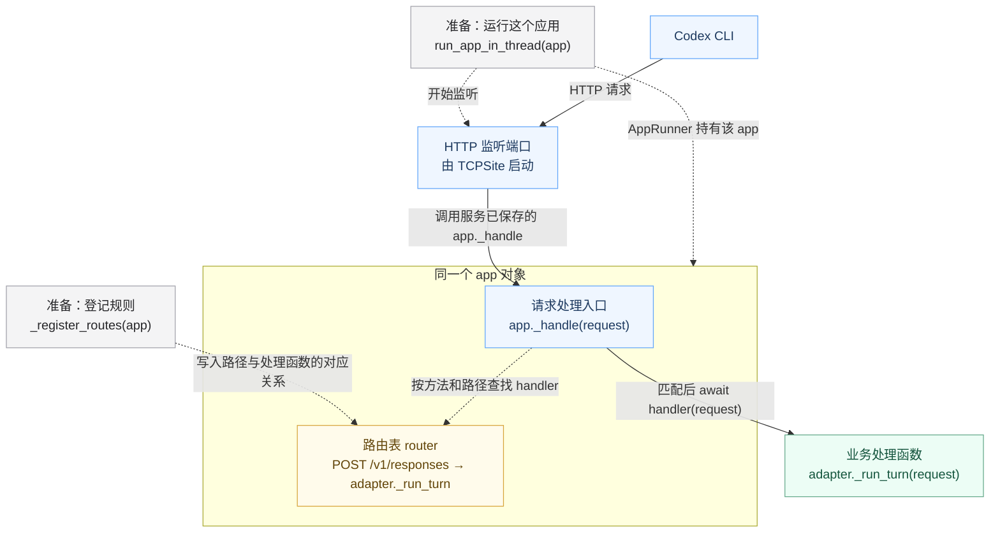

# HTTP 请求怎样从监听进入处理函数

[返回 scope 第②段](../01-scope.md#breadcrumb-adapter-entry) · [本步函数索引](../02-short-term-memory/overview.md) · [run_app_in_thread 卡片](../02-short-term-memory/functions/slime/agent/aiohttp_threaded.py/run_app_in_thread.md)

> 路由登记、后台 HTTP 服务和请求分派，通过同一个 `app` 对象连接起来。先把处理规则放进 `app.router`，再运行这个应用；请求到达后，aiohttp 查它的路由表并调用匹配的处理函数。

本页沿用户提出的 **Codex → ResponsesAdapter → `/v1/responses`** 举例。Claude Code 对应 AnthropicAdapter 和 `/v1/messages`，应用与监听服务的连接方式相同。这里接清服务端内部的交接，CLI 怎样组装请求见[归档中保留的发送端对照](archive/scope-v1.md#client-request-target)。

## 先看整体图：同一个 app 把监听与路由接起来



**先沿实线从 Codex 看到 `_run_turn`，再看查表支线说明 handler 从哪里来。** `app` 的框表示对象内部的组成，不表示另一个进程或线程；路由器和请求处理入口属于这个应用。准备工作说明：路由已经写好，HTTP 服务也已经关联到这个 app。

实线表示本次请求的传递与调用；虚线表示准备时建立的连接，或处理请求时查询已有路由。`_run_turn` 是 Adapter 的方法，因此画在 app 的框外；app 通过保存的 handler 调用它。响应回传先折叠，避免遮住当前要理解的交接。

## 图里的函数分别在哪里

| 图中关系 | 真实函数与源码位置 | 本页只看什么 |
| --- | --- | --- |
| app 的创建 | `BaseAdapter.__init__`<br>[slime/agent/adapters/common.py:224、240](https://github.com/THUDM/slime/blob/18868a79b0b083a093798a94ed0f8cb4f71b9c14/slime/agent/adapters/common.py#L224-L240) | 创建 `self.app`，把它交给路由登记方法 |
| 准备：登记规则 | `ResponsesAdapter._register_routes`<br>[slime/agent/adapters/responses.py:181–182](https://github.com/THUDM/slime/blob/18868a79b0b083a093798a94ed0f8cb4f71b9c14/slime/agent/adapters/responses.py#L181-L182) | 在这个应用中登记 `/v1/responses → self._run_turn` |
| 准备：交出 app | `_AdapterService.endpoint`<br>[examples/coding_agent_rl/generate.py:188–209](https://github.com/THUDM/slime/blob/18868a79b0b083a093798a94ed0f8cb4f71b9c14/examples/coding_agent_rl/generate.py#L188-L209) | 创建 Adapter 后，把它的 `app` 交给启动函数 |
| 准备：关联服务并监听 | `run_app_in_thread` 内的 `_run`<br>[slime/agent/aiohttp_threaded.py:65–81](https://github.com/THUDM/slime/blob/18868a79b0b083a093798a94ed0f8cb4f71b9c14/slime/agent/aiohttp_threaded.py#L65-L81) | 用同一个 `app` 创建 runner、site，开始监听并继续运行 |
| 请求入口：查表并调用 | `Application._handle`，aiohttp 参考源码<br>[aiohttp/web_app.py:527–569](https://github.com/aio-libs/aiohttp/blob/v3.12.15/aiohttp/web_app.py#L527-L569) | 根据请求查路由、取处理函数并调用 |
| 业务处理函数 | `BaseAdapter._run_turn`<br>[slime/agent/adapters/common.py:387–394](https://github.com/THUDM/slime/blob/18868a79b0b083a093798a94ed0f8cb4f71b9c14/slime/agent/adapters/common.py#L387-L394) | 接住 aiohttp 传来的 `request`，读取正文并进入模型处理 |

从 Codex 到应用入口的实线折叠了 aiohttp 的连接与解析过程。路由查找和调用对应的库源码版本与 Slime 的源码基准分别标注，具体边界见文末。

## 1. 登记路由：处理规则存进 app

**在 `generate.py` 中，从创建 Adapter 的那句进入。** `_AdapterService.endpoint:187–195` 的关键调用是：

```python
_, adapter_cls = _AGENTS[agent_name]
adapter = adapter_cls(...)  # 构造参数省略；初始化及路由登记发生在这句内部
```

本页的 ResponsesAdapter 通过继承链使用 `BaseAdapter.__init__`；Claude 场景的 AnthropicAdapter 也使用这个基类初始化方法。执行基类代码不会改变 `self` 的实际类型，因此 `self._register_routes(...)` 会进入具体 Adapter 覆盖的方法。登记完成后才返回这里，继续 `generate.py:200` 的 HTTP 启动。

**先在 `BaseAdapter.__init__` 创建应用。** 以下为当前问题相关的语句节选，中间的其他初始化省略：

```python
self.app = web.Application(client_max_size=64 * 1024 * 1024)  # 224：创建应用
self._register_routes(self.app)  # 240：把同一个应用交给具体 Adapter
```

此时 `self` 是 ResponsesAdapter；它继承的初始化代码调用其具体路由方法：

```python
# ResponsesAdapter._register_routes:182
app.router.add_post("/v1/responses", self._run_turn)
```

- `app.router` 是这个应用的路由器。
- `add_post` 登记 HTTP 方法 `POST`、路径 `/v1/responses` 和处理函数 `self._run_turn`。
- 这里传入的是处理函数，尚未处理任何网络请求。`self._run_turn` 绑定的是当前 Adapter 实例。

**这一阶段留下的东西**：一个已经知道“什么请求交给什么函数”的 `app`。如果沿 Claude Code 阅读，只把这一处换成[已有路由卡片](../02-short-term-memory/functions/slime/agent/adapters/anthropic.py/AnthropicAdapter._register_routes.md)中的 `/v1/messages`。

## 2. 启动监听：把这个 app 交给服务运行

**在 `_AdapterService.endpoint` 交出应用：**

```python
# generate.py:200–209，保留本题需要的参数
app_handle = run_app_in_thread(
    adapter.app,
    host=CONFIG.adapter_bind_host,
    port=CONFIG.adapter_port if not self._endpoints else 0,
    # 省略 thread_name 和 runner_kwargs，完整调用见源码及函数卡
)
```

**在 `run_app_in_thread` 的后台函数 `_run` 建立监听：**

```python
# aiohttp_threaded.py:69–72
runner = web.AppRunner(app, **(runner_kwargs or {}))  # 接住带有路由的 app
loop.run_until_complete(runner.setup())             # 准备应用的请求处理服务器
site = web.TCPSite(runner, host, port)               # 指定监听地址和端口
loop.run_until_complete(site.start())               # 启动监听

# 73–80：读取实际端口、保存运行资源、通知调用方；此处折叠
loop.run_forever()                                 # 81：继续运行事件循环
```

`adapter.app`、启动函数的参数 `app`、后台函数捕获的 `app` 指向同一个对象。参数传递没有重新创建一个空应用，先前登记的路由仍在其中。`AppRunner` 保存并运行这个应用，`TCPSite` 使用 runner 对应的服务器监听端口。

调用方取得 `AppHandle` 后继续执行，后台服务仍运行。每次请求到达时使用已有服务；此时不会重新执行一次 `run_app_in_thread`。

<a id="listener-to-adapter"></a>

### 关键连接：服务回调到 app，app 再回调到 Adapter

监听地址与端口只说明从哪里接收连接；**创建服务时还传入了处理连接和请求的对象**。`runner.setup()` 把 `app._handle` 交给 Server，`site.start()` 把该 Server 交给 `loop.create_server`。所以请求到达时，网络层有一个已经保存好的应用入口可以调用。

| 两层连接 | 提前保存的函数 | 后续作用 |
| --- | --- | --- |
| 网络服务 → 应用 | `app._handle` | 网络层将解析出的 request 交给这个应用 |
| 应用 → Adapter | 路由登记的 `adapter._run_turn` | 匹配请求方法与路径后，调用这个 Adapter 的方法 |

<details>
<summary>逐处追踪：app._handle 怎样经过 Server、RequestHandler，最后被调用</summary>

以下关系按 **aiohttp v3.12.15** 核对；`self` 的含义随所属类变化：

| 保存与调用位置 | 关键语句 | 同一个回调怎样传递 |
| --- | --- | --- |
| [Application._make_handler，web_app.py:442–447](https://github.com/aio-libs/aiohttp/blob/v3.12.15/aiohttp/web_app.py#L442-L447) | `Server(self._handle, ...)` | 这里 `self` 是 app，交出 `app._handle` |
| [Server.__init__，web_server.py:31](https://github.com/aio-libs/aiohttp/blob/v3.12.15/aiohttp/web_server.py#L15-L33) | `self.request_handler = handler` | Server 保存这个应用入口 |
| [TCPSite.start，web_runner.py:119–129](https://github.com/aio-libs/aiohttp/blob/v3.12.15/aiohttp/web_runner.py#L116-L129) | `loop.create_server(server, host, port, ...)` | 将 Server 作为协议工厂交给事件循环监听 |
| [Server.__call__，web_server.py:74–84](https://github.com/aio-libs/aiohttp/blob/v3.12.15/aiohttp/web_server.py#L74-L84)；[RequestHandler.__init__，web_protocol.py:205](https://github.com/aio-libs/aiohttp/blob/v3.12.15/aiohttp/web_protocol.py#L200-L206) | `RequestHandler(self, ...)`；`self._request_handler = manager.request_handler` | 连接的 HTTP 协议对象继续保存相同的 `app._handle` |
| [RequestHandler.start，web_protocol.py:582–596](https://github.com/aio-libs/aiohttp/blob/v3.12.15/aiohttp/web_protocol.py#L575-L596)；[_handle_request:510](https://github.com/aio-libs/aiohttp/blob/v3.12.15/aiohttp/web_protocol.py#L500-L514) | `request_handler = self._request_handler`；`await request_handler(request)` | 正常解析出请求后，真正调用先前保存的 `app._handle` |

</details>

到达 app 之后还有第二层：路由登记时保存的 `self._run_turn` 已经绑定当前 Adapter 实例。应用查到该处理函数，再执行 `await handler(request)`，就进入这个 Adapter 的方法。**两层回调分别连接“网络服务 → 应用”和“应用 → 具体 Adapter”。**

<details>
<summary>如果还想确认：AppRunner 到底把哪个请求处理入口交给了监听端口？</summary>

以下来自 aiohttp **v3.12.15**，是对服务内部绑定关系的参考；每段属于不同函数，并非一个连续函数体。

```python
# web_runner.py，AppRunner.__init__:380
self._app = app

# web_runner.py，继承的 BaseRunner.setup:289
self._server = await self._make_server()

# web_runner.py，AppRunner._make_server:396
return self._app._make_handler(loop=loop, **self._kwargs)

# web_app.py，Application._make_handler:442–447
return Server(
    self._handle,
    request_factory=self._make_request,
    loop=self._loop,
    **kwargs,
)

# web_runner.py，TCPSite.start:119–129，省略检查及 socket 选项
server = self._runner.server
self._server = await loop.create_server(
    server, self._host, self._port,
    # ssl、backlog、reuse_address、reuse_port 参数省略
)
```

由此接上：runner 持有这个 app；服务器使用它的 `_handle` 和请求对象工厂；site 把该服务器接到监听端口。

| 函数 | 固定版本源码 |
| --- | --- |
| `AppRunner.__init__` | [aiohttp/web_runner.py:371–380](https://github.com/aio-libs/aiohttp/blob/v3.12.15/aiohttp/web_runner.py#L371-L380) |
| `BaseRunner.setup` | [aiohttp/web_runner.py:278–289](https://github.com/aio-libs/aiohttp/blob/v3.12.15/aiohttp/web_runner.py#L278-L289) |
| `AppRunner._make_server` | [aiohttp/web_runner.py:389–396](https://github.com/aio-libs/aiohttp/blob/v3.12.15/aiohttp/web_runner.py#L389-L396) |
| `Application._make_handler` | [aiohttp/web_app.py:419–447](https://github.com/aio-libs/aiohttp/blob/v3.12.15/aiohttp/web_app.py#L419-L447) |
| `TCPSite.start` | [aiohttp/web_runner.py:116–129](https://github.com/aio-libs/aiohttp/blob/v3.12.15/aiohttp/web_runner.py#L116-L129) |

</details>

## 3. 请求到达：查路由，再调用匹配的函数

Codex 发来 `POST /v1/responses` 后，aiohttp 的服务层接收、解析并建立 `request`，再交给应用的请求处理入口。连接协议与 HTTP 解析细节暂时折叠，先看已经取得 `request` 之后发生什么。

下面是 **aiohttp v3.12.15 的 `Application._handle` 教学裁剪**，保留实际执行顺序，省略检查、Expect 处理、中间件和状态保存：

```python
match_info = await self._router.resolve(request)  # 530：按请求查找路由
handler = match_info.handler                     # 549：取出匹配的处理函数
return await handler(request)                    # 569：交入请求，等待并返回响应
```

对本例的路径，`handler` 就是“登记规则”节点先前保存的、当前 Adapter 的 `self._run_turn`。因此下一处进入 Slime：

```python
# slime/agent/adapters/common.py:387、394，中间 docstring 省略
async def _run_turn(self, request: web.Request) -> web.StreamResponse:
    body = await request.json()  # 从这次请求中读取 JSON 正文
    # 后续会话关联、模型生成、协议回复与轨迹记录接回已有函数卡
```

这就把“HTTP 服务收到了请求”接到了“`_run_turn` 里已经有 `request` 和 `body`”。处理器产生的响应由 aiohttp 沿这次 HTTP 请求回给 CLI；模型生成与完整响应过程在本页折叠。

**HTTP 在这里怎样往返**：CLI 向 Adapter 发请求，Adapter 向 CLI 回响应；Adapter 另外作为客户端向 SGLang 发请求，SGLang 向 Adapter 回响应。它们是两段各自的请求—响应交换。“能回响应”不等于服务端自动具备向原客户端任意发起新请求的能力。

### 只有匹配的请求才进入这个方法

路由器会检查请求方法和路径。以下是不同的接收情况，两个 Adapter 的路由表分别属于各自的应用：

| 接收应用 | 请求 | 处理去向 |
| --- | --- | --- |
| ResponsesAdapter | `POST /v1/responses` | 该 Adapter 的 `_run_turn` |
| AnthropicAdapter | `POST /v1/messages` | 该 Adapter 的 `_run_turn` |
| AnthropicAdapter | `POST /v1/messages/count_tokens` | `_count_tokens` |
| 任一应用中未登记的路径 | 例如 `POST /not-registered` | 404，不调用 `_run_turn` |

路径存在而 HTTP 方法不匹配时可返回 405。错误匹配的框架依据见 [UrlDispatcher.resolve:1067–1070](https://github.com/aio-libs/aiohttp/blob/v3.12.15/aiohttp/web_urldispatcher.py#L1031-L1070)。

## 从哪里继续读、读完回到哪里

| 当前需要补什么 | 进入哪里 | 读到什么程度、回到哪里 |
| --- | --- | --- |
| 服务对象和应用从哪里来 | [_AdapterService 类卡](../02-short-term-memory/classes/examples/coding_agent_rl/generate.py/_AdapterService.md)与 [endpoint 卡片](../../step-005-agent-preparation/02-short-term-memory/functions/examples/coding_agent_rl/generate.py/_AdapterService.endpoint.md) | 只确认 `adapter.app` 的来路，回到本页第 2 段 |
| 后台服务怎样启动 | [本步 run_app_in_thread 卡片](../02-short-term-memory/functions/slime/agent/aiohttp_threaded.py/run_app_in_thread.md) | 重点看 `_run` 的 runner、site 和 start；回到本页第 3 段。卡片保留原 Claude 示例，本页用 Codex 说明相同启动机制 |
| 路由登记具体做什么 | 本页第 1 段的 Responses 源码；Claude 对照见 [Anthropic 路由卡](../02-short-term-memory/functions/slime/agent/adapters/anthropic.py/AnthropicAdapter._register_routes.md) | 确认路径和处理函数，回到本页 `handler = match_info.handler` |
| 取得 body 后怎样处理模型请求 | [现行 BaseAdapter._run_turn 卡片](../../step-001-harness-to-adapter/02-short-term-memory/functions/slime/agent/adapters/common.py/BaseAdapter._run_turn.md) | 从 `394` 接住正文，沿既有处理到 `423` 的生成调用，再返回 [scope 第③段](../01-scope.md#breadcrumb-sglang-request) |

当前先记住一条完整关系：**在同一个 app 中登记路由 → 运行这个 app → 请求到达后查询它的路由 → 调用登记的处理函数**。这里的准备与处理分属不同时间；服务启动函数返回，并不意味着后台服务停止。

## 版本与证据

- **Slime**：`18868a79b0b083a093798a94ed0f8cb4f71b9c14`，本地源码已逐处核对。
- **aiohttp**：外部源码固定为 `v3.12.15`，仅用来说明框架如何接上应用、监听与路由。本机系统 Python 没有安装 aiohttp，Slime checkout 未发现 `.venv`，尚未确认实际运行环境采用这个版本。
- **图与裁剪**：图按正常路径组织；线程通知、错误处理、底层网络解析、中间件以及模型处理细节折叠。`Application._handle` 的三行仅在这一裁剪前提下表示直接调用目标 handler。
- **运行边界**：本页依据静态源码和固定库源码整理，没有启动真实 Codex、Adapter、沙箱或模型服务；Mermaid 图示与文档检查不算真实请求验证。
- **形成过程**：[用户的问题、方案与本次落实](../04-flow.md#http-dispatch-page-applied)。
