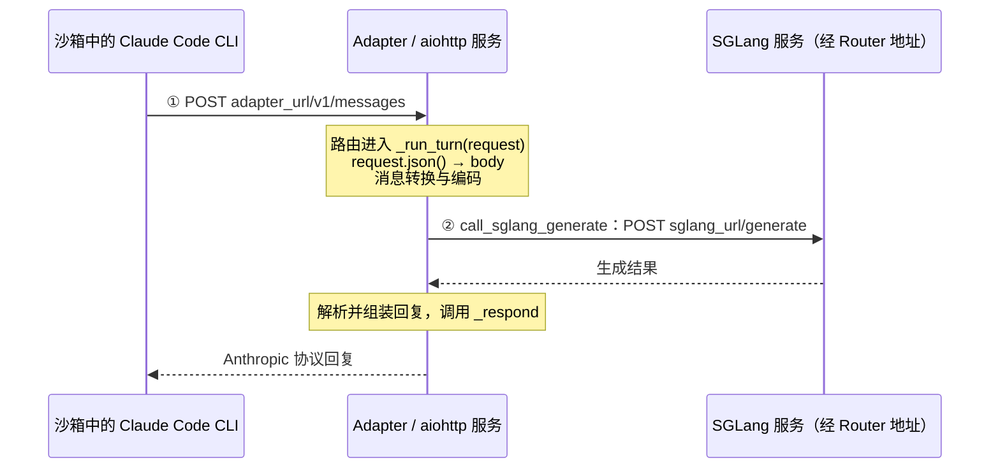

> 2026-10-25 采用三段面包屑导航前的完整 scope。源码基准为 `18868a79`；原文保留，仅重算相对链接。

---

# 01 · 阅读范围：沙箱中的 CLI 怎样请求 SGLang

[步骤入口](../README.md) · [本步记录](../02-short-term-memory/overview.md) · [前一步任务总结](../../step-008-harness-communication/05-task-flow.md) · [旧版 scope](scope-at-2f231865.md)

## 1. 阅读目标

- **整体目标**：理解 Coding Agent / Coding RL 的运行流程。
- **本步问题**：沙箱中的 CLI 怎样把模型请求送到 Adapter，再由 Adapter 请求 SGLang，并把回复交回 CLI？
- **阅读范围**：沿 Claude Code / Anthropic 的正常路径，接清请求地址、HTTP 路由、`request → body` 与两次 HTTP 往返；前面已读的启动和模型处理只回顾必要交接。

## 2. 指挥官函数

- **整体位置**：`generate → _generate` 组织一次任务；本步发生在 [_generate:287](https://github.com/THUDM/slime/blob/18868a79b0b083a093798a94ed0f8cb4f71b9c14/examples/coding_agent_rl/generate.py#L283-L298) 等待 `harness.run(...)` 的期间。
- **本步指挥官**：[BaseAdapter._run_turn:387–475](https://github.com/THUDM/slime/blob/18868a79b0b083a093798a94ed0f8cb4f71b9c14/slime/agent/adapters/common.py#L387-L475)，它接住 HTTP 请求，串联模型输入准备、SGLang 调用与回复。
- **进入方式**：aiohttp 根据 [AnthropicAdapter._register_routes:48–50](https://github.com/THUDM/slime/blob/18868a79b0b083a093798a94ed0f8cb4f71b9c14/slime/agent/adapters/anthropic.py#L48-L50) 登记的关系调用它；服务创建与监听复用 Step 005，CLI 启动复用 Step 008。

## 3. 给出真正干活的核心骨架

### 3.1 继承整体骨架，定位等待期间的请求

沿用 `evaluation=False` 的正常路径。以下为教学裁剪：省略多数参数、配置解析、检查、日志、追踪、超时与失败包装，保留真实顺序和沙箱使用边界。

```python
state = _AdapterService(...)  # Step 005：准备服务依赖
adapter, adapter_url, _ = state.endpoint(...)  # 取得本次 Agent 的服务端点
adapter.open_session(...)  # Step 005：登记会话
async with boot_agent_sandbox(...) as sb:  # Step 006：沙箱与 CLI 就绪
    baseline = await swe.prepare_workspace(...)  # Step 007：准备工作区和初始基准
    agent_exit_code = await harness.run(...)  # Step 008：启动 CLI，等待执行结果
    # 等待期间：CLI → HTTP → Adapter → HTTP → SGLang → Adapter → CLI
    # 本步补齐请求入口；Adapter 内部的模型处理接回 Step 001
    agent_metrics = await harness.collect_metrics(...)  # Step 002：收集统计
    diff_text = await swe.git_diff(...)  # Step 002：用 baseline 提取补丁

reward, applied_cleanly = await swe.run_evaluation(...)  # Step 003：独立评测
samples = await adapter.finish_session(...)  # Step 004：导出训练样本
...  # 返回前的结果处理及最终会话清理
return samples
```

步骤编号表示阅读顺序。模型请求发生在 CLI 运行期间，可以重复多次；`harness.run` 等 CLI 整体结束后才交回执行结果。

### 3.2 局部骨架：两次 HTTP 请求接起三个运行位置

`sb` 是 Slime 操作沙箱的接口。Step 008 已沿 `run_agent → exec_and_wait → sb.exec` 将启动命令和环境变量交入沙箱；随后由运行中的 CLI 发出模型请求。

| 地址 | 从哪里来、交给谁 | 用于哪段请求 |
| --- | --- | --- |
| `adapter_url` | [Step 005 的 endpoint](../../step-005-agent-preparation/02-short-term-memory/functions/examples/coding_agent_rl/generate.py/_AdapterService.endpoint.md) 组成服务地址；[Step 008 的 launch_and_wait](../../step-008-harness-communication/02-short-term-memory/functions/slime/agent/harness/claude_code.py/ClaudeCodeHarness.launch_and_wait.md) 将它放入 CLI 的 `ANTHROPIC_BASE_URL` | CLI → Adapter |
| `sglang_url` | `_AdapterService.__init__:174` 从 SGLang Router 的 IP、端口组成，`endpoint:190` 传给 Adapter | Adapter → SGLang |

服务准备时，`_register_routes` 登记 `POST /v1/messages → self._run_turn`，`run_app_in_thread` 启动监听。下面描述请求到达后的交互：



第一份请求包含 CLI 的消息等 JSON 数据；第二份由 Adapter 重新组装，包含 `input_ids`、`sampling_params` 等模型输入。CLI 得到回复后继续它的任务；`_run_turn` 在发送回复后记录本轮轨迹。模型输入转换、结果解析和轨迹算法沿用 [Step 001](../../step-001-harness-to-adapter/01-scope.md)，本步只接清通信边界。

<a id="adapter-entry-navigation"></a>

### 3.3 阅读导航与停止位置

**先看路由这一小段**，接着沿请求进入已读的 `_run_turn`；地址或监听的来源不清楚时，再回查上面的 Step 005 / 008 卡片。

| 阅读入口 | 本轮只看清什么 | 返回或继续位置 |
| --- | --- | --- |
| [AnthropicAdapter._register_routes:48–50](https://github.com/THUDM/slime/blob/18868a79b0b083a093798a94ed0f8cb4f71b9c14/slime/agent/adapters/anthropic.py#L48-L50) | `POST /v1/messages` 对应 `_run_turn`；启动时登记，请求到达时才执行 | `_run_turn:394` |
| [BaseAdapter._run_turn 的现行卡片](../../step-001-harness-to-adapter/02-short-term-memory/functions/slime/agent/adapters/common.py/BaseAdapter._run_turn.md) | `request.json()` 得到 `body`，经已读的输入准备调用生成函数 | `423` 的 `call_sglang_generate` |
| [call_sglang_generate 的现行卡片](../../step-001-harness-to-adapter/02-short-term-memory/functions/slime/agent/adapters/common.py/call_sglang_generate.md)，重点 [570–625](https://github.com/THUDM/slime/blob/18868a79b0b083a093798a94ed0f8cb4f71b9c14/slime/agent/adapters/common.py#L570-L625) | 读取 Adapter 持有的地址、组装 payload，在 `610` 向 `/generate` 发出第二次 HTTP 请求并读取结果 | 回到 `_run_turn:425` |
| [AnthropicAdapter._respond 的现行卡片](../../step-001-harness-to-adapter/02-short-term-memory/functions/slime/agent/adapters/anthropic.py/AnthropicAdapter._respond.md) | 将已解析的结果封装成 CLI 能接收的协议回复，复用已读职责 | CLI 继续任务；`_run_turn` 完成本轮记录 |

每轮最多向下追两层，解决当前交接后返回本表。服务线程与 loop、CLI 内部 HTTP 客户端、SGLang Router 内部分发、续生成和异常恢复暂不展开。

**停止条件**：能串起“Slime 经 `sb` 启动 CLI → CLI 请求 Adapter → Adapter 请求 SGLang → 回复经 Adapter 回到 CLI”，并分清两个地址及两份请求。本轮先更新范围和导航，函数卡片随实际讨论按需修订。

## 版本说明

- **源码基准**：`18868a79b0b083a093798a94ed0f8cb4f71b9c14`，本机 checkout 为 `/home/fredkeira/projects/slime`。
- **本次校准**：旧版 scope 绑定 `2f231865`，现按当前 `_AdapterService.endpoint`、`harness` 实例及 `_run_turn` 的位置重接导航，将重点放在 CLI → Adapter → SGLang 的通信交接。
- **材料边界**：[旧版 scope](scope-at-2f231865.md)完整保留；本步 `02` 内原先调入的两张旧卡、`03` 快照和[通信参考](run-communication-path.md)仍保留原版本。本页优先链接 Step 005、008、001 的现行记录，未据此刷新历史快照或认定用户已掌握接收机制。
- **证据范围**：本轮只核对静态源码，没有启动真实 CLI、沙箱、Adapter 或 SGLang 请求。
