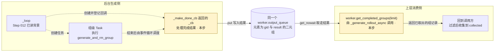

# 01 · 阅读范围：完成结果的入队与领取

[步骤入口](../README.md) · [函数索引](../02-short-term-memory/overview.md) · [前一步](../../step-012-async-rollout-worker-loop/README.md)

## 1. 阅读目标

接上 Step 012 的 Task 注册点，弄清三个时刻：**准备并注册回调 → 任务结束后回调入队 → 消费方调用方法取组**。本步先追踪一组正常完成的结果，保留组编号与结果的对应关系。

继续沿用本地 AsyncRolloutWorker；生成成功、返回 list，结果中没有 ABORTED/PENDING。本轮不展开异常、取消、中止重试与输入快照复制的内部机制。get_completed_groups 的 queue.Empty 是正常的“已经没有可取结果”停止条件，必须保留。

## 2. 入口与最小前置

- 从已读 [_loop 的注册行](https://github.com/THUDM/slime/blob/18868a79b0b083a093798a94ed0f8cb4f71b9c14/slime/rollout/fully_async_rollout.py#L222) 进入本步；[_loop 背景卡](../02-short-term-memory/functions/slime/rollout/fully_async_rollout.py/AsyncRolloutWorker._loop.md)保留完整旧骨架。
- 两个主读方法是 [_make_done_cb](https://github.com/THUDM/slime/blob/18868a79b0b083a093798a94ed0f8cb4f71b9c14/slime/rollout/fully_async_rollout.py#L246-L275) 和 [get_completed_groups](https://github.com/THUDM/slime/blob/18868a79b0b083a093798a94ed0f8cb4f71b9c14/slime/rollout/fully_async_rollout.py#L147-L161)。前者创建回调，返回的 _cb 组织完成处理；后者由消费方另行调用。它们不是彼此直接调用的上下级函数。
- 最小已有数据：gid 是 _loop 的局部组编号；group 是创建该 Task 时的输入组；self.output_queue 是同一个 worker 的完成结果队列。Task 的正常返回值来自已读 generate_and_rm_group。
- [worker 类卡](../02-short-term-memory/classes/slime/rollout/fully_async_rollout.py/AsyncRolloutWorker.md)仅用于认出对象接口。输入源 data_buffer 与完成队列 output_queue 分开；Sample 字段、线程协调和队列内部继续留白。

## 3. 核心骨架与阅读导航

<a id="overall-position"></a>

### 3.1 整体位置：后台交付结果，上层按需领取

本步仍在 `generate_rollout_fully_async` 的**本地 worker 分支**：后台 `_loop` 持续运行，上层 `_generate_rollout_async` 收集本次需要的组。两侧通过**同一个 worker 的 output_queue** 交接。

图中的**虚线表示创建、登记或完成后的调度；实线只表示结果流向**。高亮的是本步展开的位置。



- **后台侧**：`_loop` 创建任务并登记回调；任务结束后，事件循环执行 `_cb`，把结果写入队列。创建回调与后来执行回调的具体区别在 3.2 展开。
- **消费侧**：`_generate_rollout_async` 主动调用 `worker.get_completed_groups`。这个方法虽然属于同一个 worker，但由消费侧调用；取到结果后返回调用方，再做过滤与收集。

这两侧可以交错运行。消费方也可能先调用、发现队列为空并得到 `[]`；**队列本身不会触发消费方执行**。图中的 `result` 与消费方变量 `group` 指同一份已生成的组结果。

<details>
<summary>图中关系的源码依据与旧版</summary>

- 入口和本地分支：`fully_async_rollout.py:381–389`；创建或复用 worker：`58–79`。
- 创建组级 Task 与登记回调：`214–223`；回调由 `_make_done_cb:246–275` 返回，正常入队位于 `273`。
- 消费方主动调用：`312`；队列取出并返回：`155–161`；过滤后的收集：`314–321`。
- [完整源码摘录](../references/source-excerpts.md) · [修改前的 scope](../references/scope-before-position-diagram-2026-10-26.md) · [本次修正过程](../04-flow.md#scope-position-diagram-revision)。

</details>

### 3.2 完整核心骨架

下面把同文件的定义与调用片段放在一个代码块中供定位，**不是可自顶向下执行的独立脚本**。先保留正常完成路径；回调工厂的输入备份、回调的失败分支暂省略，原文见[完整源码](../references/source-excerpts.md)。保留 gid、group、result、limit，因为它们正是本步要追踪的交接。

```python
# ① _loop:222：此刻先得到回调函数，再登记它
task.add_done_callback(self._make_done_cb(gid, group))

# ② _make_done_cb:246–275：外层现在执行，内层以后接完成的 Task
def _make_done_cb(self, gid, input_group):
    # 省略 retry_group 的准备，只跟随正常完成路径
    def _cb(done_task):
        result = done_task.result()
        self.output_queue.put((gid, result))
    return _cb

# ③ get_completed_groups:147–161：消费方调用时，最多取 limit 组
def get_completed_groups(self, limit=None):
    completed = []
    while limit is None or len(completed) < limit:
        try:
            completed.append(self.output_queue.get_nowait())
        except queue.Empty:
            break
    return completed

# ④ _generate_rollout_async:312–321：仅定位接收方
for _gid, group in worker.get_completed_groups(limit=target - len(collected)):
    verdict = call_dynamic_filter(...)
    if verdict.keep:
        collected.append(group)
```

④选择本地非 straw 的正常接收路径，省略指标和不保留结果的处理。过滤仍由消费方决定；“取走一组”不保证“最终保留一组”。本步停在 get_completed_groups 的返回及这个接收位置，不展开过滤器。

### 3.3 先看什么、记住什么

| 顺序 | 主读卡片 | 本段只看清什么 |
| --- | --- | --- |
| 1 | [_make_done_cb：准备与注册](../02-short-term-memory/functions/slime/rollout/fully_async_rollout.py/AsyncRolloutWorker._make_done_cb.md#phase-1) | 外层函数现在返回的是 _cb 函数，登记时不读取该 Task 的结果 |
| 2 | [_make_done_cb：完成时入队](../02-short-term-memory/functions/slime/rollout/fully_async_rollout.py/AsyncRolloutWorker._make_done_cb.md#phase-2) | 事件循环传入结束的 done_task，正常时得到 result，连同 gid 放进队列 |
| 3 | [get_completed_groups](../02-short-term-memory/functions/slime/rollout/fully_async_rollout.py/AsyncRolloutWorker.get_completed_groups.md) | 每取一次移走一个 (gid, group)，达到 limit 或遇空就返回，剩余结果继续留队 |

**停止位置**：能区分 _make_done_cb 返回的函数、_cb 产生的入队副作用，以及 get_completed_groups 返回的组记录列表。_cb 留在父函数卡中；不为 put、append、result 或每个局部语句单独建卡。

<details>
<summary>版本、分支与保留的未知</summary>

- Slime 本地和本次查询的官方 main 都是 `18868a79b0b083a093798a94ed0f8cb4f71b9c14`，工作区干净。[核对证据](../references/source-evidence.json)。
- 示例默认 straw 选择 DistributedRollout；本步继续已确认的本地 worker 读法，不声称覆盖该默认实现。
- 回调失败、取消、ABORTED/PENDING 重试、输入备份复制，以及消费方丢弃结果后的完整补充流程后续按问题展开。
- “返回的函数为什么仍能用 gid/self”有一份[最小 Python 参考](../references/python-callback-notes.md)，不要求先学习完整闭包章节。
- 没有运行真实 worker、Agent、模型、队列服务或训练。

</details>
