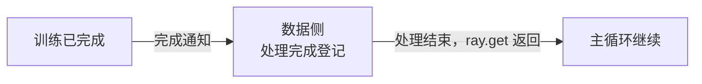
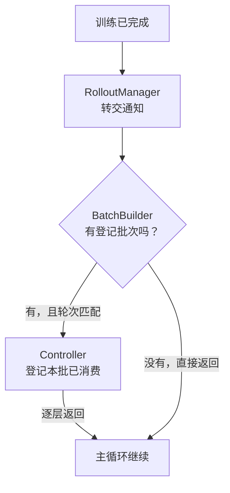
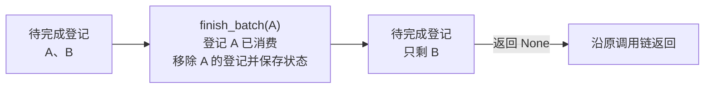

# RolloutManager.training_completed · 阅读版对照稿

**表达方式对照**：本页保留第一版递进图示；[第二版用紧凑伪代码与同行注释表达相同三层](training-completed-mental-model-v2.md#layer-purpose)。

**当前采用稿**：[正式函数卡已合并第二版](../02-short-term-memory/functions/slime/ray/rollout.py/RolloutManager.training_completed.md#mental-model)。本页继续作为第一版历史对照。

> **调用链面包屑**：[Step 017](../01-scope.md) → [train 的完成通知](../02-short-term-memory/functions/train.py/train.md#training-completion) → [3.1 RolloutManager](#layer-manager) → [3.2 BatchBuilder](#layer-builder) → [3.3 RolloutQueueController](#layer-controller) → [3.4 逐层返回](#return-to-caller)。

这是按本轮反馈修订的同一份对照稿。先按 **3.1 → 3.2 → 3.3** 跟随调用下潜，再按 **3.4** 返回；**3.3.1–3.3.3** 是 controller 同一个方法内部的处理阶段，不代表继续进入新的辅助函数。

## 1. 定位：这次从哪里进入

- **前一步**：主循环已经等待本轮训练调用完成，现在进入 `train.py:71` 的数据侧完成通知。
- **本次问题**：这个通知经过哪些对象，最后改变哪份登记？
- **阅读边界**：只追到 `finish_batch` 的正常状态变化；锁、租约、进度算法和存储回收内部留作按需回查。
- **源码版本**：固定证据为 `18868a79`；当前本机 checkout `540ea919` 的相关方法与之相同。[原正式卡片](../02-short-term-memory/functions/slime/ray/rollout.py/RolloutManager.training_completed.md)继续保留。
- **认识记录**：首次接触为 Step 017、2026-10-29；本次编号与面包屑调整不改变个人理解状态。完整评审见[审阅记录](../../../../../../../../backlog/repo-reading/2026-10-20-task-driven-cognitive-architecture/step-017-training-completion-memory-review.md)。

## 2. LLM 整理：使用场合、具体内容与心智模型

### 2.1 使用场合：训练已结束，通知数据侧收尾

主循环已经等本轮训练结束，接着告诉数据管理侧：这一轮交给训练的数据已经使用完，可以做完成登记。

### 2.2 具体内容：入口转交、核对批次、完成记账

RolloutManager 接收并转交本轮编号；BatchBuilder 判断是否登记过队列批次，有记录时核对轮次，再让 controller 完成该批次的消费记账。没有批次记录时直接结束。

### 2.3 建议构建的心智模型

> 本轮训练已结束，这个入口让数据管理侧完成“这批数据已用过”的登记。有批次记录时，核对轮次，再由 controller 更新消费进度、移除该批未完成登记并保存；没有批次记录时直接返回。
>
> 外层 ray.get 等这次处理完成后继续主循环。controller 不决定停止生成；暂停新任务是主循环在 88 行另外调用 pause_rollout_admission 的动作。

<a id="progressive-mental-model"></a>

#### 2.3.1 第一层图：先看为什么需要这次调用

**“训练已完成”是调用前提；这次调用要完成的是数据侧登记。** 先把内部三层对象收成一个框，只看主循环交出了什么、等什么完成。



#### 2.3.2 第二层图：把“数据侧”这个框展开

保留上一层的起点和终点，只打开中间的框：Manager 接收并转交，BatchBuilder 判断本轮有没有登记批次，Controller 执行消费记账。这里画正常返回路径；有批次但轮次不匹配的抛错情况见 3.2。



#### 2.3.3 第三层图：只打开 Controller，观察哪份状态改变

现在选中第二层的“有登记批次”分支，假设本轮是批次 A，转换结果已就绪且训练已完成。A、B 是批次引用的示意名称，不是运行中的 GPU 任务。以下为源码推导。



三张图表达同一件事，从用途、参与对象到具体变化逐层细化。第一层不会把“训练已完成”当作本函数算出来的结果；第三层也不把“移除登记”画成终止其他 rollout。读图之后，需要对应代码时再进入下方 3.1–3.4。

<a id="caller-submit"></a>

### 2.4 调用代码：先等训练，再等通知处理

以下是 `train.py:67、71` 的真实调用节选；中间只省略注释和空行。

```python
ray.get(actor_model.async_train(rollout_id, rollout_data_ref))  # 先等训练结束
ray.get(rollout_manager.training_completed.remote(rollout_id))  # 再等数据侧完成收尾
```

第二行通过 Ray 进入 3.1。外层 `ray.get` 要等整个通知调用返回后，主循环才能继续。

## 3. 本场景的输入与输出：沿调用链下潜

**整段输入**是已经训练完成的 `rollout_id`，相关对象中保存了本轮批次信息；**正常返回值**是 `None`。需要观察的主要结果是消费进度与批次登记的变化。

本节用一个明确的机制对照贯穿：第 7 轮训练完成；BatchBuilder 保存的轮次也是 7，当前 `batch_id` 指向已就绪的批次 A。`ref_A`、`ref_B` 只是批次引用的示意名称，下文状态表来自静态源码推导，未运行真实队列。原有 `batch_id=None` 主例在 3.2 单列，不与这个对照混用。

<a id="layer-manager"></a>

### 3.1 第一层：RolloutManager.training_completed 转交通知

> **本层位置**：[train.py:71](/home/fredkeira/projects/slime/train.py:71) —Ray 调用→ **RolloutManager.training_completed** → [下一层 3.2：BatchBuilder.training_completed](#layer-builder)。

**本层论点：管理器只把轮次编号交给自己的 BatchBuilder。** 它不在这两行里选择批次或修改队列状态。

源码：[rollout.py:430–431](/home/fredkeira/projects/slime/slime/ray/rollout.py:430)。

```python
def training_completed(self, rollout_id):
    self.batch_builder.training_completed(rollout_id)
```

- **进入时**：`rollout_id=7` 表示外层通知“第 7 轮训练已完成”。
- **发生什么**：把同一个编号传给 `self.batch_builder`，这里是普通方法调用。
- **为什么下潜**：本层看不到如何确定当前批次，需要进入 3.2。
- **返回位置**：3.2 返回后，本方法结束并返回 `None`，外层等待的 Ray 调用随之完成。

[进入 3.2：跟随同一个 rollout_id](#layer-builder) · [回看调用方 2.4](#caller-submit)

<a id="layer-builder"></a>

### 3.2 第二层：BatchBuilder.training_completed 确认要收尾的批次

**本页的 3.2 处理完成登记。** [暂停卡的 3.2](../02-short-term-memory/functions/slime/ray/rollout.py/RolloutManager.pause_rollout_admission.md#pause-worker)处理后台是否继续接新任务；两个编号是各自文件内部的局部导航，不属于同一条调用链。

> **本层位置**：[3.1 RolloutManager](#layer-manager) → **BatchBuilder.training_completed** —Ray 调用→ [下一层 3.3：RolloutQueueController.finish_batch](#layer-controller)。

**本层论点：先判断有没有批次，再检查通知是否对应当前轮次，最后交出 batch_id。**

源码：[batch_builder.py:144–148](/home/fredkeira/projects/slime/slime/data/batch_builder.py:144)。

```python
def training_completed(self, rollout_id):
    if self.batch_id is not None:
        if rollout_id != self.rollout_id:
            raise ValueError("Training completion does not match the current batch")
        ray.get(self.controller.finish_batch.remote(self.batch_id))
```

| 判断位置 | 对照场景中的值 | 结果与下一位置 |
| --- | --- | --- |
| 有没有批次 | `self.batch_id` 指向 A | 有批次，继续核对轮次 |
| 是不是同一轮 | 传入的 7 等于 `self.rollout_id` 中的 7 | 允许收尾 A |
| 传给 controller 什么 | `self.batch_id`，即 A 的编号 | 进入 3.3，并在本层 `ray.get` 等它完成 |

**这里换了一种编号**：`rollout_id` 用于核对训练轮次；真正交给 `finish_batch` 的是 `batch_id`，用于定位具体批次。

另外两条路径在本层收住：

- **原有主例 `batch_id=None`**：直接返回 `None`，不进入 3.3。
- **有批次但轮次不一致**：抛出 `ValueError`，不执行完成登记；错误沿调用链向上传播。

[进入 3.3：跟随 batch_id](#layer-controller) · [本层结束后返回 3.1](#layer-manager)

<a id="layer-controller"></a>

### 3.3 第三层：RolloutQueueController.finish_batch 改变消费记录

> **本层位置**：[3.1 RolloutManager](#layer-manager) → [3.2 BatchBuilder](#layer-builder) → **RolloutQueueController.finish_batch**。本次到这一层为止。

**本层论点：接到 A 的编号后，确认并保存“该批次已被训练消费”的状态。** 下面先保留方法的连续源码，再用 3.3.1–3.3.3 对应内部阶段；这些小节不是新函数调用层。

源码：[queue_data_source.py:814–827](/home/fredkeira/projects/slime/slime/data/queue_data_source.py:814)，只增加阶段标记，语句和顺序保留。

```python
def finish_batch(self, batch_id):
    """Advance one accepted conversion, retaining only unfinished batches."""
    with self._training_lock:
        batch = self.batch(batch_id)  # 3.3.1：查找并验证批次
        if not batch or not batch["ready"]:
            raise ValueError("Cannot finish an unknown or unready training batch")
        task = self.queue.task_status(batch_id)  # 3.3.2：定位结果与训练数据状态
        receipt = self.result(Lease(**task["lease"]))
        state = self._training_state()
        self._advance(state, [receipt.position])  # 3.3.3：更新并保存
        state["batches"] = [ref for ref in state["batches"] if asdict(ref.manifest) != batch["ready_ref"]]
        self._save_training_state(state)
        if getattr(self.args, "rollout_queue_online_gc", False):
            self._collect_storage()
```

<a id="controller-check"></a>

#### 3.3.1 查找并验证：确定批次存在且结果已就绪

**论点：只为有效批次做完成登记。** `self.batch(batch_id)` 查找 A；不存在或 `ready=False` 时抛错，后面的状态更新不执行。`ready` 表示批次的转换结果已就绪，训练已经完成则是上层调用前保证的条件。

这里的 `queue.task_status(...)["state"] == "completed"` 指批次准备/转换任务完成，并不代表模型训练完成。先有可训练的数据，再由 train.py:67 等模型训练结束，最后 71 行通知本方法登记已消费；三个时点不能合并。

锁只作为这段状态操作的保护范围识别，本次不展开锁的实现。

[接着看 3.3.2：需要哪份结果与状态](#controller-state)

<a id="controller-state"></a>

#### 3.3.2 定位材料：结果回执与训练数据状态

**论点：知道改哪份记录，才能理解后面的“完成”。** 这里只保留三个对象的用途，不继续下钻它们的读取实现。

| 对象 | 本次用它做什么 |
| --- | --- |
| `task` | 找到 A 对应的队列任务信息，取得其 lease |
| `receipt` | 取得已有结果的登记信息；下句只需要 `receipt.position` 定位消费位置 |
| `state` | 训练数据消费者的进度与未完成批次登记；`state["batches"]` 保存还需完成登记的批次引用 |

`state` 不是正在执行的 GPU 任务列表，也不是全部未完成 rollout 的集合。进入下一段时，示意状态为 `state["batches"] = [ref_A, ref_B]`，且 A 的 `ready_ref` 与 `ref_A.manifest` 对应。

[接着看 3.3.3：这些材料怎样改变状态](#controller-mutation)

<a id="controller-mutation"></a>

#### 3.3.3 更新并保存：登记 A 已消费，保留其他登记

**论点：收尾的直接证据是状态前后变化。** 对应上面源码的三句 `_advance`、过滤 `state["batches"]`、`_save_training_state`。

| 语句与观察对象 | 调用前 | 成功执行后 |
| --- | --- | --- |
| `_advance(state, [receipt.position])` | 尚未在此次收尾中确认 A 的结果位置 | 将该位置纳入已处理状态，并按连续已处理位置更新进度 |
| 过滤 `state["batches"]` | `[ref_A, ref_B]` | `[ref_B]`，与 A 匹配的引用被移除 |
| `_save_training_state(state)` | 保存的是旧状态 | 保存更新后的进度与批次登记 |
| 另一个仍在生成的任务 C | 受生成调度管理 | 本方法没有向 C 提交停止或取消命令 |

消费游标是否向前推进取决于前面是否还有空缺，不能把 `_advance` 简化成“必定加一”。这里的“释放对应队列额度”是消费完成后的管理效果；直接能看到的是确认消费位置、移除当前登记、保存状态，不等于释放 GPU 或立刻删除所有文件。

最后的 online GC 是条件式存储回收入口，按其启用条件执行；本次不展开回收实现。正常完成后，`finish_batch` 返回 `None`。

[进入 3.4：沿原调用链返回](#return-to-caller) · [回看本层完整源码](#layer-controller)

<a id="return-to-caller"></a>

### 3.4 逐层返回：最终解除 train.py 对这次通知的等待

> **返回路径**：[3.3 Controller](#layer-controller) → [3.2 BatchBuilder](#layer-builder) → [3.1 RolloutManager](#layer-manager) → **train.py:71**。

| 返回哪一层 | 这一层接下来发生什么 |
| --- | --- |
| Controller → BatchBuilder | 3.2 的 `ray.get` 取得正常结果 `None`，BatchBuilder 方法结束 |
| BatchBuilder → RolloutManager | 3.1 的普通方法调用结束，RolloutManager 方法返回 `None` |
| RolloutManager → train.py | 2.4 的外层 `ray.get` 完成，主循环继续后续流程 |

如果在 3.2 发现 `batch_id=None`，返回路径直接从 BatchBuilder 开始，不经过 Controller。若检查或下游调用抛错，则不会走完表中的正常返回链。

**本次收束**：第 7 轮的通知已经处理完；有登记时完成 A 的消费记账，无登记时正常结束。下一次回看只需从面包屑找到所在层；更深的锁、租约、存储格式、进度算法和 GC 内部仍按具体问题决定是否进入。

## 4. 我的直接表述（原话）

以下保留现有卡片的全部个人表述与当时的助手校准。折叠只调整默认展示，不改写原话或将助手结论归为用户理解。

<details>
<summary>展开已有原话与当时反馈</summary>

用户承接上一函数并要求继续：

> 好的 我现在大概理解这里的async train了 让我们继续吧

这是对上一函数的总体理解反馈与继续指令，尚无对当前 training_completed 的直接表述。

用户随后对完成通知中的编号提出理解：

> 好的
> 那么我们看一下下一个部分吧
> 之前看的是ray actor model async train对吧
> 那么后续的内容是什么呢？
> 后续是这里的rollout manager training completed remote id
> 也就是这里的rollout部分的代码
> 这里是给一个rollout id
> 这里具体的代码是在做什么呢？
>
> 根据这里的rollout id来判断这里是否和本地的是一个？
> 我没有特别理解这里的内容了

用户已观察到编号比较。助手补充比较对象的来源、batch_id 对检查的前置条件，以及 rollout_id 校验与 batch_id 定位收尾记录的不同用途；这些精确关系尚待反馈。

用户要求收敛为简单心智模型：

> 也就是在判断当前是在哪一个轮次？
> 那么之后呢？
> 我没有特别理解 我目前只是希望简单的构建一下这里的心智模型

助手据此用“训练已用完这批数据 → 通知数据管理侧收尾”概括职责，并说明轮次检查只是防止确认错批次；默认无批次记录时直接返回。该简化模型尚待反馈，不再展开 controller 内部。

用户继续要求明确当前应保留的模型：

> 所以这里根据我们目前看到的内容 应该保留怎样的心智模型呢？
> 我不是特别理解
> 因为你说的当前的代码好像还没有实现？
> 我们需要继续读这里的的controller 的finish batch吗？

本轮校准的是“代码已实现，但当前默认分支不触发”。助手只核对 finish_batch 的短入口职责，不将整套队列实现加入精读范围；该模型效果待后续反馈。

用户最终选择保留职责层理解，停止下钻：

> 要不还是简单读一下？
> 这里就是访问了training lock 我简单猜测一下是在这个lock里面拿到当前batch的id
> 同时考虑是否ready了
> 如果ready了
> 就拿到这个具体的tsk
> 并且得到这里的result的receipt？
> state什么呢
>
> 算了还是不继续精读了吧
> 我需要了解的是 他就是知道这批数据完成了然后修改这里的运行状态？ 知道他负责的这一批数据完成了？

本轮只核对其职责表述：训练方已等本轮训练结束，再通知 finish_batch 更新相应批次的管理记录，使它不再列在未完成批次中。它不是在内部探测 GPU 的训练进度。lock、receipt、state 的前述猜测不写为已掌握知识，遵守用户停止精读的决定。

用户要求结论的源码依据，并暂按这一职责继续主线：

> 具体效果是：把这批从“未完成批次”列表中移除，并保存更新后的状态。 这是从哪里知道的呢？
> （好的 我现在先假设这里的更新状态完成了
> 那么然后我们应该如何考虑下一步呢？

助手补出 824–825 行的直接依据，并推荐下一处权重交接。用户表达的是暂按职责继续，不是完整掌握 controller 内部。

2026-10-30 用户回顾（节选）：

> 之后这里的rollout manager training completed remote的部分获得的内容是这里的rollout id
> 应该标志的内容是释放这里的目前还在跑的queue
> 是我的理解

传入轮次编号的方向已被用户识别；“释放目前还在跑的 queue”仍需按上面的批次容量与运行任务区别校准，不记为已理解。见[本轮完整回顾](../04-flow.md#training-review-and-resume-20261030)。

2026-10-30 用户复述与边界疑问（完整原文）：

> 这里看到写的是batch builder 的 training completed
> 然后这里又回调到batchbuilder的ray get controller finish batch?
> 如果有这个batch 并且这个rollout id是这个rollout id的话
> 那么这里就让controller 停掉这里的batch是我对于这里的理解
>
> 但为什么这俩的我在点击rolloutmanager 的training completion
> 我不升入看这内容
> 但是我大概理解是
> 如果完成了训练
> 那么目前登记的训练内容就应该释放了对吗?
> 也就是不应该再考虑继续还没有完成的rollout侧的任务?
> 是我的理解

用户已观察到两层转交与条件检查；已训练批次需要收尾的方向正确。停止正在运行的 batch、停止考虑其他未完成 rollout 并非此方法的职责。本轮仅补明这项边界，具体控制器实现继续留白；解释效果待反馈。见[本轮记录](../04-flow.md#finished-batch-versus-pending-rollout-20261030)。

</details>


### 4.1 本轮关于消费登记与返回链的补充

> 好的 我大概理解了 也就是这里的的batch 是在通过一个queue task status的部分来确定
> 这里的task 已经完成了
> 确认数据已经被消费了
> 所以就可以吧使用的数据做一个标记 确定一下这一部分的内容已经被消费了
> 我可以这么理解吗?
> 这里并没涉及别的内容
> 那么返还到上面一层 training completed 也是为了 让这里登记一下这一部分数据使用过了
> 以及回到最上方
> 这里告诉这里的batch builder 这里的训练内容训练结束了
> 那么也就是train的71步这里结束了对吗?

用户已接上消费登记和逐层返回到第 71 行的方向；queue task 的 completed 与训练完成的区别由助手补充，尚待反馈。见[本轮记录](../../step-017-generation-training-loop/04-flow.md#batch-ready-training-finished-consumed-20261030)。

## 5. 尚不清楚

本轮新增的状态对照尚待用户反馈。前序未知完整保留在下面；此前停止下钻的决定属于历史，本轮只按用户当前请求轻量查看 finish_batch 的状态变化，不扩展其辅助机制。

- 当前“训练完成”与“完成通知”的职责区分，尚待用户反馈。
- 本轮已解释释放已训练批次的容量与停止在途生成任务的区别，尚待用户反馈。
- 用户复述的当前批次收尾与其他未完成 rollout 的关系，本轮以 A/B 场景区分，尚待反馈；不要求继续精读 controller。
- 参数 rollout_id、BatchBuilder.self.rollout_id 与 batch_id 的区别已说明，用户的精确理解待反馈。
- 用户明确停止精读 finish_batch 的 lock、receipt 和 state；这些辅助机制保留未知，不影响当前职责层模型。
- 没有运行真实 Ray 通知或训练；当前默认分支的效果来自固定源码判断。

## 6. 来源、验证与完整例子

<details>
<summary>展开固定版本与历史来源</summary>

- 新增核对：固定版本的 [finish_batch:814](https://github.com/THUDM/slime/blob/18868a79b0b083a093798a94ed0f8cb4f71b9c14/slime/data/queue_data_source.py#L814)、`_training_state:713`、`_advance:730`、`_save_training_state:751`。后面三个只核对 state 的含义、进度与保存职责，没有扩展为逐行阅读。
- A/B/C 表是状态关系的教学构造，未运行真实 Ray、训练、队列或存储回收；消费进度不保证每次都能连续前移。
- 此稿重排前的正式卡片仍保留，个人最近认识时间与历史版本不因整理改变。

- [本轮完成通知带读](../04-flow.md#training-completed-reading)。
- [轮次编号的来源与比较](../04-flow.md#completion-id-matching)：第 7 轮例子是固定源码的静态推导，没有新增运行。
- [默认未触发与已有实现的区别](../04-flow.md#implemented-but-not-triggered)：只读核对 controller 入口，未运行该分支。
- 固定源码：train.py:67–71；rollout.py:430–431、545–558；batch_builder.py:32–38、48–57、144–148。具体哈希与范围见 [源码证据](source-evidence.json)。
- 当前分支 batch_id=None 来自初始化和 begin 的正常调用；仅静态核对，没有用构造运行结果替代真实训练，也未执行 controller.finish_batch。

</details>
