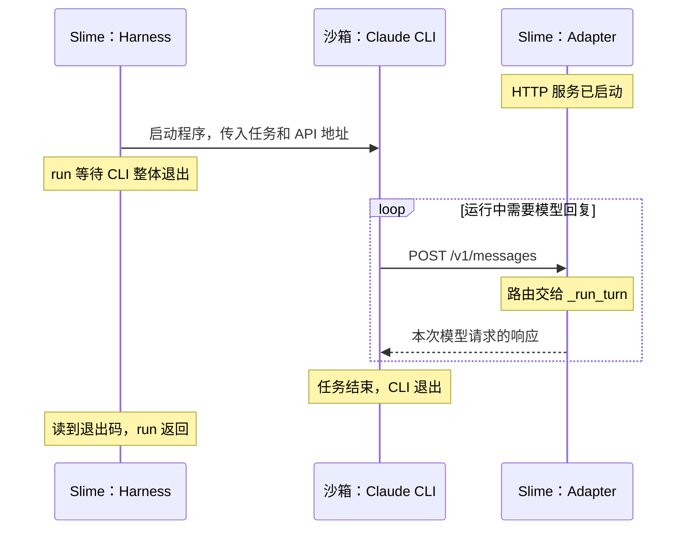

# 讨论记录：任务驱动的认知架构

日期：2026-10-20。

[返回讨论入口](README.md)。本页保存实际表述、助手建议与研究依据；已确认事项和待讨论方案的区别见入口页。

最新分工见[Step 0 只看骨架，Step 1 逐段读 `_run_turn`](#step-zero-skeleton-step-one-run-turn)。此前[目录纠正](#keep-coding-agent-archive-initial-model)明确保留两个步骤；归并候选与误操作不作为当前安排。

## 2026-10-20：重新梳理步骤与责任边界（讨论中）

用户希望一起逐项恢复和确认步骤约定，并明确表示：

> 我觉得目前这里的common部分的格式是我觉得比较合适的
>
> 对于long term的memory的机制我觉得也是没有问题的
>
> 我觉得我们需要一起梳理一下才行？
> 并且聊清楚负责范围？

本轮已经明确的两点：

- 单个函数记录以本轮确认的 [BaseAdapter._translate 样例](../../../.agents/skills/repo-reading-memory/references/base-adapter-translate.md)为讨论基准。它已单独保存为 reference，旧模板尚未按此重写；旧样例和新样例的版式不完全一致。
- 长期记忆继续沿用既有继承机制：下一步的 `03` 合并前一步的 `03` 与 `02`，保留内容、未知及来源。此次认可不表示新增了源码理解或掌握状态。

本轮待逐项讨论的是：一个阅读步骤怎样划界、步骤内各文件分别保留什么，以及用户和助手各自负责什么。首个讨论问题是“一个具体问题为一步，还是一个函数为一步”；助手建议按问题组织，但本段写入时用户尚未选择。不将这一建议记为新约定，不先改写 skill、模板或历史步骤。

### 当前先讨论：函数短期记忆中的“形成过程”

用户将问题聚焦到已确认的 `base-adapter-translate.md`：

> 我其实比较想要知道的事情是这里的形成过程在这个short term memory里面起到什么作用？

助手提出的职责解释：函数文件里的这一节是本条认识的追溯入口，链接到 `04-flow.md` 中实际发生的问题、源码材料、提示、用户表述和澄清。它帮助区分“助手提供的解释”和“用户实际确认的关系”，完整过程仍放在 flow，不在每份函数记忆中重复。源码引用用于核对技术事实，形成过程用于回查认识怎样得来；进入长期记忆时保留原始形成来源。

以上是当前待用户核对的解释，还没有确认改名、删除这一节或调整其格式。步骤边界的问题暂留，先澄清这项职责。

### 继续澄清：与心智模型的重复和引用数量

用户指出：

> 但是你不觉得这里的形成部分的内容和最后的心智模型部分有重叠吗？
> 以及这里的心智模型我实在不清楚为什么需要保留这么多的文件引用？
> 这一块的职责不是特别清楚？

核对当前样例后，助手确认存在重复：“只转换、不执行工具”同时出现在模型和形成过程说明中，原话区与形成过程区也重复链接问题四。此前对追溯用途的解释没有消除当前版式中的重复。

助手提出待讨论的分工：函数记忆保存可供恢复理解的模型、代表性输入输出、用户原话与未知；步骤 flow 保存实际提问、材料、澄清及后续回答；函数文件的来源区集中提供必要源码定位和一个原讨论入口。按这一提案，函数文件不再单列“形成过程”，也不在原话与来源之间反复放同一链接。此处只记录提案，尚未修改样例、skill 或模板，等待用户继续讨论。

### 从任务与认知负荷重新讨论架构

用户进一步明确设计初衷：

> 1. 为了降低认知负载
> 2. 让不同的代码在阅读的时候能够复用需要的代码而不必从头看开始看

用户对现有机制的理解是：

> 短期记忆只是负责给出到底哪些模块需要被调用
> 长期记忆则把短期的记忆保存起来
> 这样子日后如果需要用的时候提取

同时提出，设计应围绕具体任务：例如为了读懂 Coding Agent，在当前步骤了解需要的模块，并逐步理解模块如何组成整体。用户要求从脑科学、认知科学或教育学角度检验架构，考虑人的注意力有限。

以下是助手查阅研究后提出的解释与设计建议，尚未作为新的已确认规范执行：

- **以简化的完整任务组织阅读。** 复杂技能教学中的整体任务方法强调从较简单但有完整目的的任务开始，再逐渐增加复杂度；可据此保留任务主线，每次只展开其中必要的交接。[van Merriënboer、Kirschner 与 Kester，2003](https://doi.org/10.1207/S15326985EP3801_2)。这是教学框架对源码阅读的应用建议，不是该论文验证过本仓库的目录设计。
- **让当前需要共同理解的信息能一起阅读。** 认知负荷与分散注意研究发现，学习者被迫拼接相互依赖的材料会产生额外负担；无需整合的材料则没有同样的整合收益。对应建议是把函数的关键模型、代表输入输出放在同一份可独立理解的记录中，把展开过程与额外证据留作按需回查。[Chandler 与 Sweller，1991](https://ro.uow.edu.au/articles/journal_contribution/Cognitive_Load_Theory_and_the_Format_of_Instruction/27778410)。
- **保留轻量的主动解释。** 提示学习者解释材料之间的关系可以帮助建立理解；对当前阅读可采用一个交接问题或输入变化预测，按实际回答记录，不要求复述整篇说明。[Chi 等，1994](https://onlinelibrary.wiley.com/doi/10.1207/s15516709cog1803_3)。
- **区分外部保存与人的记忆。** 文本材料实验中，提取练习对延迟保持有益；文件已经归档并不等于读者已能回想或应用。对应建议是在需要复用时先尝试简短回想，缺失处再查记录，不设置额外考试或固定打卡要求。[Roediger 与 Karpicke，2006](https://www.psychologicalscience.org/journals/psychological-science/j.1467-9280.2006.01693.x/)。

助手建议把职责分为：

| 位置 | 拟议职责 |
| --- | --- |
| 项目任务主线与进度入口 | 保存具体任务的起点、终点、主要交接和当前阅读位置；帮助定位本步为何值得读 |
| 本步 `01-scope.md` | 保存本步问题、可以沿用的前置认识、需要打开的源码及停止边界 |
| 本步 `02` | 保存为解决当前问题新建立或修正的关系，以及实际展开的函数记录；模块清单只作为索引 |
| 本步 `03` | 按已认可机制保留前序累计模型、使用条件、未知与来源，按当前任务检索需要的部分 |
| `04-flow.md` 与额外参考 | 保存值得回溯的疑问、修正及证据，作为辅助材料；不要求每次续读全部加载 |

这里对“短期记忆只列需要调用的模块”作出的修正建议是：短期记忆还需要保存本步理解了怎样的交接、为何需要相关模块，以及哪些关系仍未展开。每步既建立局部函数模型，也把它接回当前任务；后续复用需要知道接口、适用场景及来源版本。

当前 common 样例继续作为已认可的函数格式，不因为研究建议继续追加栏目。阅读时先按其用途和输入输出使用已有认识；当本次任务需要内部机制、遇到不符合预期的输入，或已有记忆不足时，再深入实现。函数返回值之外的副作用、状态或生命周期关系在与当前问题有关时同样需要交代。

分工建议：助手负责选择和定位真实场景、核对源码、检索既有认识、控制展开范围并整理记录；用户提供实际理解、疑问和反馈，不承担记忆文件的重复填写。下一轮优先讨论具体任务的起点、终点与正常路径，再检验本步范围是否合适。上述分工与调整仍待共同讨论，未据此改写 skill、模板、样例或阅读进度。

## 本轮完整问答：从认知科学重新检查设计

### 用户的提问

> 我觉得我们需要考虑清楚每一个部分到底负责什么这件事情
> 首先我们设置的初衷
> 1. 为了降低认知负载
> 2. 让不同的代码在阅读的时候能够复用需要的代码而不必从头看开始看
>
> 那么当前心智模型部分已经做到了把这个基本的设计给补上了？
>
> 也就是说这里的输入和输出补上了
> 短期记忆只是负责给出到底哪些模块需要被调用
> 长期记忆则把短期的记忆保存起来
> 这样子日后如果需要用的时候提取
>
> 这是我对于这部分的理解
> 那么现在有了这些基础模块的情况下
>
> 这里还缺少了什么呢？
> 因为人的注意力是有限的
>
> 因为这个设计还是需要基于一个某一个具体的任务的
> 例如我目前需要读懂coding agent
> 那么是基于这个任务去在当前的步骤去了解对应的模组对吧
>
> 然后在过程中顺便了解了 每一个模组是如何组成的这件事
>
> 请从脑科学或者认知科学 或者教育学的角度考虑 我到底应该如何设计这个架构

### 助手给出的架构建议

我建议把这套架构定为：**围绕一个具体任务建立主线，在主线中按需理解模块，再把可复用的认识保存下来。**

你认可的 `common` 格式已经比较好地承担了“解释一个局部模块”的职责。但还需要补清楚：**为什么现在用它、它和其他模块怎样交接、这一步读到哪里就够了。**

有一点需要调整：**短期记忆不能只是“需要调用哪些模块”的清单，还要保存这一步新理解的关系。** 否则积累下来的会是一批函数说明，却仍需要自己重新把它们连接起来。

从认知科学和教学研究看，有三个原则适合指导这套设计。下面是将研究应用到源码阅读的建议，并非研究直接验证过这些文件夹。

1. **先有完整任务的轮廓，再逐步展开局部。**
   复杂技能教学中的整体任务方法，主张从较简单但完整的任务开始，逐渐增加复杂度。对你而言，就是先知道一次 Coding Agent 任务怎样从输入走到结果，再进入其中一个环节，而不是先读完全部模块才拼整体。[van Merriënboer 等，2003](https://doi.org/10.1207/S15326985EP3801_2)

2. **把必须一起理解的信息放在一起。**
   当学习者必须来回拼接相互依赖的材料时，会增加额外负担。因此，你坚持在同一份记录里看到心智模型、具体输入输出和调用代码，是合理的。完整历史、额外解释、验证材料可以按需打开。[Chandler 与 Sweller，1991](https://ro.uow.edu.au/articles/journal_contribution/Cognitive_Load_Theory_and_the_Format_of_Instruction/27778410)

3. **保存之外，还需要少量主动解释和提取。**
   自己解释“为什么这样交接”，有助于把新信息接入已有知识；适量回想也有助于延迟保持。对应到我们的协作，可以只是预测一次输出、解释一处交接，不需要每读一个函数都做完整复述。[Chi 等，1994](https://onlinelibrary.wiley.com/doi/10.1207/s15516709cog1803_3)、[Roediger 与 Karpicke，2006](https://www.psychologicalscience.org/journals/psychological-science/j.1467-9280.2006.01693.x/)

据此，我会这样分配现有各部分的职责：

| 部分 | 核心职责 | 应保留的内容 |
|---|---|---|
| **任务主线** | 让你始终知道正在理解什么任务 | 任务起点、终点、主要环节、当前位置 |
| **本步范围 `01`** | 控制这次需要投入的注意力 | 当前问题、可沿用的认识、需要展开的部分、停止位置 |
| **短期记忆 `02`** | 保存本步新增或修正的认识 | 新理解的模块关系，以及相关函数的记录 |
| **长期记忆 `03`** | 为以后阅读提供可提取的已有认识 | 累计模型、模块记录、适用场景、未知与来源 |
| **过程与参考** | 支持必要的追溯和深入核对 | 关键误解怎样修正、详细源码证据、扩展解释 |

**你现在最需要补的是前两项，以及短期记忆中的“关系”。** 长期记忆的继承机制可以继续保留。

例如，将来沿 Coding Agent 主线读到模型请求时，可以这样安排：

```text
整体任务：一份代码任务怎样被执行，并交回结果。

本步问题：请求中的对话与工具信息，怎样交给模型输入准备环节？

可以复用的认识：
_translate 整理出 translated 和 tools_schema。

本步需要建立的关系：
调用者接住这两份结果，再一起交给模板渲染。

本步停止位置：
先说清这次交接；模板内部怎样生成 token，留给后续问题。
```

这里的增量，是把已经理解的 `_translate` **接进任务主线**。它可能只涉及两行调用，却能让整体模型向前走一步。

对于模块内部，我建议采用这样的展开方式：

- **第一次遇到**：理解它的用途、输入、输出或副作用，以及由谁使用。
- **再次遇到**：先简短唤起已有模型，能接上当前任务就继续。
- **当前问题需要内部机制，或已有模型解释不了新情况时**：再打开实现，增加认识。

这样，“顺便了解模块怎样组成”就有明确边界：**展开到足以解释当前交接为止。** 某个模块内部的每个辅助函数，不必同时进入你的注意范围。

函数记录还需要支持一个实际用途：**以后遇到什么情况，我应该想到它？** 你现有的“使用场合”已经可以承担这一点；再配合输入输出、调用代码、源码版本，就能帮助判断旧认识是否适用于当前场景，不必另加一套复杂栏目。

至于“形成过程”，它在这套架构里属于辅助材料。值得保存的是关键理解变化，例如“原先把工具定义和具体调用混在一起，后来怎样区分”；日常恢复理解时，优先看任务主线、当前问题和函数模型即可。

最后，分工也应该减轻你的负担：**我负责选择真实场景、定位源码、提取已有记忆、控制展开范围和整理记录；你负责表达当前怎样理解、哪里接不上。** 文件怎么放、来源怎么维护，不应成为你额外的学习任务。

下一步我建议先一起确定：**“读懂一次 Coding Agent 任务”具体从哪里开始、到哪里结束。** 有了这条主线，才能判断每一步需要哪些模块，以及哪些细节可以暂时留白。

## 如何继续读源码的初步建议

后续用户指出，这一建议把方法讨论带回了旧固定路线；本轮当前范围以下一节澄清为准。本节保留当时建议，不作为新的阅读进度。

用户提出：

> 那么在这个基础上请和我讨论一下
> 如果按照这个样子的话 应该如何继续读这里的源代码

本轮读取本文件及入口页，并核对 Slime 的唯一阅读路线、Step 000 与固定版本 `2f2318653f6f794dddd321eff7c9d4b7b174643f` 的源码。现有路线的下一入口仍为 `train.py::main()`；用户此前已走过单任务 `generate()` 的完整任务链，相关历史继续保留，不因重新梳理方法而清零，也不据此假定所有内容仍能随时回忆。

助手建议先用“一份代码任务怎样被框架送入 Coding Agent 执行，再把结果交回外层”确定任务主线。当前优先补启动与调用关系：谁发起工作、准备结果交给谁、什么时候进入生成流程。已有单任务讲解与 `_translate` 函数记录在主线遇到对应模块时按需复用。

建议的第一个小问题是：`main` 怎样把启动准备的结果交给实际运行阶段？本步以 `main(args, restore_plan)` 为入口，暂时接受配置已解析；观察 `create_rollout_manager(...)` 返回 `startup`，以及 `main` 怎样把其中的配置、资源布局和 manager 交给 `train(...)`。`train` 中第 51 行的 `rollout_manager.generate.remote(...)` 用于定位下一次交接。

该步的预期新增认识是“准备阶段返回运行所需对象，调用者再将它们交给运行阶段”，而不是单纯记住三个函数名。资源分配内部、训练算法及完整失败清理属于后续按问题展开的内容。当前只有建议和静态定位，尚未创建新学习步骤，也未把建议写成用户已理解的模型或修改阅读进度。

源码入口：[main，第 103 行](https://github.com/THUDM/slime/blob/2f2318653f6f794dddd321eff7c9d4b7b174643f/train.py#L103)、[train 内的生成请求，第 51 行](https://github.com/THUDM/slime/blob/2f2318653f6f794dddd321eff7c9d4b7b174643f/train.py#L51)、[create_rollout_manager，第 293 行](https://github.com/THUDM/slime/blob/2f2318653f6f794dddd321eff7c9d4b7b174643f/slime/ray/placement_group.py#L293)。

## 澄清：从零设计步骤及模块组合

用户澄清：

> 虽然这里的讲过这里的generate tokens
> 但是那是在之前的固定的路线上
> 所以目前讨论的内容是如何在当前这里的从0构建起来一个每一步具体应该怎么做的方式
> 我的意思是当前有这里的short term memory
> 那么这一个step 应该还有当前的主线这里的每一步
> 比如这里的_render_token_id
> 还有下面的call_sglang_generate
>
> 自然这里可以单独把这里的函数的内容放在 short term memory
> 我想要问的问题是到底如何在一个长期的部分把这些拼凑起来
> 每一个step到底怎么构建这里的模块
>
> 也就是除了01的short term和 02的long term
> 别的章节根据之前说的认知模型 我们应该还有什么模块？

本轮据此聚焦步骤自身的设计，保留此前已读历史，但不使用旧固定路线来决定方法示范的下一入口。源码中的准确符号是 `_render_token_ids`；以下围绕 `BaseAdapter._run_turn` 中的连续调用说明，省略请求初始化与后续响应处理：

```python
translated, tools_schema = self._translate(body)
prompt_ids = _render_token_ids(translated, tok, tools=tools_schema, add_generation_prompt=True)
turn = await call_sglang_generate(prompt_ids, s, body, adapter=self, session_id=sid)
```

静态核对来源：[固定版本 common.py 第 341 行起](https://github.com/THUDM/slime/blob/2f2318653f6f794dddd321eff7c9d4b7b174643f/slime/agent/adapters/common.py#L341)。三个调用展示的是实际程序主线，tokenizer、session、请求参数等也是交接条件。这里只核对源码，未运行模型生成。

### 助手提出的组合方式（待讨论）

除两层记忆外，增加一个便于直接阅读的“本步任务与主线”入口，集中说明当前问题、起点、终点、整体中的位置和实际调用与数据交接。范围与主线可以放在同一页，减少必须同时打开的文件；编号及是否合并既有 scope 暂不修改。

| 内容 | 职责 |
| --- | --- |
| 本步任务与主线 | 说明本步为何进入这些调用、当前展开哪里、哪些仅定位、结果交到哪里以及下一问 |
| 短期记忆的函数记录 | 按已认可的 common 格式，保存本步新增或修正的函数认识 |
| 短期记忆的 overview | 保存本步新增或修正的组合关系，并链接有关函数；函数目录清单不能代替这些关系 |
| 长期记忆的函数记录 | 保留此前累计的可复用函数认识、未知和来源 |
| 长期记忆的 overview | 保留进入本步前的整体任务模型、函数之间的交接关系及索引，便于按当前任务提取 |
| 可选 references | 保存需要回查的重要澄清和额外证据；与实际程序主线分开 |

组合关系的例子包括：`body` 交给 `_translate`；`translated` 与 `tools_schema` 连同 tokenizer 交给 `_render_token_ids`；得到的 `prompt_ids` 连同 session、请求参数等交给 `call_sglang_generate`。这部分要写清“谁的哪份输出被谁当作什么使用”，而非只列三个函数名。

假设按三个步骤展开这段主线，第一步新增转换接口及其输入输出，第二步新增模板渲染及两份转换结果怎样交过去，第三步新增生成请求及 prompt IDs 怎样交过去。该拆法仅为示范，不要求一个函数必须对应一个步骤；一步也可以只增加一条连接，或涉及多个短函数。

继承仍按已认可机制进行：本步 `03` 保留进入时的累计模型，新函数与新连接写入本步 `02`；进入下一步时，将两者合并成新的 `03`。合并不仅继承函数文件，也将 overview 中的连接补进累计整体模型；本步不持续改写自己的前序长期快照。

任务主线可以由助手据源码先提供定位图并标明未展开部分，这属于源码说明；用户已理解的关系仍按实际反馈记录，不能把整张主线图自动当成用户已掌握。当前只记录上述方案，未改动模板、skill 或新建实际学习步骤。

## 待执行的 Step 01 回填与 backlog 归档

用户要求先把已确认的 reference 复制到当前 Step 01，并明确要求覆盖前说明具体方案。此前方案的范围是：用 reference 的完整内容覆盖 common 函数记录，按目标位置重算相对链接，并修正 overview 的一处旧锚点。该覆盖方案仍待用户确认，本轮归档不执行覆盖。

随后用户提出：

> 之前我们一直讨论的问题是需要一个制度对吧能否在backlog中把我们的讨论全部放上去呢？ 吧目前的discussion 相关的部分都放进去吧

据此，原 `00-repo-reading/discussions/` 下的全部 14 份材料迁入 `backlog/repo-reading/`，并建立[制度待办与讨论索引](../README.md)。迁移保留讨论、试用步骤和样例的正文与原始来源，只调整必要链接；AGENTS.md 和原方法入口已指向 backlog。当前仍需共同确定制度，不把归档本身视为采纳全部提案。

## 再次明确讨论主线：形成过程与分层职责

用户进一步明确本轮讨论的起点与范围：

> 那么我们在推进的一个比较体系化的系统
> 确定的是需要一个关于function的short term memroy
> 但是我们在讨论的是这里的形成过程是否应该保留
> 我们认为中间的过程和当前的short term memroy很像 重复性很高
> 然后我们就查了按照认知心理学 和脑科学 和教育学 和资深工程师的视角
> 考虑到底如何构建这个分层架构的抽象

### 已确定与待判断的边界

已确定需要函数级短期记忆，已有 common 样例和长期继承机制继续作为设计基础。当前核心问题是：“形成过程”相对短期记忆，是否提供值得单独保存的信息？用户指出的重复，是重新检查各层职责的起点。

形成过程是否独立保留、保留哪些内容，以及任务主线和函数组合放在哪里，都还需要讨论。此前的目录与组合建议不是已确认制度；当前也不推进新的源码阅读步骤。

### 助手提出的分析起点（待讨论）

先区分三个维度，避免直接将它们视为同一层级的并列模块：

| 维度 | 要回答的问题 | 当前材料中的对应内容 |
| --- | --- | --- |
| 内容的抽象层级 | 一个函数做什么？多个函数怎样共同完成任务？ | 函数模型、调用与数据交接、任务整体模型 |
| 认识的积累方式 | 本步新增了什么？此前已经积累了什么？ | 短期记忆、长期记忆及继承 |
| 认识变化的追溯 | 当时提出了什么问题？哪些材料和反馈使认识发生变化？ | 形成过程、原始表述和证据入口 |

这是对现有设计的分析建议，不是新增三个目录的要求。认知心理学、脑科学、教育学和工程实践是后续评估这些职责的视角，不直接决定文件夹数量。此前保存的研究依据主要涉及认知负载、整体任务、自我解释和提取练习；这里的三维区分属于助手的设计判断。

### 以现有形成过程检查独有信息

[common 样例](../../../.agents/skills/repo-reading-memory/references/base-adapter-translate.md)中的“形成过程”目前主要链接到 [Step 01 的过程记录](../step-01-translate-preview/04-flow.md)。需要区分链接本身的导航用途，和链接目标中再次展开的内容。

例如，过程记录中的“这里只转换格式，不执行工具”，作为最终结论已经进入函数模型；重复这句话本身没有增加新的函数认识。过程记录另外保存了当时为什么追问这个边界、助手提供了什么材料，以及用户实际回答了什么。这些信息的用途是追溯认识如何形成，与直接恢复当前函数模型不同。

下一步应判断这种追溯会在什么场合被使用、是否值得独立保存，以及能否只保留必要入口或关键变化。不能仅因存在追溯信息就认定全部过程都要保留，也不能仅因结论重复就认定全部过程都该删除。本轮只明确问题并更新讨论入口，未删除或改写函数样例、形成过程、skill、模板或阅读进度。

## 具体化职责划分：任务、模型与学习记录

用户指出上一轮抽象仍不清楚：

> 嫩否给出比较清楚的抽象和不同的分工职责呢
> 当前还是不清晰的

助手据此将建议单独整理为[职责划分草案](responsibilities-proposal.md)，避免只列抽象维度却不给出实际放置方式。草案将系统分为阅读导航、知识模型和学习记录三类职责；模型中区分函数卡片与组合关系，短期和长期继续采用同类结构，按本步新增与前序累计划分。

对形成过程的具体建议是：保留关键学习事件和证据入口，函数文件链接回来源，完整函数说明不再在过程页重讲。草案用同一个转换例子列出各文件保存什么，并明确助手负责组织、核对与记录，用户提供实际理解和反馈。

本轮保存的是助手建议，尚未视为用户确认；现行 skill、模板、函数样例和历史过程记录没有据此调整。

## 比较讲解稿与短期记忆

用户把讨论缩小到一个具体比较：

> 那么先考虑一个问题吧 是这里的1.3 · 同一请求如何变成两份内部数据 和我们的short term memroy的却别是什么

本轮直接对照[1.3 讲解稿](../step-01-translate-preview/references/translation-explanation.md)与[用户后来认可的 common 短期记忆样例](../../../.agents/skills/repo-reading-memory/references/base-adapter-translate.md)。Step 01 原位置的 common 文件仍是回填前版本，不能以旧版省略了工具定义为理由，断言短期记忆不需要这部分内容。

### 对实际内容的判断

1.3 是助手编写的教学讲解稿：按当前位置、请求输入、转换入口、消息路、工具路和下游交接逐步展开。它不是保存实际问答、反馈和修正的形成过程记录。

新版短期记忆不仅保存用户原话，也包含助手核对的场景、完整的代表性输入输出和 LLM 模型。因此，不能把区别简化成“1.3 是助手解释，短期记忆全是用户已经理解的内容”。

| 内容 | 1.3 讲解稿 | 新版短期记忆样例 |
| --- | --- | --- |
| 两份结果的用途、转换不执行工具 | 展开解释 | 模型中保留，存在重叠 |
| 系统指令、消息、历史工具调用与工具定义 | 展示请求并逐项解释字段对应 | 展示一组成对输入输出，并解释必要字段对应，存在明显重叠 |
| 下游模板渲染 | 用调用处说明结果去向 | 保留同一调用片段和简短职责模型，存在重叠 |
| 转换内部如何分给两个 helper、无关参数如何处理 | 有进一步展开 | 当前没有同等展开 |
| 用户原话、明确未知、首次接触与认识更新时间 | 链接记忆，提醒讲解不等于理解 | 直接保存，作为后续接续依据 |

两份材料目前主要都围绕 `_translate` 这一局部；不是不同抽象层级的必然分工。短期记忆经过补全之后，已覆盖 1.3 中相当多的解释，实际冗余需要承认。

### 建议的边界

- **讲解稿用于建立理解。** 当前概念接不上时，按具体问题展开为什么这样转换、每一步怎样对应、helper 怎样处理；可以包含用户尚未理解的内容。
- **短期记忆用于恢复和复用本步的认识。** 保留够用的场景、输入输出和职责模型，并明确区分用户已表达的理解、助手补充与未知。后续阅读优先用它，不要求重走完整讲解。

区分依据是用途与展开程度，不是“能不能有输入输出”，也不是文件长短。代表性输入输出对记忆恢复有用，应继续保留在用户已认可的短期记忆中。

助手建议以已认可的短期记忆格式为基础，1.3 只在有额外推导、内部机制或针对具体疑问的解释时作为可选参考；单纯重复记忆卡片的部分不必长期维护第二份。具体保留或合并方式尚未决定，本轮没有改动两份材料。

## 把职责方案做成完整步骤示范

用户要求：

> 先按照之前的讨论吧这里的step转换成为你觉得合适的内容吧
> 我需要看清楚这里的step0 在你的分配之下会变成什么样子

本轮按前文一直比较的 `_translate` 转换步骤制作[Step 0 结构示范](../step-00-translate-structure-preview/README.md)。它另存为完整文件夹，原 Step 01、Slime 的实际 `step-000-initial-model` 和已认可 reference 都保留；Step 0 是此示范的编号，个人认识仍注明来自原 Step 01。

实际展示的分工如下：

- 首页展示本步问题、在请求处理中的位置和各文件入口；`01` 进一步限定本步范围与停止位置。
- `02/functions` 保存 common 与 Anthropic 两份函数卡片；common 沿用已认可的模型、代表性输入输出和原话，形成过程入口归拢到来源区。Anthropic 保留原有最小场景与未知，并说明它没有传入工具定义。
- `02/overview.md` 保存用户已表达的关系，另列助手核对的实际交接位置；渲染与生成只定位，不写成用户新增理解。
- `03` 如实标明没有导入前序模型，保留后续合并机制。
- `04` 收为四次关键问题与实际反馈，完整问答链接原记录，不复制整套函数讲解。
- 可选参考只补充两个 helper 的输入分工，以及请求中其他参数的边界；原 1.3 讲解仍可通过链接回查。

已用固定版本的转换方法及纯辅助函数核对两份卡片的输入输出；核对示范的 52 个本地链接与锚点，原步骤、原初始模型及 reference 共 21 份文件与制作前逐字节一致。本轮是记录结构的具体展示，没有运行模型、推进源码阅读或更改个人认识状态。

## 纠正起点：从 Coding Agent 任务开始

用户指出：

> 部队啊 这里的step 不是从coding agent部分开始看吗？
> 不是目前的这个train

助手此前把转换局部示范当作 Step 0，并保留项目旧的外层启动入口，未满足用户要看 Coding Agent 起点的要求。本轮将当前入口统一到[新的 Coding Agent Step 0](../../../00-repo-reading/repositories/slime/steps/step-000-coding-agent/README.md)，以 `examples/coding_agent_rl/generate.py::generate` 组织一份任务的主线。

新的结构先展示任务准备、Harness 运行期间的模型与工具交互、diff、独立评估、结果与清理。既有 `_translate` 两份函数认识继承到 `03`，作为主线内的可复用局部；新函数仅定位的内容和助手解释与用户认识分开。下一处观察点为 `_AdapterService(args)`，不是外层训练启动。

同步修正项目入口、唯一阅读路线与网页的当前阅读说明。旧初始模型和旧转换示范保留为历史或局部参考，不继续充当当前 Step 0。没有把重排和静态核对记作新的个人理解或实际运行结果。

## 再次纠正：两层记忆都以单个函数为单位

用户先指出：

> 不对啊 这里的short-term-memory 应该是还是对应的functions啊
> 只不过是 之前的long term memory 给的是长期的functions

随后再次明确：

> 不对啊 这里的02 short term memory应该是对应的单个的function
> 这里的分层的部分是不是又写错了呢？

此前助手把 Step 0 的 `02` 写成整体关系图和入口索引，未建立正在阅读的 `generate` 函数卡片；同时错误地把“尚未有新复述”当成不建立卡片的理由。

本轮按用户纠正：`02/functions/examples/coding_agent_rl/generate.py/generate.md` 保存当前单函数的使用场合、调用代码、输入输出、LLM 模型和明确留白的个人原话区；`03/functions` 继续保存此前的转换函数卡片。整体主线和跨函数关系放在步骤首页，overview 只做函数索引。同步修正规范、skill 和两个索引模板，不重写旧讨论快照。

## 第一阶段的函数基线直接进入长期记忆

以下为上一轮误解及处理历史，已被后续“首步函数放短期、长期初始为空”澄清撤回，不作为执行规则。

用户进一步指出：

> 这里暴露的第二个问题是当前的02部分应该是03的内容，因为这是第一步

据此区分初始化和后续增量：Step 0 先把已经整理的函数卡片放入 `03` 建立基线；`02` 留给基线之后新增或修正的函数认识。首步没有前序步骤，不表示 `03` 必须为空，也不能把初始整理本身算成短期新增认识。

本轮将 `generate` 从 `02/functions` 移入 `03/functions`，保留正文、未知、个人表述状态及源码版本，仅增加初始基线的归属说明。`02` 当前没有增量函数卡片，原有两份转换卡片继续保留在 `03`。步骤入口、引用、首步规则及索引模板同步调整；不改写上一轮错误归类的历史记录。

## 首步函数放短期、长期初始为空

用户澄清：

> 反了 应该是把step 0的 02的function 调换到这里short term function 才对啊
> 一开始03的部分应该是空的

正确初始状态是：Step 0 的函数记录位于 `02/functions`，`03` 暂无前序继承。进入下一步后，才将上一份 `03 + 02` 合并成新的长期记录。此前“第一步直接放 03”的解释和新增规则撤回。

本轮把三份函数卡片全部移回 `02`，`03` 只保留空状态说明；更新当前索引、引用、skill 与首步模板。保留旧材料的作者、原话和来源，但不将这些材料预先算成本轮的前序长期记忆。

## 每轮 step 先确认主题

用户进一步指出：

> 那么这里不应该包含 这里的generate 才对啊，当前还没有到generate的轮次，因为需要的基础内容都还没有获取 请删除，同时把这个记录为一个为一个规则
> 每一轮的step 都需要我确认这一步想要讨论什么这件事情，

据此删除当前 Step 0 中提前创建的 `generate` 函数卡片及配套任务讲解、源码核对文件，清除自动转入 `generate` 或 `_AdapterService` 的接续说明。已有两份转换函数记录保留，`03` 仍为空。

新增明确规则：每一轮 step 先由用户确认具体问题与函数或模块范围，再展开源码、创建对应函数记忆和更新阅读进度。助手可以提出候选问题，但不能把候选、已准备材料、旧路线或此前读过的事实当成本轮主题已确认。已有明确指定时不重复询问；更换核心主题时重新确认。

当前只有 Coding Agent 方向已经确定，下一轮具体主题仍待用户确认。此次删除和规则整理不算新的源码阅读步骤。

### 进一步澄清：先讨论函数与短期记忆

用户继续明确：

> 是先和我讨论这一步的短期memory 或者这个step 想要讨论什么函数这件事情能够

据此细化上面的规则：每个 step 开始前，先一起讨论准备读哪个函数、围绕它弄清什么，以及短期 memory 准备保留哪些认识。助手可以根据当前问题提出候选函数和理由，由用户确认后再展开源码和建立函数记录。

这次讨论确定的是本步范围和记录重点，不要求预先给出技术答案，也不要求证明已经掌握。已有明确指定时直接沿用；核心范围改变时再讨论确认。本次只细化规则，没有选择新的函数或开始新的源码阅读。

## Anthropic 记录直接引用 common

用户明确：

> 当前的anthropic adapter_translate的这个部分我觉得需要直接指向当前这里的baseadapter._translate
> 因为是继承关系，不应该分开讨论才对 这里的common已经把这个特例拆解完了

当前 common 记录已经使用 Anthropic 请求完整展示系统指令、消息历史、工具调用与结果、工具定义和两份输出。因此将本步的 Anthropic 文件改为引用入口，短期索引也直接指向 common；场景、输入输出和心智模型只维护在 common 中。

源码中的 `AnthropicAdapter` 继承 `BaseAdapter`，并在子类中实现 `_translate`。引用入口保留这个关系、源码定位与原始记录；历史原话和未知仍可从原记录回查。common 正文、旧步骤快照与长期记忆保持原样。

## 先独立短期 memory skill

用户提出：

> 把这个规则也写在
> short term memory 这一个skill里面吧？ 我觉得需要创建不同的skill
> 来完成这里的对于这个系统的构建

随后选择本轮范围：

> 先独立短期 memory，其余先列分工建议

本轮建立 [repo-reading-short-term-memory](../../../.agents/skills/repo-reading-short-term-memory/SKILL.md)，只负责本步 `02` 的函数记录与索引，明确共同记录已覆盖具体实现时直接引用。原有 `repo-reading-memory` 保留为总入口，短期工作转给新 skill，尚未拆分的长期规则继续留在原处。

新 skill 直接使用原模板与已认可样例，没有重写当前函数记录或历史来源。步骤编排、长期继承和过程记录的[分工建议](skill-responsibilities-proposal.md)单独保存，尚未创建这些候选 skill；“形成过程”是否需要独立职责仍待讨论。

## 当前 Step 还需要补什么

用户问：

> 我比较想要知道 当前的step 我应该还要补充什么
> 看一下讨论的板块吧

对照此前关于任务主线、函数模型和形成过程的讨论，当前缺口主要在步骤层：Step 0 的 README 目前说明记录规则，`01-scope.md` 的核心问题、入口条件与停止位置仍待确认；common 的函数记录已经展示当前转换场景的调用、输入输出与模型。

助手建议先一起确定本步的具体问题及其在 Coding Agent 任务中的位置，再补入口条件、所需函数之间的交接和停止位置。放在步骤 README / scope 中，只写够用的关系并链接函数卡片，不重新放入 memory overview，也不重复完整输入输出。

以已有 `_translate` 材料为例，可以讨论“收到模型请求后，怎样为后续渲染整理两路信息”，暂时接受 `body` 已取得，观察到 `translated` 与 `tools_schema` 交出为止；请求如何收到、后续渲染如何实现继续留白。这只是说明步骤层应写什么的候选，尚未由用户确认为本步主题。

本步结束时，再根据实际讨论记录新增或修正的关系以及下一问。`02` 按需要更新函数认识，`03` 继续保持首步无前序继承；`04` 只追加实际发生的技术问题、材料、反馈和修正，不预写学习过程。现有结构纠错历史保留，制度讨论继续放在本目录。

本次只保存评估与建议，没有选择新的函数、展开新的源码或改写当前 Step 的待确认范围。

## 起步时还不知道模块，导航图怎样逐步建立

用户认可带缩进和职责注释的导航形式，并给出已有完整示意：

```text
generate:
    ...  # Pre-4：模型入口、任务、会话、环境与题目准备
    HARNESS_CLS().run:  # Action 4 组织启动；Action 6 执行并等待 CLI
        # Action 7：CLI 运行期间，经 HTTP 回连 Adapter
        BaseAdapter._run_turn:
            # 当前 Action 2：消息与工具定义转换
            translated, tools_schema = self._translate(...)
            ...  # Action 3：编码、采样与模型生成
            ...  # Action 3.5：协议响应、本轮轨迹与请求收尾
    ...  # CLI 结束后：收集 diff、评估、导出结果与清理
# Action 5：环境的创建、命令、文件与回收能力，贯穿上述阶段
```

用户接着问：

> 但是问题是一开始的时候 是不知道会有这些模块的
> 所以这个图应该怎么画和考虑呢？

认可导航的表达形式，不等于已经理解其中全部模块，也不等于已确认现在开始阅读 `generate`。以下是助手提出的建图方法，尚未推广为新的执行规则。

起步图只表达已确定的任务与边界，内部允许是一整个待展开部分。连入口都没有定位时，不先填写真实函数名：

```text
一次 Coding Agent 任务：
    输入：任务信息（具体字段待核对）
    ...  # 执行过程尚未展开
    输出：执行结果（具体结构待核对）
```

之后若实际定位到 `generate`，先把任务入口对应到它；若再从调用方看到 `HARNESS_CLS().run`，才增加这个节点。下例只演示图怎样增长，不声称本轮已阅读这些源码：

```text
generate:  # 入口已定位，整体行为尚未展开
    ...  # run 之前的处理尚未展开
    HARNESS_CLS().run:  # 已看到调用，内部尚未展开
        ...  # 本次调用内部待展开
    ...  # run 返回后的处理尚未展开
```

每步只沿用户确认的问题展开有关部分，并补上足够的输入、输出或交接。图中区分“已定位但未展开”“本步正在展开”“已有函数记录可引用”；用户实际理解的状态仍依照其反馈记录。未发现的模块不预填名称、数量或 Action 编号；助手为定位提供的源码线索也要标明来源，不能写成用户已经掌握。

新一步从前一步的图增加节点、交接或修正，前一步保留当时的范围和未知，不用最终完整图回填旧步骤。图放在步骤 README / scope，函数细节继续在 memory 中；Action 名称可以在对应职责已经明确后作为资料导航补入。

完整示意混合了直接函数调用、CLI 的运行以及 HTTP 回连，后续应标出交接方式，不能把全部缩进理解成同一个进程里的 Python 调用栈。跨阶段的环境能力也可保留为旁注，不强塞成一个顺序节点。

本次保存的是建图建议，没有新增函数卡片、改写当前 Step 的阅读范围或创建其他 skill。

## 怎样判断先读 run 还是消息转换

用户进一步问：

> 但是我是知道这里需要先看一下translate理解数据格式
> 但是如果不是的话呢？
> 我的意思是 如何判断一开始是读这里的harness_CLS().run还是先看这里的translate messages？

这个问题补出了前述流程中的一个空缺：用户尚不了解候选函数时，助手需要先做少量源码定位，提供选择依据，不能只要求用户确认函数名。定位只查看当前任务入口、候选调用的参数、职责和结果，不等于正式展开全部实现，也不产生新的函数记忆。

助手提出的选步方法：从本轮想解释的具体行为出发，先浏览相关入口的一层调用；区分“必须先懂才读得下去的前置关系”和“可以先按接口接受的内部细节”。优先展开能回答当前问题、前置条件可承受的一段；遇到实际阻塞理解的未知，再转去补对应前置，随后回到原问题。这是阅读深度的选择，不是按执行顺序逐行读完所有函数。

本轮仅为比较候选而核对固定版本 `2f2318653f6f794dddd321eff7c9d4b7b174643f`：

- [BaseHarness.run](https://github.com/THUDM/slime/blob/2f2318653f6f794dddd321eff7c9d4b7b174643f/slime/agent/harness/common.py#L81) 接收沙箱、工作目录、会话标识、Adapter 地址、时间预算和 prompt，负责配置、启动并等待，返回退出码。若当前问题是“代码任务怎样交给 CLI 执行”，可以先看这个接口与主干；消息内部格式可暂留白。
- [AnthropicAdapter._translate 与 _translate_messages](https://github.com/THUDM/slime/blob/2f2318653f6f794dddd321eff7c9d4b7b174643f/slime/agent/adapters/anthropic.py#L58) 处理模型请求中的数据转换。若当前问题是“模型请求里有什么，以及怎样转成内部消息”，则应进入这条线；可以先说明 `_translate` 的两份输出，需要逐字段对应时再展开 `_translate_messages`。

如果完全从零追踪一次 Coding Agent 任务，助手的默认建议是先浅看外层启动与交接，再沿一个具体请求进入数据转换；这不意味着先读完 `run` 的全部子函数。用户当前明确想先理解数据格式时，可以把转换作为准备单元，并说明暂时接受的上游条件与之后返回的位置。

每次向用户提出候选时，应说清“这一步解决什么问题、为什么现在读它、需要暂时接受什么、读到哪里停止”，由用户确认问题与范围。该方法仍是讨论建议，本轮没有确定新的阅读入口或创建函数记录。

## 进入 run 之前仍需建立最小调用场景

用户追问：

> 但是如果我要读cls run岂不是需要知道这里的前置信息呢？

这一追问指出，上文“默认先浅看 run”仍缺少条件：需要先判断它的最低阅读前置是否已经具备。不能先选定函数，再把读者尚不明白的全部输入都标为“暂时接受”。

应区分运行前置与阅读前置。运行时必须真正准备好环境、工作区、会话等对象；阅读时至少需要知道这些对象代表什么、为什么传给本函数，以及本函数结束后交回什么，不一定先展开它们的全部创建实现。

本轮在固定版本 `2f2318653f6f794dddd321eff7c9d4b7b174643f` 的[调用处](https://github.com/THUDM/slime/blob/2f2318653f6f794dddd321eff7c9d4b7b174643f/examples/coding_agent_rl/generate.py#L182)核对：当前配置先选定 Harness 类，调用方准备会话，创建沙箱并准备工作区，再将执行环境、目录、会话标识、Adapter 地址、时间预算和 prompt 交给 `run`。这些是选择该阅读单元前应提供的最小上下文，不表示已经理解各准备模块的内部机制。

助手修正建议为：先圈定要解释的行为，再从调用处列出必要条件，与用户已有理解对照。若连某项条件的含义和用途都不清楚，就先补这项前置；若已经能按其接口理解当前交接，只是不清楚内部怎样实现，可以保留未知并进入目标函数。完成最小前置后再回到原来的问题，避免无限向上追溯。

因此，可能选出的首个单元是“进入 run 需要哪些条件，以及这些条件怎样交给它”，而不是直接逐行读 `run` 的内部。最终选步仍需用户确认；本轮只补充判断方法，没有创建新的源码学习记录。

## 缩小起点：以一次模型请求组织主线

用户指出：

> 但是那样子的话前置启动步骤就太多的了感觉
> 而且当前的_run_turn确实是涉及的内容是最少的

这说明前面的建议仍把过多启动条件带入当前阅读目标。整体定位不要求先把外层启动链学齐；不能把“先浅看 Harness 启动”固化为默认起点。对于当前理解模型请求与数据格式的目标，可以从边界更容易圈定的一次请求切入。

助手据此提出：用 `BaseAdapter._run_turn` 承载局部主线，以已有 `_translate` 记录作为本步可展开的部分。两者分工不同：前者说明这次请求中各环节的位置，后者保存本步函数的场景、输入输出与心智模型。入口函数包含多个环节，不要求一轮全部读完，也不据代码行数断言它是整个仓库中最简单的函数。

```text
BaseAdapter._run_turn(request):
    body = await request.json()
    ...  # 预处理、会话检查与运行状态准备，暂不展开
    translated, tools_schema = self._translate(body)  # 已有转换记录可复用
    ...  # 后续处理逐步展开
```

这是依据当前固定版本的导航缩减。最小语境是：运行中的 Agent 发来一次模型请求，本轮观察其内容怎样被整理；服务启动、沙箱创建、CLI 安装等留在上游边界之外。若某项未知直接影响当前输入输出的理解，再补那一项，不将所有运行准备都变成阅读前置。

后续选步的候选标准应是“局部问题明确、输入输出可展示、需要同时理解的前提较少，并能接回已有模型”。先在这个局部建立可复用认识，再按问题向外连接调用者、向内展开实现。当前保留用户对 `_run_turn` 的偏好与本次建议，没有自动新建函数卡片或标记整段请求处理已读。

## 借鉴资深工程师的函数阅读方式

用户问：

> 大厂资深的工程师会怎么读这里的函数呢？

不存在统一适用于所有工程师的顺序。本轮参考 Google 的公开工程实践：[评审导航](https://google.github.io/eng-practices/review/reviewer/navigate.html)建议先看整体意图和关键部分，再按合理顺序查看其他部分，必要时先读测试；[评审关注点](https://google.github.io/eng-practices/review/reviewer/looking-for.html)强调设计、行为、上下文、并发边界和有效测试。这些原文针对代码评审，下面是助手对本次源码阅读的应用建议。

先在目标函数处建立一个可核对的工作模型：它接收什么、返回什么、改变哪些状态，正常路径经过哪些职责。对于 `_run_turn`，可以先概括为“处理一次模型请求，转换与生成结果、写出响应并维护本轮轨迹及请求状态”，不先研究所有上游初始化。

```text
_run_turn(request):
    ...  # 读取请求、识别会话并检查条件
    _translate
    _render_token_ids
    call_sglang_generate
    parse_model_output / _build_reply
    _respond
    manager.record_turn
    ...  # 清理运行中的请求状态
```

这只是当前固定源码的正常路径草图。随后按具体问题下钻：研究数据格式就看 `_translate` 及一个代表样例；研究轨迹缺失就核对响应和记录的先后及失败分支；研究请求结束后的状态就看收尾。导航草图中出现一个名字，不意味着已读懂它的实现。

本轮静态核对了 `slime/agent/adapters/common.py:318` 开始的函数：正常路径中 `_respond` 成功返回后才调用 `manager.record_turn`，响应阶段发生连接错误或取消时走其他分支；请求状态在 `finally` 中清理。这些是进一步理解或修改该函数时值得检查的关系，不是要求本步同时掌握全部机制。

现有 `tests/test_agent/test_adapters.py:101` 的消息转换测试提供小输入与对应断言，可直接辅助理解当前转换场景；同文件另有 HTTP 请求和多轮测试，按问题选择即可。本轮只读取源码与测试，没有执行完整 Agent 或测试套件。

有相关经验的人可以调用已有的 HTTP、服务调用、序列化和状态管理知识，因而能暂时通过接口理解更多部分；学习者需要的前置可能不同。不能把专家省略的中间理解当作不存在，也不必照搬其速度和一次覆盖范围。当前仍可把深度限定为 `_run_turn` 主线中的数据转换；完整启动链继续留在上游边界之外。

本轮保存的是阅读方法建议，尚未创建新的函数记录、技能或阅读步骤。

## 回到整体目标：优先看哪些函数

用户澄清：

> 回带最开始的问题 一个资深的大厂工程师
> 在想要了解这里的coding agent的是怎么工作的时候会优先看哪些函数

本轮重新区分两个目标：建立 Coding Agent 的整体工作模型，与选择一个前置较少的局部进行细读。此前以 `_run_turn` 中的数据转换为当前细读候选，不代表理解整体时完全跳过任务编排与 CLI 启动。

下面是助手依据当前固定源码给出的优先顺序建议，不是对所有资深工程师习惯的统计，也不将它自动采用为新的阅读进度。

| 优先位置 | 先回答什么 | 第一遍停止在哪里 |
| --- | --- | --- |
| `examples/coding_agent_rl/generate.py::generate` | 一份任务怎样准备、执行、收集修改、评估并交回样本？ | 看清主干与各环节交接；准备模块先看作用，不追完创建实现 |
| `BaseHarness.run` 与 `ClaudeCodeHarness.launch_and_wait` | 实际启动了谁，怎样等待完成，模型请求发向哪里？ | 看清外部 CLI、工作目录、Adapter 地址与会话信息的交接 |
| `AnthropicAdapter._register_routes` 与 `BaseAdapter._run_turn` | CLI 的模型请求怎样进入 Slime，又怎样获得响应？ | 建立一次请求的正常路径，再按问题进入转换、渲染和生成调用 |
| `swe.git_diff` 与 `swe.run_evaluation` | Agent 做了哪些修改，任务结果怎样评估？ | 看清 diff 与评分的来源和用途 |
| `BaseAdapter.finish_session` | 多次请求留下的轨迹怎样变成返回的 Sample？ | 看清会话轨迹的收集与导出，内部树结构等后续再看 |

以上以已用的 Claude Code / Anthropic 分支为例；这条分支在代码中的默认选择不等于用户本机运行时必然使用它。对应源码位置已经核对：`generate.py:182`、`harness/common.py:81`、`harness/claude_code.py:57`、`adapters/anthropic.py:48`、`adapters/common.py:318` 与 `245`、`swe.py:230` 与 `239`。

其中最关键的整体关系是：Slime 编排任务并启动外部 CLI；运行中的 CLI 发起模型请求，Adapter 处理这些请求。`_run_turn` 表示其中一次模型请求，单独阅读它不能完整解释整个 Coding Agent 的任务生命周期。`_translate_messages` 则属于该请求路径内的更细一层，不必作为整体导览的第一站。

第一遍可以优先连通前三处，再补结果与轨迹两端；整体扫读只说明位置与交接，不要求先读完全部启动前置，也不把图中出现的函数记成已掌握。后续正式细读哪一段，继续与用户确认本步问题和范围。

这一建议借鉴[Google 评审导航](https://google.github.io/eng-practices/review/reviewer/navigate.html)中先看整体意图、关键部分再看其余细节的做法；函数排序本身来自本仓库的实际职责与调用关系。

## 用户确定剪枝三步法并要求保存到指南

用户提供“先找指挥官函数、首轮只看正常路径、调用下钻不超过两层”的完整方法，并明确：

> 这个是准则 请按照方法论来看上的代码吧

随后要求：

> 把这段话记下来 存放在代码阅读指南里面

原文已完整保存到[代码阅读指南](../../../00-repo-reading/code-reading-guide.md#用户提供的准则原文)，不在此重复维护。指南另列当前源码的行号、返回值和调用形式差异，并给出 `evaluation=False` 正常路径的裁剪；原文不按当前版本悄悄改写。

方法入口、工作流、仓库约定与 Slime 阅读入口已接入该指南。本次保存不代表已掌握整个 Coding Agent，也不提前生成后续函数的学习记录。

## 代码阅读指南增加第二条：阅读时记录什么

用户提供关于记录数据变化、临时路径、设计疑问与 Git diff 的完整文字，并要求：

> 作为如何读的第二条

内容已加入[代码阅读指南的第二条](../../../00-repo-reading/code-reading-guide.md#方法二读代码时记录什么)，原有第一条正文保留。新增内容继续区分用户提供的表述与已核对的源码事实，并说明它与现有函数记忆、步骤主线和过程记录的对应关系；没有因此删除原有函数记录或执行原文示意中的 Git 操作。

## 依据两条指南重新考虑系统设计

用户问：

> 那么按章这个上面的指南
> 我应该怎么重新考虑或者设计呢 ？

助手将建议保存为[独立讨论稿](guide-based-redesign.md)：Step 围绕一个问题及其数据变化或交接组织；步骤层保存裁剪主线，函数层继续保存可复用的输入输出与实际认识，长期机制保留，临时定位与真正发生的理解变化分开。函数卡片不等于逐行翻译，不能依据新文章中的泛化表述删除已确认的记录机制。

Skill 方面，已有短期 skill 继续使用；步骤 skill 候选暂时协同承担主线与过程，长期 skill 候选只处理继承，不急于为每种记录各建一个技能。本次只形成方案，没有改写当前步骤、模板、源码或新增 skill。

## 本步 scope 明确为三项

用户进一步明确：

> 请和我一起设计这个overview吧
> 这里阅读范围应该是
> 1. 给出这里的阅读目标：理解coding agent
> 2. 找到指挥官函数
> 3. 给出真正干活的核心骨架
>
> 请按照之前指南中的方法给出这里的scope吧

据此将当前 [Step 0 的 01-scope.md](../../../00-repo-reading/repositories/slime/steps/step-000-coding-agent/01-scope.md)直接组织为这三个部分。阅读目标是理解 Coding Agent 的整体工作轮廓；指挥官函数定位到 `examples/coding_agent_rl/generate.py::generate`；核心骨架按代码阅读指南的剪枝方法，仅保留登记会话、启动沙箱、准备工作区、运行 Agent、取得改动、独立评测、导出样本七个步骤。

助手静态核对了本地 Slime 提交 `2f2318653f6f794dddd321eff7c9d4b7b174643f` 的 `generate.py:182` 起始实现。骨架是 `evaluation=False` 正常路径的教学裁剪，保留真实调用和主要数据交接，省略参数准备、配置、检查、日志、异常、附加元数据和最终清理。

本次确认用于当前 scope，未全局改写模板或旧 Step 01 的五项范围格式。已有 `02` 函数记录与初始为空的 `03` 保留，没有新建 `generate` 的函数卡片；列出骨架中的函数不作为用户已理解其内部实现的证据。后续深入哪个函数、围绕什么问题以及短期 memory 的记录重点，仍逐轮共同确认。

### 核心骨架先省略参数

用户反馈：

> 这里的参数全放进去了感觉有点乱

据此仅简化当前 scope 的骨架展示：调用参数统一用 `...` 省略，保留函数名、执行顺序、返回值与各步职责。具体参数留到阅读相应函数时再展开。

### 对当前 scope 的评价

用户问：

> 你觉得这样子scope怎么样呢？

助手认为，当前三段结构适合作为 Step 0 的阅读约定：阅读目标说明为什么读，指挥官函数给出入口，核心骨架限定第一遍观察的职责与顺序。参数折叠后可以先关注主线；末尾已有停止条件，不需要继续增加栏目。

建议进一步区分总目标与本步目标：“理解 Coding Agent”是总目标，本步先建立一次任务从准备、执行到评测和样本导出的外层流程，并找到后续下钻的位置。七个核心调用还没有展开 `HARNESS_CLS().run(...)` 内部的 Agent 工作过程，因此不能据此认定已经解释了全部机制。

可考虑将本步目标凝练为：“先看清一次 Coding Agent 任务经过哪些主要环节、各环节负责什么，以及后续应从哪里继续深入。”这属于助手提出的措辞建议，尚未作为用户确认后的目标改写到 scope；函数记忆与阅读进度不因本次评价发生变化。

## 将 scope 读法独立为 skill

用户要求：

> 暂时把这个部分也变成一个 skills吧 顺便给出这个skill的 reference
> 按照我给你的详细的方法，找到指挥官函数 以及开启脑内过滤器 残酷忽略5类 噪音代码等 那些方法生成一个skills吧

据此创建 [repo-reading-scope](../../../.agents/skills/repo-reading-scope/SKILL.md)，职责限于本步阅读目标、指挥官函数、核心骨架与停止位置。两份 reference 分别保存[详细剪枝方法](../../../.agents/skills/repo-reading-scope/references/pruning-method.md)和[当前 Coding Agent scope 样例](../../../.agents/skills/repo-reading-scope/references/coding-agent-scope.md)。用户提供的完整指南原文继续保存在原位置，通过链接回查。

方法保留五类过滤与最多两层的下钻边界；函数名只是入口线索，实际是否编排任务要看源码职责。骨架默认省略参数，保留调用顺序、真实返回结构与必要业务分支。新技能入口同步接入方法、工作流与记忆总入口，新 scope 模板采用三段结构；旧步骤和当前函数记忆保留。

编写前使用一段教学构造源码进行基线试用：助手正确选中了私有编排函数，并保留业务分支，但把参数展开为多行，复现了此前用户指出的骨架冗长问题。技能因此将参数展示明确为默认 `...`，仅在用户本轮问题明确涉及参数时展开相关项。

使用新 skill 对同一构造源码独立复测后，参数已统一省略，私有编排函数、工作区嵌套、两条业务评估分支与结果返回仍被保留。另一个未确认范围的场景只给出候选，没有自动确定下一步。新 skill 与修改后的记忆总入口通过 `quick_validate.py`；本地引用、UI 元数据和样例代码一致性检查通过，既有函数记忆未变。这些检查验证技能的格式与本次使用行为，不代表学习者已经掌握相应源码。

## 将推荐阅读顺序独立为 skill

用户提出：

> 但是我比较想要知道这里给出了七个步骤 为什么是从 harness run开始讲解的呢

并提供一段关于“原子核”“向心跳跃”的完整说明，最后要求：

> 同时把这个作为推荐阅读顺序的skill吧

完整说明保存到新技能的[方法 reference](../../../.agents/skills/repo-reading-order/references/inside-out-method.md)，原话与实际执行规则分开。创建 [repo-reading-order](../../../.agents/skills/repo-reading-order/SKILL.md)，负责已有骨架后比较候选入口；它与 scope 的职责分别是“优先深入哪里”和“本步范围怎样写”。

本轮核对固定提交 `2f2318653f6f794dddd321eff7c9d4b7b174643f` 的 Harness 与 Adapter：`BaseHarness.run` 负责执行用户准备、上下文、配置及启动等待；具体 Claude Code Harness 配置请求地址后运行外部 CLI；`_run_turn` 是运行期间的一次模型请求。以“怎样启动 Agent”为问题时可优先推荐 Harness；评分或格式问题则选择各自直接相关的入口。该条件没有把前置和评测归成普遍低价值部分，也没有确认开始新的 Harness 阅读步骤。

编写前对启动与评分两个场景做了基线试用：助手已能分别选择 Harness 与评测，保留必要前置并不自动建立新步骤。本次新增技能用于保存和复用用户的方法，同时在 reference 中注明原文绝对化表达与当前源码的差别。

使用新 skill 独立试用后，两种问题继续分别推荐 Harness 与评测，并保留 CLI 运行期间经 HTTP 请求 Adapter 的边界。新 order 技能及已更新的 scope、memory 入口通过格式校验；8 个本地引用和 8 个固定版本函数定位通过检查。既有两份函数记录与初始长期记忆内容未改，也没有创建新的 Harness 函数记录。

### 应用 order skill：当前先读哪一行

用户问：

> 好的那么请通过这个skill 来给出我现在应该先阅读哪一行的代码呢

助手依据现有七步骨架推荐先进入 `slime/agent/harness/common.py:81` 的 `BaseHarness.run`，其调用处是 `examples/coding_agent_rl/generate.py:205`。本轮候选问题是“任务准备好后，怎样把它交给 Agent 启动执行并等待结果”；先读至第 104 行，辨认执行用户准备、上下文构造、配置与启动等待的交接。沙箱、工作区、任务提示、会话与 Adapter 地址先作为已准备的输入，具体创建过程按需要回查。此处记录推荐，未自动创建下一步或函数记忆。

### 用户确定本轮交接问题

用户随后明确追问 `harness_cls().run` 怎样接到 `BaseAdapter._run_turn`，并担心内部调用被拆成过多步骤。当前据这个已明确的问题进入 [Step 1](../../../00-repo-reading/repositories/slime/steps/step-001-harness-to-adapter/README.md)：以一个交接问题划分阅读单元，不以每个函数调用划分一步。原话和技术澄清保存在 [Step 1 的 flow](../../../00-repo-reading/repositories/slime/steps/step-001-harness-to-adapter/04-flow.md#从启动到请求入口)，连续讲解同步到已有任务 walkthrough。步骤创建和助手解释不表示用户已经掌握；后续仍根据实际反馈继续。

## 教学怎样配合代码与心智模型

用户继续问：

> 那么这里如果要教学的话 应该怎么考虑这里的一系列内容呢？
> 我的意思是 当我们知道这里最重要的是这里的run
> 以及内部最核心的run turn
> 应该如何兼顾这里代码和心智模型的区域呢？

助手提出：同一条任务主线持续可见，代码按当前问题逐段展开，心智模型按已经核对的关系逐次更新。先区分 `run` 管理整次 CLI 运行、`_run_turn` 处理一次模型请求这两个观察层次；它们通过运行中的 CLI 和 HTTP 相连。

代码区域每次只提供足以判断当前关系的局部证据：先看启动调用，再看 CLI 的 Adapter 地址配置，最后看 HTTP 路由。三个观察点都属于本步的同一个交接问题，不按观察点或辅助函数新增学习步骤。

心智模型区域保留当前层次、累计关系与明确未知。启动代码对应“run 启动并等待 CLI”；地址配置对应“CLI 向 Adapter 请求模型”；路由对应“请求由 `_run_turn` 处理”。每次带读先给局部材料，听取用户对关键关系的解释，再核对和补充；助手提供的模型与用户自己的表述分开。

记录分工继续沿用现行架构：跨函数关系保存在步骤层；分别展开函数后，短期卡片各自保留职责、输入输出和边界；长期机制负责继承。`run` 卡片围绕运行条件、启动等待、退出码；`_run_turn` 卡片围绕一条请求、模型处理、一次响应。函数卡片链接步骤关系图，无须都重复整条连接讲解。

这是一项待共同讨论的教学组织建议。本轮没有据此重排网页、修改函数卡片、创建新 skill 或推断用户已掌握连接关系。

## 核心骨架与局部细读之间补面包屑

用户追问：

> 那么这一步应该放在哪一个文件的哪一个部分呢？
> 我的意思是 这里和狠心骨架是核心骨架
>
> 但是当前这里要解释harness.run需要处理的问题是
>
> 我自然非常清楚直接读这里的baseadapter的self._translate很好
> 但这里是否应该给出一个面包图什么的呢？
> 否则感觉这里的内容根本就不清楚
> 是怎么突然就走到了这里的
> 还是这里的_translate并不适合作为第一步呢？

本轮将缺少的定位区分为两层：Step 0 的 scope 保留整次任务的核心骨架；Step 1 的 README 在具体材料前增加“当前位置与来路”，用短面包屑说明如何经过 Harness、CLI、HTTP 和 `_run_turn` 到达 `_translate`。函数卡片继续保存局部输入输出与模型，不重复承担整条路线。

已有任务 walkthrough 在 `_translate` 讲解前也增加当前位置导航，并从同一维护来源同步到 Hugo。这个局部适合作为消息格式的细读入口，进入前先说明来路与当前问题；不要求先通读 Harness 的全部实现。现有转换认识直接回查继承记录，未创建新的学习步骤或改写已有函数记忆。

## 用户仍不清楚阅读方向与详略控制

用户明确反馈：

> 我还是不是特别理解应该从什么方向来处理和阅读这里的源代码，
> 这里阅读链路的详略到底是如何控制的呢？
> 我还是不是特别明白

此前解释先后使用了“看启动连接”和“读消息格式”两个局部目标，却没有始终固定本轮问题，不能把已有图示或文件生成当成用户已经能够自主控制详略。

本轮先沿用用户已提出的问题：“CLI 怎样把请求送到 `_run_turn`？”助手负责先提出具体裁剪和理由：`BaseHarness.run` 只辨认它委派启动的位置；具体 Harness 中细看启动命令与 Adapter 地址；Adapter 中细看 URL 到处理函数的路由绑定；`_run_turn` 看清接收请求即止。用户准备、配置文件、命令等待内部机制先按职责略读，`_translate` 的格式转换留给另一项问题。

建议的详略判断是：会改变当前问题的解释，或者缺少它就无法连接前后关系的代码，细读；只回答另一个内部实现问题的代码，先记录职责与边界。当前连接能在不猜测关键中间环节的情况下说清楚时，结束本轮。问题若转为权限故障或转换规则，原来略读的部分再成为细读对象。

这是助手对本次阅读方法的具体化，尚无用户确认该方法已经明白。没有新增步骤或修改技能规则。

## 从函数作用继续走到实现

用户进一步问：

> 但是之前的设计都是给出对应的函数的作用
> 这里要怎么一步步走下去的同时考虑清楚这里的实现是什么样子的呢？

这一问说明只展示职责和调用导航还不够。助手补充的教学方式是：先保留函数的外部职责，再打开函数主体，沿一组具体输入追踪内部操作、中间值与返回值；随后每次选择一个尚未解释的调用继续展开，并返回原函数补全其实现模型。

以当前 `BaseHarness.run` 为例，主体依次包含准备执行用户、构造 `HarnessContext`、写配置、调用 `launch_and_wait` 并返回其退出码。进一步展开当前 Claude Code 分支时，可以看到真实 CLI 命令、环境变量和 `run_agent`；追踪 `adapter_url → ctx.adapter_url → env["ANTHROPIC_BASE_URL"]`，能够解释地址怎样真正交给 CLI，而不只记住“启动 Agent”这项用途。

阅读安排应保留尚未展开的调用，之后围绕它们继续提问，而不是将略读永久视为完成。正常路径的阶段目标是能用一组输入说明关键中间数据怎样形成、哪个实际动作被执行，以及输出来自哪里；外部组件的内部实现可以单独保留边界。

已有目录分工保持：逐段源码推演保存在教学正文和实际讨论中；函数记忆摘要保留职责、已弄清的实现路径与未知；步骤层保持跨函数位置。此次为教学组织的补充讨论，没有改写用户原话或把这些源码说明标为用户已经理解。

## 怎样记录读懂实现的过程

用户问：

> 有没有什么比较好的方式来处理这一部分的内容呢？
> 我的意思是记录下来，大厂程序员是怎么读懂这里的代码的呢？

本轮查阅 Google 的公开评审导航和微软的代码变更理解研究，区分公开资料实际支持的做法与为本次源码学习设计的记录格式。没有把“所有大厂工程师都采用某一种笔记”当成结论。

具体记录样例已补到[代码阅读指南：从函数作用继续读懂实现](../../../00-repo-reading/code-reading-guide.md#从函数作用继续读懂实现记录一次具体追踪)。记录收敛为当前问题、代码证据、当前解释、下一处未知四项，以 `adapter_url → ctx → env → exec_and_wait` 为静态追踪实例。样例同时保留额外环境配置可能覆盖地址的条件，避免把简化路径写成所有情况。

这份记录示范如何保存理解实现所用的证据与因果关系，作为对既有方法二的补充；没有新增技能、改写既有函数记忆或计入用户已掌握内容。

## 多函数关系仍缺少解释

用户明确反馈：

> 那么关键是当前的这里的几个模块感觉是缺失了如何处理这个部分的内容啊？
> 涉及这么多的函数 我根本不清楚这里的调用关系

这一缺口由步骤层的关系说明承担，单个函数卡片与只有名称的面包屑不足以说明所有跳转。本轮在当前教学正文中补充“调用处看到的代码 → 当时的对象 → 实际执行体 → 连接依据”，步骤 README 链接同一份表格。

源码核对发现本例有两组需要明确的关系：`ClaudeCodeHarness` 对象执行继承的 `BaseHarness.run`，再调用自身的 `launch_and_wait`；`AnthropicAdapter` 对象由路由进入继承的 `BaseAdapter._run_turn`，再调用自身的 `_translate`。中间经 `run_agent → exec_and_wait` 启动外部 CLI，CLI 到 Adapter 的连接是 HTTP，不是 Harness 对 Adapter 的普通方法调用。

继承机制按本地《Fluent Python》第 2 版第 14 章核对，并用 AST 检查当前具体类是否定义相应方法。完整证据保存在本步 SOURCE-CHECK。没有创建新技能或新的记忆层；用户是否已理解调用关系仍待后续实际反馈。

<a id="function-notes-and-task-relations"></a>

## 函数记忆与任务关系的记录职责

用户纠正本轮需要解决的问题：

> 你目前要写的部分是这里的repo reading
> 但是问题是
> 这里的repo reading
> 我需要考虑的内容是
> 当前规划的无论是01 scope
> 还是short term memory和long term memory
> 都没有包含如何解读这里到底是如何把这个调用关系讲清楚的
> 以及调用关系本身是否适合放在short term memory这种function为导向的部分呢？
> 我们需要解决的是一个抽象问题 以及如何记录这里的笔记的问题

这次讨论的对象是通用 repo-reading 的职责与记录单位。上一轮补充了 Slime 的具体调用关系，却没有解决这类解释应由哪个模块承担、怎样形成可复用笔记的问题。

现有 [workflow](../../../00-repo-reading/workflow.md) 与 [memory skill](../../../.agents/skills/repo-reading-memory/SKILL.md) 已将任务主线和跨函数连接放在步骤层，但没有给出足够明确的记录结构、逐步展开方法与接续规则。仅指定放在 README / scope，不能代替这三项设计。

### 助手提出的区分与方案（尚未确认）

需要区分两个维度：`02` 与 `03` 表示本步和此前累计，记录单位仍然都是函数；单函数认识与跨函数关系则是两种不同的记录内容。完整的任务关系不宜只归到某个函数卡片中，函数卡片仍保留直接调用背景、关键输入输出及指向任务说明的链接。

候选方式有三种：放进 scope 会使阅读计划同时承担完整实现解释；分散进各函数卡片会重复链路且缺少连续入口；在步骤层明确一份任务链路笔记，能够按具体任务组织关系，并引用已有函数记录。助手推荐第三种，文件名和是否独立成文件暂不决定。

任务链路笔记建议只保留当前问题需要的内容：

1. 任务及边界：什么事件或输入开始，到什么结果结束。
2. 当前已核对的执行链路：每一段怎样触发下一段，区分普通调用、回调和跨进程通信等关系。
3. 关键交接：传递什么数据，结果怎样回来，谁继续推进任务；附必要源码依据。
4. 当前展开处与未知：哪些环节只知道职责，哪些关系尚未核对；不预填尚未读到的链路。

阅读时先定位当前缺少的一条关系，检查调用处、接收或注册处及必要实现，再用数据和控制权的去向解释这次交接。只展开足以回答当前问题的代码；已经清楚的函数内部链接到函数记忆，不重复抄写。临时追踪路径在确认后整理成链路解释，走错的路径只有影响理解时才保留到形成过程。

按此提案，scope 仍决定这步读什么，任务笔记说明多个函数怎样完成任务，函数记忆说明各函数自身怎样工作，`04-flow.md` 追溯实际问题与修正。图是任务说明的一种表达方式；只有箭头而无交接解释仍不够。

同一任务进入下一步时，任务链路也应从前一步的当前版本接续，增补或修正本步查清的关系，保留未展开处、来源和旧步骤快照；函数记录继续沿用既有 `新 03 = 旧 03 + 旧 02`。两种接续不能互相代替。助手的源码解释与用户实际表达的理解仍分别标明。

以上为待讨论方案，未修改通用模板、skill 或现有函数记忆，也未创建新的学习步骤。独立文件与否、具体命名和接续格式需要继续确认；保存讨论不表示这些内容已成为制度。

### 任务链路是否在每个 step 独立成章

用户继续问：

> 那你可以告诉我这里的我应该把这个归在哪里吗？
> 因为很明显它不属于单个函数调用
> 我是否应该在每一个step里面单独开？一个章节呢？

助手建议在每个已经开始的 step 中，将任务链路作为与函数记忆平级的独立章节，候选文件名为 `05-task-flow.md`，中文名为“任务链路”。现有 `04-flow.md` 继续保存理解形成与修正过程，不兼任程序执行链路。目录编号和已有文件暂不调整。

这份章节以当前具体任务为单位，记录本步起点与终点、当前执行链路及关键数据交接、本步展开或修正的关系、仍未展开的部分及来源。关系说明需要解释如何触发下一段、传入什么以及结果交回哪里，不能只有一张列出函数名的图。单个函数的详细解释通过链接复用 `02` 或 `03` 中的记录。

“每一步保留一章”不表示每一步从头画一张新图：同一任务沿用前一步的链路版本，只增补本步查清的关系，旧步骤保留当时快照。没有新增关系时沿用已有模型，不为填充章节扩大阅读范围；尚未开始的 step 不预建空文件。

这仍是针对用户问题给出的结构建议，尚未作为用户已确认的制度；本轮只保存讨论，没有创建 `05-task-flow.md`，也没有改写模板、skill 或既有步骤文件。

### 先生成一份 task-flow 试用

用户要求：

> 好的那么先生成一个这样子的task-flow吧

据此在当前 [Step 1 新建任务链路笔记](../../../00-repo-reading/repositories/slime/steps/step-001-harness-to-adapter/05-task-flow.md)，由步骤 README 提供入口。样例沿用已确认的 Harness 启动到 Adapter 收到请求这一范围，记录任务位置、执行链路、关键数据交接、请求完成与 CLI 退出的区别、未展开处和源码依据。

本轮用固定版本源码核对调用、配置、路由及返回值，没有运行外部服务。单函数认识通过原有记录复用，不因链路出现了某个函数就新增该函数卡片；用户的理解状态也不因生成样例而更新。通用模板、skill 和其他步骤暂未推广，后续根据这份样例的实际反馈调整。

### 试用反馈：函数调用树没有讲清 HTTP 发生的时机

用户反馈仍不理解信息为何突然通过 HTTP POST 发出，以及运行顺序。原话和技术澄清保存在 [Step 1 的问题记录](../../../00-repo-reading/repositories/slime/steps/step-001-harness-to-adapter/04-flow.md#http-请求为什么会发生先后顺序仍不清楚)。

这次反馈暴露出任务链路笔记还需要区分调用树与事件时序：准备地址不等于发送请求，接收端注册不等于发送请求，启动外部程序后还存在该程序内部的运行过程。现将按执行者、时间排列的说明置于前面，原函数树折叠为回查入口；完整说明同步到同源教学正文。此为本次样例调整，不据此认定用户已经理解，也未将其扩展为新的通用模板规则。

### 再次试用反馈：还需要从函数体追踪进入与返回

用户看过上一轮解释后，仍明确表示完全跟不上 `run` 如何往下执行。完整原话与本轮解释见 [Step 1 的对应记录](../../../00-repo-reading/repositories/slime/steps/step-001-harness-to-adapter/04-flow.md#run-execution-still-unclear)。

此次将 task-flow 的主讲解改为从 `run` 函数体逐句展开，给每个关键子调用标明进入哪里、何时返回、此刻谁还在等待。尤其分开“后台启动命令已返回”和“被启动的 Claude 已退出”，再把 HTTP 请求放回这段等待期间。函数调用树继续作为回查入口；不把新的讲解形式或静态检查当成用户已理解的证据。

<a id="task-flow-document-review"></a>

### 文档仍然混乱：按任务阶段组织，而不是累加解释

用户继续反馈：

> 我感觉这里的内容好乱
> 科技大厂程序员会如何写这里的文档呢？
> 这里的文档也太乱了根本看不懂

本轮是文档结构审阅，不是新的源码学习步骤。检查当前文件发现：

- `05-task-flow.md` 先逐句展开六段，再给函数调用树、关键交接表和请求完成与退出的说明，同一条关系反复出现。
- `walkthrough.md` 的第 3 节已经讲 Harness 启动，第 4 节却又从 `run` 开始重新讲，读者刚走到请求接收端，又被带回启动端。
- 主线同时要求读者跟踪用户准备、上下文对象、配置文件、命令参数、后台脚本和 HTTP 交接；实现深度变化缺少明确层次。

这是助手对文档结构的判断，不把阅读困难归因于用户，也不将之前生成文件视为讲解已有效。

#### 可以参考的公开工程写作方法

Google 的[文档组织指南](https://developers.google.com/tech-writing/two/large-docs)建议围绕读者任务组织提纲、明确范围、在需要时逐步引入细节；[图解指南](https://developers.google.com/tech-writing/two/illustrations)强调先明确图要传达的结论，再选择图中信息。查阅日期：2026-10-20。这些是公开写作依据，不能推断所有科技公司的工程师都采用同一模板。

应用到本例，建议主文只保留一条任务叙述，三个阶段使用相同粒度：启动程序、运行期间的模型请求、程序结束后的返回。每个阶段下再放该阶段需要的短代码与局部调用；源码路径、辅助实现和版本证据用于回查。形成过程仍保存在 `04-flow.md`，不再作为一轮轮补充复制进当前主文。

#### 结构对照

| 现有组织 | 候选组织 |
| --- | --- |
| 按遇到的函数逐层跳入，读者先记住大量符号 | 先说明 Harness、Claude CLI、Adapter 三个角色及各自位置 |
| 启动、请求、返回分散在数次重复解释中 | 一张时序图串起全过程；三个正文阶段对应同一张图 |
| 日志目录、配置、命令保护与 HTTP 交接处于相近层级 | 每段保留能解释交接的代码，辅助实现按需展开 |
| 第 4 节再次解释第 3 节的启动 | 启动只在启动阶段讲一次，请求阶段从已运行的 CLI 接续 |

下面给出首屏与分段的候选，不表示已经替换正式正文，也不表示用户已经接受这种组织。

#### 候选：Claude 启动后，怎样向 Adapter 请求模型

本文沿 Claude Code / Anthropic 分支解释一条正常路径。起点是 `generate` 已准备好沙箱、工作区与 Adapter 服务，开始调用 `HARNESS_CLS().run(...)`；沿模型请求到达 `_run_turn`，并交代 CLI 结束后如何返回外层。

先辨认三个角色：

| 角色 | 在哪里运行、负责什么 |
| --- | --- |
| Harness | Slime 一侧；启动 Claude CLI，等待它退出 |
| Claude CLI | 沙箱中的独立程序；执行任务，需要模型回复时发送请求 |
| Adapter | Slime 一侧已启动的 HTTP 服务；接收请求并执行 `_run_turn` |

图中只画角色间的交接；启动与等待的内部函数放在第 1、3 段。



正常路径中，响应交回 Claude 后，它可以继续请求；CLI 整体结束后，启动脚本写退出码，Harness 的等待逻辑读到结果，`generate` 才继续收集 diff。

正文按三个阶段展开：

| 阶段标题 | 本段解决的问题 | 对应源码入口与必要细节 |
| --- | --- | --- |
| 1. 在沙箱中启动 Claude | 谁把任务交给哪个程序？ | `BaseHarness.run → ClaudeCodeHarness.launch_and_wait → run_agent → exec_and_wait`；沿命令和环境到 `sb.exec`，说明程序何时真正启动 |
| 2. Claude 向 Adapter 请求模型 | 地址从哪里来，收到请求后谁执行？ | `ANTHROPIC_BASE_URL` 指向 Adapter；外部 CLI 发请求；`add_post("/v1/messages", self._run_turn)` 指定接收处理器 |
| 3. Claude 退出，外层任务继续 | 等什么结束，结果交还给谁？ | 完成标记携带退出码；沿返回值回到 `generate` 的 `agent_exit_code`，随后收集 diff |

例如第 2 段只保留两个连接点的代码，分别说明发生在哪一端：

```python
# 启动配置节选：把 API 地址交给 Claude CLI
"ANTHROPIC_BASE_URL": ctx.adapter_url,
```

```python
# Adapter 接收端：指定这个 HTTP 路径的处理器
app.router.add_post("/v1/messages", self._run_turn)
```

连接这两段的是外部 CLI 的 HTTP 请求。具体发送函数属于 CLI 安装包，本轮仍未检查；不能把两段配置画成 Python 的直接调用。完整配置、重试和脚本保护等实现放在对应阶段的回查入口；如果后续问题恰好涉及它们，再在该阶段局部展开。

该候选沿用固定源码 `2f2318653f6f794dddd321eff7c9d4b7b174643f`；本轮重新核对了 `run`、`launch_and_wait`、`run_agent` 和路由，其他连接沿用[当前源码核对记录](../../../slime_photo/code-reading/chapters/01-task-execution/SOURCE-CHECK.md)。没有运行 CLI、沙箱或模型服务。

本轮只保存审阅和候选，正式 `05-task-flow.md`、Hugo 正文及函数记忆保持原样。下一次采用候选时，合并或移动重复内容；不再将候选追加成另一套平行主文。用户尚未对这版候选提供反馈。

<a id="task-flow-source-navigation"></a>

### 后续要求：流程图必须能定位具体实现和返回位置

用户随后明确指出，仍分不清要看哪一个 Harness 的实现，希望图中直接给出代码行号，并解释每段代码做什么；多层嵌套时需要能继续跟随。完整原话保存在 [Step 1 的对应反馈](../../../00-repo-reading/repositories/slime/steps/step-001-harness-to-adapter/04-flow.md#source-location-and-return-feedback)。

这条反馈修正了上一版“源码位置主要放回查”的安排：对于当前正在跟踪的链路，文件和行号本身就是必要的导航信息，应默认可见。当前落实在 [task-flow 的源码导航](../../../00-repo-reading/repositories/slime/steps/step-001-harness-to-adapter/05-task-flow.md#source-jump-map)：

- 先指出当前选型及实际对象，区分 `ClaudeCodeHarness` 和 `AnthropicAdapter`。
- 文件至少保留 `harness/` 或 `adapters/` 目录，避免两个 `common.py` 混淆。
- 图中同时给出实际执行函数、阅读行范围、关键语句做什么；箭头标明调用行。
- 每次进入子调用，保留从哪一行进入、当前要找什么、读到哪里、完成后回到哪里。
- HTTP 请求单独标出边界；尚未检查的外部实现明确留白，不填虚构的函数和行号。

本次替换既有调用导航，没有整篇采用上一版候选。逐句长解释在 task-flow 中折叠保留；同一导航同步到教学正文与 Hugo。函数记忆、步骤范围和个人理解状态不因补齐导航而更新。

<a id="core-first-and-handoff-depth"></a>

### 继续讨论：先读重要函数，怎样与清楚的任务链路配合

用户在认可函数调用链、继续追问 HTTP 服务之后，提出：

> 我觉得这里的链条还是不是很清晰 你觉得应该如何修改这里的文档才能够做到比较合理的
> 把这里的内容比较合理地写出来呢？
> 我目前其实不是很清楚了
> 这里还能够按照之前的我给你的看重要的函数吗？
> 还是说这里不适用呢 ？

这里保留前一轮“函数调用的链条没有问题了”的确认；新的困难在于整体讲解仍难以串联，以及不知道原阅读方法怎样继续使用。不能据此清零已读事实，也不能认定 HTTP 机制已理解。

#### 方法继续使用，展开深度由当前问题决定

助手的建议是：**重要函数决定先读哪里；交接说明负责把读过的代码连接起来。** `run` 适合回答如何启动 Agent；一次模型请求则要看运行中的 CLI 怎样接到 `_run_turn`。一个核心入口不必承载整套系统的所有行为。

之前的“忽略五类噪音”应按当前问题应用。解释 HTTP 请求去向时，`ANTHROPIC_BASE_URL` 和路由注册就是关键证据；日志格式、权限准备等细节仍可折叠。是否属于配置代码，不能单独决定是否省略。

判断一段代码是否需要展开，可以检查：省略后，是否仍说得清“谁把什么交给谁、由什么触发、结果回哪里”？缺少其中一项时，只补能解释这个交接的代码；这些关系已经清楚时，回到主线。函数调用深度限制用来提醒及时返回，不能用来删掉跨程序的必要连接。

#### 对现有正文的具体改法（候选）

本轮核对发现：walkthrough 第 3 节已讲 Harness 启动，第 4 节又从 `run` 开始，随后再出现源码导航和 HTTP 往返讲解。同一过程反复展开，让读者在启动端与接收端之间来回跳。task-flow 开头仍说暂不展开服务启动，后文却已经加入监听过程，阅读边界也需统一。

| 现有内容 | 建议处理 |
| --- | --- |
| 带具体文件、行号和返回位置的调用图 | 保留为已读启动链的回查入口；当前 HTTP 小节直接从已运行的 CLI 接续 |
| HTTP 小节中再次完整解释 `run → run_agent → exec_and_wait` | 合并到前面的启动小节，只维护一份；请求小节保留“CLI 已启动，Harness 等其退出” |
| HTTP 的配置、监听、请求、响应分散出现 | 先列已完成的准备，再按一次请求的发生顺序解释；阅读回查顺序与实际执行顺序分别标明 |
| 辅助函数的完整实现 | 当前不影响交接的部分折叠；关键文件、行号和几行代码继续直接可见 |
| 每次追问后再附一段完整讲解 | 新澄清整合到对应位置；历次问题、解释与修正保留在 `04-flow.md` |

下面是请求小节的短版候选，用于比较组织方式，不是新增的正式主文。

#### 候选：已经启动的 Claude，怎样获得一次模型回复

此刻，Claude CLI 已在沙箱中运行，Harness 正等待它整体退出。Claude 通过模型 API 请求回复；本项目让 Adapter 提供这个兼容入口，再由 Adapter 接入模型处理。

**请求之前已经完成的两项准备：**

- 接收端已登记 `POST /v1/messages → self._run_turn`，并开始监听。位置：`slime/agent/adapters/anthropic.py:49`；服务由 `examples/coding_agent_rl/generate.py:161` 启动，监听实现在 `slime/agent/aiohttp_threaded.py:69–72`。
- 启动端已把访问地址放进 `ANTHROPIC_BASE_URL` 交给 CLI。位置：`slime/agent/harness/claude_code.py:63`。设置这个字段本身不发送请求。

现在只跟随一次请求：

```text
正在运行的 Claude CLI
    │ 向配置的 API 地址发送 POST /v1/messages，携带请求 JSON
    ▼
Adapter 的 HTTP 服务
    │ 按预先登记的路由进入处理器
    ▼
BaseAdapter._run_turn(request)
    │ adapters/common.py:325：读取 JSON，得到 body
    │ adapters/common.py:341：把 body 交给已有的 _translate 处理
    │ ……本段略去后续模型处理……
    │ adapters/common.py:363、391：组织响应并交回 HTTP 框架
    ▼
这次请求的 HTTP 响应回到 Claude CLI
    └─ CLI 继续任务；Harness 仍等待它整体退出
```

图中缩写路径均相对于 `slime/agent/`。跨过 HTTP 箭头时已经切换执行主体；不能继续把它当作 `run` 里面的一层 Python 子调用。Claude 的内部发送函数未检查，图中不编造其函数名或行号。

这一小节只把后续模型处理视为“得到待回复内容”。响应实现位于 `adapters/anthropic.py:71–75`：普通响应通过返回值交给框架，流式分支在处理器执行期间写入同一次请求的响应；两者都回到发起请求的 CLI。一次响应完成与 CLI 整体退出是两个时刻。

**阅读时怎么控制详略：** 先读 `_run_turn` 第 325 行，认清它接收的 `body`；为解释来源，回查第 49 行的路由和第 63 行的地址。监听机制只补到 `TCPSite` 启动即可；线程启动、退出标记、完整模型生成留在各自问题下。这是按问题选择的阅读顺序；实际执行仍然是先准备服务与启动配置，后由 CLI 发请求。

候选沿用固定提交 `2f2318653f6f794dddd321eff7c9d4b7b174643f`。本轮重新静态核对了地址、路由、监听、请求读取与响应代码；外部 CLI 的请求行为沿用[已有来源核对](../../../slime_photo/code-reading/chapters/01-task-execution/SOURCE-CHECK.md)，未检查 CLI 内部发送实现，也没有运行通信链路。

当前只保存改法与候选，未替换 task-flow 或 Hugo 正文。采用时应合并已有对应小节，而非把候选再追加到正文末尾。函数短期记忆继续保存单个函数；跨函数交接仍由 task-flow 承担，不需要再增加一种 memory。

<a id="function-reuse-and-reading-practice"></a>

## 2026-10-21：函数笔记怎样支持真实阅读与后续取用

用户继续提出：

> 但是这个又有一个问题，这个问题是原先的设想是 如果我整理了每一个function 那么就能够在需要的时候取用，但是现在发现的问题变成了 遇到这个一连串的问题
> 所以我会比较想要知道大厂程序员会怎么阅读这样子的代码库呢？
> 以及如何做笔记

### 助手判断：区分阅读单位与存储单位

函数记录适合保存某个局部能力，能减少以后重读实现的成本；一次阅读则可以围绕一个具体行为，由多个函数共同解释。函数清单本身不能决定当前该取用哪几项，也不能单独说明它们在这个场景下何时连接。原有函数记录和继承机制继续保留，需要补清的是任务路径怎样引用这些记录。

已有 `05-task-flow.md` 可承担这个职责，无需为每个新疑问再增加一种文件。一个 step 围绕已确认的问题展开，包含必要的函数；遇到一个辅助函数，不自动开一个 step。能独立复用的函数认识归入函数卡片；与具体场景有关的触发、交接和返回关系归入 task-flow。

### 工程实践依据及其范围

“大厂程序员一定采用某种笔记格式”“看七行就能完全理解系统”等绝对表述不适合作为学习标准。以下研究描述特定样本中观察到的行为，不能据此推断所有公司或今天每位资深工程师的习惯。查阅日期：2026-10-21。

- Sillito、Murphy 与 De Volder 的 [Questions Programmers Ask During Software Evolution Tasks（2006）](https://www.cs.ubc.ca/~murphy/papers/other/asking-answering-fse06.pdf)，第 4.3、5.1 节：研究区分了单个代码实体周围的问题与多个实体、关系共同构成的问题；分别发现实体和关系，并不足以自动理解整体行为。观察中也有提出候选解释、用断点运行核对的做法。这支持按具体问题连接局部证据，不支持要求先写完所有函数笔记。
- 微软研究的 [Maintaining Mental Models: A Study of Developer Work Habits（2006）](https://www.microsoft.com/en-us/research/publication/maintaining-mental-models-a-study-of-developer-work-habits/)：调查和访谈发现开发者花费精力恢复隐性知识，且知识常只保存在个人记忆中。它提醒我们恢复理解本身有成本，不意味着大厂已有可直接照搬的完善笔记制度。
- Baltes 与 Diehl 的 [Sketches and Diagrams in Practice](https://arxiv.org/abs/1706.09172)：对三家公司的探索研究及 394 位参与者的在线调查发现，图常用于设计、解释和理解，且多数较为非正式。不需要先绘制完整规范的架构图，才能记录一条关键连接。

以下工作法是助手结合研究与当前学习约定提出的方案，尚不是用户新确认的规则。

### 一次阅读怎样进行

1. 从“理解 Coding Agent”收敛到一个能明确结束的问题，例如“CLI 的一次模型请求怎样进入 Adapter，并把响应交还给 CLI”。同时注明当前采用的分支和起止位置。
2. 从能回答问题的入口开始，写出暂定路径。未知连接保留问号；不要预先假定所有模块都已知道。先读重要函数仍适用，重要性由当前问题决定。
3. 一次核对一个连接：谁触发、传递什么、接收者是谁、完成后返回哪里。直接调用可查调用处和定义；HTTP 则查发送端地址约定、接收端路由与请求内容，不能沿 Python 调用栈假定两端直接相连。
4. 遇到不确定处，选能回答问题的证据：源码与测试用于核对实现，能运行时用断点或小范围实验确认实际对象、参数和顺序；设计理由查文档、提交记录或维护者说明。代码事实与设计意图的推断分别记录。当前没有执行通信链路，不将建议实验写成已运行。
5. 当前问题能够沿一条具体路径讲到终点时收束，把仍不影响这条路径的疑问留待后续选择。先写紧凑的路径，再引用需要复用的函数记录；不要求先整理完所有函数才允许继续。

### 笔记怎样分工、怎样取用

| 当前文件 | 主要保存什么 | 下次什么时候打开 |
| --- | --- | --- |
| `01-scope.md` | 本步问题、核心入口、适用场景与停止位置 | 确认这份记录是否回答当前问题 |
| `05-task-flow.md` | 经核对的路径、关键交接、源码证据与函数卡片链接 | 知道行为或问题，却还不知道该找哪些函数时 |
| `02` / `03` 的函数卡片 | 函数的场景、输入输出、局部模型和未知；沿用现有格式与继承机制 | 已找到相关节点，需要恢复它的局部能力时 |
| `04-flow.md` | 实际问题、解释、误解及修正的来由 | 当前结论不足以理解，或需要回查为什么修正时 |

取用路径可以是“从项目或步骤入口按问题找到 task-flow → 沿路径找到相关函数卡片 → 只对照新场景补差异”。已明确知道函数名时，也可以直接查函数索引。任务记录与函数记录互相链接，长篇函数实现只维护在对应记录或参考中。

例如后续阅读 `_render_token_ids` 时，可取用 `_translate` 已有记录中的两项输出：`translated` 和 `tools_schema`。新一步需要核对这两项怎样传给渲染，而不必因此重读整个 Harness 启动流程，也不必重写转换函数的全部解释。这只是复用示例，不表示已确认进入新的函数学习步骤。

一条紧凑的任务笔记可以这样写（教学整理示例，依据此前固定源码，未实际运行）：

```text
问题：运行中的 Claude CLI 怎样把模型请求交给 Adapter？
适用：ClaudeCodeHarness + AnthropicAdapter；源码版本 2f2318653f6f794dddd321eff7c9d4b7b174643f
已有条件：Adapter 已监听；CLI 已拿到 API 地址。
路径：CLI 发 HTTP 请求 → 已登记路由分派 → _run_turn 读取 body。
证据：slime/agent/harness/claude_code.py:63；adapters/anthropic.py:49；adapters/common.py:325。
      后两条路径均相对于 slime/agent/。
复用：body 后续交给 _translate；输入输出见已有函数卡片。
返回区别：模型请求的响应回 CLI；Harness 等待的是 CLI 整体退出。
未知：CLI 安装包内部的实际发送函数；当前通信链路未运行。
```

这类笔记的作用是让下次能找到路径、恢复局部认识并定位尚未核实的连接。它不能保证换到任何新场景都无需推理。对已经有证据的部分复用；对新增关系继续核对，正是此机制的工作方式。

本轮只保存方法讨论与研究来源；不替换此前待讨论的正文候选，不修改函数卡片或继承规则，不因方案写出而记录用户已经掌握。

<a id="scope-inherited-skeleton-branch"></a>

### 2026-10-21：scope 继承核心骨架，在下面展开本步分支

用户提出具体安排：

> 我在想的问题是 当前情况下 这里的scope是否能够做到的是
> 继承一下step0的核心干活框架？
> 采用面包屑的方式 在核心骨架下面单独拆分出来一个分支吧

本轮按此安排调整 [Step 1 的 scope](../../../00-repo-reading/repositories/slime/steps/step-001-harness-to-adapter/01-scope.md)：整体指挥官继续是 `generate`，原样继承 Step 0 的七项核心骨架；在骨架下面单独展开第 4 项 `HARNESS_CLS().run(...)`，用面包屑标出本步的 Harness、CLI 与 Adapter 位置。分支标明源码文件和行号，HTTP 交接单独标注，并说明 CLI 整体退出后返回第 4 项、继续第 5 项。

scope 负责“整体在哪里、本步从哪里向下看”；已有 task-flow 继续负责具体交接与实现依据，函数记忆继续保存局部认识。Step 0、函数卡片、长期继承规则与详细教学正文保持原样。本轮只落实当前 scope 的结构，不预先展开其他六项，也不把这项格式选择记录为用户新增源码理解。

<a id="step-zero-merge-proposal"></a>

### 2026-10-21：讨论将 Step 0 的函数记录归并到 Step 1

用户进一步提出：

> 那么从这个角度来说是否需要考虑一下走一个从下至上呢？
> 也就是说这里的step 00的coding agent的 function应该转移到后面的01？
> 同时把这里的step-000的部分删掉？

助手区分两项决定：阅读时可以先用 scope 从整体定位，再把局部函数的认识向上接回任务；这与是否保留独立的 Step 0 目录并非同一项决定。将函数记录归并到 Step 1，可以减少当前目录之间的重复，但不因此更换已选的阅读问题或默认先读新的函数。

当前核对结果：Step 0 有七份文件，其中两份函数记录分别是 `BaseAdapter._translate` 和指向共同模型的 `AnthropicAdapter._translate`。Step 1 的 `03` 完整继承了它们；去掉继承说明后，两份正文分别与 Step 0 原文一致，没有 Step 1 独有的函数内容需要合并。

已向用户确认删除范围：是将整个 Step 0 合并进 Step 1、移除活跃目录并保留历史归档，还是保留 Step 0 的骨架而只迁移函数记录。选择尚未收到时不移动或删除目录。

候选归并方案的具体影响：

1. 两份转换记录进入 Step 1 的 `02-short-term-memory/functions/`，与现有 `BaseHarness.run` 并列，保留原话、首次接触、来源与未知；Anthropic 仍引用 common 记录。
2. Step 1 的 `03` 去掉这两份重复继承；因没有其他前序函数记录，索引说明暂无前序继承。目录调整不写成新增理解。
3. 已放入 Step 1 scope 的七项核心骨架继续保留。若合并整个 Step 0，将它作为 Step 1 的整体定位，调整“继承自活跃 Step 0”的表述并保留历史来源。
4. 若移除整个 Step 0 活跃目录，原七份文件先归档，再修正项目入口、scope reference、来源与历史讨论的链接；历史内容不随活跃入口一起丢失。

本条保存方案与核对结果。实际函数迁移、历史归档和目录删除仍待删除范围明确；尚未执行。

<a id="archive-both-coding-agent-steps"></a>
<a id="keep-coding-agent-archive-initial-model"></a>

### 2026-10-21：纠正目录去留，只移出 initial-model

用户此前补充：

> 同时删除掉step-001-harness-to-adapter的部分吧

助手误将此处理解为同时移出 Coding Agent 与 Harness 两个步骤，并进行了归档。用户随后明确纠正：

> 不是我的意思是保留 coding agent和harness - to adapter
> 溢出的是这里的init model

本次按这条明确纠正处理：

- 将 `step-000-coding-agent/` 与 `step-001-harness-to-adapter/` 恢复到 Slime 的 `steps/`，16 份文件恢复为误操作前的内容。此前已调整的核心骨架与面包屑分支一并保留。
- 只将 `step-000-initial-model/` 及旧跳转文件 `000-initial-model.md` 移出当前步骤目录，保存在[历史归档](../archived-steps/README.md)。归档保留原始记录和来源。
- 恢复两步原有的函数内容及继承关系，修正项目入口和唯一进度；不执行此前将 Step 000 函数合并进 Step 001 的候选方案。

当前保留的步骤是 Coding Agent 核心骨架与 Harness 到 Adapter 的连接；这次仅纠正目录范围，不新增源码认识，也不将 HTTP 疑问记为已解决。

<a id="step-zero-skeleton-step-one-run-turn"></a>

### 2026-10-21：Step 0 只看骨架，Step 1 逐段读 `_run_turn`

用户进一步明确要求：

> 1.然后考虑一下这里我其实需要的是第一步的step 000 translate部分的代码转移到这里的step-001里面
> 因为一开始的step000其实没有分析任何其他的步骤
> 2.然后这里的harness-to-adapter 就可以先把这里的run turn部分的代码转移一下？
> 也就是说000的部分其实目前暂时不考虑使用任何的代码分析只是了解股价在step001的部分才把 run turn 部分的代码精准的处理一下？
>
> 也就是把这里的run turn的部分一步步讲解一下
>
> 然后在这里的scope给出run_turn的具体的流程？
>
> 你觉得这样子是大厂程序员的阅读方式吗？

助手据此将“代码转移”落实为阅读材料和函数记录的归属调整，未修改 Slime 源码；原话中的“股价”按上下文理解为整体骨架，原文保留。

本次采用的分工：

| 位置 | 职责 |
| --- | --- |
| Step 0 的 scope | 阅读目标、`generate` 入口与七项核心骨架；只定位整体任务 |
| Step 0 的 `02` / `03` | 暂无函数卡片，不把骨架中的符号当作已分析的函数 |
| Step 1 的 scope | 继承整体骨架，以面包屑定位 `_run_turn`，列出一次请求的正常处理顺序、行号与停止边界 |
| Step 1 的 `02` | `_run_turn` 函数记录、原样移入的 common 转换记录与 Anthropic 引用入口，以及原有 `BaseHarness.run` 记录 |
| Step 1 的 `03` | 暂无前序函数继承，移除与 `02` 重复的转换副本 |
| Step 1 的 `05-task-flow.md` | 保留已讨论的 Harness → CLI → HTTP 来路，需要时回查 |
| Step 1 的 `04-flow.md` | 本次实际问题、助手解释、源码核对与后续反馈；不冒充函数执行顺序 |

逐段讲解增补到[现有任务正文](../../../slime_photo/code-reading/chapters/01-task-execution/walkthrough.md#run-turn-step-by-step)，同步到原 Hugo 页面。当前先连接 `request → body / sid / Session → translated + tools_schema → prompt_ids → turn → parsed / reply → response / 轨迹`，每个子函数先看本次交接所需的输入输出；模板、SGLang、解析器与轨迹树内部不在这一轮全部展开。

关于工程师的阅读方式，助手赞成这个安排：先取得整体位置，再围绕一个问题沿真实执行路径读具体代码，最后把局部认识接回整体。Sillito 等人的[程序理解研究](https://www.cs.ubc.ca/~murphy/papers/other/asking-answering-fse06.pdf)区分了寻找起点、围绕起点探索、连接多项信息及整合模型等问题，支持“局部实体加关系”这一关注点；它不规定本仓库的目录名，也不能证明所有大厂工程师采用同一套笔记制度。将该研究用于此次目录分工是助手的应用判断。

保留边界：`_run_turn` 处理一次模型请求，不承载 CLI 的完整工具执行循环；同一轮先调用 `_respond` 再记录轨迹，但非流式分支在 `_respond` 返回时只是准备了响应对象。完整技术纠正见 [Step 1 记录](../../../00-repo-reading/repositories/slime/steps/step-001-harness-to-adapter/04-flow.md#run-turn-reading-scope)。

此次迁移不改变已有原话、认识时间或明确未知；新增 `_run_turn` 的模型是助手解释，尚无用户完整职责复述，未运行 CLI、沙箱或模型服务。长期继承仍采用下一步 `03 = 本步 03 + 本步 02`。


<a id="short-term-template-drift"></a>

### 2026-10-21：短期函数记录偏离认可样例的原因与修正

用户指出新生成的记录与认可样例完全不同：

> 这里的模板不应该是生成类似于BaseAdapter._translate一样的内容吗？
> 为ieshenme这里会变成这个样子
> 感觉完全不一样？
> 流程上面是哪里出了问题
> /home/hongshi/projects/dextermayhewjd.github.io/00-repo-reading/repositories/slime/steps/step-001-harness-to-adapter/02-short-term-memory/functions/slime/agent/adapters/common.py/BaseAdapter._translate.md

本轮讨论的是笔记模板与生成流程，不是模型聊天模板的行为。用户此前要求“简短”，没有授权换掉已经指定的记录结构和任务场景。修正前的规则、占位模板及新函数记录已保存为[原始证据快照](references/2026-10-21-short-term-template-drift-before.md)。

| 出错环节 | 可观察事实 | 修正 |
| --- | --- | --- |
| 选模板 | 短期 skill 正文要求“原话在前”的紧凑模板，底部又列 BaseAdapter 认可样例；助手按前者生成，未按后者验收 | 以认可样例为成稿结构来源，短期占位模板同步；历史紧凑例子只供回查 |
| 缩减场景 | 助手把原调用的工具定义、`tokenize=True` 与助手前缀，替换成无工具、自定义模板、`False` 与“你好”的小实验 | 主记录接住 `_translate` 的真实两路输出和原调用参数；变更参数的观察实验放补充说明 |
| 验收 | 当时核对了 Jinja 模板能否渲染和链接是否存在，却没有核对成稿结构及当前任务是否对应 | 同时核对认可样例的栏目顺序、当前场景、关键模式参数和输出边界，再检查技术证据与链接 |

本次修正采用用户指明的 [BaseAdapter._translate](../../../00-repo-reading/repositories/slime/steps/step-001-harness-to-adapter/02-short-term-memory/functions/slime/agent/adapters/common.py/BaseAdapter._translate.md) 作为结构基准，原文件和 skill 中的独立 reference 不改。新 [apply_chat_template 记录](../../../00-repo-reading/repositories/slime/steps/step-001-harness-to-adapter/02-short-term-memory/functions/src/transformers/tokenization_utils_base.py/PreTrainedTokenizerBase.apply_chat_template.md) 按“开头定位 → LLM 四项 → 本场景输入输出 → 原话 → 未知 → 折叠来源”重排，保留此前用户疑问；没有真实模型 tokenizer 时，只声明已核对的输出类型与用途，不虚构 token 值。

同步调整 [短期 skill](../../../.agents/skills/repo-reading-short-term-memory/SKILL.md)、[短期模板](../../../.agents/skills/repo-reading-memory/references/short-term-memory-template.md) 与主动入口中的旧版顺序说明；长期机制仍完整继承原记录，旧快照不批量重写。本次属于格式和流程纠错，不代表用户形成了新的源码理解。

验证：新卡片、短期模板和认可样例的栏目及四项 LLM 小标题逐项一致，示例完整接住上游两份输出，调用代码与 Slime 源码一致。另以修订后的 skill 独立试写 `_render_token_ids` 临时候选，未读取已有的该函数卡片；候选保留了相同结构、两路输入及真实调用参数，并将具体 token 值留作未知。该试写只验证一次生成行为，不替换正式记录，也不等于运行过真实 tokenizer。

随后用户要求：

> 那么按照这个方式来处理一下 这里的_render_token_id 了吗？

据此将正式的 [_render_token_ids 记录](../../../00-repo-reading/repositories/slime/steps/step-001-harness-to-adapter/02-short-term-memory/functions/slime/agent/adapters/common.py/_render_token_ids.md) 按同一结构整理。主样例接住 `_translate` 的全部消息和工具定义；此前 `FakeTokenizer` 的输入、结果与验证边界移入折叠来源保留。原有两段用户表述、未知与认识时间均保留，未把上轮独立试写直接覆盖到正式记录，也未新增理解确认。


<a id="function-contract-and-internal-execution"></a>

### 2026-10-21：函数职责模型之外，还需要内部执行过程

用户反馈：

> 这里的call sglang我完全就不是特别这里怎么就变成了这个样子完全像是一个黑盒子
> 我需要怎么拆解这里的call sglang呢？
> 感觉当前的心智模型在拆解比较不求甚解的函数的时候是没有问题的
> 但是碰到这种函数的时候我其实不知道内部具体做了什么这件事情

助手确认上一轮只从响应中的 `output_ids` 入手，跳过了参数如何生成、预算如何限制、请求如何准备和等待，因而局部例子没有连接成完整内部过程。这是讲解顺序和详略的缺口，不能解释为用户已经理解其余部分。

当前修正方案在既有文件中试用，不新增一套记忆层，也不把方案默认升级为所有 skill 的规则：

| 记录 | 此处承担的职责 |
| --- | --- |
| scope | 函数在任务中的位置，以及本轮进入哪个执行阶段 |
| walkthrough | 按真实顺序分段；每段保留进入的值、实际操作、产物及继续位置，标出等待、提前返回和异常路径 |
| 短期函数卡片 | 保留调用方可复用的职责与输入输出、个人原话和未知；链接具体实现讲解 |
| flow | 保存实际问题、讲解为何失效、怎样调整及后续反馈 |

一个复杂函数可以对应多段讲解，仍只维护一张函数卡片。代码分段不等于创建新函数或新 step。沿顺序进入一个阶段，遇到决定本段结果的子函数就按需打开，读完回到调用行继续；不会因为它被标为“配置”“检查”“异常”就一概省掉。库接口也要说明当前调用的可观察行为与等待位置，是否继续追库内部由实际卡点决定。

本次将 `call_sglang_generate` 划为生成设置、长度检查、请求信息、HTTP 往返、响应提取、返回记录六段，另标出失败路径；先在第一段用具体的生成设置解释 `sp` 如何形成，随后接回第 457 行的长度检查。原响应编号例子留在第五段作参考。正文见[函数内部执行图](../../../slime_photo/code-reading/chapters/01-task-execution/walkthrough.md#call-sglang-internal-flow)。

这是助手针对当前反馈提出并落入现有讲解的修正；用户尚未反馈其是否解决黑盒感，也未确认掌握各执行阶段。

<a id="working-memory-and-reading-unit"></a>

### 2026-10-21：代码块与顺序链接仍不符合工作记忆的直觉

用户在查看 `_run_turn` 的多次局部排版后反馈：

> 你觉得这样子是好的组成方式吗？
> 需要做到比较好的方式是
> 我总觉得这里的这个方式还是有点不太符合人的工作记忆的直觉呢？
> 我觉得不应该这么做的感觉

此前用户指出，函数内的完整阶段表与 scope 重复，希望 `_run_turn` 的记录承担补清子函数之间连接的职责。助手随后试用了交接说明、代码旁的跳转与返回标记，以及代码块加简短注释、下方顺序链接。以上是逐轮试排，不表示用户已认可最终格式；当前卡片也尚未收为 reference。

**本轮对当前材料的观察。** 代码、编号、链接与子函数卡片仍需要读者自行对应；跳转时还要记住本次问题、已有变量和返回位置。父卡的“你好。”示例与子卡的工具调用示例不同，虽然已注明，仍需额外转换场景。同一小段同时更新轨迹用的 `turn`、准备响应参数，单看语句顺序尚不能直接区分两类用途。这些是助手对文档的诊断候选，不能代替用户报告其主要困难。

**研究依据与应用边界。**

- Chandler 与 Sweller 的实验讨论了相互依赖但分散呈现的材料带来的整合负担，支持让当前必须一起理解的信息就近呈现。[1991 年论文](https://www.tandfonline.com/doi/abs/10.1207/s1532690xci0804_2)。
- Cowan 对组块的界定依赖概念之间已有的关联；把源码划为一个函数，并不等于学习者已经能将其视为一个熟悉的知识单位。[2001 年论文，第 1.3 节](https://memory.psych.missouri.edu/assets/doc/articles/2001/cowan-bbs-2001.pdf)。不据此规定每页必须有几个函数、变量或行数。
- Altmann 与 Trafton 的目标记忆模型涉及暂停目标的恢复及线索作用。[2002 年论文](https://www.interruptions.net/literature/Altmann-CogSci02.pdf)。将它用于保留阅读问题和返回位置，是设计推论，不是对本笔记布局的直接实验证明。

**尚待试用的方向。** 保存仍以函数为单位；阅读时围绕当前需要解释的一个关系，把必要前提、局部代码、结果与去向放在同一处。已读子函数在调用处只保留当前需要的结果摘要，链接供继续深挖时使用，不要求每次按链接重读整张卡。涉及父子函数的例子应保持一致，或在当前处提供足够的对应信息；实际源码顺序继续保留，同时标明不同数据的用途。

这不要求新建一层目录，也不把完整 scope 或子函数卡片复制进 `_run_turn`。是否采用原地摘要、折叠或其他展示方式，需先辨认主要困难，再用一个小片段检验：读者能否在当前处说明“在看什么、已有的数据是什么、这几行改变了什么、接下来用在哪里”，而无需跨页重新拼接。检验不以强制复述或考试作为推进门槛。

助手已询问主要卡点是信息过多、跳转后难以接续，还是函数间的数据关系不清；截至本段保存时尚无回答。本轮只保存反馈、依据和候选，未再次修改函数卡片、skill、阅读进度或 reference。

#### 接续建议：先用一个交接点试排

用户继续询问：

> 那么你觉得我们应该接下来怎么做呢？

助手建议沿用已确认的目录与函数卡片外层结构，先在聊天中试排 `_run_turn` 内的一个具体问题：已经有了 `reply`，为什么还要计算 `in_tok` 和 `out_tok`？这属于当前已讨论的响应准备范围，不开启新的 step。

试排把本段需要的前提、实际代码与下游用途放在一起：`reply` 已提供回复材料；`prompt_ids` 与 `turn.output_ids` 分别提供本次输入、输出的 token ID 列表；`in_tok, out_tok = len(prompt_ids), len(turn.output_ids)` 取得两个数量；`_respond` 接收它们，在当前 Anthropic 非流式场景中经 `_render_response` 放入 `usage.input_tokens` 与 `usage.output_tokens`。例如列表分别有 100 项和 40 项，响应中的数量就是 100 和 40；这些数字只是示意，不是当前“你好。”场景的实测结果。源码依据为固定版本 `2f2318653f6f794dddd321eff7c9d4b7b174643f` 的 `common.py:356、363` 与 `anthropic.py:71–75、198–208`。

此处的子函数链接供需要追问内部实现时打开；理解本段所必需的数据含义与去向直接呈现。试排成功与否看能否沿数据接续读完、是否仍需跨页寻找前提，不把强制复述当作检验方式。若这种呈现得到用户认可，再在原卡片“本场景的输入与输出”中整理其他实际交接点，并根据试用结果修订 skill。每段展开多少取决于当前问题，不预设所有语句都采用同样篇幅。

这是待反馈的下一步建议。本轮仅接续保存讨论，函数卡片与 skill 尚未改动；未将 `_run_turn` 收为 reference，也未更新用户的源码理解状态。

<a id="run-turn-local-handoff-trial"></a>

#### 用户同意先生成：在原函数卡片中试排局部交接

用户回复：

> 好的先按照这种生成方案吧
> 然后看一下是否能够比较清楚的解决这里的问题

这次确认的是先生成一版用于阅读反馈，并非已经认可其阅读效果或将它设为通用规则。助手据此修改 [Step 1 的 BaseAdapter._run_turn 卡片](../../../00-repo-reading/repositories/slime/steps/step-001-harness-to-adapter/02-short-term-memory/functions/slime/agent/adapters/common.py/BaseAdapter._run_turn.md#before-respond) 的“本场景的输入与输出”局部。

试排沿原源码顺序，从已有 `reply` 接续：先就地说明本例的回复材料，再分别解释 `turn.ill_formed` 更新、token 用量、响应模式，最后将参数交给 `_respond` 并接回记录轨迹的位置。每处把当前需要的已有值、实际语句、结果和使用位置放在一起。例如 [token 用量段](../../../00-repo-reading/repositories/slime/steps/step-001-harness-to-adapter/02-short-term-memory/functions/slime/agent/adapters/common.py/BaseAdapter._run_turn.md#token-usage) 直接连接两份 ID 列表、`len` 计数和响应中的 `usage`，无需先打开另一张卡片寻找去向。

当前主线统一沿用原卡片的“你好。”非流式假设场景；其他响应模式的字段说明和四种结果保留在折叠区。子函数卡仍可用于深入，但本段直接提供继续阅读所需的结果，并标明子卡采用不同的工具调用例子。`turn` 的更新明确接到后面的 `record_turn`，与响应参数区分；保留非流式响应在 handler 返回后由 aiohttp 发送的边界。

外层栏目、LLM 四项、原始输入输出、个人引文、认识时间与明确未知继续保留；本轮不调整 scope、阅读进度、其他函数卡片、skill 或 reference。效果仍需用户阅读后反馈，不能从源码核对或文件生成推断已经降低了认知负担。

核对结果：局部语句与固定版本的 `common.py:353、354、356、357、363、384–391` 顺序一致，`usage` 字段与 `anthropic.py:207` 一致；原卡片局部之前的内容、原话及未知逐字保留。检查了相关本地链接、锚点和折叠区，并确认 28 份相关文件未改动。本轮没有执行完整请求或模型生成。

<a id="respond-inputs-with-consumer"></a>

#### 后续反馈：把响应参数的准备与使用放进同一张卡片

用户阅读试排后继续反馈：

> 我总觉得这里还是不是特别清楚
> 以及这里要不干脆全都放在_respond里解决得了？
> 反正除了dataclasses replace是python的函数 其余的都被这里的respond使用到了？

助手认可将响应所需的参数准备收入 `_respond` 的输入说明。此前按语句位于哪个函数来分配详细讲解，让响应参数的来源与使用分散在两张卡片中；本次按这些数据服务的职责调整阅读位置。`len` 和 `dict.get` 也属于 Python 提供的调用，因此是否为 Python 函数不作为分界：`in_tok`、`out_tok` 与 `stream` 供响应使用，而 `dataclasses.replace` 更新后的 `turn` 供后续轨迹记录使用。

本次修改仍限于本步短期函数记录：

- [_respond](../../../00-repo-reading/repositories/slime/steps/step-001-harness-to-adapter/02-short-term-memory/functions/slime/agent/adapters/common.py/BaseAdapter._respond.md#response-preparation) 在原“本场景的输入与输出”中补齐两个计数与响应模式的来源、实际准备代码、示例值及用途，再接原有的响应实现和输出。主例继续使用该卡片已有的工具调用场景，计数 `100/40` 保持为构造值；四种响应模式的对照说明一并移入。
- [_run_turn](../../../00-repo-reading/repositories/slime/steps/step-001-harness-to-adapter/02-short-term-memory/functions/slime/agent/adapters/common.py/BaseAdapter._run_turn.md#before-respond) 保留 `turn.ill_formed` 更新及其与 `record_turn` 的连接，响应部分留下调用和返回位置，并链接 `_respond` 的输入说明。旧的计数、响应准备锚点继续作为新位置的入口。

执行边界明确保留：两行准备代码仍在源码 `common.py:356–357` 的 `_run_turn` 内执行，实际 `_respond` 从第 363 行接收参数，并在 `anthropic.py:71–75` 使用它们。移动的是讲解位置，没有把参数计算描述成 `_respond` 的内部实现，也没有修改 Slime 源码。

本轮沿用原有栏目、场景、个人原话和未知；没有更新掌握状态，也没有将这次调整推广到 skill 或 reference。待反馈的问题是：将专用于响应的入参准备和使用放在一起，能否让用户连续读懂这一段。

迁移核对：两张卡的定位、认识时间、个人原话及未知保持不变；`_respond` 原有完整输入、实际实现、JSON 输出与 SSE 示例保持不变。两行参数准备与固定源码一致，文中明确归属于调用者；四种响应模式的对照完整移入。相关本地链接与旧锚点可用，27 份其他相关文件未改动。本轮没有重新运行 HTTP 或模型链路。

**接下来的建议：用一次连续阅读检验当前分工。** 用户追问：

> 那么你会怎么继续做呢？

助手建议先沿现有工具调用例子的普通响应路径（`stream=False`）读完 `_respond`，围绕“准备好的回复材料怎样成为本次 HTTP 响应”这一问，在同一页接通输入准备、读取 `reply.wire`、`_render_response` 组装正文、`web.json_response` 创建响应对象，以及返回 `_run_turn` 的位置。流式分支保留为随后对照，不与普通路径同时作为当前观察点；本轮尚未据此修改函数卡片或更新阅读进度。

现阶段先观察是否仍需跨页寻找必要输入、是否能接回调用方，再针对实际缺口调整。`_run_turn` 继续保留调用与返回的上下文，`_respond` 保留专供响应使用的短小入参准备和内部行为。若试读后认可这一分工，再修订短期 skill 中“连续语句一律留在父函数”的过强表述：专供某个调用使用的必要准备可以归入该函数的输入说明，但须标明调用者和源码位置；服务其他用途或多个环节的状态不随之全部搬入。这里只提出后续修订方向，未将效果或通用规则记为已确认，也未自动展开下一处函数。

<a id="respond-normal-path"></a>

#### 按已讨论的方案实际整理 `_respond` 普通响应路径

用户先询问是否已修改，助手说明上一轮仅保存了后续建议，随后用户明确要求：

> 好的那么就按照这里的_respond 来处理吧

本轮将方案写入原 [_respond 函数卡](../../../00-repo-reading/repositories/slime/steps/step-001-harness-to-adapter/02-short-term-memory/functions/slime/agent/adapters/common.py/BaseAdapter._respond.md#ordinary-response) 的“本场景的输入与输出”。原有输入准备和工具调用例子保留，从 `stream=False` 出发依次说明：`reply.wire` 拆出内容块与停止原因 → `_render_response` 把它们与计数等字段组成 Python 字典 → `web.json_response` 创建 `web.Response` → `_run_turn` 接收对象、记录轨迹并返回给 aiohttp。

`_render_response` 的真实实现直接放在当前交接处，标出已有值如何进入 `content`、`stop_reason` 和 `usage`。完整 `_respond` 实现移到来源折叠区；流式说明作为普通路径结束后的折叠对照，保留原有 SSE 内容、事件顺序和验证边界。个人原话、认识时间、明确未知以及原有输入输出代码块均保留。

核对采用两层证据：文档结构、旧样例、原话、链接与相关文件差异；另从固定源码提取原函数，用本页构造参数局部执行普通分支。结果确认 `_render_response` 返回字典，`_respond` 返回尚未发送的 `web.Response`；除随机消息 ID 外，正文与此前保存的 JSON 一致。本轮没有启动 HTTP 服务、CLI 或模型，原有 HTTP/SSE 运行记录仍保留其先前来源。

本轮修改函数卡片及本讨论入口，28 份其他相关文件保持不变，包括 `_run_turn`、scope、阅读进度、skill 和 reference。此处记录的是文档方案已落实，阅读效果及个人理解仍待用户反馈。

<a id="respond-input-output-first"></a>

#### 顺序展开后仍看不清输入与输出：先对照整体，再按数据变化拆开

2026-10-21，用户对上述实际改排反馈：

> 不对啊 我现在一斤迷失了 我已经看不到这里的输入和输出分别是做了什么这件事情了
> 有没有能够拆解的好的办法呢？

这是明确的负面阅读反馈，不能继续将上一版记录为效果尚无反馈，更不能用局部代码验证通过推断用户已经读懂。助手检查当前卡片后发现：“输入”之下连续放入参数准备、完整 `Reply`、拆包与内部调用，整个函数的返回值到后面才展开；输入与输出之间夹了过多实现，中间字典与最终响应对象也需要更鲜明地区分。完整输入里的 `manager_message` 等字段虽然有历史保留价值，但当前分支并不读取它们。

**本轮提出的局部拆法，尚待试读：** 继续以 `_respond` 为单函数记录入口，外层栏目不变。先紧邻展示整个函数的输入与输出，回答它完成了什么；再把内部实现按两次有意义的数据变化展开，每段紧邻放置“输入值 → 对应代码 → 输出值”。提取 `wire` 与返回调用者作为衔接说明。调用者的参数计算、流式对照与完整历史样例继续保留，按需展开，不抢占第一遍观察位置。

示范仍沿用原卡片的 Anthropic 工具调用场景和构造计数 `100/40`，只观察 `stream=False`。下面是现有例子的字段对照，不是一次新运行，也不是新的精简输入：

| 输入中使用的值 | 输出响应的 JSON 正文中对应的值 |
| --- | --- |
| `reply.wire[0]`：思考、文字、`read_file` 工具调用三个内容块 | `content`：保留同样的三个内容块 |
| `reply.wire[1] = "tool_use"` | `stop_reason = "tool_use"` |
| `body["model"] = "slime-actor"` | `model = "slime-actor"` |
| `in_tok = 100`、`out_tok = 40` | `usage.input_tokens = 100`、`usage.output_tokens = 40` |

其余两个实参单独交代：`stream=False` 选择普通响应；`request` 在这个分支内部不读取，流式分支才传给 `_render_stream`。表格只截取有输入对应关系的正文字段，完整正文还包含函数补上的消息 ID、类型、角色与 `stop_sequence`。整个 `_respond` 返回的是 `web.Response` 对象，包含状态、响应头和 JSON 正文；这里的 JSON 字典不是整个函数的返回值。

内部只聚焦两次转换：

1. `_render_response`：用内容块、停止原因、模型名和计数组装响应正文字典。
2. `web.json_response`：把正文字典序列化，并装入 `web.Response`，返回给 `_run_turn`。

为显示中间结果，可将真实嵌套返回表达式作如下教学展开。`response_data` 与 `response` 是示范中新增的局部变量，不是原实现的变量名；不修改 Slime 源码：

```python
blocks, stop_reason = reply.wire
response_data = _render_response(body, blocks, stop_reason, in_tok, out_tok)
response = web.json_response(response_data)
return response
```

这一写法的检查点是：读者能否立即找到输入值在输出中去了哪里，以及每段返回的对象是什么。后续具体深入哪一段按仍不清楚的数据变化决定，不因拆成两段就新建两张函数卡片或跳到新步骤。

本轮核对本地 Slime 固定提交 `2f2318653f6f794dddd321eff7c9d4b7b174643f` 的 `anthropic.py:71–75、198–208` 和 `common.py:353–363`，没有重跑 HTTP 或模型链路。本次保存反馈、原因分析和聊天示范，尚未将新排法写入函数卡片、skill 或 reference，也未更新个人掌握状态。

<a id="respond-internal-mechanism"></a>

#### 用户纠正重点：简单的参数准备可以略过，难点是响应内部实现

用户进一步澄清：

> 还是有一个问题 这里其实turn in tok和out tok的方式都比较简单和直接
> 比较复杂的是respond内部到底做了什么这件事情

这次澄清说明，上一轮仅改善总输入输出的排版不足以解决问题。用户认为外围的 `turn` 与计数处理简单直接；未解决的是 `_respond` 内部实际执行了什么。不能把这句话升级为全部外围代码均已掌握，也不能擅自判定用户只卡在某一个子调用。

助手据源码区分当前需要展示的两层：`AnthropicAdapter._respond` 自身从 `wire` 取值并选择分支；普通分支的工作由 `_render_response` 与 `web.json_response` 完成，流式分支由 `_render_stream` 完成。子函数的名称和职责仍可能是黑盒，需要在当前函数的上下文中打开真正执行的代码，展示中间数据或发送动作，再回到调用处，而不能用另一串抽象名称替代实现讲解。

本轮沿已经采用的普通分支，选 `web.json_response` 作为一次实际展开的示范，并补入[原短期函数卡片](../../../00-repo-reading/repositories/slime/steps/step-001-harness-to-adapter/02-short-term-memory/functions/slime/agent/adapters/common.py/BaseAdapter._respond.md#json-response-internals)：`data` 接住正文字典，`json.dumps` 生成字符串，`Response` 在当前默认路径设置 JSON UTF-8 响应头、编码并保存正文字节，响应对象逐层返回给 `_run_turn`。卡片中的已有 `_render_response` 实现、完整样例和流式对照继续保留；参数准备不再增加讲解。

方法上的候选分工仍是：整张函数卡片保留入口与总输入输出，在其中按真实子调用展开当前未知的实现；一个局部片段同时放具体代码、中间结果及返回位置。只为该问题服务的辅助调用暂时就地解释，有独立复用需求时再讨论是否另建函数卡。这是依据本轮反馈提出的做法，尚未成为已认可的 skill 或 reference。

证据来自本地固定版本的 Slime `anthropic.py:71–75、198–274`、`common.py:353–391`，以及本地 aiohttp `3.13.5` 的 `web_response.py:652–688、698–702、833–856`。本轮为静态实现追踪，没有新增 HTTP、SGLang 或 CLI 运行。已将用户原话与仍未解决的实现问题同步补入原函数卡片，不改 scope、学习路线或此前的认识时间。

<a id="respond-tree-and-function-boundaries"></a>

#### 认可调用树，但一张函数卡片承担了过多内容

用户继续反馈：

> 我觉得这个方式挺好的_respond
> │
> ├─ 从 reply.wire 取出内容块和停止原因
> │
> ├─ 普通响应：stream=False
> │  ├─ _render_response
> │  │  └─ 新建字典，填入 content、stop_reason、model、usage 等字段
> │  └─ web.json_response
> │     ├─ json.dumps：把字典转成 JSON 字符串
> │     └─ Response：
> │        设置状态码和响应头
> │        把字符串编码成 bytes，保存为响应正文
> │
> └─ 流式响应：stream=True
>    └─ _render_stream
>       建立响应 → 把内容块组织成事件 → 逐个写出事件
> 主要是这里的respond 修改的内容是在是太多了
> 全放在一个函数的心智模型里面 还用这种方式编排我觉得还是不行？

本次明确认可的是树状展开帮助定位；同时明确否定把全部实现堆进同一张 `_respond` 卡片。不能将其记录为整张卡片、内部实现掌握状态或 skill reference 已获认可。上一轮通过继续增加内部代码缓解黑盒感，却扩大了单张卡片的负担。

助手提出以下内容分配，仍是讨论方案：

| 记录入口 | 负责回答的问题 | 应保存的内容 |
| --- | --- | --- |
| `BaseAdapter._respond` | 给定回复材料，选择哪种响应方式，最后交回什么？ | 保留既有外层栏目；短模型、总输入输出、普通/流式分支、用户认可的导航树和被调用记录入口；树上的短注释不继续展开为长篇实现 |
| `anthropic.py::_render_response` | 已有内容怎样组装成完整响应正文字典？ | 接收的字段、字段组合代码、字典输出、必要来源 |
| `aiohttp.web.json_response`（实现位于 `aiohttp/web_response.py`） | 正文字典怎样成为 HTTP 响应对象？ | 序列化、当前 `Response` 构造路径、状态/响应头/正文、返回对象；`json.dumps`、编码等短小操作就地解释 |
| `anthropic.py::_render_stream` | 同一份内容怎样按 SSE 协议逐步写出？ | 连接准备、事件组织与写出、返回对象及发送副作用；完整事件样本作为该记录的补充材料 |

这样仍按实际函数保存、复用短期记忆，既不把所有被调用者实现放入父卡，也不为每次内置调用都建立卡片。子记录沿用已认可的函数记录外层格式；开头说明从哪个父调用进入、读完返回哪里，并用父卡同一个场景的数据接续。父卡保留足够理解职责的输入输出，恢复总体关系不要求先打开全部子卡。

原 `_respond` 的长段落优先移动到对应被调用函数记录，尽量保留原文、场景、样本来源与验证边界；完整 JSON 和 SSE 示例归属各自负责产出的记录。移动不改变首次接触、个人认识时间或运行证据。当前工具调用、计数与随机 ID 仍来自各自原记录，不改成新的运行事实。

局部调用树属于 `_respond` 的实现导航，整个任务及 `_run_turn` 的主线继续由 scope 负责。流程导航、简短心智模型、实现细读各有职责，不因都属于一次响应就要求物理上放进同一份正文。

本轮只保存反馈与可评审的分配建议，尚未创建上述子记录、移动函数正文或修改 skill/reference。原有 `_respond` 卡片保留，下一次整理应以用户认可的分工为依据；这里不自动扩大源码阅读范围。

<a id="respond-split-implemented"></a>

#### 用户确认后，将父函数与三个被调用函数分开记录

用户确认上述分工：

> 好的就这么做吧

本次实际调整仍限定在 Step 1 的短期函数记录中：

- [BaseAdapter._respond](../../../00-repo-reading/repositories/slime/steps/step-001-harness-to-adapter/02-short-term-memory/functions/slime/agent/adapters/common.py/BaseAdapter._respond.md#response-tree) 保留原定位、认识时间、个人原话、明确未知，以及短模型、总输入输出和用户认可的调用树。参数准备和完整 `Reply` 放在折叠区；原有 `response-preparation`、`token-usage`、`ordinary-response`、`json-response-internals` 锚点继续有效。
- [_render_response](../../../00-repo-reading/repositories/slime/steps/step-001-harness-to-adapter/02-short-term-memory/functions/slime/agent/adapters/anthropic.py/_render_response.md) 接收字典组装的实现说明，按同一工具调用场景补齐独立输入输出。返回值明确为 Python 字典，并连接后续 `web.json_response`。
- [web.json_response](../../../00-repo-reading/repositories/slime/steps/step-001-harness-to-adapter/02-short-term-memory/functions/aiohttp/web_response.py/json_response.md) 接收序列化、响应头、编码和 `Response` 构造说明，以及完整历史 HTTP JSON；`json.dumps` 和字节编码留在本卡解释，没有额外建立细碎卡片。
- [_render_stream](../../../00-repo-reading/repositories/slime/steps/step-001-harness-to-adapter/02-short-term-memory/functions/slime/agent/adapters/anthropic.py/_render_stream.md) 接收事件顺序、字段对照、发送副作用和全部 12 个历史 SSE 事件，保留写出与客户端消费的区别。

三张子卡均沿用认可的外层格式，明确从父函数哪个分支进入、返回哪里；没有直接复述时如实注明。四张卡片沿用同一份三个内容块、工具调用 ID 与构造计数 `100/40`。`_render_response` 的字典输出由此前 HTTP JSON 对应表示得到，保留原随机消息 ID 的来源说明，不冒称本次新运行结果。

短期索引新增四张卡片入口，并去掉末尾过时的实时接续描述；任务主线仍由步骤入口及唯一阅读路线负责。`_run_turn`、其他函数记录、scope、长期记忆、阅读路线和 skill/reference 均不因本次迁移而改写。原共同接口与 Anthropic 实现的引用关系保持不变。

本轮是内容分工与迁移，未启动新的阅读步骤，也不将同意拆分、文件生成或源码检查记为用户已掌握实现。

迁移检查通过：原有 15 段代码与数据块均在四张卡片中保留，原话与旧锚点不丢失，51 个本地链接及目标锚点有效，21 份相关既有文件保持不变。四张卡片保留相同外层栏目；`_respond` 折叠区外的非空行由 173 行减为 81 行。用实际 `_render_response` 和本地 `web.json_response` 核对字典、响应对象、JSON 字节与默认状态；除随机生成的消息 ID 外，结果与记录中的同一场景一致。完整 12 个旧 SSE 事件逐项与输入内容对照，此次未启动 HTTP 服务、CLI、SGLang 或模型。

<a id="respond-output-object"></a>

#### 认可拆分写法后，要求父卡直接说清返回对象

用户继续反馈：

> 我支持这里的写法
> 但是这里起码告诉我一下这里response是什么吧

用户支持当前写法，同时指出输出只写“响应对象”仍不足以恢复理解。本轮保留四张卡片的分工，在父卡的[输出位置](../../../00-repo-reading/repositories/slime/steps/step-001-harness-to-adapter/02-short-term-memory/functions/slime/agent/adapters/common.py/BaseAdapter._respond.md#response-object)补清：`response` 是调用者的变量名；普通分支返回的是 `aiohttp.web.Response` 实例，保存 HTTP 状态码、响应头和正文；模型文字和工具调用位于正文 JSON 的 `content` 中。

补充的观察代码读取 `response.status`、`response.headers["Content-Type"]`、`response.body`，并通过 `json.loads(response.text)` 读到当前例子第二个内容块的“我先读取文件。”。明确这只是普通分支的查看方式，原有表格继续区分流式返回对象和发送时机；没有把库内部实现重新搬回父卡。

本次使用原有子卡片的同一份正文字典构造实际 `web.Response`，核对上述属性、JSON 内容和 `prepared=False`；没有发送 HTTP 请求。用户的支持是对写法的反馈，尚不据此认定已掌握返回对象或内部实现；原话同步保存到父卡。

<a id="respond-input-output-fields"></a>

#### 用户澄清：需要看输入数据在输出中保留到了哪里

用户继续说明：

> 我的意思是，哪些保留了这里的body in_tok啊什么的

上一轮只解释响应对象的类型和属性，未直接回答输入与输出之间的字段对应。本次在父卡的[总输入输出](../../../00-repo-reading/repositories/slime/steps/step-001-harness-to-adapter/02-short-term-memory/functions/slime/agent/adapters/common.py/BaseAdapter._respond.md#response-fields)补上普通分支的对照：请求中的模型名进入 `model`，`reply.wire` 的两部分进入 `content` 与 `stop_reason`，`in_tok` 和 `out_tok` 进入 `usage` 下的两个计数字段。

同时区分输入请求字典 `body` 与输出正文字节 `response.body`，说明其余实参承担分支选择或连接准备，以及响应新增的固定字段和随机 ID。保留流式字段分布与模型名来源的差异，具体实现继续链接子卡。

这是对父卡总输入输出的补充，四张函数卡片的分工保持。用户原话保留在父卡，未据此更新个人掌握状态、认识时间、scope 或 skill/reference。字段依据为本地 Slime 固定提交 `2f2318653f6f794dddd321eff7c9d4b7b174643f` 的 `anthropic.py:71–75、198–274`。

<a id="respond-shape-and-reading-depth"></a>

#### 用简短输出示意连接整体职责，不要求先记全协议细节

用户继续提出：

> 这里适合简单写一下 这里的response大概是长什么样子吗？ 放在一个比较合适的位置？
>
> 目前其实我从上到下 大概的理解就是这里通过吧上述一系列的内容转化为合适的内容 变成了web可以传输的格式，然后放在这里的response里面我可以简单这么理解吗？
>
> 所以似乎好像也不需要 具体了解这里的格式或者内容？

本次实际在父卡的[字段对应表后](../../../00-repo-reading/repositories/slime/steps/step-001-harness-to-adapter/02-short-term-memory/functions/slime/agent/adapters/common.py/BaseAdapter._respond.md#response-shape)补上普通分支的 `response` 结构示意：状态、响应头、字节正文，以及将正文解码后能看到的模型名、三个内容块、停止原因和计数。示意沿用已有输入，明确省略哪些字段，不作为实际对象打印结果；原有 Python 属性观察代码折叠保留。

助手对当前阅读深度的建议：先能说明回复内容、停止原因和用量被组织成 HTTP 响应，以及普通分支交回 aiohttp 后才发送，就可以接回调用方。完整字段、JSON 编码细节与 SSE 事件顺序在需要修改或排查响应时再读子卡。流式分支仍单独保留，不能把普通分支的对象示意套到已写出事件的流式响应。

用户这次确实表达了整体职责的初步理解，因此父卡的最近认识说明同步更新；尚未据此认定两种响应路径或发送时机已掌握，也没有自动开始下一步或改变函数分工。示意继续依据原固定源码与已验证的同一场景，未新增 HTTP、CLI 或模型运行。

<a id="run-turn-card-critical-review"></a>

#### 批判性审阅：_run_turn 的记录为什么仍不合理

后续用户已[收窄审阅范围](#run-turn-review-focus)：保留当前 scope 与 task flow 的主体，聚焦 `_run_turn` 卡片。下文保留当时的助手评估与候选，不作为已确认的整体调整方案。

2026-10-21，用户在 task flow 和 `inflight` 补充后继续反馈：

> 我依旧觉得这里的这个还是_run_turn的部分还是不是特别合理
> 请你批判的检查并且给出辩证的观点吧

本次只审阅，不直接改写函数卡片、scope 或 task flow。评估依据是既定目标“降低阅读负担、以后能取用单函数认识”，以及当前文档和固定源码；以下是助手的结构判断与待讨论建议，不是已验证的学习效果或新确认的规范。

**主要判断：函数卡片应保留，但当前没有明确区分“恢复这个函数的认识”和“沿本次任务连续读代码”。** 前两轮逐项补齐数据与收尾，解决了一些局部缺口，却没有充分审视整张卡片的主要用途。栏目符合样例、源码解释正确，不足以证明组织合理。

**1．本步任务恰好接近一个编排函数的职责，三个文件因此重叠。** [scope 的 3.3、3.4](../../../00-repo-reading/repositories/slime/steps/step-001-harness-to-adapter/01-scope.md)已经包含正常路径和阶段表；[task flow](../../../00-repo-reading/repositories/slime/steps/step-001-harness-to-adapter/05-task-flow.md#run-turn-flow)再次按 `_run_turn` 展开；[函数卡片](../../../00-repo-reading/repositories/slime/steps/step-001-harness-to-adapter/02-short-term-memory/functions/slime/agent/adapters/common.py/BaseAdapter._run_turn.md#before-respond)又详细串联后半段。它们各有用途，但目前详细解释的归属不够明确。少量上下文重复有助于独立阅读；多份相似但详略不同的流程则要求读者自己判断应跟哪一份。

**2．输入输出写得具体，但没有把编排函数的结果放在同一层看。** 当前卡片用完整的普通响应 JSON 表示输出，轨迹记录和任务登记主要在后面解释。对 `_run_turn` 而言，至少需要并列辨认：返回给 aiohttp 的 `response`、保存在 manager 中的消息与生成记录，以及退出时移除当前 Task 登记的状态变化。它还依赖已配置的 Adapter、tokenizer、模型服务等；这些只需简短说明，不必罗列全部成员变量。认可样例的栏目可以保留，但不能把这个有状态的编排函数完全写成一次字典转换。

**3．卡片作为“补交接缺口的页面”有道理，作为独立恢复认识的入口却不够稳定。** 当前先展示整份请求和最终 JSON，然后从 `_build_reply` 之后详细展开。前半段如何得到 `turn`、`parsed`，主要要去其他页面找；`dataclasses.replace`、响应尾部和 `inflight` 反而占较多篇幅。这不是要求再把完整流程抄进卡片，而是提示应该明确：此处先给调用者所需的完整合同，再按需看关键局部。卡片不应变成“其他页面没写的剩余代码都收在这里”。

**4．场景和记录状态也增加了额外切换。** `_run_turn` 用“你好。”，`_build_reply`、`_respond` 和 `record_turn` 用读取 README 的工具调用。各卡独立复用时，采用不同小例子可以成立；如果要求读者顺着这些卡片追同一次请求，就不能把它们当成一条连续运行轨迹。卡片还多次提醒“尚未复述/尚待反馈”，有助于防止虚构掌握，但缺少复述不等于用户明确不懂。学习反馈状态应简短集中；“尚不清楚”优先保留实际疑问与明确未展开的机制。

**需要保留的合理部分：** `_run_turn` 是真实且可复用的函数，值得独立记录；用户原话、源码依据和验证边界应继续保留。`inflight` 的登记与移除属于它自己的状态管理，放在该函数下有依据，现有前后状态示意也有解释价值。问题是正文详略和职责划分，不是因为 `inflight` 被写进了父函数就必然错误。“它不是函数”只回答了目录归属的一部分，不能单独决定应该展开多少内容。

**两种组织都能成立，关键是详细流程只选一个主维护位置。**

| 方案 | 适用理由 | 代价 |
| --- | --- | --- |
| 完整流程以 `_run_turn` 卡片为主，task flow 只连接 Harness、CLI 与 HTTP 边界 | 适合以单个编排函数作为主要阅读入口，读函数时少跳页 | 需要收回刚加入 task flow 的内部流程，不沿用用户最新选择的任务链入口 |
| 完整流程以 task flow 为主，函数卡片负责可复用的合同与关键局部 | 沿用当前已选择的 task flow，保留函数记忆的独立用途 | 必须约束卡片和 scope 的详细程度，不能三处继续各写一遍 |

助手倾向第二种，理由是用户刚明确要求以 `_run_turn` 组织 task flow，而不是认为这种安排普遍更正确。候选分工如下，尚未执行：

| 位置 | 优先回答的问题 |
| --- | --- |
| scope | 为什么读到这里、本步要解决什么、在哪里停；保留整体骨架与简短定位 |
| task flow | 本次请求如何走过这些调用、各值从哪里来并交到哪里；维护完整交接主线 |
| `_run_turn` 短期卡片 | 调用需要什么条件，返回什么、改变什么状态，以及哪些顺序与清理约束需要记住 |
| 子函数卡片 | 各自的具体实现与成对输入输出；需要时从主线进入，读完返回 |

按这一候选，`_run_turn` 卡片可以继续使用认可的外层栏目，在“本场景的输入与输出”中先并列返回值、保留的数据与临时状态，再用少量说明记住两项关键约束：`_respond` 正常返回后才到 `record_turn`，进入主体后的退出经过 `finally` 清理。这不等于客户端已收到响应，也不代表所有异常路径都记录轨迹。完整协议 JSON 与子函数算法各回到对应记录；`inflight` 的代码和状态表可作为按需展开的局部说明。若需要一个贯穿所有调用的真实例子，应在任务链中明确统一场景，而不是要求把所有旧函数卡的例子改写成同一份。

本轮没有再次改稿或修改 skill。下一轮应先检验这份职责选择是否回答了用户的实际困难，再决定改哪一处；不因文件变短或链接检查通过就宣称已经降低了认知负担。

<a id="run-turn-review-focus"></a>

#### 收窄审阅范围：保留 scope 与 task flow，聚焦 _run_turn 卡片

2026-10-21，用户进一步明确：

> 我觉得当前的scope其实没有问题 但是05-task-flow 大部分我觉得也没有什么问题只是这里为什么会加入一个inflight 这种细节部分不应该出现在这里？
> 主要是_run_turn这里的问题比较大？

**本次已明确的范围：** scope 保持现状；task flow 的主体继续保留；主要审阅 `_run_turn` 函数卡片。助手上一轮将局部卡片问题扩大为整体分层调整，范围过大。少量上下文重复有助于独立阅读，不能仅凭几个文件都出现同一函数或同一段流程，就判断它们需要整体重构。

**task flow 的局部修正：** 本步目标是看清一次模型请求的处理与交接，因此只保留“结束时清理当前请求登记”及源码位置、函数卡片链接。移除该处 `current_task`、集合登记与移除的代码，以及等待、取消的展开；已有实现说明仍完整保存在 `_run_turn` 卡片中。若今后另开会话关闭的阅读问题，在途任务管理可以成为那一步的主线，不能据此规定所有 task flow 都不涉及生命周期。

**重新聚焦卡片后的助手判断，仍供讨论：**

1. 认可样例的外层栏目可以保留。当前主要问题在栏目内部：先给整份请求和响应，随后从 `_build_reply` 之后展开，形成前半段概括、后半段细讲的失衡。
2. 整个函数的结果应先放在一起说明：返回 `response`、向 manager 保存本轮消息与生成记录、退出时清理当前请求登记。完整协议字段属于 `_respond` 的细节；父卡保留必要外观与链接即可。
3. 父卡需要解释自己的数据衔接，例如解析标记如何补进 `turn`、回复材料如何分别交给响应与记录；这些局部可以用少量代码和前后数据说明。完整执行顺序继续从现有 task flow 查阅，子函数内部继续从已有卡片查阅。
4. `inflight` 的局部状态示意有保留价值，可按需展开；它不应在卡片中与核心输入输出占据同样的阅读权重。此前将 token 计数与响应模式的准备放在 `_respond` 输入处一起阅读的约定继续保留。

本轮只落实 task flow 的局部精简并保存本次纠正，未改写 scope、`_run_turn` 卡片或 skill，也未变更函数认识时间。以上卡片改法尚未作为新模板执行。

<a id="function-model-before-task-summary"></a>

#### 从 scope 进入函数，阅读后再总结 task flow

2026-10-21，用户进一步明确函数卡片的用途与阅读顺序：

> 主要需要让人能够构建心智模型的同时需要和flow和task flow不一样
> 重点式这里依旧是一个函数而不应该是一个这样子的部分是我的判断
> 阅读的人一般会从scope来找到要读的function
>
> 这里的职能应该和scope分开
> 而task flow是结束之后对于这一个scope的总结

**本次明确的分工：** 读者从 scope 找到要读的函数，函数卡片帮助建立该函数的心智模型；task flow 是本步阅读后对该 scope 的整合总结。04-flow 继续沿用既有职责，保存实际问题、解释、证据与理解修正。

| 位置 | 主要用途 | 观察对象 |
| --- | --- | --- |
| 01-scope | 确定本步读什么、为什么读、从哪里进入、读到哪里停 | 阅读范围与函数入口 |
| 02 中的单函数卡片 | 理解并在以后恢复这个函数的职责、输入输出、关键机制与边界 | 一个完整函数 |
| 04-flow | 回查问题如何被提出、解释和修正 | 实际发生的理解过程 |
| 05-task-flow | 本步阅读后，总结各函数怎样配合回答 scope 的问题 | 本步范围内的整体关系与结果 |

**对前一轮建议的纠正：** 助手将“完整调用顺序继续看 task flow”作为父卡的补足方式，会让读者在理解函数之前依赖事后的总结，也使 `_run_turn` 卡片只剩零散衔接。按本次分工，函数卡片应能支持首次阅读和后续复用，不能只是某次讨论的后半段补充。

**对 `_run_turn` 改稿的含义，以下为助手建议：**

- 保留已认可的外层栏目，以完整的 `_run_turn` 为叙述对象。先讲一次调用负责什么、接收什么、返回或留下什么，再展示它如何组织各处理环节。
- 函数内部的简短流程可以保留。`_run_turn` 本身承担编排职责，子函数之间怎样连接就是理解它所必需的实现内容；具体子函数的完整算法继续按需进入已有记录。
- scope 与函数卡片都可能出现同一段调用骨架。是否重复，应看它分别承担入口定位还是函数解释，而不是仅凭出现相同函数名判断冗余。task flow 随后把已理解的函数放回本步问题中总结。
- 局部的解析标记更新、token 计数、响应模式和在途登记，按其对函数整体理解的重要程度安排详略。它们仍有正确归属，但不应把整张卡片变成“其他地方没有讲到的剩余代码”。

例如，函数心智模型可以先围绕这句话展开，尚未据此改写原卡：

> `_run_turn` 是 Adapter 处理一次模型请求的入口。它组织输入准备、模型生成与解析，随后交付协议响应并保存本轮轨迹。协议差异由具体 Adapter 的实现处理；一次调用处理一次请求，CLI 的多轮工具循环在外部继续。

上述示例依据既有固定源码记录，只是助手的候选表述，未作为用户已掌握的技术结论。本轮保存职责澄清，并将步骤 README 中“先看 task flow，再进入函数”的引导改为“scope → 函数卡片 → 阅读后的 task flow 总结”。未改动 scope、task flow 主体、函数卡片或 skill，也未自动认定本步已经完成。

<a id="run-turn-function-model-implemented"></a>

#### 按完整函数模型重写 _run_turn，并区分两层阅读跳转

2026-10-21，用户要求落实卡片，同时继续追问职责边界：

> 好的那么请通过这种方式来生成这个卡片吧
> 那么关于函数跳转的部分应该在scope 还是task flow里完成呢？
> 这里run_turn应该怎么做呢？
> 重要的是这里职责边界和好的抽象
> 也就是如何构建这里对于一个函数的心智模型

**本次采用的跳转分工：**

| 位置 | 提供的跳转 | 用途 |
| --- | --- | --- |
| scope | 从本步目标与骨架进入要读的函数卡片或源码 | 决定当前读什么、读到哪里 |
| 函数卡片 | 从实际调用处进入子函数，交代实参、返回结果和回来后继续的位置 | 解释当前函数怎样完成职责 |
| task flow | 在本步阅读后回查参与任务的各函数 | 总结本 scope 内的整体配合 |

因此，`_run_turn` 自身的子函数调用是函数实现的一部分。卡片要保留足以理解这些组合关系的代码与数据，不能因 scope 有骨架、task flow 有总结，就把内部编排全部移走。子函数的完整算法仍由自己的卡片承接，调用处只保留当前函数需要使用的输入、返回值或副作用。

**本次实际改稿：** 继续采用认可样例的栏目，以“一次模型请求的处理单元”建立模型。输入区写明请求与已有的 Adapter 条件；结果区同时展示返回的 HTTP 响应、保存在 manager 的本轮材料和在途登记的变化。函数返回值仍只有 `response`，其余是状态变化。

内部按三段解释：请求内容如何成为模型输入；生成 token 如何成为回复材料；同一轮材料如何分别用于响应和记录。每段先给实际代码和数据关系，再提供子函数入口，并明确返回后使用什么结果。原有“你好。”场景继续保留；子卡自己的工具调用例子明确作为独立样例，不能冒充同一次运行。

`turn` 的解析标记更新继续留在第二段，token 计数与响应模式说明继续链接 `_respond` 输入，完整普通响应字段与 `inflight` 的代码、状态表折叠保留。用户原话、首次接触、最近认识更新、已有来源与旧锚点均保留。scope 只增加直达卡片及局部跳转的入口说明，task flow 主体不变；没有新增函数或重新选择下一步。

技术依据仍是本地 Slime 固定提交 `2f2318653f6f794dddd321eff7c9d4b7b174643f`，按实际代码核对 `_respond → record_turn → return / finally` 的顺序、`TurnRecord` 字段、协议钩子与普通响应。样例是静态推导，没有新增模型、CLI 或 HTTP 端到端运行。记录重排不代表用户新增理解，也未将本卡升级为 skill reference。

<a id="run-turn-explanation-bullets"></a>

#### 保留原版式，只将 turn 开始的解释分条

2026-10-21，用户认可三段处理中的标题、代码块和跳转表，要求调整中间说明。用户最终贴出第二段的完整原格式，并明确（节选）：

> 但是中间turn开始的解释
> 我希望是用- 来一点一点表示逻辑关系的
> 或者1,2,3也可以
> 但是当前这种不可以

助手最初将要求扩大为三段代码全部增加序号、拆分解释并移除跳转表；用户纠正后，这些扩大范围的改动已收回。本次相对用户认可的卡片只改第二段代码与跳转表之间的两段解释，分为五条：`turn` 保存生成事实，输出 token 解码为 `raw_output`，解析得到 `parsed`，组装为 `reply`，将解析标记补回 `turn`。

标题、代码、跳转表、其余段落、原话和认识时间保持原样。此反馈确认的是局部表达形式，不作为新的源码理解或通用模板升级。

<a id="run-turn-uniform-explanations"></a>

#### 将同类解释统一为分条形式

用户随后要求：

> 那么别的部分是否也需要这样子来同步处理呢？
> 应到考虑采用一种格式

本轮在同一张 `_run_turn` 卡片内同步：三个内部阶段统一为“标题与源码范围 → 代码块 → 分条逻辑说明 → 子函数跳转表”。每条说明以具体数据或状态关系为单位，用 `-` 分条；保留完整代码块和原跳转表，不再给代码新增序号或拆散代码。第二段沿用用户刚认可的版本；第一、第三段改为相同的解释形式，第三段原本位于表格之后的说明移到表格之前。

折叠的 `inflight` 操作说明与末尾职责边界也改为分条；场景引导、输入输出表、心智模型引用块、原话和来源继续保留各自格式。统一的是同类解释的呈现方式，本轮没有批量重写其他函数卡片、scope、task flow 或 skill。代码和表格内容、认识时间保持不变，没有新增源码运行或个人掌握结论。

<a id="run-turn-anchor-reference"></a>

#### 将已认可的 _run_turn 保存为锚点函数 reference

2026-10-21，用户认可上述格式并要求独立保存：

> 好的 我觉得这个挺好的
> 作为一个锚点函数
> 应该是这样子的
> 请把这个作为一个参考写在当前的skill里面吧
> 作为一个reference单独保存

已将当前卡片完整复制为短期记忆 skill 的 [BaseAdapter._run_turn 参考](../../../.agents/skills/repo-reading-short-term-memory/references/base-adapter-run-turn.md)，只调整相对链接并在折叠来源中注明原卡片与本次确认；原 Step 1 函数卡片保留。

[skill](../../../.agents/skills/repo-reading-short-term-memory/SKILL.md#锚点函数的组织方式)同时补充适用条件与组织方式：函数作为本步阅读入口、内部需要组织多个子函数时，先给完整输入输出和状态变化，再按“阶段标题与源码范围 → 连续代码块 → 分条逻辑说明 → 子函数跳转表”解释。分条的是数据与状态关系，代码和表格保持完整；阶段数量由实际函数决定。

scope 提供阅读范围、骨架和函数入口，函数卡片解释自身编排并提供调用处的局部跳转，task flow 在本步阅读后总结整体配合。基础 `_translate` 样例继续保留，简单函数不必套用锚点函数的展开程度。本次确认针对记录形式与参考用途，没有新增源码运行、个人掌握结论或下一步阅读范围。


<a id="aenter-compact-model-boundaries"></a>

#### 2026-10-21 · aenter 卡片的精简边界：函数模型、基础概念与实现细节

用户反馈与当前复述：

> 这里还是内容太多了我感觉
> 心智慕讲究一个比较小的内容
> 但是覆盖全面
> 当前这里的aenter感觉还是有点臃肿？
> 你觉得哪些东西是属于aenter的
> 哪些是属于sandbox的基础概念呢？
> 或者说我这里到底可以做出哪些省略 因为我需要的只是一个心智模型
> 但是需要满足之前的skill的条件
> 虽然我感觉我好想也读懂了这里
> 这里简单来说就是在拿到这个image之后根据这个e2b sanbox
> 的协议
> 在进入的时候会返回一个self
> 这个self当中会包含这里的一系列内容
> 然后这里命名为ev
> 但是其实里面是包含了关于远处的sandbox的全部的信息包括sandbox id什么的？

**助手核对与诊断：** 复述抓住了按已有配置创建、返回 self 并由 ev 接住的主线。需要收窄“全部的信息”：self 保存配置、用于操作远端的 SDK 对象和 sandbox_id，不包含远端全部文件、进程或内存。当前卡片已达 206 行，将语法教学、环境基础、函数契约、逐段实现与历次追问堆在一起；完整讲解与可复用的函数心智模型应区分。

**本轮建议，尚未实施为新规范或改写卡片：**

- 函数卡片保留当前场景、进入时机、已配置的 self、通过 SDK 创建远端环境、更新 _sb / sandbox_id、返回原对象，以及创建失败时不进入块内代码的边界。
- Sandbox 基础说明承接沙箱与镜像是什么、本地控制对象与远端环境的区别；可合为一份参考，卡片只保留必要定义和链接。
- Python 语法背景承接 with / async with、进入退出协议、as 绑定返回值的一般机制；卡片仍明确本实现 return self 的结果，不必重讲完整语法。
- metadata 键名拼接、环境变量默认值来源、重试内部与 SDK 通信作为按需实现参考。移出正文不表示这些实现不存在或已经掌握。
- 沿用现有 skill 的栏目顺序；LLM 模型一至两句话，一组对应的输入输出与状态变化。简单函数不必套锚点函数的多阶段全文展开。当前核心原话可保留，完整历史追问与验证细节从 flow 和折叠来源回查。

建议的核心模型：进入上下文时，按当前对象保存的配置申请远端沙箱；成功后把 SDK 对象和沙箱 ID 存入原对象，并返回它作为 ev。

依据为现行 repo-reading-memory 的“默认使用短例子”“完整讲解放 references”，以及 repo-reading-short-term-memory 的“栏目保持”“简单函数直接展示输入输出”。本轮不修改 skill、函数卡片或已读状态，也不新建一层 memory。是否实施精简及基础参考的具体位置仍待后续确定。


<a id="aenter-compact-model-implemented"></a>

#### 2026-10-21 · 按确认方案精简 aenter 函数卡片

用户确认：

> 好的请按照这样子修改吧

已按上一节的分工修改当前 Step 2 的 [E2BSandbox.__aenter__ 卡片](../../../00-repo-reading/repositories/slime/steps/step-003-swe-evaluation/02-short-term-memory/functions/slime/agent/sandbox.py/E2BSandbox.__aenter__.md)：由 206 行收敛为 75 行，保留定位、LLM 四项、对应的输入输出、核心原话、未知和折叠来源。输入保留镜像、metadata 键名、规格、存活时间和重试配置；输出保留原对象、SDK 对象与沙箱 ID，并保留失败时不进入代码块的边界。

Sandbox 基础、async with 语法、对象关系与三段实现展开移至一份[参考说明](../../../00-repo-reading/repositories/slime/steps/step-003-swe-evaluation/references/sandbox-entry.md)。旧原话完整保留在 Step 2 的 04-flow，卡片仅保留直接说明创建时机的复述并提供回查链接；来源链接明确绑定原始 Step 2，以便后续继承。

本次沿用已有 skill，未修改通用规范或锚点函数 reference；公开 walkthrough 继续承担完整讲解职责，前序函数记忆保持原样。此次为记录压缩和材料归位，不新增个人掌握状态、阅读步骤或运行结论。

<a id="aenter-balanced-explanation"></a>

#### 2026-10-21 · 精简后补回连接输入输出的关键解释

用户反馈：

> 这个也太精简了吧 有没有参考过往版本的比较合适的长度呢？

上一版保留了栏目、配置和结果，但删除了配置如何成为创建请求、创建结果如何存入对象的关键代码与解释。仅有最终状态表，不足以独立回顾这个函数。

本轮对照用户已认可的 [BaseAdapter._translate 样例](../../../.agents/skills/repo-reading-memory/references/base-adapter-translate.md)及精简前的 aenter 记录，调整当前函数卡片：

- 补足使用场合和具体内容，让 LLM 模型明确本地对象、远端环境与返回值的关系。
- 保留配置输入和状态变化表，增加同一场景的 `metadata` 示例。
- 恢复实际创建、保存 SDK 对象与 ID、返回 `self` 的连续代码，并用四条说明对应数据与对象的交接。
- Sandbox 基础、完整上下文管理语法、键名拼接与重试细节继续放在参考中。

本次采用的详略判断是：读者能从当前场景的输入，经过关键语句，解释输出与状态变化。参考样例的总行数还包含较长的数据示例，因此不按同一个行数复制篇幅。该调整仍待用户评价，不升级为新的 skill 规范，也不改变个人认识时间或推进下一函数。

<a id="sandbox-memory-entry-boundary"></a>

#### 2026-10-21 · 模块、协议、具体方法与尚未阅读的函数记录

用户询问：

> 好的我清楚了 当前的sandbox只是一个协议
> 然后呢
> 这里有一个实现也就是这里的exec
> 然后才是这里需要理解的sandbox.exec？
> 然后这里的ensure agent user 是执行这个exec 并且是某一条特定的指令？
> 那么我目前应该创建怎样的short term memory呢
> 以及目前是否应该把我目前碰到的除了刚才说古德aenter.md之外的几个函数都省略呢？
> 因为目前确实还没有读到？

**源码核对：** `agent_sandbox` 是 `slime.agent.sandbox` 模块的别名；`Sandbox` 是该模块中的协议，约定 `exec` 等操作；`E2BSandbox` 是当前具体实现，`exec` 是其中一个方法。`ensure_agent_user` 是同模块中的函数，通过传入对象的 `sb.exec` 执行一组用户和权限准备命令。本例 `sb` 与传入的 `ev` 是同一个对象，实际方法是 `E2BSandbox.exec`。模块名、协议名、实例与方法不可混作一个层次。

**当前记录建议：**

- 保留已经展开的 `E2BSandbox.__aenter__` 卡片。
- 下一张建议围绕 `ensure_agent_user`，记录它使用已有沙箱、组织哪些准备命令、返回值与环境变化；其内部的 `exec` 先保留够用的输入输出说明，具体命令与执行实现尚待阅读。
- `agent_sandbox` 的模块定位、`Sandbox` 的协议含义可作为卡片中的简短背景，不分别创建函数卡片。
- 当问题进一步转向命令怎样执行时，再为 `E2BSandbox.exec` 建卡；协议中的 `Sandbox.exec` 作为接口定位即可，当前不准备两份重复记录。
- 尚未进入的下游函数在主线保留名称和职责；不因以后可能读到，就先补齐全部函数卡片。已经开始讨论、但只理解接口的函数仍可保留卡片与明确未知，不能把“尚未全部掌握”当作删除理由。

**对现有材料的核对：** `run_evaluation` 已讨论分派与两种 grader 的选择，`_grade_scaleswe` 已用于定位环境进入的调用处；二者后续细节尚未逐段阅读。`_apply_diff` 和 `_run_eval_cmd` 的完整卡片则是助手提前整理的材料，本轮已在索引明确标注待阅读。建议后续将纯备课材料与当前函数记忆分开；本轮仅澄清状态与提出分工，未移动或删除卡片，未新建 `ensure_agent_user` / `exec` 卡片，也未修改 skill。

依据为现行短期 memory skill 的单函数入口、按实际问题展开及辅助函数按需拆分约定。以上源码关系是助手校对，用户对协议与实现的原表述保留为待澄清认识；未新增运行证据或完整掌握结论。

<a id="protocol-context-in-function-card"></a>

#### 2026-10-21 · 在实际使用协议的函数卡片中保存最小背景

用户随后询问下一张卡片是什么，以及怎样把协议加入短期记忆，原话与落实记录见 [Step 2 本轮讨论](../../../00-repo-reading/repositories/slime/steps/step-003-swe-evaluation/04-flow.md#ensure-agent-user-card)。

本轮创建 `ensure_agent_user.md`，把协议解释放在输入部分，对应签名中的 `sb: Sandbox`：协议约定接口，实参 `ev` 提供具体对象，方法调用由该对象实现。模块名只作定位说明；完整语言依据并入既有 `sandbox-entry.md` 参考。函数本身继续按既定格式记录场景、输入输出、代码与逐条解释，`E2BSandbox.exec` 暂只保留接口与未知。

这是当前卡片的组织方式，未新增通用协议模板、概念层目录或独立协议函数卡，也未将“能调用 exec”当作已经理解全部协议方法。前序的未读材料标记和保留策略继续沿用。

<a id="aexit-function-record-ownership"></a>

#### 2026-10-21 · 阅读路径与记录归属分开：__aexit__ 独立保存

用户在助手将 `E2BSandbox.__aexit__` 的完整实现写进 `_grade_scaleswe` 后指出：

> 但是这个和sandbox相关的代码为什么不放在sanbodx的aexit里面呢？

这次暴露的是既有规则的应用错误。助手把退出方法视为父函数收尾所需的短辅助函数，却忽略了本轮已单独展开它的参数、实现、返回值、远端副作用与失败边界。阅读可以沿父函数进入，形成的单函数认识仍应按定义位置保存，便于其他使用场景复用。

- `_grade_scaleswe` 负责保留退出触发时机、等待关系和评测结果的去向。
- `E2BSandbox.__aexit__` 负责保存 SDK 对象、`kill()`、异常日志、自身返回值与资源副作用。
- Python 上下文机制的扩展材料与验证证据仍在已有参考，函数卡片保留必要的具体语境和引用。

已将退出记录独立保存到本步 `02-short-term-memory/functions/slime/agent/sandbox.py/E2BSandbox.__aexit__.md`，父卡保留局部跳转和返回交接，完整落实见 [Step 2 的归属纠正](../../../00-repo-reading/repositories/slime/steps/step-003-swe-evaluation/04-flow.md#aexit-record-ownership)。判断依据是现有短期 memory skill 的独立职责、输入输出与复用需要，不以函数行数决定是否独立，也不因此把尚未展开的所有 helper 预先建卡。

原讲解与替身验证保留来源；本次移动和整理不表示新增掌握状态，没有修改通用 skill 或前序长期记忆。

<a id="trajectory-card-depth"></a>

#### 2026-10-21 · 单张函数卡片需要讲清哪一层

用户在 Step 3 连续追问压缩、消息树分叉、共享前缀与会话移除后，提出：

> 我觉得这里这个trajectory的部分有非常多的细节？
> 单张卡片真的能够讲完吗？
> 还是单张卡片只能讲述比较基本的内容呢？

**本轮问题**：如何使一张函数卡片既能解释实现，又不承担整个模块的全部算法。它延续了此前 [_respond 的拆分](#respond-tree-and-function-boundaries)、[函数模型与任务总结的边界](#function-model-before-task-summary)和[阅读路径与记录归属分开](#aexit-function-record-ownership)的约定。

**助手的判断**：单张卡片应讲清当前函数在已确认场景下的完整模型：输入、输出、状态变化、自身的关键处理与必要边界。完整模型不要求递归展开所有被调用者。`get_trajectory` 自身确实负责遍历、委托、汇总、赋奖励和移除；通过真实调用解释这些行为，已经是在读它的实现。继续追问 token 怎样拼接、共享 mask 怎样计算、改写怎样对齐时，问题已经进入其他函数负责的层次。

| 当前内容 | 建议归属与深度 |
| --- | --- |
| `get_trajectory` 接收什么，遍历哪些路径，汇总什么结果，何时移除哪个会话 | 保留在该函数卡片的输入输出和内部阶段；`pop` 的范围与时机必须直接讲清 |
| 一条路径不保证对应一个样本，共享历史可能作为其他分支的上下文 | 父卡保留影响结果的简短边界与跳转入口，避免错误预测输出 |
| 路径里的生成记录怎样组织成样本，token 续接、分段与 mask 的具体计算 | 按实际负责的函数继续阅读；形成独立问题并展开后，再建立相应函数卡片，父卡保留进入和返回的交接 |
| 完整的压缩、分叉、重新对齐对照例子 | 留在本步 references，供跨函数核对；各卡片引用相同例子，不各抄一份完整推演 |
| 本步读完后，记录、导出与奖励怎样配合 | 由本步 task flow 总结，不用它代替首次阅读所需的函数解释 |

**当前应用建议，尚待用户反馈**：`get_trajectory` 保留现有导出主干、完整输入输出、必要边界和已有引用，不继续累加整个轨迹模块的算法展开。后续把“一条路径如何变成样本”作为一个独立阅读问题，再按实际交接推进。父子卡使用同一组数据，进入子卡时接住哪个变量、返回父卡后交给哪里都要明确，避免拆开后再次失去连续性。

拆分不按固定字数或函数数量决定：若复杂算法就在一个函数内部，仍在该函数卡片中按处理阶段展开；简单的 `len`、字典读取等操作无需各建卡。有独立职责、具体输入输出且实际需要理解的函数，才形成独立记录。也不把尚未逐段读过的实现写成个人已掌握。

本轮保存问题与分工建议，未新建轨迹子函数卡片，未重写现有函数卡片、skill 或前序长期记忆。源码阅读位置继续停在 [Step 3](../../../00-repo-reading/repositories/slime/steps/step-004-trajectory-to-samples/README.md) 的 `get_trajectory` 与样本组装交接。

<a id="shared-state-memory"></a>

#### 2026-10-21 · 函数卡片之外，怎样回查 sid 与 inflight 这样的共享状态

在 `shutdown_session` 已补入五步执行摘要之后，用户指出：

> 但是这里对于inflight的部分我其实还是不知道是什么 包括这里的sid 我其实也不知道是否应该单独开一个short term memroy记录一下 否则我感觉我一直记不住这里到底是什么

**本轮暴露的缺口**：知道函数的执行步骤，仍可能不知道步骤所操作的对象是什么。此前 `inflight` 的定义和状态变化保留在 `_run_turn` 的折叠区，新的函数卡片却直接使用名称；存在材料并不代表读者已经建立或能够提取这部分认识。

**助手给出的局部处理**：

- 当前函数卡片在输入前直接解释 `sid` 是会话编号，`inflight` 是按编号记录当前请求 Task 的字典，先给一个具体形状。
- 将两者合在一份[独立状态说明](../../../00-repo-reading/repositories/slime/steps/step-004-trajectory-to-samples/references/session-id-and-inflight.md)中，保存“是什么、长什么样、谁登记、谁移除、谁使用”。它沿用本步 `references`，从当前卡片和索引链接进入。
- 状态说明负责恢复对象关系；函数卡片负责具体操作，已有 `_run_turn` 记录仍保留其登记与清理的实现。无需为两个变量分别创建不存在的函数，也不要求读者为回忆一个名称重读整个 `_run_turn`。

这次先应用现有“函数卡片 + 参考材料”的分工。是否让概念或对象成为与函数并列的短期记忆类型、如何继承和索引，尚未形成新的通用约定；未改动 skill、旧步骤或 `03`。当前函数的最小定义和引用随卡片保留，详细说明有固定来源入口。

源码澄清和实际阅读边界见 [Step 3 本轮记录](../../../00-repo-reading/repositories/slime/steps/step-004-trajectory-to-samples/04-flow.md#sid-inflight-background)。用户明确报告这两个名称仍不清楚，不能以此前的流程复述或材料已存在为由标记掌握。

<a id="split-shared-state-explanations"></a>

#### 2026-10-22 · 将 sid 与 inflight 分开解释

用户在继续追问 sid 与题目、树、messages 的区别后，明确提出：

> 我觉得这里的sid和对应的inflight还是拆开比较好吧
> 拆分开来解释我觉得会非常有益处？

**已确认并落实的局部调整**：先用 [sid 说明](../../../00-repo-reading/repositories/slime/steps/step-004-trajectory-to-samples/references/session-id.md)建立“一次独立执行”的对象含义，再用 [inflight 说明](../../../00-repo-reading/repositories/slime/steps/step-004-trajectory-to-samples/references/inflight.md)解释该执行中的请求登记。函数卡片分别引用，两份说明保留各自源码证据；旧合并路径只做导航。

本次反馈说明当前两个对象需要分开建立认识，不据此推出“每个变量都应单独建卡”的通用规则。仍沿用 references，不修改 skill、不新增记忆层、不改写长期快照。此前合并方案与本次修正均保留，技术记录见 [Step 3](../../../00-repo-reading/repositories/slime/steps/step-004-trajectory-to-samples/04-flow.md#split-sid-inflight-references)。

<a id="scope-whole-skeleton-local-question"></a>

#### 2026-10-22 · 完整骨架负责定位，本步范围只展开当前问题

用户指出 Step 004 的 scope 未沿用 Step 001–003 的构建方式，并明确当前只看 `adapter.open_session`。[原话与本步修正](../../../00-repo-reading/repositories/slime/steps/step-005-agent-preparation/04-flow.md#scope-narrowed-to-open-session)保留在步骤记录中。

助手对照后确认：前几步先保留完整 `generate` 骨架，再展开当前入口；初版 Step 004 却只留下准备阶段片段，并把会话登记、沙箱启动、工作区准备三个并列阶段都作为本步内容，混淆了整体定位和当前展开范围。

- **scope**：继承完整骨架，标出本步第 1 项；局部只展开 `open_session`，说明进入位置、返回位置与停止条件。
- **函数卡片**：保存 `sid` 与配置的具体输入、`store[sid]` 的状态变化、返回值和边界；已有内容保留。
- **后续位置**：沙箱与工作区准备出现在整体骨架中，不代表本步也要展开；后续仍先确定要解决的问题。

这是既有 scope 方法的应用纠正，不新增“每步只能读一个函数”的限制。当前入口需要的子函数仍可按问题展开；并列阶段不能仅因相邻就全部纳入。本次同步范围与导航，保留前序卡片和历史过程，未修改 skill，也不把结构反馈记成新的函数理解。

<a id="function-entry-object-context"></a>

#### 2026-10-22 · 进入函数前，先恢复调用对象与参数的含义

用户在 scope 收窄为 `open_session` 后继续提出：还不清楚 `session_id` 与 `adapter`，直接进入函数是否合适。原话与源码依据见 [Step 4 本次讨论](../../../00-repo-reading/repositories/slime/steps/step-005-agent-preparation/04-flow.md#open-session-minimal-context)。

**这次发现的区别**：缩小函数数量解决展开范围，补清对象与参数解决读者能否理解这个调用。只写“对象已经准备好”，并没有交代对象是谁、来自哪里、代表哪一次业务活动。以前读过相关函数，也不表示这层关系此刻能够直接提取。

**助手建议，待反馈**：仍围绕当前登记问题，先看 `generate` 的调用现场，再按需回查 Adapter 的实例创建和 session_id 的来源。初步顺序是“谁调用、为哪次执行调用 → 用哪些输入 → 进入函数看发生什么变化”。对象身份和当前用途先讲清；tokenizer 加载、HTTP 服务启动、完整编号算法等创建细节，仅在直接影响当前理解时展开。

scope 可在局部骨架前给出最小来源导航，函数卡片保存本场景的对象定义与输入输出，已有 sid 说明继续复用。此次先保存问题和建议，不新增通用记忆层、不修改 skill，也不将整个 Adapter 初始化流程自动纳入本步。

<a id="scope-adapter-method-bridge"></a>

#### 2026-10-22 · 局部骨架接出对象来源和方法调用

用户进一步指出 `open_session` 的局部骨架应涉及 Adapter 和登记方法的关系，并询问已有 skill 或 reference。完整原话、方法核对与调整见 [Step 4 本次记录](../../../00-repo-reading/repositories/slime/steps/step-005-agent-preparation/04-flow.md#adapter-open-session-scope-bridge)。

本次在现有 scope 方法内落实：保留整体七项骨架，局部导航从调用方取得服务状态开始，标出 Adapter 的创建位置、执行编号的来路及实际进入的 `BaseAdapter.open_session`。入口表分别约束对象来源、参数含义、登记实现的阅读深度；函数体和具体数据仍归已有卡片。

已有 skill 的 reference 主要展示整体骨架，本次只调整当前 scope，未修改 skill 或新增通用 reference。对象创建的完整实现不因出现在导航中就变成本步必须读完的内容；材料调整也不代表用户已经理解这些关系。

<a id="scope-skill-context-branch-proposal"></a>

#### 2026-10-22 · scope skill 小幅修改，增加条件分支与示例

用户继续询问：

> 那么当前这个skill需要修改吗
> 还是把这个作为一个特殊情况加一个分支和reference？

**助手建议，尚待后续采用**：在原 `repo-reading-scope` 中小幅增加条件分支，并用当前案例提供独立 reference。保留现有“阅读目标、指挥官、核心骨架”三段结构和五类过滤方法。这个分支适用于调用对象、关键输入或实际方法实现尚不清楚的情况；`open_session` 是示例，不把函数名作为触发条件。

| 位置 | 拟增加的内容 | 边界 |
| --- | --- | --- |
| 原 skill 第 3 节：提取核心骨架，有限下钻 | 当读者尚不清楚调用对象身份、关键输入的含义或必要来源、实际进入哪个实现时，在局部骨架补上对应关系，并指向 reference | 对象与输入已清楚时保持直接调用骨架；不因看到对象方法就固定追构造函数 |
| 条件分支 | 仅补当前缺失的链路，例如对象来源 → 当前调用，或输入来源 → 当前调用，再标出进入的函数和返回位置 | 能说清谁对什么做什么即回到本步；tokenizer 加载、网络服务启动等初始化内部按问题另行展开 |
| 独立 reference，拟名 `references/local-call-context.md` | 使用当前 Step 4 的 3.2 作为示例，交代适用条件、为何保留 Adapter 与编号来路、哪些部分折叠以及停止位置 | 保留固定源码版本与原步骤来源；不复制完整步骤，也不要求其他项目出现相同组件 |

仅保存 reference 而不在主 skill 写触发条件，后续仍可能不会在需要时读取它；把整个案例加入通用必走流程，又会给简单调用增加负担。建议由主 skill 负责“何时用”，reference 负责“怎样写出合适的局部骨架”。

本轮完成方法评估并保存建议，没有修改 skill、创建新 reference 或改写已确认的 Step 4 scope。采用后可分别用“对象来源不清楚”和“对象已清楚的简单调用”核对分支是否适用，验证不会遗漏必要背景或扩大阅读范围。

<a id="shared-input-reference"></a>

#### 2026-10-22 · 相关名称集中速查，函数卡片保留当前输入

用户询问 `base_sample`、`protocol`、`md`、`instance_id` 与 `session_id` 是否应保存为 reference，还是仅留在当前解释中。[原话与源码关系](../../../00-repo-reading/repositories/slime/steps/step-005-agent-preparation/04-flow.md#shared-input-reference)保存在本步过程。

**本次局部处理**：新增一份[输入背景速查](../../../00-repo-reading/repositories/slime/steps/step-005-agent-preparation/references/generate-input-context.md)，共同说明这些相关名称的含义、类型、来路和后续用途，供不同函数回查。scope 保留导航入口，函数卡片继续在输入旁解释自己用到的参数；已有 sid 详细说明直接引用。

**分工判断**：同一调用背景中的少量相关名称适合合在一份速查中。若只出现一次、解释也短，可以直接留在调用处；若跨函数使用或反复妨碍理解，reference 提供固定回查位置。抽出 reference 后，当前函数仍须能看清“接收什么、做什么、交出什么”，不能把所有必要定义都藏到链接后。此项沿用既有函数与参考材料分工，不新增变量卡片类型，也不按每个名称拆文件。

本次未修改 skill，前述 scope skill 的条件分支仍是独立的待采用提案；当前新增的是项目阅读 reference，未将其提升为通用 skill 样例。

<a id="split-input-references"></a>

#### 2026-10-22 · 输入背景参照 Step 003 分开说明

用户进一步要求将几个名称拆开，参照 Step 003 的处理。[原话与本步修改](../../../00-repo-reading/repositories/slime/steps/step-005-agent-preparation/04-flow.md#split-input-references)记录在当前步骤。

本次将上一版合并表调整为“参考目录 + 单个对象或概念的说明”：base_sample、protocol、md、instance_id 各有一份 reference，session_id 复用已有独立说明。各页保存必要的形状、来路、用途与关联链接；目录只回答去哪里查，函数卡片仍承担本函数的完整输入输出模型。

这次反馈纠正了此前“少量相关名称合在一起即可”的应用判断：当读者需要逐个建立概念时，总览表不能替代单独说明。拆分的依据是当前理解问题，而非要求仓库里每个变量都单独成文。原合并讨论保留为历史，不继续作为当前材料的粒度建议；未修改 skill 或既有函数记录。

<a id="class-memory-vs-reference"></a>

#### 2026-10-22 · 源码中的类是否应成为正式记忆

用户在 Session 被放入 reference 后进一步追问：

> 或者这里class什么的到底如何处理？我的意思是reference中的是否只是一个变量
> 但是如果是在真是存在的一个dataclass的话是否应该需要另外考虑呢？

**当前暴露的缺口**：此前只因 Session 是数据类、没有手写初始化方法，就将其归为对象参考，这个理由不足。`Session` 是 `common.py:33–42` 中独立定义的类型，`open_session` 创建它，`_run_turn` 使用它，`finish_session` 取出它；这些函数需要共同依赖对这一类型的认识。它与某次调用中的 `session` 变量名不属于同一层次。

**助手修正与建议，尚未作为新规则实施**：

`reference` 表示补充材料的用途，不是“变量专用区”，也不意味着类只能放在这里。正式记忆应能记录当前任务中需要独立理解、以后能够复用的源码定义。现行 skill 只明确了函数记录，对独立类型尚未规定；建议补上类卡片，而不是给没有手写实现的类编造一份 `__init__` 函数卡片。

| 当前在记录什么 | 建议的职责与位置 |
| --- | --- |
| 函数或方法，例如 `BaseAdapter.open_session` | 函数卡片：输入、处理、输出或状态变化 |
| 类或数据类型，例如 `Session`、确实展开阅读时的 `Sample` | 类卡片：代表什么、必要字段或状态、怎样构造、对象例子、关键约束与使用入口 |
| 当前场景中的名字或值，例如 `session`、`base_sample`、`sid` | 优先在使用它的卡片中交代；反复需要回查时，可保留独立 reference，并链接对应的类型定义 |
| 长例子、语法解释、实验、比较材料 | reference：支持正式模型，按需展开 |

**Session 的具体判断**：建议成为正式的类卡片。决定因素是它有稳定的定义和跨函数复用的用途，不是类的代码行数，也不是它是否使用 `@dataclass`。普通类同样适用；类卡负责对象的整体职责与必要状态，复杂方法按实际问题继续使用函数卡，不把整个类的全部方法重抄一遍。仅看到类名不触发建卡。

**尽量保留现有结构的方案**：

```text
02-short-term-memory/
├── overview.md
├── functions/slime/agent/adapters/common.py/BaseAdapter.open_session.md
└── classes/slime/agent/adapters/common.py/Session.md
```

这里的 `classes/` 是拟增加的记录类别，还未创建。`02` 与 `03` 仍区分本步和此前累计，继承规则仍为前一步的 `03 + 02`；采用后将函数卡和类卡一起继承。overview 继续只做索引，scope 与 task flow 的职责不变。无需为 dataclass 再单设一套记忆层。

**类卡格式建议**：沿用定位、LLM 四项、原话、未知与折叠来源，只让模型与例子匹配记录对象。对 Session，第四项展示构造及使用代码；场景部分展示“构造输入 → 新对象的字段 → 交给哪个调用方”。保留两项字段、默认值、对象示例和“不含 sid，关联由 store 保存”的边界即可。若是方法较多的普通类，只记录当前任务所需的整体职责与状态，链接已实际展开的方法卡片。

**与现有 reference 的关系**：`base_sample` 是当前传入变量的名字，`Sample` 是类型名。已有 base_sample 参考负责调用场景；今后独立阅读 Sample 时可以建立类卡，并让变量说明引用它。现有 Session reference 的技术内容可在采用方案后复用到类卡，语法依据仍保留为补充资料，避免维护两份相同正文。

本轮保存问题、修正判断与具体方案；未修改 skill、未创建 classes 目录、未迁移 Session，也未回写旧步骤或长期快照。此前[按 reference 保存 Session 的记录](../../../00-repo-reading/repositories/slime/steps/step-005-agent-preparation/04-flow.md#session-object-reference)作为形成历史保留；[本次回查](../../../00-repo-reading/repositories/slime/steps/step-005-agent-preparation/04-flow.md#session-class-record-question)说明归属仍在讨论。

<a id="session-class-card-trial"></a>

#### 2026-10-22 · 确认类卡片方向，以 Session 试用

用户认可上一轮方案，要求生成卡片，并用 per-session state 概括 Session 实例的作用。[原话与本步解释](../../../00-repo-reading/repositories/slime/steps/step-005-agent-preparation/04-flow.md#session-class-card)保存在 Step 004。

本轮将 Session 整理为 [02 中的正式类卡片](../../../00-repo-reading/repositories/slime/steps/step-005-agent-preparation/02-short-term-memory/classes/slime/agent/adapters/common.py/Session.md)，落实以下分工：

- 类卡保存类型代表什么、构造输入、实例字段与默认值，以及它与使用方的关系。沿用既有卡片栏目，只把例子适配为“构造参数 → 新实例 → 按 sid 登记”。
- `open_session` 函数卡保存创建与登记动作，通过链接进入类卡；不在两处重复维护完整类型模型。
- 原 Session reference 保留入口与 dataclass 的补充语法依据。reference 是材料用途，不按“是不是函数”机械归类。
- 类卡与函数卡同在本步 `02`，后续按已确认的 `03 + 02` 机制继承；本轮不修改已形成的长期快照，也不提前建立下一步。

**已确认与待反馈分开**：用户确认增加类卡并生成 Session 示例；这不等于已经认可此次成稿的全部详略，或已经掌握类、实例与变量的每个区别。当前只落实这一张具体卡片，通用 skill、模板和其他类型的记录未批量改写；是否将本例保存为通用 reference，留待卡片反馈后处理。

<a id="scope-map-without-function-cards"></a>

#### 2026-10-22 · 暂不填写函数卡片，仍需保留局部阅读地图

用户要求简单建立 Step 005、先弄清 scope，随后追问是否正确使用了 skill、为什么仍有缺项。[完整反馈与修改记录](../../../00-repo-reading/repositories/slime/steps/step-006-agent-sandbox/04-flow.md#scope-local-skeleton-correction)保存在该步骤。

复核发现，初稿只有三段标题、整体七项骨架和停止位置，缺少本步 `boot_agent_sandbox` 的局部调用关系。助手将“不提前填写具体函数”解释为连局部阅读导航也暂缓，没有沿用 Step 003、004 的整体定位与局部展开方式。

本次在 [Step 005 scope](../../../00-repo-reading/repositories/slime/steps/step-006-agent-sandbox/01-scope.md#boot-agent-sandbox-local-skeleton)补回局部骨架、实际实现定位、旧卡片回查与返回位置。scope 说明接下来怎样读，函数卡片记录实际展开后的单函数模型，task flow 在读通后总结；三者的内容深度仍分开。

现有 skill 要求提取当前任务的核心调用，但 reference 主要展示 Step 0 的整体骨架；[此前的条件分支建议](#scope-skill-context-branch-proposal)尚未落实。这次只修正当前 scope 并保存问题，不将新稿自动升级为通用 reference，也不记作用户已认可全部写法或已读懂实现。

<a id="scope-local-navigation-branch"></a>

#### 2026-10-22 · 确认在 scope skill 中增加局部导航分支

用户接续要求：

> 那么同时把skill中多加入一个局部导航分支吧
> 你觉得呢？

已在 [repo-reading-scope](../../../.agents/skills/repo-reading-scope/SKILL.md)第 3 节增加按需分支，保留原先三段 scope 与五类过滤规则：

- 本步已确认要展开一个核心调用时，依次保留整体位置、局部骨架、阅读入口及返回位置。
- 调用对象、关键输入或实际实现不清楚时，补最少的来源关系，再回到本步调用；完整初始化不自动纳入范围。
- 只做整体概览时保留整体骨架；局部调用简单且来源清楚时，用几行代码和返回说明即可。
- 暂不写函数卡片时仍可准备已确认范围内的局部导航；用户明确要求只定位、不展开内部时，沿用更窄边界。

新增 [local-call-context reference](../../../.agents/skills/repo-reading-scope/references/local-call-context.md)：以 Step 005 的启动沙箱为主例，展示位置、代码骨架、旧卡片回查、阅读深度和退出时机；以 Step 004 的 Adapter 调用说明缺少对象或输入背景时的处理。reference 保留固定源码版本与原步骤来源，没有复制完整函数解释。

本轮只更新通用方法及本讨论记录。既有步骤、函数与类卡片、长期记忆快照和学习进度未改写；用户授权增加分支不表示已理解示例中的源码机制。

**验证与修订**：用固定源码摘录试写了“展开沙箱启动”“补清 Adapter 与编号来路”“只做整体概览”三个独立请求。对照稿的前两项没有保留完整整体骨架；加入分支后的试写补出了局部交接与返回位置，整体概览没有下钻。对象来源场景仍曾把全局压缩成“open_session → boot_agent_sandbox → 后续工作区与执行流程”，因此将规则明确为保留全部业务环节与必要嵌套；独立复测该场景后，完整七项骨架与局部来源同时保留。skill 格式、reference 链接和固定源码片段均已核对；这些有限试写用于检查本次规则，不代表所有后续输出均已验证。

<a id="e2b-object-card-boundary"></a>

#### 2026-10-22 · E2B 对象模型与具体操作是否要分别建卡

用户在讨论 `cand`、`_sb` 与远端通信后问：

> 那么这个关于e2b的这个sandbox或者这里的一系列操作需要单独生成一个函数卡片吗？

**当前建议**：独立保存一张 Slime `E2BSandbox` 的类卡片，沿用此前 Session 的试用方式。当前问题主要是对象代表什么、保存什么状态、怎样通过 SDK 操作远端；这些关系会被进入、执行命令、写文件和退出共同使用，适合拥有一个可回查的对象模型。它的记录对象是 Slime 的封装类，外部 SDK 的 `AsyncSandbox` 作为 `_sb` 的类型与操作入口说明。

| 内容 | 建议归属 |
| --- | --- |
| `E2BSandbox`、实例 `cand`、字段 `_sb` 和远端环境的区别；关键状态在进入前后的变化 | 本步 `02/classes/slime/agent/sandbox.py/E2BSandbox.md` 类卡片，沿用现有栏目 |
| 如何准备环境、保存客户端、返回自己 | 已有 `E2BSandbox.__aenter__` 函数卡；若要形成更新版本，在本步 `02` 承接旧卡与新认识，保留 `03` 快照 |
| `exec`、`write_file` 怎样完成某一次具体操作 | 类卡先保留职责、输入输出概括与源码入口；独立追问方法内部时再建立函数卡，避免一次预建全部方法 |
| 如何回收远端环境 | 已有 `E2BSandbox.__aexit__` 函数卡 |
| 服务地址的详细配置、SDK 版本差异和底层网络机制 | 已有讨论或补充 reference；类卡保留“地址由 SDK 配置、后续操作仍需网络请求”的必要关系 |
| 准备沙箱和 CLI、交给调用方使用、退出回收 | `boot_agent_sandbox` 的编排模型；类卡采用后，此处保留简短交接与链接 |

类卡的停止位置是：能分清两个本地对象与远端环境，能指出关键状态与几个操作入口。它不承包所有方法实现，也不要求额外为每个 SDK 调用建立记录。上轮放入父函数卡的对象解释可作为内容来源，采用后再整理成单一维护入口。

**状态**：本次保存分工建议，尚未生成 E2BSandbox 类卡或拆分方法卡，未修改 skill、旧卡片或长期快照。该建议沿用已讨论的类卡方向，不视为用户已经确认本次具体拆分。技术上下文见 [Step 5 · 本地客户端与远端地址](../../../00-repo-reading/repositories/slime/steps/step-006-agent-sandbox/04-flow.md#sandbox-client-and-address)。

<a id="e2b-class-card-created"></a>

#### 2026-10-22 · 确认建立 E2BSandbox 类卡片

用户随后确认：“好的那么做一个这样子的卡片吧”。本轮在 Step 005 的 `02/classes/slime/agent/sandbox.py/` 建立 [E2BSandbox 类卡片](../../../00-repo-reading/repositories/slime/steps/step-006-agent-sandbox/02-short-term-memory/classes/slime/agent/sandbox.py/E2BSandbox.md)，沿用 Session 的栏目，保存对象职责、构造与进入后的状态、本地与远端关系及操作入口。

`boot_agent_sandbox` 中的共用对象说明改为引用类卡，父函数自身的输入输出和两段编排保留。已有 `__aenter__`、`__aexit__` 卡片继续引用；其他方法仅定位用途与接口。详细配置和 SDK 证据仍在原讨论中，未把整套 SDK 展开为新卡片。

本次落实的是用户已确认的具体记录分工；成稿详略与补充解释尚待反馈。没有修改通用 skill、旧步骤或长期快照，也没有标记本步完成。源码核对与形成过程见 [Step 5 本次记录](../../../00-repo-reading/repositories/slime/steps/step-006-agent-sandbox/04-flow.md#e2b-class-card)。

<a id="reactivate-prior-function-memory"></a>

#### 2026-10-23 · 本步用到的旧函数也进入短期记忆

用户在 Step 7 回顾 `ensure_agent_user` 时，指出仅把旧函数留在长期记忆会增加页面跳转。[完整原话与本次处理](../../../00-repo-reading/repositories/slime/steps/step-008-harness-communication/04-flow.md#reactivate-prior-function-memory)。

**本次明确的分工**：

- `02` 是本步正在使用的函数记录，包含新函数，也包含为当前问题从 `03` 调取的完整旧卡；无需先产生新认识才允许调取。
- `03` 保留此前累计的快照，继续作为检索来源。只调取本步实际需要的函数，候选和未用到的依赖不自动进入 `02`。
- 本步调用处、scope 和索引链接 `02`，完整记录就近可读；同一张本步卡片被多处引用，不按调用次数再建副本。
- 调取保留原话、未知、认识时间和原始来源，必要时补充当前调用位置。只有新的明确理解或修正才更新认识状态。
- 下一步的 `03` 仍合并上一步 `03 + 02`；同一源码路径与符号归并为一份完整记录，纯调取不增加一份重复条目。

已用 Step 7 的 `ensure_agent_user` 落实，并同步短期 memory skill、记忆总入口、工作流和统一格式。此前“没有变化的函数留在 `03`”改为按本步是否需要取用判断；旧步骤与当前 `03` 快照继续保留。该约定解决记录取用问题，实际阅读体验仍可根据后续反馈调整。

<a id="task-flow-fixed-format"></a>

#### 2026-10-23 · task flow 由人形成总结，同时需要固定格式

在 Step 7 的调用树被调整为执行顺序表之后，用户问：

> 之前的task flow之前参考的样本或者reference吗？

助手回查：Step 7 初稿实际参考了 [Step 4 的 task flow](../../../00-repo-reading/repositories/slime/steps/step-005-agent-preparation/05-task-flow.md)。现有步骤有历史成稿，短期 memory skill 也已说明 task flow 的职责；当前尚无独立的 task-flow skill、固定 reference 或专用模板。历史成稿可以借鉴，不等于其图示形式适合所有任务。

用户进一步明确：

> 总体是需要人总结
> 但是本身需要有一个格式是我的理解

**已明确的要求**：task flow 需要人的总结，也需要稳定的记录格式。不能因为总结需要结合具体阅读，就让每一步的栏目和组织方式随意变化。

**助手建议的格式，尚待讨论采用**：

| 固定部分 | 要回答的问题 |
| --- | --- |
| 1. 本步的起点与终点 | 从主线哪里进入，开始时已有何种材料，本步到哪里结束？简短承接 scope，不重新规划范围。 |
| 2. 各部分怎样完成任务 | 按实际阶段说明关键交接。每段固定交代“输入或触发 → 关键动作 → 结果及下一站”，在相应位置给出具体实现、源码行号与卡片链接。 |
| 3. 本步最终得到什么 | 返回值、状态变化或远端副作用是什么，接下来由谁使用？与单个函数的局部结果区分。 |
| 4. 仍未解决的问题 | 当前解释覆盖到哪里，哪些机制仍未展开或有疑问？不自动创建下一步或代填已经掌握。 |

固定的是需要回答的问题和交接信息。阶段数量随真实任务变化；顺序执行可以用短代码或顺序表，跨进程与同时运行可用时序图。图应明确所表达的是调用层级、执行先后还是数据交接；不强制每一步使用相同图形。

总结以实际讨论与阅读为依据，助手可以帮助组织和核对；个人原话和形成过程仍在 `04-flow.md`，函数内部细节仍在函数卡片。源码与验证依据可在末尾折叠保存，当前跟踪所需的文件和行号直接可见。

本次只保存上述要求与候选格式；四部分的具体安排尚未被用户确认，也未据此新建 skill、模板或批量改写已有 task flow。

<a id="task-flow-step-one-to-five-review"></a>

#### 2026-10-23 · 从 Step 1–5 的已有 task flow 提取共同格式

用户要求：

> 我觉得适合参考一下之前的01-05的task flow的格式你再看一下是否合适？

**本次检查范围**：对照五份 task flow 的当前主文、输入输出、函数导航、收束与来源；同时检查 Step 1 将旧 Harness/HTTP 讲解保留在折叠区的方式。本次评审针对文档结构，没有重新验证全部源码或运行示例。

| 已有成稿 | 值得复用的组织 | 作为通用格式时的取舍 |
| --- | --- | --- |
| [Step 1：一次模型请求](../../../00-repo-reading/repositories/slime/steps/step-001-harness-to-adapter/05-task-flow.md) | 调用后紧接数据产物；分清 HTTP 响应与轨迹记录两个接收方；协议共用与差异单独说明 | 主文与折叠历史分开看；协议比较、在途登记及旧上游讲解不作为每步必填栏目 |
| [Step 2：补丁到奖励](../../../00-repo-reading/repositories/slime/steps/step-003-swe-evaluation/05-task-flow.md) | 起点、终点和选定场景明确；调用旁标结果；表格解释两项输出，再接回 Coding RL | 只有分支会改变结果含义时才需要结果对照表 |
| [Step 3：轨迹到样本](../../../00-repo-reading/repositories/slime/steps/step-004-trajectory-to-samples/05-task-flow.md) | 接住前序材料、按阶段交接、说明最终字段来源、列明未展开内容，四部分职责较完整 | 建议作为主要结构样例；详细拼接算法继续由函数卡片承接 |
| [Step 4：会话配置登记](../../../00-repo-reading/repositories/slime/steps/step-005-agent-preparation/05-task-flow.md) | 回补已有流程中的空缺；用小字典展示登记后的状态；说明同一状态何时被使用和取走 | 适合作为状态登记类变体，不把所有函数的输出都强行画成数据流水线 |
| [Step 5：执行沙箱](../../../00-repo-reading/repositories/slime/steps/step-006-agent-sandbox/05-task-flow.md) | 准备、yield 交付、调用方使用、退出回收分开；说明返回调用方的位置和使用期 | 适合作为资源生命周期变体；交出对象与整段生命周期结束需要分别写清 |

**从实际成稿提取的共同格式**：

```text
标题：本步具体完成的任务
> 一小段整体总结：接住什么，经哪些关键环节，交出什么
导航：scope / 函数记录 / 形成过程

1. 本步在任务中的位置
   前序关系、当前已有输入、所选场景与本步终点

2. 已读部分怎样完成交接
   一条紧凑主线：真实调用或阶段 → 数据/状态变化 → 下一站
   在主线上保留必要文件与行号，紧接对应函数卡片入口

3. 本步结果的含义与去向
   按任务选择：输出字段、登记后的状态、或交付后的使用期
   需要时给一个小例子；说明结果交给谁、何时继续使用或回收

4. 本步的收束与后续衔接
   已覆盖的范围、仍有的疑问，以及返回整体主线的位置

折叠来源：固定版本、原讨论、静态核对与真实运行的边界
```

这保留了上一轮四部分建议的方向，但有两处应调整：开头的 `>` 整体总结是五份成稿的共同部分；最后一部分同时包含边界与主线接续，不能只写成未解决问题清单。第三部分允许按返回数据、状态变化、资源使用期调整标题和展示方式。

**对 Step 7 图示问题的重新判断**：

- Step 1–5 的主线普遍采用文本流程或调用树，树形本身不构成问题。较清楚的节点同时给出调用、结果和接续位置，Step 3 还用阶段编号辅助顺序。
- Step 7 原树主要显示调用嵌套，一些结果与返回解释分散在后续四段中；对跨层等待，需要读者自行补出时间关系。此前改为顺序表补上了进入与返回，但顺序表不应因此成为所有 task flow 的唯一图形。
- 通用要求应落在可跟随的交接上：进入谁、带入什么、得到什么、继续哪里；遇到等待或跨进程才补谁仍在运行、何时返回。详细实现从函数卡片展开，摘要中避免反复讲同一条链。
- 建议以 Step 3 为主要结构 reference，Step 4、5 分别作为状态与生命周期变体；Step 1、2 补充多接收方与结果分支的例子。这里的 reference 是推荐用途，尚未新建 skill 下的固定副本。

**状态**：用户已要求参考已有格式，本轮已完成比较并保存建议。具体模板、主 reference 的选择和对 Step 7 的进一步改写仍是待讨论方案；五份历史记录、Step 7 成稿、Step 8 范围与各层 memory 均未在本次改动。


<a id="task-flow-step-three-reference"></a>

#### 2026-10-23 · 将 Step 003 作为 task flow 的主要 reference

用户在比较 Step 1–5 后确认：

> 好的那么就把这个step 03作为主要的reference 加入在skill里面吧

**本次落实**：建立独立的 [repo-reading-task-flow skill](../../../.agents/skills/repo-reading-task-flow/SKILL.md)，将 [Step 003 原 task flow](../../../00-repo-reading/repositories/slime/steps/step-004-trajectory-to-samples/05-task-flow.md)完整保存为 [主要 reference](../../../.agents/skills/repo-reading-task-flow/references/step-003-trajectory-to-samples.md)。样例正文保留，仅增加副本来源说明并调整相对链接。

- 开头保留 `>` 整体总结与本步导航，正文按位置、交接、结果和收束四部分组织，末尾折叠源码、形成依据和验证范围。
- 图形依据真实交接选择；调用树不自动等于执行顺序，关键节点要说明输入、变化、去向与返回。Step 004 和 Step 005 只作为按需回查的状态与生命周期变体。
- scope 负责阅读定位，函数/类卡片负责各自模型，`04-flow.md` 保留实际讨论，task flow 负责阅读后的整体配合。已在方法入口、工作流、记忆总入口、短期 skill 和仓库规则中接入。
- 本次是格式与 reference 的保存；原 Step 003、其他既有步骤及唯一学习进度未改，不由此推定用户已理解更多源码。

**验证**：skill 格式检查与新增链接检查通过；主要 reference 与原文除相对链接外完全一致，336 份既有步骤及进度文件保持原样。另以 Step 005 的 scope 和卡片做一次隔离试用，未读取其已有 task flow：使用主要 reference 后，临时稿保留四部分结构，并将结果部分适配为资源交付、使用与回收。试用稿仅保存在临时目录，没有回写学习记录。Hugo 0.166.0 构建通过；本次没有新增真实沙箱或模型实验。


<a id="task-flow-hierarchy-reference"></a>

#### 2026-10-23 · 将 Step 007 的调用层级保存为新的 task flow reference

用户先明确图示需要保留函数调用的层级：

> 之前的wrokflow图应该是包含了这里的层级关系才对吧
> 也就是我知道我需要运行这里的run
> 主题有4个部分
> 但是每一个function 应该有接下去的调用我是这么理解的

在 Step 007 按此修订后，用户确认：

> 对的 我觉得这个比较适合最为新的task flow的reference？
> 看一下当前的这个skill吧？

**复核**：原 skill 已有缩进表达调用层级、补充返回和等待关系的要求，但仍将顺序表与调用树并列为可选主展示。此前平铺为八段虽然说明了顺序，却丢失了 `BaseHarness.run` 的四个直接部分及内部归属；这是格式要求不够明确的地方。实际修订经过见 [Step 007 的图示反馈](../../../00-repo-reading/repositories/slime/steps/step-008-harness-communication/04-flow.md#task-flow-call-hierarchy)。

**本次落实**：

- 将当前 Step 007 的完整正文保存为 [调用层级 reference](../../../.agents/skills/repo-reading-task-flow/references/step-007-harness-call-hierarchy.md)，只增加副本来源说明并调整相对链接。原 Step 007 不再改写。
- [task-flow skill](../../../.agents/skills/repo-reading-task-flow/SKILL.md)明确：Step 003 继续作为整体四部分结构的主样例；涉及嵌套调用时，Step 007 是第 2 部分的主要图示参考。
- 主图先展示入口直接执行的关键部分，再把子调用放在真实调用者下面；旁注保留作用、数据变化与逐层返回。顺序表只能补充这类图示，重复对照折叠保存。
- 四个主分支是此例的实际结构，其他函数按源码确定数量与展开深度；跨进程 HTTP 交互标明触发关系，不能误画为普通 Python 直接调用。
- 本次只确认记录格式与样例用途。已有函数卡片、步骤范围和唯一学习进度保持原样，不据此增加源码掌握结论。

**验证**：skill 格式检查通过；42 个相关本地链接及锚点有效；新 reference 与原 Step 007 正文除相对链接调整外完全一致，338 份既有步骤、原 reference 与进度文件保持原样。另用一个虚构的三分支函数进行隔离试用，产出保留三个直接部分、各自子调用、逐层返回及独立 HTTP 触发关系，没有套用四分支或补造 SDK 实现；试用未写入学习记录。


<a id="continue-step-eight-before-bulk-flow-rewrite"></a>

#### 2026-10-23 · 继续 Step 008，还是先统一重写旧 task flow

用户表述：

> 好的我目前大概是理解
> 起码是这里的harness之间的communication
> 那么现在是否需要看一下这里的step 008了呢？
> 还是你觉得我们目前先通过这个skill 先把原来的流程部分先全部通过 通过这个方式重构一遍会比较好呢？

**当前反馈**：用户报告大致理解当前 Harness 通信这一部分。结合前文，当前讨论涉及配置、CLI 启动、远端执行与等待；不据此新增 HTTP 接收、SDK 内部或所有异步机制已掌握的结论。

**助手建议，待用户反馈**：优先接续已确认的 [Step 008](../../../00-repo-reading/repositories/slime/steps/step-009-adapter-request-entry/01-scope.md)，暂不批量重写旧 task flow。

- 当前已有 CLI 启动端和 Step 001 的模型处理端，缺的是中间的 HTTP 接收、路由和 `request → body`；Step 008 直接补这段交接。
- 按既有 scope，首个观察点仍是 `AnthropicAdapter._register_routes` 中的 `app.router.add_post("/v1/messages", self._run_turn)`。先看清路径与处理函数的对应，再按需回查服务监听，最后接回 `_run_turn` 的 JSON 读取；本轮仅核对入口，没有新增函数卡片或开展完整带读。
- 新 task-flow skill 用于后续实际形成的总结。旧记录在被调取时，若父子调用、数据去向或返回关系妨碍理解，再局部修订；明确错误应及时纠正。统一格式可以辅助回顾，但不作为继续读源码的前置任务。
- Step 008 读完后，可再判断是否需要整理整条主线；该建议不等于已经确认新的整理任务，也不改变旧步骤的认识时间与来源。

本次源码入口与固定版本 `2f2318653f6f794dddd321eff7c9d4b7b174643f` 核对一致，没有新增真实 HTTP 或 CLI 运行。学习进度仍只在[唯一路线](../../../slime_photo/code-reading/repo-reading-route.md#当前接续)维护。


<a id="slime-version-update-impact"></a>

#### 2026-10-23 · Slime 更新后，是否需要从 Step 0 重建理解

用户提出：

> 等一下 我现在会比较想要知道的是  当前slime更新了
> 我们之前的逐步阅读slime的逻辑还成立吗？
> 还是需要从step0 重新更新一下这里对于每一步具体的理解呢？

**本次核对**：本地已由旧学习基准 `2f231865` 更新为 `18868a79`，实时查询官方 main 也为后者，工作区干净。旧版到新版相差 23 个提交；Coding Agent、核心 agent 与 Sample 类型的本次检查范围有 23 个文件变化。完整的新旧关系、逐步影响和源码依据见[版本评估](../../../00-repo-reading/repositories/slime/version-reviews/2026-10-23-2f231865-to-18868a79.md)。

**助手结论与建议，尚未作为批量迁移指令执行**：

- 原来的职责拆分、从核心骨架按当前问题深入的读法仍成立；先从 Step 0 校准新版地图，不把此前学习状态清零。
- 需要修正入口与合同：业务编排转到 `_generate`；工作区返回 baseline；沙箱默认 provider、服务 endpoint、单轮生成与样本附带信息有更新。
- 当前 Step 7/8 先校准标记读取与服务创建位置，再接续接收链；Step 1/3 的原始 token 前缀、部分生成续接和 replay 作为具体新增问题按需补读。
- 旧 step、reference 与两层 memory 保留原版本归属；实际要用的卡片在本步按需添加新版差异。旧步骤正文未在本轮覆盖。
- 本轮是静态版本评估；未运行真实推理/训练，也未替用户确认新的函数阅读范围或源码掌握程度。


<a id="slime-all-steps-recalibration"></a>

#### 2026-10-23 · 每个 step 都重新校准，保留逐步理解过程

用户明确要求：

> 我觉得我们需要重新校准这里的每一个step 否则可能之前的认知就是错误的
> 这是我的理解

**已确认范围**：Step 0–8 都需要按新版重新核对，不能只挑看起来变化大的环节；此前“只在回看受阻时按需改旧卡”的建议不再作为本轮校准范围。

**推进节奏已确认**：先完成全体短期卡片的静态盘点，再从 Step 0 整理新版骨架。助手提供两种节奏后，用户选择：

> 逐步共同校准：先更新 Step 0，确认理解后逐步往下（推荐）

因此本轮先校准 Step 0，确认理解后再进入后续步骤；全范围校准已获确认，各步的理解反馈仍需实际发生。

- [逐步卡片盘点](../../../00-repo-reading/repositories/slime/version-reviews/2026-10-23-step-card-audit.md)覆盖 49 份短期卡片、43 个不同目标。它是本体差异和明确依赖变化的检查清单，不是逐卡正文已经迁移的证明。
- 函数本体没变仍须检查上下文。例如 `apply_pre_commands` 使用的 `_PRE` 已从 `/workspace` 改到 `/tmp`；轨迹入口没变，但配置默认阈值与 `_SampleBuilder` 有变化。
- [Step 0 新版 scope](../../../00-repo-reading/repositories/slime/steps/step-000-coding-agent/01-scope.md)已对准 `generate → _generate`、按样本选择运行对象、`baseline → git_diff` 和运行统计；[旧版全文](../../../00-repo-reading/repositories/slime/steps/step-000-coding-agent/references/scope-at-2f231865.md)保留。
- 当前没有覆盖 Step 1–8 的函数正文或长期记忆，也没有把静态校准写成用户掌握；后续每步继续核对入口、输入输出、作用与副作用、调用关系和代表场景。

**判断方式**：旧表述若与旧源码不符，作为原有理解错误纠正；旧表述原本正确而新版改变了行为，标为版本变化；尚无证据的细节保留待核实。不能把所有旧认识一律判错，也不能以函数名没变为依据原样沿用。


<a id="trace-infrastructure-topic"></a>

#### 2026-10-23 · 将执行追踪基础设施留作独立专题候选

用户在 Step 1 新版校准时提出：

> 同时这里又出现了这个trace_span我觉得日后需要单独出一期？
> 感觉这里变成了新的基础设施的感觉

**助手核对**：`trace_span` 的定义位于 `slime/observability/trace_utils.py`，由整次任务、沙箱准备与清理、模型请求、工作区准备、评测和轨迹收尾等位置共用，适合按跨模块的执行追踪基础设施理解。对比 `2f231865 → 18868a79`，追踪工具本来就存在；新版扩大了 Coding Agent 的接入，工具实现自身也有异常收尾的调整，不能描述为此版本才创建了整套 Trace 能力。

**后续候选**：沿一次 Coding Agent 任务，单独回答“各阶段怎样留下记录，并关联成可查看的执行过程”。接入已有 [Trace 与验证专题](../../../slime_photo/code-reading/chapters/04-trace-validation/README.md#coding-agent-trace-candidate)，建议逐项处理：

1. 一个 `trace_span` 记录什么，阶段开始、结束与结果怎样表示。
2. 任务与模型请求的追踪身份怎样关联，跨 Adapter 事件循环时怎样显式传递上下文。
3. 记录怎样导出、查看，怎样用于定位等待、失败与耗时。

这层执行诊断与 `TurnRecord` / manager 保存的训练轨迹用途不同；不把两者合并为一张“轨迹”卡。当前只登记后续候选，不新建 step、不预建函数卡，也不把推荐当作已确认的具体开读时间。Step 1 继续沿原始 token 接续与模型请求的校准主线；现阶段遇到追踪包装时注明职责并折叠。

源码依据：`18868a79` 的 `generate.py:229–251、272–307、325、412–413` 与 `adapters/common.py:410–423、594–626`；仅作静态定位，未验证完整分布式追踪效果。当前接续仍以[唯一路线](../../../slime_photo/code-reading/repo-reading-route.md#当前接续)为准。


<a id="trace-skeleton-before-mechanism"></a>

#### 2026-10-23 · 骨架先说明追踪职责，独立专题再展开机制

用户继续追问：

> 还是你觉得就应该在这里的骨架层面就说清楚呢？
> 我的意思是这个trace span的部分？

**助手建议与本次调整**：Step 0 已说明追踪的基本用途；Step 1 还需要对应当前代码，交代 `agent_tokenize` 和 `agent_model_turn` 分别包住哪些调用。因此在 Step 1 局部骨架中显示这两层包装，补齐“作用、包围范围、留下什么”三点。业务结果仍是 `prompt_ids` / `turn`，Trace 另外留下诊断记录；并未把独立专题提前展开。

后续专题负责记录格式、上下文传递、异常收尾和导出等实现机制。当前这项建议用于解决读者对回源码时的缺口，尚未获得用户对调整效果的反馈；没有新增已掌握结论。原先登记的专题候选继续保留，当前仍是 Step 1。


<a id="business-functions-before-trace"></a>

#### 2026-10-23 · 先读三个业务函数，再解释追踪包装

用户明确自己的阅读顺序：

> 那么我觉得这里的顺序依旧应该是从translate开始
> 然后到这里的session promopt id
> 然后在世这里的call sglang generate
> 然后才是这里的讲解一下trace span的部分对吧
> 我觉得我会这样子来看这里的代码？

**本轮采用**：`_translate → _session_prompt_ids → call_sglang_generate → trace_span`，替代助手此前优先从 `_session_prompt_ids` 开始的推荐。前三处先建立请求转换、输入准备和模型生成的输入输出关系，再解释追踪在观察哪些已经读清的阶段。

这是阅读与讲解顺序，源码中的外层追踪依然先进入并包围业务调用。骨架保留真实嵌套，阅读导航按用户指定的顺序组织。第四处先讲本地包围关系与记录用途；跨边界传播、导出和查看机制仍保留为独立专题候选。当前首个阅读入口为 `_translate`；没有将顺序确认记录为任何函数已掌握。

<a id="agent-results-separate-step"></a>

#### 2026-10-23 · 把运行统计与补丁提取独立成步

在比较 `collect_metrics`、`git_diff` 与 `run_evaluation` 后，用户明确希望：

> 作为新的step2？
> 我还是觉得会希望了解清楚说
> 这里每一步到底发生了什么？
> 所以就会需要看清楚？
> 直接全部塞进当前的step2不合理

完整原话与技术范围见[新 Step 002 的记录](../../../00-repo-reading/repositories/slime/steps/step-002-agent-results/04-flow.md#scope-confirmation)。本轮按这一要求将“结果收集”与“独立评测”分开，替代助手此前把补丁交接并入评测、只概述统计用途的建议。

- 新 Step 002 先读 `harness.collect_metrics`，再读 `swe.git_diff`，逐个明确输入来源、主要动作、输出和消费者。
- `01-scope.md` 给出整体位置、局部调用与停止点；函数输入输出和模型在实际阅读时写入 `02`。当前先建 scope，不预填函数理解或 task flow。
- `03` 完整继承新版 Step 1 的 20 份记录；原后续步骤的长期记忆仍保留旧快照，等逐步校准时再合并。
- 目录采用原 Step 002–008 顺延为 Step 003–009 的安排，导航链接同步；原话、历史来源编号和固定 skill 样例不重写成新编号。具体见[新旧编号对照](../../../00-repo-reading/repositories/slime/step-numbering-2026-10-23.md)。

这里确认的是一个独立阅读单元及其顺序，并非要求每个内部函数或每条语句都建立一个新 step。先把相邻的两项结果收集讲清，再进入后一步评分，避免当前学习问题被较大的评测范围覆盖。

<a id="function-mechanism-note-boundary"></a>

#### 2026-10-23 · 函数的输入说明与跨函数机制分开

用户在 `collect_metrics` 的阅读中指出，统计何时开始、由谁更新应作为机制来理解，函数卡只保留连接；用户已经知道 hook，并要求从认知角度考虑后续函数怎样阅读。完整原话保存在[本步纠正记录](../../../00-repo-reading/repositories/slime/steps/step-002-agent-results/04-flow.md#function-mechanism-boundary)。

**已明确的反馈**：不能因为一个机制解释了当前函数的输入来源，就把整条机制放进当前函数卡。用户需要补清的是本项目中的具体绑定与发生时机，不是重新学习 hook 的通用概念。

**本轮修正**：将初始化、事件更新与读取的完整段落移至 [压缩统计的产生与收集机制](../../../00-repo-reading/repositories/slime/steps/step-002-agent-results/references/compaction-metrics-lifecycle.md)，函数卡保留一句输入背景和一个有明确含义的链接。原函数的输入输出、实现、LLM 模型和用户技术表述保留。沿用现有 `references/`，未新增正式机制 memory 类型、skill 或继承规则。

**认知依据与适用边界**：

- Chandler 与 Sweller 的实验表明，当理解需要整合分散材料时，整合呈现有利；不必要的附加说明也可能增加负担。因此不能简单追求“都放一页”或“每个函数一页”，应围绕当前需要共同推理的关系安排材料。[1991 年论文及摘要](https://ro.uow.edu.au/articles/journal_contribution/Cognitive_Load_Theory_and_the_Format_of_Instruction/27778410)。
- 既有知识影响说明方式的效果。对初学者有帮助的支持，未必同样适合已有相关知识的人；这里据用户明确反馈省去 hook 入门解释，聚焦具体实现关系。[Kalyuga 等，2003](https://ro.uow.edu.au/articles/journal_contribution/The_expertise_reversal_effect/27724950)。
- 上述研究未检验本仓库的 Markdown 结构；下面的职责分工是将研究应用到当前问题的设计建议，不是认知科学规定的目录标准。

**建议延续的分工**：

| 记录 | 围绕什么问题组织 | 当前例子 |
| --- | --- | --- |
| scope | 接下来为了什么问题，进入哪处代码，读到哪里停 | 从 `collect_metrics` 进入，再到 `git_diff` |
| 函数卡 | 给定当前输入和状态，这一次调用做什么、返回什么或改变什么 | 已有统计文件 → 读取并整理 → `agent_metrics` |
| 机制 reference | 同一份数据或状态如何跨函数、事件、阶段形成并被使用 | 统计文件初始化 → 事件更新 → 结束后读取 |
| task flow | 读完本步后，如何把本步结果及其去向连接成整体 | CLI 结束后的运行统计、代码补丁及后续交接 |

`04-flow.md` 继续保存真实追问与修正过程。机制 reference 应有完整的因果链和回到函数的入口；函数卡需要一小句输入前提，避免只留下一个必须点击才能理解的裸链接。机制若已经与一份现成的 task flow 完全重合，直接引用既有内容，不再复制。只有出现当前材料无法回答的跨函数问题时才补机制页，不给每个函数机械生成一份。

**对第二个函数的处理建议**：按当前 scope 将其理解为后续的 `swe.git_diff`。先围绕真实接口 `sb、workdir、baseline → diff_text` 阅读函数自己的行为；`_repository_tree` 属于直接内部调用，按需要理解其接口。若疑问转成“baseline 为什么在 CLI 运行前创建、如何与结束后的状态配对”，再围绕快照的生命周期集中说明，读完返回 `git_diff` 的输入与比较。这是后续阅读方法，本轮未建立 `git_diff` 卡片或新的快照机制页。

核心判断是：**代码定位按函数，解释范围按当前问题的因果关系。** 函数内的关键分支不能被全部移出；跨函数的完整生命周期也不必全部塞回一个消费者函数。目录保存与用户实际理解仍分别记录。

<a id="task-flow-reading-path-review"></a>

#### 2026-10-23 · task flow 是否也要保留阅读时的问题路径

Step 002 已按原定范围收束并生成 task flow 后，用户提出：

> 这里的task flow蜗居的这里是否还需要考虑到我们阅读的顺序呢？
> 这里如果只是单纯的只是看调用的话是否不太好？

**当前材料的缺口**：现有 [Step 002 task flow](../../../00-repo-reading/repositories/slime/steps/step-002-agent-results/05-task-flow.md)说明了程序在 CLI 结束后先收集统计、再提取补丁，也补上统计的上游来路。但它没有直接呈现本轮为何从 `collect_metrics` 回查 `run_hook`、再回查配置与初始化，最后才继续 `git_diff`。函数名和调用层级能恢复程序关系，读者仍需回到完整问答才能恢复当时的阅读动机。

**助手建议，尚未作为通用格式确认**：保留现有四部分结构；第 2 节先写一段简短的“本轮怎样读通”，再展示现有“程序怎样执行”的调用层级图。前者按问题组织，后者按源码组织，两种箭头分别标明含义。

本轮主要阅读路径可压缩为：

```text
collect_metrics：它读取的统计从哪里来？
    ↓ 回查写入者
run_hook：一次事件怎样修改统计？谁配置了这个事件处理？
    ↓ 回查准备阶段
write_config：脚本放在哪里，PreCompact / PostCompact 怎样注册？
    ↓ 补上初始状态
launch_and_wait 的初始化片段：运行开始时，统计文件怎样清零？
    ↓ 带着输入来路返回
collect_metrics：已有统计怎样变成 agent_metrics？
    ↓ 继续主线的下一个结果
git_diff：运行前后的工作区状态怎样形成 diff_text？
```

这段路线从本步 [04-flow 的实际问答](../../../00-repo-reading/repositories/slime/steps/step-002-agent-results/04-flow.md)提炼，只保留主要问题、回查动作和返回点，不逐条重放所有聊天。开始时已经出现过少量上游定位；上图不能反过来被当成每个函数首次出现的精确时间线，也不是函数互相调用的关系。

采用该方案后，各处仍有不同职责：

| 位置 | 保存什么 |
| --- | --- |
| scope | 本步准备解决什么、从哪里开始、按需进入哪里、到哪里停止 |
| 单函数卡片 | 单个函数的场景、输入输出、内部处理和局部跳转 |
| 04-flow | 实际提问、原话、解释、证据与后续纠正，保留完整形成过程 |
| task flow 的简短阅读路径 | 阅读结束后提炼出的关键问题链，帮助复习时恢复为什么跳转、读完返回哪里 |
| task flow 的执行图与结果 | 程序真实怎样调用、数据怎样交接，以及本步最终得到什么 |

不建议用聊天顺序替换执行图，那会把“读者回查输入来源”误当成程序运行次序；也不建议再复制一份完整 04-flow。当前建议只增加一小段可恢复理解的阅读路径，保留已认可的调用层级、结果和边界。

本轮只保存讨论与方案，没有重排 Step 002 task flow、修改 skill 或替换 reference，也没有改变 Step 002 已按范围收束的进度。是否将该方案落实并推广为固定格式，仍由后续反馈决定。

<a id="task-flow-reading-path-applied"></a>

#### 2026-10-23 · 在 Step 002 落实阅读路径图与执行图

用户确认：

> 好的那么现在重新排一下这个task flow吧
> 我觉得你说的很对 或许应该是再有一个新的图？

已将 [Step 002 task flow](../../../00-repo-reading/repositories/slime/steps/step-002-agent-results/05-task-flow.md)第 2 节调整为两个小节：

- **[2.1 阅读路径](../../../00-repo-reading/repositories/slime/steps/step-002-agent-results/05-task-flow.md#reading-path)**：按本轮关键问题，记录为何从读取者回查写入者、配置和初始化，补齐后怎样返回主线。每个节点保留读到的关系及源码行号，图后提供本步函数卡片链接。
- **[2.2 执行关系](../../../00-repo-reading/repositories/slime/steps/step-002-agent-results/05-task-flow.md#execution-flow)**：保留原调用层级图，继续表达 `_generate` 在 CLI 结束后先取统计、再取补丁，各个子调用完成后返回哪里。

四部分结构和其他正文主体保持原样；原有上游卡片导航移到阅读图下方，减少重复。完整原话与调整记录见[本步 flow](../../../00-repo-reading/repositories/slime/steps/step-002-agent-results/04-flow.md#task-flow-reading-path-applied)。

本次确认与实施的范围是这份 task flow。通用 skill 和原 reference 尚未修改，其他步骤不批量套用；也不据此修改源码阅读进度或个人掌握状态。

<a id="reading-path-scope-placement"></a>

#### 2026-10-23 · 阅读路径图是否更应该放在 scope

用户进一步指出使用时机：

> 或者这个图更加应该放在scope里面？
> 因为scope是会在阅读的时候看的一张图？

助手重新按用途判断：刚新增的阅读路径图主要回答“现在看哪里、遇到缺口回查哪里、读完回到哪里”。当它作为阅读时持续使用的导航，更适合归入 scope，和现有 [3.4 阅读导航](../../../00-repo-reading/repositories/slime/steps/step-002-agent-results/01-scope.md#34-每次读哪一段读到什么程度)合并。上轮放入 task flow 的理由是阅读后回顾；这个用途成立，但不能因此让日常导航在两份文件中重复维护。

**当前建议，尚未移动正文**：

1. 将 task flow 的“2.1 阅读路径图”及卡片入口移到 scope 3.4，和已有导航表整合，保留阅读问题、深度与返回位置。“读到什么”调整为“这里要弄清什么”，作为可复用的阅读导航。
2. task flow 保留程序实际执行图、输入输出及整体结果，提供回到 scope 阅读路径的链接，不复制同一张导航图。
3. 04-flow 继续保留真实的追问与修正历史；“当时实际怎样走过来”不与“现在建议怎样读”混成一种记录。

scope 可以随阅读推进补全：开始只列已确认的主线和已知入口；发现输入来路不清楚，再补入已确认要读的回查分支。未展开部分保留未知，不能把后来才发现的路径写成一开始就已知。阅读结束后形成的导航可用于复习，历史上的路径变化仍由 04-flow 保存。

本次仅讨论图的归属，尚未移动或改写 scope、task flow，也没有修改 skill；Step 002 的源码阅读仍按原范围收束。

<a id="reading-path-moved-to-scope"></a>

#### 2026-10-23 · 确认将阅读路径图移到 scope

用户明确要求：

> 那么把这部分放在scope里面吧

本次落实到 [Step 002 的 scope 3.4](../../../00-repo-reading/repositories/slime/steps/step-002-agent-results/01-scope.md#reading-path)：阅读路径图与导航表使用一致编号，保留函数卡片链接、读到什么程度与返回位置；按当前缺口决定是否进入回查分支。图从已发生的问题中整理，不预设起步时就已知全部依赖。

[task flow](../../../00-repo-reading/repositories/slime/steps/step-002-agent-results/05-task-flow.md#reading-path)只保留返回 scope 的入口、原程序执行图与任务结果。原阅读路径锚点继续有效，历史链接能找到新位置；步骤 README 同步导航。两份正文不再重复维护同一张阅读图。

这次确认的是本步阅读图的归属。函数卡片、前序长期记忆、通用 skill 和原 reference 不变；完整迁移经过见[本步记录](../../../00-repo-reading/repositories/slime/steps/step-002-agent-results/04-flow.md#reading-path-moved-to-scope)。

<a id="step-one-reading-map-review"></a>

#### 2026-10-23 · Step 001 是否也适合区分阅读路径与执行总结

用户提出：

> 那么当前的step01部分的内容适合也这样子做一下吗？

**核对结果**：Step 001 的 [scope 3.4](../../../00-repo-reading/repositories/slime/steps/step-001-harness-to-adapter/01-scope.md#confirmed-reading-order)已经按本轮明确的顺序列出 12 个观察点、源码位置、深度与返回点，但没有压缩成一张可快速跟随的阅读路径图。3.2 的上游面包屑、3.3 的正常执行骨架各有用途，不能直接代替阅读导航。

**适合复用分工，图的内容应按本步重新组织**。Step 002 的主要困难是从读取者回查统计的产生；Step 001 则沿业务数据流阅读，中途回看追踪包装，并在后面理解前缀保存怎样支持后续请求。建议保留既有 12 项表格，在它前面增加按以下关系组织的阅读图：

```text
1–3：_translate → _session_prompt_ids → call_sglang_generate
          └─ 输入编码不清楚时：_render_token_ids → apply_chat_template → 返回
    ↓ 先读业务，再回看包围它们的追踪
4：trace_span
    ↓ 返回业务主线
5–8：decode → parse_model_output → _build_reply → 响应参数准备
    ↓
9–12：_respond → record_turn → 保存 PromptPrefix → 返回与清理
```

图中 4 是阅读回看，不是程序在生成后才开始追踪；源码中 `common.py:412、414` 的追踪分别包住对应业务阶段。保存 `PromptPrefix` 则供后续同一会话的 `_session_prompt_ids` 检查，不能画成本次请求在末尾立即重新执行输入准备。辅助函数继续从所属父函数进入，不增加为外层平铺阶段。

**另一个独立问题是 task flow 的版本**：现有 [05-task-flow](../../../00-repo-reading/repositories/slime/steps/step-001-harness-to-adapter/05-task-flow.md#run-turn-flow)仍是 `2f231865` 的交接图，主线直接使用 `_render_token_ids`，没有新版 `_session_prompt_ids` 和前缀保存；页内 `_run_turn` 从 318 行开始，当前固定版本实际从 387 行开始。scope 已按 `18868a79` 校准并注明差异。因此不能只更换图的样式，就将旧 task flow 视作新版总结。

建议先在已校准的 scope 3.4 增加阅读图，保持现有阅读次序、深度表与函数卡片；task flow 的新版整理另按当前源码校准，保留原版本材料与来源。此次只是适用性判断与具体方案，尚未修改 Step 001 正文、函数记忆、通用 skill 或学习进度。

<a id="step-one-reading-map-applied"></a>

#### 2026-10-23 · 确认在 Step 001 落实阅读图与执行总结分工

用户确认：

> 好的那么按照这样子来做一下修改吧

[Step 001 的 scope 3.4](../../../00-repo-reading/repositories/slime/steps/step-001-harness-to-adapter/01-scope.md#reading-path)已在原 12 项观察表前补图，保留原顺序、卡片入口、回查深度与返回位置。追踪放在第 4 项回看，表示本轮阅读策略；前缀保存与第 2 项的关系表示后续请求如何取用，均不当作程序的倒序执行或即时回跳。

[当前 task flow](../../../00-repo-reading/repositories/slime/steps/step-001-harness-to-adapter/05-task-flow.md)按 `18868a79` 重整，显示真实追踪嵌套、输入编码、生成、解析、响应、轨迹记录与前缀保存。旧总结及上游讲解[全文归档](../../../00-repo-reading/repositories/slime/steps/step-001-harness-to-adapter/references/task-flow-at-2f231865.md)，保留原版本边界；当前页的原显式锚点继续可用。配对核对还修正了新版 Codex 使用 `ResponsesAdapter` 的入口，不据此视为已展开其内部实现。

此次仅在 Step 001 落实已确认的分工：scope 用于阅读导航，函数卡片保留单函数模型，04-flow 保留实际讨论，task flow 总结执行与数据交接。函数与类卡片、长期记忆和通用 skill 保留，未推进其他步骤或补写个人掌握状态。实施与验证边界见[本步记录](../../../00-repo-reading/repositories/slime/steps/step-001-harness-to-adapter/04-flow.md#scope-map-and-task-flow-refresh)。

<a id="scope-reading-path-reference"></a>

#### 2026-10-23 · 将 Step 001 scope 保存为 skill reference

用户提出：

> 我觉得这里关于scope的部分可以转换到这里的skill里面作为一个reference来考虑？

已将当前 Step 001 scope 完整复制为 [阅读路径图样例](../../../.agents/skills/repo-reading-scope/references/step-001-reading-path.md)，保留整体骨架、上游面包屑、局部执行骨架、阅读图及原 12 项导航表。复制的正文仅调整相对链接，开头单独注明来源、固定源码版本和复用重点；原步骤正文不作改动。

[scope skill](../../../.agents/skills/repo-reading-scope/SKILL.md)新增按需分支和 reference 入口：多个观察点需要回查与返回时，使用“阅读图＋同编号定位表”；局部骨架保留真实执行关系。新步骤只从已确认入口开始，分支随问题逐步补全，不能照搬本例的函数清单、数量或已读状态。

本次固化的是 scope 的导航表达方式。原有整体 scope 样例与局部导航 reference 继续保留；函数卡片、task flow、长期记忆和项目学习进度均未随之改写。


<a id="scope-two-approved-examples"></a>

#### 2026-10-23 · Step 001 和 Step 002 都是已认可的完整 scope

用户澄清：

> 丹铅的step001不就是已经有了这些方向了吗？
> 我觉得step001和step002的scope都很好啊

两步已经具备可用的整体定位、局部骨架与阅读导航。本轮保留原正文，将它们并列作为 [scope skill](../../../.agents/skills/repo-reading-scope/SKILL.md)的完整样例：已有 [Step 001 reference](../../../.agents/skills/repo-reading-scope/references/step-001-reading-path.md)展示沿编排主线阅读与中途回看；新增 [Step 002 reference](../../../.agents/skills/repo-reading-scope/references/step-002-reading-path.md)展示发现输入来源问题后回查，再返回主线。

两份都是已认可的完整格式，各自的特点帮助后续按问题参考。此次仅补齐 skill 的样例收录与说明，原 Step 001、Step 002、函数记忆和学习进度保持不变。


<a id="scope-runtime-input-vs-prior-knowledge"></a>

#### 2026-10-23 · scope 的输入来路不能代替学习前提的衔接

用户在 Step 003 的 3.2 指出：

> 但是我在看这里的时候会觉得其实不知道这里的3.2 中的部分内容的
> 特别是我目前还没有在step001和step002里面获得的信息

本次暴露的区别是：程序执行到当前函数时已经准备好某个对象，与前序阅读已经解释这个对象，并不等同。列字段和源码位置只回答“值从哪里来”，还需要判断读者是否有足够的输入模型进入当前函数。

在 [Step 003 的局部修正](../../../00-repo-reading/repositories/slime/steps/step-003-swe-evaluation/01-scope.md#input-bridge)中，先说明前两步实际涉及的内容，再用最小任务字典补 `md / grading / eval_cmd` 的含义；配置与对象构造保留待查，环境选择延后到对应观察点。原有运行顺序保留，阅读导航加入这段输入衔接。历史后续章节有卡片，不能自动视为当前前置知识。

本轮只在 Step 003 落实这一修正并保存讨论，Step 001、002 的认可样例、通用 skill、函数卡片和长期记忆均保留。用户报告的是理解缺口，补写解释不代表缺口已确认解决；完整记录见[本步经过](../../../00-repo-reading/repositories/slime/steps/step-003-swe-evaluation/04-flow.md#input-prerequisite-gap)。
