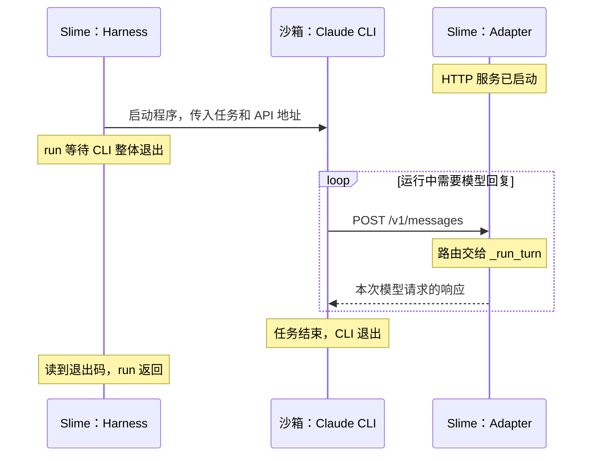

# 讨论记录：任务驱动的认知架构

日期：2026-10-20。

[返回讨论入口](README.md)。本页保存实际表述、助手建议与研究依据；已确认事项和待讨论方案的区别见入口页。

## 2026-10-20：重新梳理步骤与责任边界（讨论中）

用户希望一起逐项恢复和确认步骤约定，并明确表示：

> 我觉得目前这里的common部分的格式是我觉得比较合适的
>
> 对于long term的memory的机制我觉得也是没有问题的
>
> 我觉得我们需要一起梳理一下才行？
> 并且聊清楚负责范围？

本轮已经明确的两点：

- 单个函数记录以本轮确认的 [BaseAdapter._translate 样例](../../../.agents/skills/repo-reading-memory/references/base-adapter-translate.md)为讨论基准。它已单独保存为 reference，旧模板尚未按此重写；旧样例和新样例的版式不完全一致。
- 长期记忆继续沿用既有继承机制：下一步的 `03` 合并前一步的 `03` 与 `02`，保留内容、未知及来源。此次认可不表示新增了源码理解或掌握状态。

本轮待逐项讨论的是：一个阅读步骤怎样划界、步骤内各文件分别保留什么，以及用户和助手各自负责什么。首个讨论问题是“一个具体问题为一步，还是一个函数为一步”；助手建议按问题组织，但本段写入时用户尚未选择。不将这一建议记为新约定，不先改写 skill、模板或历史步骤。

### 当前先讨论：函数短期记忆中的“形成过程”

用户将问题聚焦到已确认的 `base-adapter-translate.md`：

> 我其实比较想要知道的事情是这里的形成过程在这个short term memory里面起到什么作用？

助手提出的职责解释：函数文件里的这一节是本条认识的追溯入口，链接到 `04-flow.md` 中实际发生的问题、源码材料、提示、用户表述和澄清。它帮助区分“助手提供的解释”和“用户实际确认的关系”，完整过程仍放在 flow，不在每份函数记忆中重复。源码引用用于核对技术事实，形成过程用于回查认识怎样得来；进入长期记忆时保留原始形成来源。

以上是当前待用户核对的解释，还没有确认改名、删除这一节或调整其格式。步骤边界的问题暂留，先澄清这项职责。

### 继续澄清：与心智模型的重复和引用数量

用户指出：

> 但是你不觉得这里的形成部分的内容和最后的心智模型部分有重叠吗？
> 以及这里的心智模型我实在不清楚为什么需要保留这么多的文件引用？
> 这一块的职责不是特别清楚？

核对当前样例后，助手确认存在重复：“只转换、不执行工具”同时出现在模型和形成过程说明中，原话区与形成过程区也重复链接问题四。此前对追溯用途的解释没有消除当前版式中的重复。

助手提出待讨论的分工：函数记忆保存可供恢复理解的模型、代表性输入输出、用户原话与未知；步骤 flow 保存实际提问、材料、澄清及后续回答；函数文件的来源区集中提供必要源码定位和一个原讨论入口。按这一提案，函数文件不再单列“形成过程”，也不在原话与来源之间反复放同一链接。此处只记录提案，尚未修改样例、skill 或模板，等待用户继续讨论。

### 从任务与认知负荷重新讨论架构

用户进一步明确设计初衷：

> 1. 为了降低认知负载
> 2. 让不同的代码在阅读的时候能够复用需要的代码而不必从头看开始看

用户对现有机制的理解是：

> 短期记忆只是负责给出到底哪些模块需要被调用
> 长期记忆则把短期的记忆保存起来
> 这样子日后如果需要用的时候提取

同时提出，设计应围绕具体任务：例如为了读懂 Coding Agent，在当前步骤了解需要的模块，并逐步理解模块如何组成整体。用户要求从脑科学、认知科学或教育学角度检验架构，考虑人的注意力有限。

以下是助手查阅研究后提出的解释与设计建议，尚未作为新的已确认规范执行：

- **以简化的完整任务组织阅读。** 复杂技能教学中的整体任务方法强调从较简单但有完整目的的任务开始，再逐渐增加复杂度；可据此保留任务主线，每次只展开其中必要的交接。[van Merriënboer、Kirschner 与 Kester，2003](https://doi.org/10.1207/S15326985EP3801_2)。这是教学框架对源码阅读的应用建议，不是该论文验证过本仓库的目录设计。
- **让当前需要共同理解的信息能一起阅读。** 认知负荷与分散注意研究发现，学习者被迫拼接相互依赖的材料会产生额外负担；无需整合的材料则没有同样的整合收益。对应建议是把函数的关键模型、代表输入输出放在同一份可独立理解的记录中，把展开过程与额外证据留作按需回查。[Chandler 与 Sweller，1991](https://ro.uow.edu.au/articles/journal_contribution/Cognitive_Load_Theory_and_the_Format_of_Instruction/27778410)。
- **保留轻量的主动解释。** 提示学习者解释材料之间的关系可以帮助建立理解；对当前阅读可采用一个交接问题或输入变化预测，按实际回答记录，不要求复述整篇说明。[Chi 等，1994](https://onlinelibrary.wiley.com/doi/10.1207/s15516709cog1803_3)。
- **区分外部保存与人的记忆。** 文本材料实验中，提取练习对延迟保持有益；文件已经归档并不等于读者已能回想或应用。对应建议是在需要复用时先尝试简短回想，缺失处再查记录，不设置额外考试或固定打卡要求。[Roediger 与 Karpicke，2006](https://www.psychologicalscience.org/journals/psychological-science/j.1467-9280.2006.01693.x/)。

助手建议把职责分为：

| 位置 | 拟议职责 |
| --- | --- |
| 项目任务主线与进度入口 | 保存具体任务的起点、终点、主要交接和当前阅读位置；帮助定位本步为何值得读 |
| 本步 `01-scope.md` | 保存本步问题、可以沿用的前置认识、需要打开的源码及停止边界 |
| 本步 `02` | 保存为解决当前问题新建立或修正的关系，以及实际展开的函数记录；模块清单只作为索引 |
| 本步 `03` | 按已认可机制保留前序累计模型、使用条件、未知与来源，按当前任务检索需要的部分 |
| `04-flow.md` 与额外参考 | 保存值得回溯的疑问、修正及证据，作为辅助材料；不要求每次续读全部加载 |

这里对“短期记忆只列需要调用的模块”作出的修正建议是：短期记忆还需要保存本步理解了怎样的交接、为何需要相关模块，以及哪些关系仍未展开。每步既建立局部函数模型，也把它接回当前任务；后续复用需要知道接口、适用场景及来源版本。

当前 common 样例继续作为已认可的函数格式，不因为研究建议继续追加栏目。阅读时先按其用途和输入输出使用已有认识；当本次任务需要内部机制、遇到不符合预期的输入，或已有记忆不足时，再深入实现。函数返回值之外的副作用、状态或生命周期关系在与当前问题有关时同样需要交代。

分工建议：助手负责选择和定位真实场景、核对源码、检索既有认识、控制展开范围并整理记录；用户提供实际理解、疑问和反馈，不承担记忆文件的重复填写。下一轮优先讨论具体任务的起点、终点与正常路径，再检验本步范围是否合适。上述分工与调整仍待共同讨论，未据此改写 skill、模板、样例或阅读进度。

## 本轮完整问答：从认知科学重新检查设计

### 用户的提问

> 我觉得我们需要考虑清楚每一个部分到底负责什么这件事情
> 首先我们设置的初衷
> 1. 为了降低认知负载
> 2. 让不同的代码在阅读的时候能够复用需要的代码而不必从头看开始看
>
> 那么当前心智模型部分已经做到了把这个基本的设计给补上了？
>
> 也就是说这里的输入和输出补上了
> 短期记忆只是负责给出到底哪些模块需要被调用
> 长期记忆则把短期的记忆保存起来
> 这样子日后如果需要用的时候提取
>
> 这是我对于这部分的理解
> 那么现在有了这些基础模块的情况下
>
> 这里还缺少了什么呢？
> 因为人的注意力是有限的
>
> 因为这个设计还是需要基于一个某一个具体的任务的
> 例如我目前需要读懂coding agent
> 那么是基于这个任务去在当前的步骤去了解对应的模组对吧
>
> 然后在过程中顺便了解了 每一个模组是如何组成的这件事
>
> 请从脑科学或者认知科学 或者教育学的角度考虑 我到底应该如何设计这个架构

### 助手给出的架构建议

我建议把这套架构定为：**围绕一个具体任务建立主线，在主线中按需理解模块，再把可复用的认识保存下来。**

你认可的 `common` 格式已经比较好地承担了“解释一个局部模块”的职责。但还需要补清楚：**为什么现在用它、它和其他模块怎样交接、这一步读到哪里就够了。**

有一点需要调整：**短期记忆不能只是“需要调用哪些模块”的清单，还要保存这一步新理解的关系。** 否则积累下来的会是一批函数说明，却仍需要自己重新把它们连接起来。

从认知科学和教学研究看，有三个原则适合指导这套设计。下面是将研究应用到源码阅读的建议，并非研究直接验证过这些文件夹。

1. **先有完整任务的轮廓，再逐步展开局部。**
   复杂技能教学中的整体任务方法，主张从较简单但完整的任务开始，逐渐增加复杂度。对你而言，就是先知道一次 Coding Agent 任务怎样从输入走到结果，再进入其中一个环节，而不是先读完全部模块才拼整体。[van Merriënboer 等，2003](https://doi.org/10.1207/S15326985EP3801_2)

2. **把必须一起理解的信息放在一起。**
   当学习者必须来回拼接相互依赖的材料时，会增加额外负担。因此，你坚持在同一份记录里看到心智模型、具体输入输出和调用代码，是合理的。完整历史、额外解释、验证材料可以按需打开。[Chandler 与 Sweller，1991](https://ro.uow.edu.au/articles/journal_contribution/Cognitive_Load_Theory_and_the_Format_of_Instruction/27778410)

3. **保存之外，还需要少量主动解释和提取。**
   自己解释“为什么这样交接”，有助于把新信息接入已有知识；适量回想也有助于延迟保持。对应到我们的协作，可以只是预测一次输出、解释一处交接，不需要每读一个函数都做完整复述。[Chi 等，1994](https://onlinelibrary.wiley.com/doi/10.1207/s15516709cog1803_3)、[Roediger 与 Karpicke，2006](https://www.psychologicalscience.org/journals/psychological-science/j.1467-9280.2006.01693.x/)

据此，我会这样分配现有各部分的职责：

| 部分 | 核心职责 | 应保留的内容 |
|---|---|---|
| **任务主线** | 让你始终知道正在理解什么任务 | 任务起点、终点、主要环节、当前位置 |
| **本步范围 `01`** | 控制这次需要投入的注意力 | 当前问题、可沿用的认识、需要展开的部分、停止位置 |
| **短期记忆 `02`** | 保存本步新增或修正的认识 | 新理解的模块关系，以及相关函数的记录 |
| **长期记忆 `03`** | 为以后阅读提供可提取的已有认识 | 累计模型、模块记录、适用场景、未知与来源 |
| **过程与参考** | 支持必要的追溯和深入核对 | 关键误解怎样修正、详细源码证据、扩展解释 |

**你现在最需要补的是前两项，以及短期记忆中的“关系”。** 长期记忆的继承机制可以继续保留。

例如，将来沿 Coding Agent 主线读到模型请求时，可以这样安排：

```text
整体任务：一份代码任务怎样被执行，并交回结果。

本步问题：请求中的对话与工具信息，怎样交给模型输入准备环节？

可以复用的认识：
_translate 整理出 translated 和 tools_schema。

本步需要建立的关系：
调用者接住这两份结果，再一起交给模板渲染。

本步停止位置：
先说清这次交接；模板内部怎样生成 token，留给后续问题。
```

这里的增量，是把已经理解的 `_translate` **接进任务主线**。它可能只涉及两行调用，却能让整体模型向前走一步。

对于模块内部，我建议采用这样的展开方式：

- **第一次遇到**：理解它的用途、输入、输出或副作用，以及由谁使用。
- **再次遇到**：先简短唤起已有模型，能接上当前任务就继续。
- **当前问题需要内部机制，或已有模型解释不了新情况时**：再打开实现，增加认识。

这样，“顺便了解模块怎样组成”就有明确边界：**展开到足以解释当前交接为止。** 某个模块内部的每个辅助函数，不必同时进入你的注意范围。

函数记录还需要支持一个实际用途：**以后遇到什么情况，我应该想到它？** 你现有的“使用场合”已经可以承担这一点；再配合输入输出、调用代码、源码版本，就能帮助判断旧认识是否适用于当前场景，不必另加一套复杂栏目。

至于“形成过程”，它在这套架构里属于辅助材料。值得保存的是关键理解变化，例如“原先把工具定义和具体调用混在一起，后来怎样区分”；日常恢复理解时，优先看任务主线、当前问题和函数模型即可。

最后，分工也应该减轻你的负担：**我负责选择真实场景、定位源码、提取已有记忆、控制展开范围和整理记录；你负责表达当前怎样理解、哪里接不上。** 文件怎么放、来源怎么维护，不应成为你额外的学习任务。

下一步我建议先一起确定：**“读懂一次 Coding Agent 任务”具体从哪里开始、到哪里结束。** 有了这条主线，才能判断每一步需要哪些模块，以及哪些细节可以暂时留白。

## 如何继续读源码的初步建议

后续用户指出，这一建议把方法讨论带回了旧固定路线；本轮当前范围以下一节澄清为准。本节保留当时建议，不作为新的阅读进度。

用户提出：

> 那么在这个基础上请和我讨论一下
> 如果按照这个样子的话 应该如何继续读这里的源代码

本轮读取本文件及入口页，并核对 Slime 的唯一阅读路线、Step 000 与固定版本 `2f2318653f6f794dddd321eff7c9d4b7b174643f` 的源码。现有路线的下一入口仍为 `train.py::main()`；用户此前已走过单任务 `generate()` 的完整任务链，相关历史继续保留，不因重新梳理方法而清零，也不据此假定所有内容仍能随时回忆。

助手建议先用“一份代码任务怎样被框架送入 Coding Agent 执行，再把结果交回外层”确定任务主线。当前优先补启动与调用关系：谁发起工作、准备结果交给谁、什么时候进入生成流程。已有单任务讲解与 `_translate` 函数记录在主线遇到对应模块时按需复用。

建议的第一个小问题是：`main` 怎样把启动准备的结果交给实际运行阶段？本步以 `main(args, restore_plan)` 为入口，暂时接受配置已解析；观察 `create_rollout_manager(...)` 返回 `startup`，以及 `main` 怎样把其中的配置、资源布局和 manager 交给 `train(...)`。`train` 中第 51 行的 `rollout_manager.generate.remote(...)` 用于定位下一次交接。

该步的预期新增认识是“准备阶段返回运行所需对象，调用者再将它们交给运行阶段”，而不是单纯记住三个函数名。资源分配内部、训练算法及完整失败清理属于后续按问题展开的内容。当前只有建议和静态定位，尚未创建新学习步骤，也未把建议写成用户已理解的模型或修改阅读进度。

源码入口：[main，第 103 行](https://github.com/THUDM/slime/blob/2f2318653f6f794dddd321eff7c9d4b7b174643f/train.py#L103)、[train 内的生成请求，第 51 行](https://github.com/THUDM/slime/blob/2f2318653f6f794dddd321eff7c9d4b7b174643f/train.py#L51)、[create_rollout_manager，第 293 行](https://github.com/THUDM/slime/blob/2f2318653f6f794dddd321eff7c9d4b7b174643f/slime/ray/placement_group.py#L293)。

## 澄清：从零设计步骤及模块组合

用户澄清：

> 虽然这里的讲过这里的generate tokens
> 但是那是在之前的固定的路线上
> 所以目前讨论的内容是如何在当前这里的从0构建起来一个每一步具体应该怎么做的方式
> 我的意思是当前有这里的short term memory
> 那么这一个step 应该还有当前的主线这里的每一步
> 比如这里的_render_token_id
> 还有下面的call_sglang_generate
>
> 自然这里可以单独把这里的函数的内容放在 short term memory
> 我想要问的问题是到底如何在一个长期的部分把这些拼凑起来
> 每一个step到底怎么构建这里的模块
>
> 也就是除了01的short term和 02的long term
> 别的章节根据之前说的认知模型 我们应该还有什么模块？

本轮据此聚焦步骤自身的设计，保留此前已读历史，但不使用旧固定路线来决定方法示范的下一入口。源码中的准确符号是 `_render_token_ids`；以下围绕 `BaseAdapter._run_turn` 中的连续调用说明，省略请求初始化与后续响应处理：

```python
translated, tools_schema = self._translate(body)
prompt_ids = _render_token_ids(translated, tok, tools=tools_schema, add_generation_prompt=True)
turn = await call_sglang_generate(prompt_ids, s, body, adapter=self, session_id=sid)
```

静态核对来源：[固定版本 common.py 第 341 行起](https://github.com/THUDM/slime/blob/2f2318653f6f794dddd321eff7c9d4b7b174643f/slime/agent/adapters/common.py#L341)。三个调用展示的是实际程序主线，tokenizer、session、请求参数等也是交接条件。这里只核对源码，未运行模型生成。

### 助手提出的组合方式（待讨论）

除两层记忆外，增加一个便于直接阅读的“本步任务与主线”入口，集中说明当前问题、起点、终点、整体中的位置和实际调用与数据交接。范围与主线可以放在同一页，减少必须同时打开的文件；编号及是否合并既有 scope 暂不修改。

| 内容 | 职责 |
| --- | --- |
| 本步任务与主线 | 说明本步为何进入这些调用、当前展开哪里、哪些仅定位、结果交到哪里以及下一问 |
| 短期记忆的函数记录 | 按已认可的 common 格式，保存本步新增或修正的函数认识 |
| 短期记忆的 overview | 保存本步新增或修正的组合关系，并链接有关函数；函数目录清单不能代替这些关系 |
| 长期记忆的函数记录 | 保留此前累计的可复用函数认识、未知和来源 |
| 长期记忆的 overview | 保留进入本步前的整体任务模型、函数之间的交接关系及索引，便于按当前任务提取 |
| 可选 references | 保存需要回查的重要澄清和额外证据；与实际程序主线分开 |

组合关系的例子包括：`body` 交给 `_translate`；`translated` 与 `tools_schema` 连同 tokenizer 交给 `_render_token_ids`；得到的 `prompt_ids` 连同 session、请求参数等交给 `call_sglang_generate`。这部分要写清“谁的哪份输出被谁当作什么使用”，而非只列三个函数名。

假设按三个步骤展开这段主线，第一步新增转换接口及其输入输出，第二步新增模板渲染及两份转换结果怎样交过去，第三步新增生成请求及 prompt IDs 怎样交过去。该拆法仅为示范，不要求一个函数必须对应一个步骤；一步也可以只增加一条连接，或涉及多个短函数。

继承仍按已认可机制进行：本步 `03` 保留进入时的累计模型，新函数与新连接写入本步 `02`；进入下一步时，将两者合并成新的 `03`。合并不仅继承函数文件，也将 overview 中的连接补进累计整体模型；本步不持续改写自己的前序长期快照。

任务主线可以由助手据源码先提供定位图并标明未展开部分，这属于源码说明；用户已理解的关系仍按实际反馈记录，不能把整张主线图自动当成用户已掌握。当前只记录上述方案，未改动模板、skill 或新建实际学习步骤。

## 待执行的 Step 01 回填与 backlog 归档

用户要求先把已确认的 reference 复制到当前 Step 01，并明确要求覆盖前说明具体方案。此前方案的范围是：用 reference 的完整内容覆盖 common 函数记录，按目标位置重算相对链接，并修正 overview 的一处旧锚点。该覆盖方案仍待用户确认，本轮归档不执行覆盖。

随后用户提出：

> 之前我们一直讨论的问题是需要一个制度对吧能否在backlog中把我们的讨论全部放上去呢？ 吧目前的discussion 相关的部分都放进去吧

据此，原 `00-repo-reading/discussions/` 下的全部 14 份材料迁入 `backlog/repo-reading/`，并建立[制度待办与讨论索引](../README.md)。迁移保留讨论、试用步骤和样例的正文与原始来源，只调整必要链接；AGENTS.md 和原方法入口已指向 backlog。当前仍需共同确定制度，不把归档本身视为采纳全部提案。

## 再次明确讨论主线：形成过程与分层职责

用户进一步明确本轮讨论的起点与范围：

> 那么我们在推进的一个比较体系化的系统
> 确定的是需要一个关于function的short term memroy
> 但是我们在讨论的是这里的形成过程是否应该保留
> 我们认为中间的过程和当前的short term memroy很像 重复性很高
> 然后我们就查了按照认知心理学 和脑科学 和教育学 和资深工程师的视角
> 考虑到底如何构建这个分层架构的抽象

### 已确定与待判断的边界

已确定需要函数级短期记忆，已有 common 样例和长期继承机制继续作为设计基础。当前核心问题是：“形成过程”相对短期记忆，是否提供值得单独保存的信息？用户指出的重复，是重新检查各层职责的起点。

形成过程是否独立保留、保留哪些内容，以及任务主线和函数组合放在哪里，都还需要讨论。此前的目录与组合建议不是已确认制度；当前也不推进新的源码阅读步骤。

### 助手提出的分析起点（待讨论）

先区分三个维度，避免直接将它们视为同一层级的并列模块：

| 维度 | 要回答的问题 | 当前材料中的对应内容 |
| --- | --- | --- |
| 内容的抽象层级 | 一个函数做什么？多个函数怎样共同完成任务？ | 函数模型、调用与数据交接、任务整体模型 |
| 认识的积累方式 | 本步新增了什么？此前已经积累了什么？ | 短期记忆、长期记忆及继承 |
| 认识变化的追溯 | 当时提出了什么问题？哪些材料和反馈使认识发生变化？ | 形成过程、原始表述和证据入口 |

这是对现有设计的分析建议，不是新增三个目录的要求。认知心理学、脑科学、教育学和工程实践是后续评估这些职责的视角，不直接决定文件夹数量。此前保存的研究依据主要涉及认知负载、整体任务、自我解释和提取练习；这里的三维区分属于助手的设计判断。

### 以现有形成过程检查独有信息

[common 样例](../../../.agents/skills/repo-reading-memory/references/base-adapter-translate.md)中的“形成过程”目前主要链接到 [Step 01 的过程记录](../step-01-translate-preview/04-flow.md)。需要区分链接本身的导航用途，和链接目标中再次展开的内容。

例如，过程记录中的“这里只转换格式，不执行工具”，作为最终结论已经进入函数模型；重复这句话本身没有增加新的函数认识。过程记录另外保存了当时为什么追问这个边界、助手提供了什么材料，以及用户实际回答了什么。这些信息的用途是追溯认识如何形成，与直接恢复当前函数模型不同。

下一步应判断这种追溯会在什么场合被使用、是否值得独立保存，以及能否只保留必要入口或关键变化。不能仅因存在追溯信息就认定全部过程都要保留，也不能仅因结论重复就认定全部过程都该删除。本轮只明确问题并更新讨论入口，未删除或改写函数样例、形成过程、skill、模板或阅读进度。

## 具体化职责划分：任务、模型与学习记录

用户指出上一轮抽象仍不清楚：

> 嫩否给出比较清楚的抽象和不同的分工职责呢
> 当前还是不清晰的

助手据此将建议单独整理为[职责划分草案](responsibilities-proposal.md)，避免只列抽象维度却不给出实际放置方式。草案将系统分为阅读导航、知识模型和学习记录三类职责；模型中区分函数卡片与组合关系，短期和长期继续采用同类结构，按本步新增与前序累计划分。

对形成过程的具体建议是：保留关键学习事件和证据入口，函数文件链接回来源，完整函数说明不再在过程页重讲。草案用同一个转换例子列出各文件保存什么，并明确助手负责组织、核对与记录，用户提供实际理解和反馈。

本轮保存的是助手建议，尚未视为用户确认；现行 skill、模板、函数样例和历史过程记录没有据此调整。

## 比较讲解稿与短期记忆

用户把讨论缩小到一个具体比较：

> 那么先考虑一个问题吧 是这里的1.3 · 同一请求如何变成两份内部数据 和我们的short term memroy的却别是什么

本轮直接对照[1.3 讲解稿](../step-01-translate-preview/references/translation-explanation.md)与[用户后来认可的 common 短期记忆样例](../../../.agents/skills/repo-reading-memory/references/base-adapter-translate.md)。Step 01 原位置的 common 文件仍是回填前版本，不能以旧版省略了工具定义为理由，断言短期记忆不需要这部分内容。

### 对实际内容的判断

1.3 是助手编写的教学讲解稿：按当前位置、请求输入、转换入口、消息路、工具路和下游交接逐步展开。它不是保存实际问答、反馈和修正的形成过程记录。

新版短期记忆不仅保存用户原话，也包含助手核对的场景、完整的代表性输入输出和 LLM 模型。因此，不能把区别简化成“1.3 是助手解释，短期记忆全是用户已经理解的内容”。

| 内容 | 1.3 讲解稿 | 新版短期记忆样例 |
| --- | --- | --- |
| 两份结果的用途、转换不执行工具 | 展开解释 | 模型中保留，存在重叠 |
| 系统指令、消息、历史工具调用与工具定义 | 展示请求并逐项解释字段对应 | 展示一组成对输入输出，并解释必要字段对应，存在明显重叠 |
| 下游模板渲染 | 用调用处说明结果去向 | 保留同一调用片段和简短职责模型，存在重叠 |
| 转换内部如何分给两个 helper、无关参数如何处理 | 有进一步展开 | 当前没有同等展开 |
| 用户原话、明确未知、首次接触与认识更新时间 | 链接记忆，提醒讲解不等于理解 | 直接保存，作为后续接续依据 |

两份材料目前主要都围绕 `_translate` 这一局部；不是不同抽象层级的必然分工。短期记忆经过补全之后，已覆盖 1.3 中相当多的解释，实际冗余需要承认。

### 建议的边界

- **讲解稿用于建立理解。** 当前概念接不上时，按具体问题展开为什么这样转换、每一步怎样对应、helper 怎样处理；可以包含用户尚未理解的内容。
- **短期记忆用于恢复和复用本步的认识。** 保留够用的场景、输入输出和职责模型，并明确区分用户已表达的理解、助手补充与未知。后续阅读优先用它，不要求重走完整讲解。

区分依据是用途与展开程度，不是“能不能有输入输出”，也不是文件长短。代表性输入输出对记忆恢复有用，应继续保留在用户已认可的短期记忆中。

助手建议以已认可的短期记忆格式为基础，1.3 只在有额外推导、内部机制或针对具体疑问的解释时作为可选参考；单纯重复记忆卡片的部分不必长期维护第二份。具体保留或合并方式尚未决定，本轮没有改动两份材料。

## 把职责方案做成完整步骤示范

用户要求：

> 先按照之前的讨论吧这里的step转换成为你觉得合适的内容吧
> 我需要看清楚这里的step0 在你的分配之下会变成什么样子

本轮按前文一直比较的 `_translate` 转换步骤制作[Step 0 结构示范](../step-00-translate-structure-preview/README.md)。它另存为完整文件夹，原 Step 01、Slime 的实际 `step-000-initial-model` 和已认可 reference 都保留；Step 0 是此示范的编号，个人认识仍注明来自原 Step 01。

实际展示的分工如下：

- 首页展示本步问题、在请求处理中的位置和各文件入口；`01` 进一步限定本步范围与停止位置。
- `02/functions` 保存 common 与 Anthropic 两份函数卡片；common 沿用已认可的模型、代表性输入输出和原话，形成过程入口归拢到来源区。Anthropic 保留原有最小场景与未知，并说明它没有传入工具定义。
- `02/overview.md` 保存用户已表达的关系，另列助手核对的实际交接位置；渲染与生成只定位，不写成用户新增理解。
- `03` 如实标明没有导入前序模型，保留后续合并机制。
- `04` 收为四次关键问题与实际反馈，完整问答链接原记录，不复制整套函数讲解。
- 可选参考只补充两个 helper 的输入分工，以及请求中其他参数的边界；原 1.3 讲解仍可通过链接回查。

已用固定版本的转换方法及纯辅助函数核对两份卡片的输入输出；核对示范的 52 个本地链接与锚点，原步骤、原初始模型及 reference 共 21 份文件与制作前逐字节一致。本轮是记录结构的具体展示，没有运行模型、推进源码阅读或更改个人认识状态。

## 纠正起点：从 Coding Agent 任务开始

用户指出：

> 部队啊 这里的step 不是从coding agent部分开始看吗？
> 不是目前的这个train

助手此前把转换局部示范当作 Step 0，并保留项目旧的外层启动入口，未满足用户要看 Coding Agent 起点的要求。本轮将当前入口统一到[新的 Coding Agent Step 0](../../../00-repo-reading/repositories/slime/steps/step-000-coding-agent/README.md)，以 `examples/coding_agent_rl/generate.py::generate` 组织一份任务的主线。

新的结构先展示任务准备、Harness 运行期间的模型与工具交互、diff、独立评估、结果与清理。既有 `_translate` 两份函数认识继承到 `03`，作为主线内的可复用局部；新函数仅定位的内容和助手解释与用户认识分开。下一处观察点为 `_AdapterService(args)`，不是外层训练启动。

同步修正项目入口、唯一阅读路线与网页的当前阅读说明。旧初始模型和旧转换示范保留为历史或局部参考，不继续充当当前 Step 0。没有把重排和静态核对记作新的个人理解或实际运行结果。

## 再次纠正：两层记忆都以单个函数为单位

用户先指出：

> 不对啊 这里的short-term-memory 应该是还是对应的functions啊
> 只不过是 之前的long term memory 给的是长期的functions

随后再次明确：

> 不对啊 这里的02 short term memory应该是对应的单个的function
> 这里的分层的部分是不是又写错了呢？

此前助手把 Step 0 的 `02` 写成整体关系图和入口索引，未建立正在阅读的 `generate` 函数卡片；同时错误地把“尚未有新复述”当成不建立卡片的理由。

本轮按用户纠正：`02/functions/examples/coding_agent_rl/generate.py/generate.md` 保存当前单函数的使用场合、调用代码、输入输出、LLM 模型和明确留白的个人原话区；`03/functions` 继续保存此前的转换函数卡片。整体主线和跨函数关系放在步骤首页，overview 只做函数索引。同步修正规范、skill 和两个索引模板，不重写旧讨论快照。

## 第一阶段的函数基线直接进入长期记忆

以下为上一轮误解及处理历史，已被后续“首步函数放短期、长期初始为空”澄清撤回，不作为执行规则。

用户进一步指出：

> 这里暴露的第二个问题是当前的02部分应该是03的内容，因为这是第一步

据此区分初始化和后续增量：Step 0 先把已经整理的函数卡片放入 `03` 建立基线；`02` 留给基线之后新增或修正的函数认识。首步没有前序步骤，不表示 `03` 必须为空，也不能把初始整理本身算成短期新增认识。

本轮将 `generate` 从 `02/functions` 移入 `03/functions`，保留正文、未知、个人表述状态及源码版本，仅增加初始基线的归属说明。`02` 当前没有增量函数卡片，原有两份转换卡片继续保留在 `03`。步骤入口、引用、首步规则及索引模板同步调整；不改写上一轮错误归类的历史记录。

## 首步函数放短期、长期初始为空

用户澄清：

> 反了 应该是把step 0的 02的function 调换到这里short term function 才对啊
> 一开始03的部分应该是空的

正确初始状态是：Step 0 的函数记录位于 `02/functions`，`03` 暂无前序继承。进入下一步后，才将上一份 `03 + 02` 合并成新的长期记录。此前“第一步直接放 03”的解释和新增规则撤回。

本轮把三份函数卡片全部移回 `02`，`03` 只保留空状态说明；更新当前索引、引用、skill 与首步模板。保留旧材料的作者、原话和来源，但不将这些材料预先算成本轮的前序长期记忆。

## 每轮 step 先确认主题

用户进一步指出：

> 那么这里不应该包含 这里的generate 才对啊，当前还没有到generate的轮次，因为需要的基础内容都还没有获取 请删除，同时把这个记录为一个为一个规则
> 每一轮的step 都需要我确认这一步想要讨论什么这件事情，

据此删除当前 Step 0 中提前创建的 `generate` 函数卡片及配套任务讲解、源码核对文件，清除自动转入 `generate` 或 `_AdapterService` 的接续说明。已有两份转换函数记录保留，`03` 仍为空。

新增明确规则：每一轮 step 先由用户确认具体问题与函数或模块范围，再展开源码、创建对应函数记忆和更新阅读进度。助手可以提出候选问题，但不能把候选、已准备材料、旧路线或此前读过的事实当成本轮主题已确认。已有明确指定时不重复询问；更换核心主题时重新确认。

当前只有 Coding Agent 方向已经确定，下一轮具体主题仍待用户确认。此次删除和规则整理不算新的源码阅读步骤。

### 进一步澄清：先讨论函数与短期记忆

用户继续明确：

> 是先和我讨论这一步的短期memory 或者这个step 想要讨论什么函数这件事情能够

据此细化上面的规则：每个 step 开始前，先一起讨论准备读哪个函数、围绕它弄清什么，以及短期 memory 准备保留哪些认识。助手可以根据当前问题提出候选函数和理由，由用户确认后再展开源码和建立函数记录。

这次讨论确定的是本步范围和记录重点，不要求预先给出技术答案，也不要求证明已经掌握。已有明确指定时直接沿用；核心范围改变时再讨论确认。本次只细化规则，没有选择新的函数或开始新的源码阅读。

## Anthropic 记录直接引用 common

用户明确：

> 当前的anthropic adapter_translate的这个部分我觉得需要直接指向当前这里的baseadapter._translate
> 因为是继承关系，不应该分开讨论才对 这里的common已经把这个特例拆解完了

当前 common 记录已经使用 Anthropic 请求完整展示系统指令、消息历史、工具调用与结果、工具定义和两份输出。因此将本步的 Anthropic 文件改为引用入口，短期索引也直接指向 common；场景、输入输出和心智模型只维护在 common 中。

源码中的 `AnthropicAdapter` 继承 `BaseAdapter`，并在子类中实现 `_translate`。引用入口保留这个关系、源码定位与原始记录；历史原话和未知仍可从原记录回查。common 正文、旧步骤快照与长期记忆保持原样。

## 先独立短期 memory skill

用户提出：

> 把这个规则也写在
> short term memory 这一个skill里面吧？ 我觉得需要创建不同的skill
> 来完成这里的对于这个系统的构建

随后选择本轮范围：

> 先独立短期 memory，其余先列分工建议

本轮建立 [repo-reading-short-term-memory](../../../.agents/skills/repo-reading-short-term-memory/SKILL.md)，只负责本步 `02` 的函数记录与索引，明确共同记录已覆盖具体实现时直接引用。原有 `repo-reading-memory` 保留为总入口，短期工作转给新 skill，尚未拆分的长期规则继续留在原处。

新 skill 直接使用原模板与已认可样例，没有重写当前函数记录或历史来源。步骤编排、长期继承和过程记录的[分工建议](skill-responsibilities-proposal.md)单独保存，尚未创建这些候选 skill；“形成过程”是否需要独立职责仍待讨论。

## 当前 Step 还需要补什么

用户问：

> 我比较想要知道 当前的step 我应该还要补充什么
> 看一下讨论的板块吧

对照此前关于任务主线、函数模型和形成过程的讨论，当前缺口主要在步骤层：Step 0 的 README 目前说明记录规则，`01-scope.md` 的核心问题、入口条件与停止位置仍待确认；common 的函数记录已经展示当前转换场景的调用、输入输出与模型。

助手建议先一起确定本步的具体问题及其在 Coding Agent 任务中的位置，再补入口条件、所需函数之间的交接和停止位置。放在步骤 README / scope 中，只写够用的关系并链接函数卡片，不重新放入 memory overview，也不重复完整输入输出。

以已有 `_translate` 材料为例，可以讨论“收到模型请求后，怎样为后续渲染整理两路信息”，暂时接受 `body` 已取得，观察到 `translated` 与 `tools_schema` 交出为止；请求如何收到、后续渲染如何实现继续留白。这只是说明步骤层应写什么的候选，尚未由用户确认为本步主题。

本步结束时，再根据实际讨论记录新增或修正的关系以及下一问。`02` 按需要更新函数认识，`03` 继续保持首步无前序继承；`04` 只追加实际发生的技术问题、材料、反馈和修正，不预写学习过程。现有结构纠错历史保留，制度讨论继续放在本目录。

本次只保存评估与建议，没有选择新的函数、展开新的源码或改写当前 Step 的待确认范围。

## 起步时还不知道模块，导航图怎样逐步建立

用户认可带缩进和职责注释的导航形式，并给出已有完整示意：

```text
generate:
    ...  # Pre-4：模型入口、任务、会话、环境与题目准备
    HARNESS_CLS().run:  # Action 4 组织启动；Action 6 执行并等待 CLI
        # Action 7：CLI 运行期间，经 HTTP 回连 Adapter
        BaseAdapter._run_turn:
            # 当前 Action 2：消息与工具定义转换
            translated, tools_schema = self._translate(...)
            ...  # Action 3：编码、采样与模型生成
            ...  # Action 3.5：协议响应、本轮轨迹与请求收尾
    ...  # CLI 结束后：收集 diff、评估、导出结果与清理
# Action 5：环境的创建、命令、文件与回收能力，贯穿上述阶段
```

用户接着问：

> 但是问题是一开始的时候 是不知道会有这些模块的
> 所以这个图应该怎么画和考虑呢？

认可导航的表达形式，不等于已经理解其中全部模块，也不等于已确认现在开始阅读 `generate`。以下是助手提出的建图方法，尚未推广为新的执行规则。

起步图只表达已确定的任务与边界，内部允许是一整个待展开部分。连入口都没有定位时，不先填写真实函数名：

```text
一次 Coding Agent 任务：
    输入：任务信息（具体字段待核对）
    ...  # 执行过程尚未展开
    输出：执行结果（具体结构待核对）
```

之后若实际定位到 `generate`，先把任务入口对应到它；若再从调用方看到 `HARNESS_CLS().run`，才增加这个节点。下例只演示图怎样增长，不声称本轮已阅读这些源码：

```text
generate:  # 入口已定位，整体行为尚未展开
    ...  # run 之前的处理尚未展开
    HARNESS_CLS().run:  # 已看到调用，内部尚未展开
        ...  # 本次调用内部待展开
    ...  # run 返回后的处理尚未展开
```

每步只沿用户确认的问题展开有关部分，并补上足够的输入、输出或交接。图中区分“已定位但未展开”“本步正在展开”“已有函数记录可引用”；用户实际理解的状态仍依照其反馈记录。未发现的模块不预填名称、数量或 Action 编号；助手为定位提供的源码线索也要标明来源，不能写成用户已经掌握。

新一步从前一步的图增加节点、交接或修正，前一步保留当时的范围和未知，不用最终完整图回填旧步骤。图放在步骤 README / scope，函数细节继续在 memory 中；Action 名称可以在对应职责已经明确后作为资料导航补入。

完整示意混合了直接函数调用、CLI 的运行以及 HTTP 回连，后续应标出交接方式，不能把全部缩进理解成同一个进程里的 Python 调用栈。跨阶段的环境能力也可保留为旁注，不强塞成一个顺序节点。

本次保存的是建图建议，没有新增函数卡片、改写当前 Step 的阅读范围或创建其他 skill。

## 怎样判断先读 run 还是消息转换

用户进一步问：

> 但是我是知道这里需要先看一下translate理解数据格式
> 但是如果不是的话呢？
> 我的意思是 如何判断一开始是读这里的harness_CLS().run还是先看这里的translate messages？

这个问题补出了前述流程中的一个空缺：用户尚不了解候选函数时，助手需要先做少量源码定位，提供选择依据，不能只要求用户确认函数名。定位只查看当前任务入口、候选调用的参数、职责和结果，不等于正式展开全部实现，也不产生新的函数记忆。

助手提出的选步方法：从本轮想解释的具体行为出发，先浏览相关入口的一层调用；区分“必须先懂才读得下去的前置关系”和“可以先按接口接受的内部细节”。优先展开能回答当前问题、前置条件可承受的一段；遇到实际阻塞理解的未知，再转去补对应前置，随后回到原问题。这是阅读深度的选择，不是按执行顺序逐行读完所有函数。

本轮仅为比较候选而核对固定版本 `2f2318653f6f794dddd321eff7c9d4b7b174643f`：

- [BaseHarness.run](https://github.com/THUDM/slime/blob/2f2318653f6f794dddd321eff7c9d4b7b174643f/slime/agent/harness/common.py#L81) 接收沙箱、工作目录、会话标识、Adapter 地址、时间预算和 prompt，负责配置、启动并等待，返回退出码。若当前问题是“代码任务怎样交给 CLI 执行”，可以先看这个接口与主干；消息内部格式可暂留白。
- [AnthropicAdapter._translate 与 _translate_messages](https://github.com/THUDM/slime/blob/2f2318653f6f794dddd321eff7c9d4b7b174643f/slime/agent/adapters/anthropic.py#L58) 处理模型请求中的数据转换。若当前问题是“模型请求里有什么，以及怎样转成内部消息”，则应进入这条线；可以先说明 `_translate` 的两份输出，需要逐字段对应时再展开 `_translate_messages`。

如果完全从零追踪一次 Coding Agent 任务，助手的默认建议是先浅看外层启动与交接，再沿一个具体请求进入数据转换；这不意味着先读完 `run` 的全部子函数。用户当前明确想先理解数据格式时，可以把转换作为准备单元，并说明暂时接受的上游条件与之后返回的位置。

每次向用户提出候选时，应说清“这一步解决什么问题、为什么现在读它、需要暂时接受什么、读到哪里停止”，由用户确认问题与范围。该方法仍是讨论建议，本轮没有确定新的阅读入口或创建函数记录。

## 进入 run 之前仍需建立最小调用场景

用户追问：

> 但是如果我要读cls run岂不是需要知道这里的前置信息呢？

这一追问指出，上文“默认先浅看 run”仍缺少条件：需要先判断它的最低阅读前置是否已经具备。不能先选定函数，再把读者尚不明白的全部输入都标为“暂时接受”。

应区分运行前置与阅读前置。运行时必须真正准备好环境、工作区、会话等对象；阅读时至少需要知道这些对象代表什么、为什么传给本函数，以及本函数结束后交回什么，不一定先展开它们的全部创建实现。

本轮在固定版本 `2f2318653f6f794dddd321eff7c9d4b7b174643f` 的[调用处](https://github.com/THUDM/slime/blob/2f2318653f6f794dddd321eff7c9d4b7b174643f/examples/coding_agent_rl/generate.py#L182)核对：当前配置先选定 Harness 类，调用方准备会话，创建沙箱并准备工作区，再将执行环境、目录、会话标识、Adapter 地址、时间预算和 prompt 交给 `run`。这些是选择该阅读单元前应提供的最小上下文，不表示已经理解各准备模块的内部机制。

助手修正建议为：先圈定要解释的行为，再从调用处列出必要条件，与用户已有理解对照。若连某项条件的含义和用途都不清楚，就先补这项前置；若已经能按其接口理解当前交接，只是不清楚内部怎样实现，可以保留未知并进入目标函数。完成最小前置后再回到原来的问题，避免无限向上追溯。

因此，可能选出的首个单元是“进入 run 需要哪些条件，以及这些条件怎样交给它”，而不是直接逐行读 `run` 的内部。最终选步仍需用户确认；本轮只补充判断方法，没有创建新的源码学习记录。

## 缩小起点：以一次模型请求组织主线

用户指出：

> 但是那样子的话前置启动步骤就太多的了感觉
> 而且当前的_run_turn确实是涉及的内容是最少的

这说明前面的建议仍把过多启动条件带入当前阅读目标。整体定位不要求先把外层启动链学齐；不能把“先浅看 Harness 启动”固化为默认起点。对于当前理解模型请求与数据格式的目标，可以从边界更容易圈定的一次请求切入。

助手据此提出：用 `BaseAdapter._run_turn` 承载局部主线，以已有 `_translate` 记录作为本步可展开的部分。两者分工不同：前者说明这次请求中各环节的位置，后者保存本步函数的场景、输入输出与心智模型。入口函数包含多个环节，不要求一轮全部读完，也不据代码行数断言它是整个仓库中最简单的函数。

```text
BaseAdapter._run_turn(request):
    body = await request.json()
    ...  # 预处理、会话检查与运行状态准备，暂不展开
    translated, tools_schema = self._translate(body)  # 已有转换记录可复用
    ...  # 后续处理逐步展开
```

这是依据当前固定版本的导航缩减。最小语境是：运行中的 Agent 发来一次模型请求，本轮观察其内容怎样被整理；服务启动、沙箱创建、CLI 安装等留在上游边界之外。若某项未知直接影响当前输入输出的理解，再补那一项，不将所有运行准备都变成阅读前置。

后续选步的候选标准应是“局部问题明确、输入输出可展示、需要同时理解的前提较少，并能接回已有模型”。先在这个局部建立可复用认识，再按问题向外连接调用者、向内展开实现。当前保留用户对 `_run_turn` 的偏好与本次建议，没有自动新建函数卡片或标记整段请求处理已读。

## 借鉴资深工程师的函数阅读方式

用户问：

> 大厂资深的工程师会怎么读这里的函数呢？

不存在统一适用于所有工程师的顺序。本轮参考 Google 的公开工程实践：[评审导航](https://google.github.io/eng-practices/review/reviewer/navigate.html)建议先看整体意图和关键部分，再按合理顺序查看其他部分，必要时先读测试；[评审关注点](https://google.github.io/eng-practices/review/reviewer/looking-for.html)强调设计、行为、上下文、并发边界和有效测试。这些原文针对代码评审，下面是助手对本次源码阅读的应用建议。

先在目标函数处建立一个可核对的工作模型：它接收什么、返回什么、改变哪些状态，正常路径经过哪些职责。对于 `_run_turn`，可以先概括为“处理一次模型请求，转换与生成结果、写出响应并维护本轮轨迹及请求状态”，不先研究所有上游初始化。

```text
_run_turn(request):
    ...  # 读取请求、识别会话并检查条件
    _translate
    _render_token_ids
    call_sglang_generate
    parse_model_output / _build_reply
    _respond
    manager.record_turn
    ...  # 清理运行中的请求状态
```

这只是当前固定源码的正常路径草图。随后按具体问题下钻：研究数据格式就看 `_translate` 及一个代表样例；研究轨迹缺失就核对响应和记录的先后及失败分支；研究请求结束后的状态就看收尾。导航草图中出现一个名字，不意味着已读懂它的实现。

本轮静态核对了 `slime/agent/adapters/common.py:318` 开始的函数：正常路径中 `_respond` 成功返回后才调用 `manager.record_turn`，响应阶段发生连接错误或取消时走其他分支；请求状态在 `finally` 中清理。这些是进一步理解或修改该函数时值得检查的关系，不是要求本步同时掌握全部机制。

现有 `tests/test_agent/test_adapters.py:101` 的消息转换测试提供小输入与对应断言，可直接辅助理解当前转换场景；同文件另有 HTTP 请求和多轮测试，按问题选择即可。本轮只读取源码与测试，没有执行完整 Agent 或测试套件。

有相关经验的人可以调用已有的 HTTP、服务调用、序列化和状态管理知识，因而能暂时通过接口理解更多部分；学习者需要的前置可能不同。不能把专家省略的中间理解当作不存在，也不必照搬其速度和一次覆盖范围。当前仍可把深度限定为 `_run_turn` 主线中的数据转换；完整启动链继续留在上游边界之外。

本轮保存的是阅读方法建议，尚未创建新的函数记录、技能或阅读步骤。

## 回到整体目标：优先看哪些函数

用户澄清：

> 回带最开始的问题 一个资深的大厂工程师
> 在想要了解这里的coding agent的是怎么工作的时候会优先看哪些函数

本轮重新区分两个目标：建立 Coding Agent 的整体工作模型，与选择一个前置较少的局部进行细读。此前以 `_run_turn` 中的数据转换为当前细读候选，不代表理解整体时完全跳过任务编排与 CLI 启动。

下面是助手依据当前固定源码给出的优先顺序建议，不是对所有资深工程师习惯的统计，也不将它自动采用为新的阅读进度。

| 优先位置 | 先回答什么 | 第一遍停止在哪里 |
| --- | --- | --- |
| `examples/coding_agent_rl/generate.py::generate` | 一份任务怎样准备、执行、收集修改、评估并交回样本？ | 看清主干与各环节交接；准备模块先看作用，不追完创建实现 |
| `BaseHarness.run` 与 `ClaudeCodeHarness.launch_and_wait` | 实际启动了谁，怎样等待完成，模型请求发向哪里？ | 看清外部 CLI、工作目录、Adapter 地址与会话信息的交接 |
| `AnthropicAdapter._register_routes` 与 `BaseAdapter._run_turn` | CLI 的模型请求怎样进入 Slime，又怎样获得响应？ | 建立一次请求的正常路径，再按问题进入转换、渲染和生成调用 |
| `swe.git_diff` 与 `swe.run_evaluation` | Agent 做了哪些修改，任务结果怎样评估？ | 看清 diff 与评分的来源和用途 |
| `BaseAdapter.finish_session` | 多次请求留下的轨迹怎样变成返回的 Sample？ | 看清会话轨迹的收集与导出，内部树结构等后续再看 |

以上以已用的 Claude Code / Anthropic 分支为例；这条分支在代码中的默认选择不等于用户本机运行时必然使用它。对应源码位置已经核对：`generate.py:182`、`harness/common.py:81`、`harness/claude_code.py:57`、`adapters/anthropic.py:48`、`adapters/common.py:318` 与 `245`、`swe.py:230` 与 `239`。

其中最关键的整体关系是：Slime 编排任务并启动外部 CLI；运行中的 CLI 发起模型请求，Adapter 处理这些请求。`_run_turn` 表示其中一次模型请求，单独阅读它不能完整解释整个 Coding Agent 的任务生命周期。`_translate_messages` 则属于该请求路径内的更细一层，不必作为整体导览的第一站。

第一遍可以优先连通前三处，再补结果与轨迹两端；整体扫读只说明位置与交接，不要求先读完全部启动前置，也不把图中出现的函数记成已掌握。后续正式细读哪一段，继续与用户确认本步问题和范围。

这一建议借鉴[Google 评审导航](https://google.github.io/eng-practices/review/reviewer/navigate.html)中先看整体意图、关键部分再看其余细节的做法；函数排序本身来自本仓库的实际职责与调用关系。

## 用户确定剪枝三步法并要求保存到指南

用户提供“先找指挥官函数、首轮只看正常路径、调用下钻不超过两层”的完整方法，并明确：

> 这个是准则 请按照方法论来看上的代码吧

随后要求：

> 把这段话记下来 存放在代码阅读指南里面

原文已完整保存到[代码阅读指南](../../../00-repo-reading/code-reading-guide.md#用户提供的准则原文)，不在此重复维护。指南另列当前源码的行号、返回值和调用形式差异，并给出 `evaluation=False` 正常路径的裁剪；原文不按当前版本悄悄改写。

方法入口、工作流、仓库约定与 Slime 阅读入口已接入该指南。本次保存不代表已掌握整个 Coding Agent，也不提前生成后续函数的学习记录。

## 代码阅读指南增加第二条：阅读时记录什么

用户提供关于记录数据变化、临时路径、设计疑问与 Git diff 的完整文字，并要求：

> 作为如何读的第二条

内容已加入[代码阅读指南的第二条](../../../00-repo-reading/code-reading-guide.md#方法二读代码时记录什么)，原有第一条正文保留。新增内容继续区分用户提供的表述与已核对的源码事实，并说明它与现有函数记忆、步骤主线和过程记录的对应关系；没有因此删除原有函数记录或执行原文示意中的 Git 操作。

## 依据两条指南重新考虑系统设计

用户问：

> 那么按章这个上面的指南
> 我应该怎么重新考虑或者设计呢 ？

助手将建议保存为[独立讨论稿](guide-based-redesign.md)：Step 围绕一个问题及其数据变化或交接组织；步骤层保存裁剪主线，函数层继续保存可复用的输入输出与实际认识，长期机制保留，临时定位与真正发生的理解变化分开。函数卡片不等于逐行翻译，不能依据新文章中的泛化表述删除已确认的记录机制。

Skill 方面，已有短期 skill 继续使用；步骤 skill 候选暂时协同承担主线与过程，长期 skill 候选只处理继承，不急于为每种记录各建一个技能。本次只形成方案，没有改写当前步骤、模板、源码或新增 skill。

## 本步 scope 明确为三项

用户进一步明确：

> 请和我一起设计这个overview吧
> 这里阅读范围应该是
> 1. 给出这里的阅读目标：理解coding agent
> 2. 找到指挥官函数
> 3. 给出真正干活的核心骨架
>
> 请按照之前指南中的方法给出这里的scope吧

据此将当前 [Step 0 的 01-scope.md](../../../00-repo-reading/repositories/slime/steps/step-000-coding-agent/01-scope.md)直接组织为这三个部分。阅读目标是理解 Coding Agent 的整体工作轮廓；指挥官函数定位到 `examples/coding_agent_rl/generate.py::generate`；核心骨架按代码阅读指南的剪枝方法，仅保留登记会话、启动沙箱、准备工作区、运行 Agent、取得改动、独立评测、导出样本七个步骤。

助手静态核对了本地 Slime 提交 `2f2318653f6f794dddd321eff7c9d4b7b174643f` 的 `generate.py:182` 起始实现。骨架是 `evaluation=False` 正常路径的教学裁剪，保留真实调用和主要数据交接，省略参数准备、配置、检查、日志、异常、附加元数据和最终清理。

本次确认用于当前 scope，未全局改写模板或旧 Step 01 的五项范围格式。已有 `02` 函数记录与初始为空的 `03` 保留，没有新建 `generate` 的函数卡片；列出骨架中的函数不作为用户已理解其内部实现的证据。后续深入哪个函数、围绕什么问题以及短期 memory 的记录重点，仍逐轮共同确认。

### 核心骨架先省略参数

用户反馈：

> 这里的参数全放进去了感觉有点乱

据此仅简化当前 scope 的骨架展示：调用参数统一用 `...` 省略，保留函数名、执行顺序、返回值与各步职责。具体参数留到阅读相应函数时再展开。

### 对当前 scope 的评价

用户问：

> 你觉得这样子scope怎么样呢？

助手认为，当前三段结构适合作为 Step 0 的阅读约定：阅读目标说明为什么读，指挥官函数给出入口，核心骨架限定第一遍观察的职责与顺序。参数折叠后可以先关注主线；末尾已有停止条件，不需要继续增加栏目。

建议进一步区分总目标与本步目标：“理解 Coding Agent”是总目标，本步先建立一次任务从准备、执行到评测和样本导出的外层流程，并找到后续下钻的位置。七个核心调用还没有展开 `HARNESS_CLS().run(...)` 内部的 Agent 工作过程，因此不能据此认定已经解释了全部机制。

可考虑将本步目标凝练为：“先看清一次 Coding Agent 任务经过哪些主要环节、各环节负责什么，以及后续应从哪里继续深入。”这属于助手提出的措辞建议，尚未作为用户确认后的目标改写到 scope；函数记忆与阅读进度不因本次评价发生变化。

## 将 scope 读法独立为 skill

用户要求：

> 暂时把这个部分也变成一个 skills吧 顺便给出这个skill的 reference
> 按照我给你的详细的方法，找到指挥官函数 以及开启脑内过滤器 残酷忽略5类 噪音代码等 那些方法生成一个skills吧

据此创建 [repo-reading-scope](../../../.agents/skills/repo-reading-scope/SKILL.md)，职责限于本步阅读目标、指挥官函数、核心骨架与停止位置。两份 reference 分别保存[详细剪枝方法](../../../.agents/skills/repo-reading-scope/references/pruning-method.md)和[当前 Coding Agent scope 样例](../../../.agents/skills/repo-reading-scope/references/coding-agent-scope.md)。用户提供的完整指南原文继续保存在原位置，通过链接回查。

方法保留五类过滤与最多两层的下钻边界；函数名只是入口线索，实际是否编排任务要看源码职责。骨架默认省略参数，保留调用顺序、真实返回结构与必要业务分支。新技能入口同步接入方法、工作流与记忆总入口，新 scope 模板采用三段结构；旧步骤和当前函数记忆保留。

编写前使用一段教学构造源码进行基线试用：助手正确选中了私有编排函数，并保留业务分支，但把参数展开为多行，复现了此前用户指出的骨架冗长问题。技能因此将参数展示明确为默认 `...`，仅在用户本轮问题明确涉及参数时展开相关项。

使用新 skill 对同一构造源码独立复测后，参数已统一省略，私有编排函数、工作区嵌套、两条业务评估分支与结果返回仍被保留。另一个未确认范围的场景只给出候选，没有自动确定下一步。新 skill 与修改后的记忆总入口通过 `quick_validate.py`；本地引用、UI 元数据和样例代码一致性检查通过，既有函数记忆未变。这些检查验证技能的格式与本次使用行为，不代表学习者已经掌握相应源码。

## 将推荐阅读顺序独立为 skill

用户提出：

> 但是我比较想要知道这里给出了七个步骤 为什么是从 harness run开始讲解的呢

并提供一段关于“原子核”“向心跳跃”的完整说明，最后要求：

> 同时把这个作为推荐阅读顺序的skill吧

完整说明保存到新技能的[方法 reference](../../../.agents/skills/repo-reading-order/references/inside-out-method.md)，原话与实际执行规则分开。创建 [repo-reading-order](../../../.agents/skills/repo-reading-order/SKILL.md)，负责已有骨架后比较候选入口；它与 scope 的职责分别是“优先深入哪里”和“本步范围怎样写”。

本轮核对固定提交 `2f2318653f6f794dddd321eff7c9d4b7b174643f` 的 Harness 与 Adapter：`BaseHarness.run` 负责执行用户准备、上下文、配置及启动等待；具体 Claude Code Harness 配置请求地址后运行外部 CLI；`_run_turn` 是运行期间的一次模型请求。以“怎样启动 Agent”为问题时可优先推荐 Harness；评分或格式问题则选择各自直接相关的入口。该条件没有把前置和评测归成普遍低价值部分，也没有确认开始新的 Harness 阅读步骤。

编写前对启动与评分两个场景做了基线试用：助手已能分别选择 Harness 与评测，保留必要前置并不自动建立新步骤。本次新增技能用于保存和复用用户的方法，同时在 reference 中注明原文绝对化表达与当前源码的差别。

使用新 skill 独立试用后，两种问题继续分别推荐 Harness 与评测，并保留 CLI 运行期间经 HTTP 请求 Adapter 的边界。新 order 技能及已更新的 scope、memory 入口通过格式校验；8 个本地引用和 8 个固定版本函数定位通过检查。既有两份函数记录与初始长期记忆内容未改，也没有创建新的 Harness 函数记录。

### 应用 order skill：当前先读哪一行

用户问：

> 好的那么请通过这个skill 来给出我现在应该先阅读哪一行的代码呢

助手依据现有七步骨架推荐先进入 `slime/agent/harness/common.py:81` 的 `BaseHarness.run`，其调用处是 `examples/coding_agent_rl/generate.py:205`。本轮候选问题是“任务准备好后，怎样把它交给 Agent 启动执行并等待结果”；先读至第 104 行，辨认执行用户准备、上下文构造、配置与启动等待的交接。沙箱、工作区、任务提示、会话与 Adapter 地址先作为已准备的输入，具体创建过程按需要回查。此处记录推荐，未自动创建下一步或函数记忆。

### 用户确定本轮交接问题

用户随后明确追问 `harness_cls().run` 怎样接到 `BaseAdapter._run_turn`，并担心内部调用被拆成过多步骤。当前据这个已明确的问题进入 [Step 1](../../../00-repo-reading/repositories/slime/steps/step-001-harness-to-adapter/README.md)：以一个交接问题划分阅读单元，不以每个函数调用划分一步。原话和技术澄清保存在 [Step 1 的 flow](../../../00-repo-reading/repositories/slime/steps/step-001-harness-to-adapter/04-flow.md#从启动到请求入口)，连续讲解同步到已有任务 walkthrough。步骤创建和助手解释不表示用户已经掌握；后续仍根据实际反馈继续。

## 教学怎样配合代码与心智模型

用户继续问：

> 那么这里如果要教学的话 应该怎么考虑这里的一系列内容呢？
> 我的意思是 当我们知道这里最重要的是这里的run
> 以及内部最核心的run turn
> 应该如何兼顾这里代码和心智模型的区域呢？

助手提出：同一条任务主线持续可见，代码按当前问题逐段展开，心智模型按已经核对的关系逐次更新。先区分 `run` 管理整次 CLI 运行、`_run_turn` 处理一次模型请求这两个观察层次；它们通过运行中的 CLI 和 HTTP 相连。

代码区域每次只提供足以判断当前关系的局部证据：先看启动调用，再看 CLI 的 Adapter 地址配置，最后看 HTTP 路由。三个观察点都属于本步的同一个交接问题，不按观察点或辅助函数新增学习步骤。

心智模型区域保留当前层次、累计关系与明确未知。启动代码对应“run 启动并等待 CLI”；地址配置对应“CLI 向 Adapter 请求模型”；路由对应“请求由 `_run_turn` 处理”。每次带读先给局部材料，听取用户对关键关系的解释，再核对和补充；助手提供的模型与用户自己的表述分开。

记录分工继续沿用现行架构：跨函数关系保存在步骤层；分别展开函数后，短期卡片各自保留职责、输入输出和边界；长期机制负责继承。`run` 卡片围绕运行条件、启动等待、退出码；`_run_turn` 卡片围绕一条请求、模型处理、一次响应。函数卡片链接步骤关系图，无须都重复整条连接讲解。

这是一项待共同讨论的教学组织建议。本轮没有据此重排网页、修改函数卡片、创建新 skill 或推断用户已掌握连接关系。

## 核心骨架与局部细读之间补面包屑

用户追问：

> 那么这一步应该放在哪一个文件的哪一个部分呢？
> 我的意思是 这里和狠心骨架是核心骨架
>
> 但是当前这里要解释harness.run需要处理的问题是
>
> 我自然非常清楚直接读这里的baseadapter的self._translate很好
> 但这里是否应该给出一个面包图什么的呢？
> 否则感觉这里的内容根本就不清楚
> 是怎么突然就走到了这里的
> 还是这里的_translate并不适合作为第一步呢？

本轮将缺少的定位区分为两层：Step 0 的 scope 保留整次任务的核心骨架；Step 1 的 README 在具体材料前增加“当前位置与来路”，用短面包屑说明如何经过 Harness、CLI、HTTP 和 `_run_turn` 到达 `_translate`。函数卡片继续保存局部输入输出与模型，不重复承担整条路线。

已有任务 walkthrough 在 `_translate` 讲解前也增加当前位置导航，并从同一维护来源同步到 Hugo。这个局部适合作为消息格式的细读入口，进入前先说明来路与当前问题；不要求先通读 Harness 的全部实现。现有转换认识直接回查继承记录，未创建新的学习步骤或改写已有函数记忆。

## 用户仍不清楚阅读方向与详略控制

用户明确反馈：

> 我还是不是特别理解应该从什么方向来处理和阅读这里的源代码，
> 这里阅读链路的详略到底是如何控制的呢？
> 我还是不是特别明白

此前解释先后使用了“看启动连接”和“读消息格式”两个局部目标，却没有始终固定本轮问题，不能把已有图示或文件生成当成用户已经能够自主控制详略。

本轮先沿用用户已提出的问题：“CLI 怎样把请求送到 `_run_turn`？”助手负责先提出具体裁剪和理由：`BaseHarness.run` 只辨认它委派启动的位置；具体 Harness 中细看启动命令与 Adapter 地址；Adapter 中细看 URL 到处理函数的路由绑定；`_run_turn` 看清接收请求即止。用户准备、配置文件、命令等待内部机制先按职责略读，`_translate` 的格式转换留给另一项问题。

建议的详略判断是：会改变当前问题的解释，或者缺少它就无法连接前后关系的代码，细读；只回答另一个内部实现问题的代码，先记录职责与边界。当前连接能在不猜测关键中间环节的情况下说清楚时，结束本轮。问题若转为权限故障或转换规则，原来略读的部分再成为细读对象。

这是助手对本次阅读方法的具体化，尚无用户确认该方法已经明白。没有新增步骤或修改技能规则。

## 从函数作用继续走到实现

用户进一步问：

> 但是之前的设计都是给出对应的函数的作用
> 这里要怎么一步步走下去的同时考虑清楚这里的实现是什么样子的呢？

这一问说明只展示职责和调用导航还不够。助手补充的教学方式是：先保留函数的外部职责，再打开函数主体，沿一组具体输入追踪内部操作、中间值与返回值；随后每次选择一个尚未解释的调用继续展开，并返回原函数补全其实现模型。

以当前 `BaseHarness.run` 为例，主体依次包含准备执行用户、构造 `HarnessContext`、写配置、调用 `launch_and_wait` 并返回其退出码。进一步展开当前 Claude Code 分支时，可以看到真实 CLI 命令、环境变量和 `run_agent`；追踪 `adapter_url → ctx.adapter_url → env["ANTHROPIC_BASE_URL"]`，能够解释地址怎样真正交给 CLI，而不只记住“启动 Agent”这项用途。

阅读安排应保留尚未展开的调用，之后围绕它们继续提问，而不是将略读永久视为完成。正常路径的阶段目标是能用一组输入说明关键中间数据怎样形成、哪个实际动作被执行，以及输出来自哪里；外部组件的内部实现可以单独保留边界。

已有目录分工保持：逐段源码推演保存在教学正文和实际讨论中；函数记忆摘要保留职责、已弄清的实现路径与未知；步骤层保持跨函数位置。此次为教学组织的补充讨论，没有改写用户原话或把这些源码说明标为用户已经理解。

## 怎样记录读懂实现的过程

用户问：

> 有没有什么比较好的方式来处理这一部分的内容呢？
> 我的意思是记录下来，大厂程序员是怎么读懂这里的代码的呢？

本轮查阅 Google 的公开评审导航和微软的代码变更理解研究，区分公开资料实际支持的做法与为本次源码学习设计的记录格式。没有把“所有大厂工程师都采用某一种笔记”当成结论。

具体记录样例已补到[代码阅读指南：从函数作用继续读懂实现](../../../00-repo-reading/code-reading-guide.md#从函数作用继续读懂实现记录一次具体追踪)。记录收敛为当前问题、代码证据、当前解释、下一处未知四项，以 `adapter_url → ctx → env → exec_and_wait` 为静态追踪实例。样例同时保留额外环境配置可能覆盖地址的条件，避免把简化路径写成所有情况。

这份记录示范如何保存理解实现所用的证据与因果关系，作为对既有方法二的补充；没有新增技能、改写既有函数记忆或计入用户已掌握内容。

## 多函数关系仍缺少解释

用户明确反馈：

> 那么关键是当前的这里的几个模块感觉是缺失了如何处理这个部分的内容啊？
> 涉及这么多的函数 我根本不清楚这里的调用关系

这一缺口由步骤层的关系说明承担，单个函数卡片与只有名称的面包屑不足以说明所有跳转。本轮在当前教学正文中补充“调用处看到的代码 → 当时的对象 → 实际执行体 → 连接依据”，步骤 README 链接同一份表格。

源码核对发现本例有两组需要明确的关系：`ClaudeCodeHarness` 对象执行继承的 `BaseHarness.run`，再调用自身的 `launch_and_wait`；`AnthropicAdapter` 对象由路由进入继承的 `BaseAdapter._run_turn`，再调用自身的 `_translate`。中间经 `run_agent → exec_and_wait` 启动外部 CLI，CLI 到 Adapter 的连接是 HTTP，不是 Harness 对 Adapter 的普通方法调用。

继承机制按本地《Fluent Python》第 2 版第 14 章核对，并用 AST 检查当前具体类是否定义相应方法。完整证据保存在本步 SOURCE-CHECK。没有创建新技能或新的记忆层；用户是否已理解调用关系仍待后续实际反馈。

<a id="function-notes-and-task-relations"></a>

## 函数记忆与任务关系的记录职责

用户纠正本轮需要解决的问题：

> 你目前要写的部分是这里的repo reading
> 但是问题是
> 这里的repo reading
> 我需要考虑的内容是
> 当前规划的无论是01 scope
> 还是short term memory和long term memory
> 都没有包含如何解读这里到底是如何把这个调用关系讲清楚的
> 以及调用关系本身是否适合放在short term memory这种function为导向的部分呢？
> 我们需要解决的是一个抽象问题 以及如何记录这里的笔记的问题

这次讨论的对象是通用 repo-reading 的职责与记录单位。上一轮补充了 Slime 的具体调用关系，却没有解决这类解释应由哪个模块承担、怎样形成可复用笔记的问题。

现有 [workflow](../../../00-repo-reading/workflow.md) 与 [memory skill](../../../.agents/skills/repo-reading-memory/SKILL.md) 已将任务主线和跨函数连接放在步骤层，但没有给出足够明确的记录结构、逐步展开方法与接续规则。仅指定放在 README / scope，不能代替这三项设计。

### 助手提出的区分与方案（尚未确认）

需要区分两个维度：`02` 与 `03` 表示本步和此前累计，记录单位仍然都是函数；单函数认识与跨函数关系则是两种不同的记录内容。完整的任务关系不宜只归到某个函数卡片中，函数卡片仍保留直接调用背景、关键输入输出及指向任务说明的链接。

候选方式有三种：放进 scope 会使阅读计划同时承担完整实现解释；分散进各函数卡片会重复链路且缺少连续入口；在步骤层明确一份任务链路笔记，能够按具体任务组织关系，并引用已有函数记录。助手推荐第三种，文件名和是否独立成文件暂不决定。

任务链路笔记建议只保留当前问题需要的内容：

1. 任务及边界：什么事件或输入开始，到什么结果结束。
2. 当前已核对的执行链路：每一段怎样触发下一段，区分普通调用、回调和跨进程通信等关系。
3. 关键交接：传递什么数据，结果怎样回来，谁继续推进任务；附必要源码依据。
4. 当前展开处与未知：哪些环节只知道职责，哪些关系尚未核对；不预填尚未读到的链路。

阅读时先定位当前缺少的一条关系，检查调用处、接收或注册处及必要实现，再用数据和控制权的去向解释这次交接。只展开足以回答当前问题的代码；已经清楚的函数内部链接到函数记忆，不重复抄写。临时追踪路径在确认后整理成链路解释，走错的路径只有影响理解时才保留到形成过程。

按此提案，scope 仍决定这步读什么，任务笔记说明多个函数怎样完成任务，函数记忆说明各函数自身怎样工作，`04-flow.md` 追溯实际问题与修正。图是任务说明的一种表达方式；只有箭头而无交接解释仍不够。

同一任务进入下一步时，任务链路也应从前一步的当前版本接续，增补或修正本步查清的关系，保留未展开处、来源和旧步骤快照；函数记录继续沿用既有 `新 03 = 旧 03 + 旧 02`。两种接续不能互相代替。助手的源码解释与用户实际表达的理解仍分别标明。

以上为待讨论方案，未修改通用模板、skill 或现有函数记忆，也未创建新的学习步骤。独立文件与否、具体命名和接续格式需要继续确认；保存讨论不表示这些内容已成为制度。

### 任务链路是否在每个 step 独立成章

用户继续问：

> 那你可以告诉我这里的我应该把这个归在哪里吗？
> 因为很明显它不属于单个函数调用
> 我是否应该在每一个step里面单独开？一个章节呢？

助手建议在每个已经开始的 step 中，将任务链路作为与函数记忆平级的独立章节，候选文件名为 `05-task-flow.md`，中文名为“任务链路”。现有 `04-flow.md` 继续保存理解形成与修正过程，不兼任程序执行链路。目录编号和已有文件暂不调整。

这份章节以当前具体任务为单位，记录本步起点与终点、当前执行链路及关键数据交接、本步展开或修正的关系、仍未展开的部分及来源。关系说明需要解释如何触发下一段、传入什么以及结果交回哪里，不能只有一张列出函数名的图。单个函数的详细解释通过链接复用 `02` 或 `03` 中的记录。

“每一步保留一章”不表示每一步从头画一张新图：同一任务沿用前一步的链路版本，只增补本步查清的关系，旧步骤保留当时快照。没有新增关系时沿用已有模型，不为填充章节扩大阅读范围；尚未开始的 step 不预建空文件。

这仍是针对用户问题给出的结构建议，尚未作为用户已确认的制度；本轮只保存讨论，没有创建 `05-task-flow.md`，也没有改写模板、skill 或既有步骤文件。

### 先生成一份 task-flow 试用

用户要求：

> 好的那么先生成一个这样子的task-flow吧

据此在当前 [Step 1 新建任务链路笔记](../../../00-repo-reading/repositories/slime/steps/step-001-harness-to-adapter/05-task-flow.md)，由步骤 README 提供入口。样例沿用已确认的 Harness 启动到 Adapter 收到请求这一范围，记录任务位置、执行链路、关键数据交接、请求完成与 CLI 退出的区别、未展开处和源码依据。

本轮用固定版本源码核对调用、配置、路由及返回值，没有运行外部服务。单函数认识通过原有记录复用，不因链路出现了某个函数就新增该函数卡片；用户的理解状态也不因生成样例而更新。通用模板、skill 和其他步骤暂未推广，后续根据这份样例的实际反馈调整。

### 试用反馈：函数调用树没有讲清 HTTP 发生的时机

用户反馈仍不理解信息为何突然通过 HTTP POST 发出，以及运行顺序。原话和技术澄清保存在 [Step 1 的问题记录](../../../00-repo-reading/repositories/slime/steps/step-001-harness-to-adapter/04-flow.md#http-请求为什么会发生先后顺序仍不清楚)。

这次反馈暴露出任务链路笔记还需要区分调用树与事件时序：准备地址不等于发送请求，接收端注册不等于发送请求，启动外部程序后还存在该程序内部的运行过程。现将按执行者、时间排列的说明置于前面，原函数树折叠为回查入口；完整说明同步到同源教学正文。此为本次样例调整，不据此认定用户已经理解，也未将其扩展为新的通用模板规则。

### 再次试用反馈：还需要从函数体追踪进入与返回

用户看过上一轮解释后，仍明确表示完全跟不上 `run` 如何往下执行。完整原话与本轮解释见 [Step 1 的对应记录](../../../00-repo-reading/repositories/slime/steps/step-001-harness-to-adapter/04-flow.md#run-execution-still-unclear)。

此次将 task-flow 的主讲解改为从 `run` 函数体逐句展开，给每个关键子调用标明进入哪里、何时返回、此刻谁还在等待。尤其分开“后台启动命令已返回”和“被启动的 Claude 已退出”，再把 HTTP 请求放回这段等待期间。函数调用树继续作为回查入口；不把新的讲解形式或静态检查当成用户已理解的证据。

<a id="task-flow-document-review"></a>

### 文档仍然混乱：按任务阶段组织，而不是累加解释

用户继续反馈：

> 我感觉这里的内容好乱
> 科技大厂程序员会如何写这里的文档呢？
> 这里的文档也太乱了根本看不懂

本轮是文档结构审阅，不是新的源码学习步骤。检查当前文件发现：

- `05-task-flow.md` 先逐句展开六段，再给函数调用树、关键交接表和请求完成与退出的说明，同一条关系反复出现。
- `walkthrough.md` 的第 3 节已经讲 Harness 启动，第 4 节却又从 `run` 开始重新讲，读者刚走到请求接收端，又被带回启动端。
- 主线同时要求读者跟踪用户准备、上下文对象、配置文件、命令参数、后台脚本和 HTTP 交接；实现深度变化缺少明确层次。

这是助手对文档结构的判断，不把阅读困难归因于用户，也不将之前生成文件视为讲解已有效。

#### 可以参考的公开工程写作方法

Google 的[文档组织指南](https://developers.google.com/tech-writing/two/large-docs)建议围绕读者任务组织提纲、明确范围、在需要时逐步引入细节；[图解指南](https://developers.google.com/tech-writing/two/illustrations)强调先明确图要传达的结论，再选择图中信息。查阅日期：2026-10-20。这些是公开写作依据，不能推断所有科技公司的工程师都采用同一模板。

应用到本例，建议主文只保留一条任务叙述，三个阶段使用相同粒度：启动程序、运行期间的模型请求、程序结束后的返回。每个阶段下再放该阶段需要的短代码与局部调用；源码路径、辅助实现和版本证据用于回查。形成过程仍保存在 `04-flow.md`，不再作为一轮轮补充复制进当前主文。

#### 结构对照

| 现有组织 | 候选组织 |
| --- | --- |
| 按遇到的函数逐层跳入，读者先记住大量符号 | 先说明 Harness、Claude CLI、Adapter 三个角色及各自位置 |
| 启动、请求、返回分散在数次重复解释中 | 一张时序图串起全过程；三个正文阶段对应同一张图 |
| 日志目录、配置、命令保护与 HTTP 交接处于相近层级 | 每段保留能解释交接的代码，辅助实现按需展开 |
| 第 4 节再次解释第 3 节的启动 | 启动只在启动阶段讲一次，请求阶段从已运行的 CLI 接续 |

下面给出首屏与分段的候选，不表示已经替换正式正文，也不表示用户已经接受这种组织。

#### 候选：Claude 启动后，怎样向 Adapter 请求模型

本文沿 Claude Code / Anthropic 分支解释一条正常路径。起点是 `generate` 已准备好沙箱、工作区与 Adapter 服务，开始调用 `HARNESS_CLS().run(...)`；沿模型请求到达 `_run_turn`，并交代 CLI 结束后如何返回外层。

先辨认三个角色：

| 角色 | 在哪里运行、负责什么 |
| --- | --- |
| Harness | Slime 一侧；启动 Claude CLI，等待它退出 |
| Claude CLI | 沙箱中的独立程序；执行任务，需要模型回复时发送请求 |
| Adapter | Slime 一侧已启动的 HTTP 服务；接收请求并执行 `_run_turn` |

图中只画角色间的交接；启动与等待的内部函数放在第 1、3 段。



正常路径中，响应交回 Claude 后，它可以继续请求；CLI 整体结束后，启动脚本写退出码，Harness 的等待逻辑读到结果，`generate` 才继续收集 diff。

正文按三个阶段展开：

| 阶段标题 | 本段解决的问题 | 对应源码入口与必要细节 |
| --- | --- | --- |
| 1. 在沙箱中启动 Claude | 谁把任务交给哪个程序？ | `BaseHarness.run → ClaudeCodeHarness.launch_and_wait → run_agent → exec_and_wait`；沿命令和环境到 `sb.exec`，说明程序何时真正启动 |
| 2. Claude 向 Adapter 请求模型 | 地址从哪里来，收到请求后谁执行？ | `ANTHROPIC_BASE_URL` 指向 Adapter；外部 CLI 发请求；`add_post("/v1/messages", self._run_turn)` 指定接收处理器 |
| 3. Claude 退出，外层任务继续 | 等什么结束，结果交还给谁？ | 完成标记携带退出码；沿返回值回到 `generate` 的 `agent_exit_code`，随后收集 diff |

例如第 2 段只保留两个连接点的代码，分别说明发生在哪一端：

```python
# 启动配置节选：把 API 地址交给 Claude CLI
"ANTHROPIC_BASE_URL": ctx.adapter_url,
```

```python
# Adapter 接收端：指定这个 HTTP 路径的处理器
app.router.add_post("/v1/messages", self._run_turn)
```

连接这两段的是外部 CLI 的 HTTP 请求。具体发送函数属于 CLI 安装包，本轮仍未检查；不能把两段配置画成 Python 的直接调用。完整配置、重试和脚本保护等实现放在对应阶段的回查入口；如果后续问题恰好涉及它们，再在该阶段局部展开。

该候选沿用固定源码 `2f2318653f6f794dddd321eff7c9d4b7b174643f`；本轮重新核对了 `run`、`launch_and_wait`、`run_agent` 和路由，其他连接沿用[当前源码核对记录](../../../slime_photo/code-reading/chapters/01-task-execution/SOURCE-CHECK.md)。没有运行 CLI、沙箱或模型服务。

本轮只保存审阅和候选，正式 `05-task-flow.md`、Hugo 正文及函数记忆保持原样。下一次采用候选时，合并或移动重复内容；不再将候选追加成另一套平行主文。用户尚未对这版候选提供反馈。

<a id="task-flow-source-navigation"></a>

### 后续要求：流程图必须能定位具体实现和返回位置

用户随后明确指出，仍分不清要看哪一个 Harness 的实现，希望图中直接给出代码行号，并解释每段代码做什么；多层嵌套时需要能继续跟随。完整原话保存在 [Step 1 的对应反馈](../../../00-repo-reading/repositories/slime/steps/step-001-harness-to-adapter/04-flow.md#source-location-and-return-feedback)。

这条反馈修正了上一版“源码位置主要放回查”的安排：对于当前正在跟踪的链路，文件和行号本身就是必要的导航信息，应默认可见。当前落实在 [task-flow 的源码导航](../../../00-repo-reading/repositories/slime/steps/step-001-harness-to-adapter/05-task-flow.md#source-jump-map)：

- 先指出当前选型及实际对象，区分 `ClaudeCodeHarness` 和 `AnthropicAdapter`。
- 文件至少保留 `harness/` 或 `adapters/` 目录，避免两个 `common.py` 混淆。
- 图中同时给出实际执行函数、阅读行范围、关键语句做什么；箭头标明调用行。
- 每次进入子调用，保留从哪一行进入、当前要找什么、读到哪里、完成后回到哪里。
- HTTP 请求单独标出边界；尚未检查的外部实现明确留白，不填虚构的函数和行号。

本次替换既有调用导航，没有整篇采用上一版候选。逐句长解释在 task-flow 中折叠保留；同一导航同步到教学正文与 Hugo。函数记忆、步骤范围和个人理解状态不因补齐导航而更新。

<a id="core-first-and-handoff-depth"></a>

### 继续讨论：先读重要函数，怎样与清楚的任务链路配合

用户在认可函数调用链、继续追问 HTTP 服务之后，提出：

> 我觉得这里的链条还是不是很清晰 你觉得应该如何修改这里的文档才能够做到比较合理的
> 把这里的内容比较合理地写出来呢？
> 我目前其实不是很清楚了
> 这里还能够按照之前的我给你的看重要的函数吗？
> 还是说这里不适用呢 ？

这里保留前一轮“函数调用的链条没有问题了”的确认；新的困难在于整体讲解仍难以串联，以及不知道原阅读方法怎样继续使用。不能据此清零已读事实，也不能认定 HTTP 机制已理解。

#### 方法继续使用，展开深度由当前问题决定

助手的建议是：**重要函数决定先读哪里；交接说明负责把读过的代码连接起来。** `run` 适合回答如何启动 Agent；一次模型请求则要看运行中的 CLI 怎样接到 `_run_turn`。一个核心入口不必承载整套系统的所有行为。

之前的“忽略五类噪音”应按当前问题应用。解释 HTTP 请求去向时，`ANTHROPIC_BASE_URL` 和路由注册就是关键证据；日志格式、权限准备等细节仍可折叠。是否属于配置代码，不能单独决定是否省略。

判断一段代码是否需要展开，可以检查：省略后，是否仍说得清“谁把什么交给谁、由什么触发、结果回哪里”？缺少其中一项时，只补能解释这个交接的代码；这些关系已经清楚时，回到主线。函数调用深度限制用来提醒及时返回，不能用来删掉跨程序的必要连接。

#### 对现有正文的具体改法（候选）

本轮核对发现：walkthrough 第 3 节已讲 Harness 启动，第 4 节又从 `run` 开始，随后再出现源码导航和 HTTP 往返讲解。同一过程反复展开，让读者在启动端与接收端之间来回跳。task-flow 开头仍说暂不展开服务启动，后文却已经加入监听过程，阅读边界也需统一。

| 现有内容 | 建议处理 |
| --- | --- |
| 带具体文件、行号和返回位置的调用图 | 保留为已读启动链的回查入口；当前 HTTP 小节直接从已运行的 CLI 接续 |
| HTTP 小节中再次完整解释 `run → run_agent → exec_and_wait` | 合并到前面的启动小节，只维护一份；请求小节保留“CLI 已启动，Harness 等其退出” |
| HTTP 的配置、监听、请求、响应分散出现 | 先列已完成的准备，再按一次请求的发生顺序解释；阅读回查顺序与实际执行顺序分别标明 |
| 辅助函数的完整实现 | 当前不影响交接的部分折叠；关键文件、行号和几行代码继续直接可见 |
| 每次追问后再附一段完整讲解 | 新澄清整合到对应位置；历次问题、解释与修正保留在 `04-flow.md` |

下面是请求小节的短版候选，用于比较组织方式，不是新增的正式主文。

#### 候选：已经启动的 Claude，怎样获得一次模型回复

此刻，Claude CLI 已在沙箱中运行，Harness 正等待它整体退出。Claude 通过模型 API 请求回复；本项目让 Adapter 提供这个兼容入口，再由 Adapter 接入模型处理。

**请求之前已经完成的两项准备：**

- 接收端已登记 `POST /v1/messages → self._run_turn`，并开始监听。位置：`slime/agent/adapters/anthropic.py:49`；服务由 `examples/coding_agent_rl/generate.py:161` 启动，监听实现在 `slime/agent/aiohttp_threaded.py:69–72`。
- 启动端已把访问地址放进 `ANTHROPIC_BASE_URL` 交给 CLI。位置：`slime/agent/harness/claude_code.py:63`。设置这个字段本身不发送请求。

现在只跟随一次请求：

```text
正在运行的 Claude CLI
    │ 向配置的 API 地址发送 POST /v1/messages，携带请求 JSON
    ▼
Adapter 的 HTTP 服务
    │ 按预先登记的路由进入处理器
    ▼
BaseAdapter._run_turn(request)
    │ adapters/common.py:325：读取 JSON，得到 body
    │ adapters/common.py:341：把 body 交给已有的 _translate 处理
    │ ……本段略去后续模型处理……
    │ adapters/common.py:363、391：组织响应并交回 HTTP 框架
    ▼
这次请求的 HTTP 响应回到 Claude CLI
    └─ CLI 继续任务；Harness 仍等待它整体退出
```

图中缩写路径均相对于 `slime/agent/`。跨过 HTTP 箭头时已经切换执行主体；不能继续把它当作 `run` 里面的一层 Python 子调用。Claude 的内部发送函数未检查，图中不编造其函数名或行号。

这一小节只把后续模型处理视为“得到待回复内容”。响应实现位于 `adapters/anthropic.py:71–75`：普通响应通过返回值交给框架，流式分支在处理器执行期间写入同一次请求的响应；两者都回到发起请求的 CLI。一次响应完成与 CLI 整体退出是两个时刻。

**阅读时怎么控制详略：** 先读 `_run_turn` 第 325 行，认清它接收的 `body`；为解释来源，回查第 49 行的路由和第 63 行的地址。监听机制只补到 `TCPSite` 启动即可；线程启动、退出标记、完整模型生成留在各自问题下。这是按问题选择的阅读顺序；实际执行仍然是先准备服务与启动配置，后由 CLI 发请求。

候选沿用固定提交 `2f2318653f6f794dddd321eff7c9d4b7b174643f`。本轮重新静态核对了地址、路由、监听、请求读取与响应代码；外部 CLI 的请求行为沿用[已有来源核对](../../../slime_photo/code-reading/chapters/01-task-execution/SOURCE-CHECK.md)，未检查 CLI 内部发送实现，也没有运行通信链路。

当前只保存改法与候选，未替换 task-flow 或 Hugo 正文。采用时应合并已有对应小节，而非把候选再追加到正文末尾。函数短期记忆继续保存单个函数；跨函数交接仍由 task-flow 承担，不需要再增加一种 memory。
