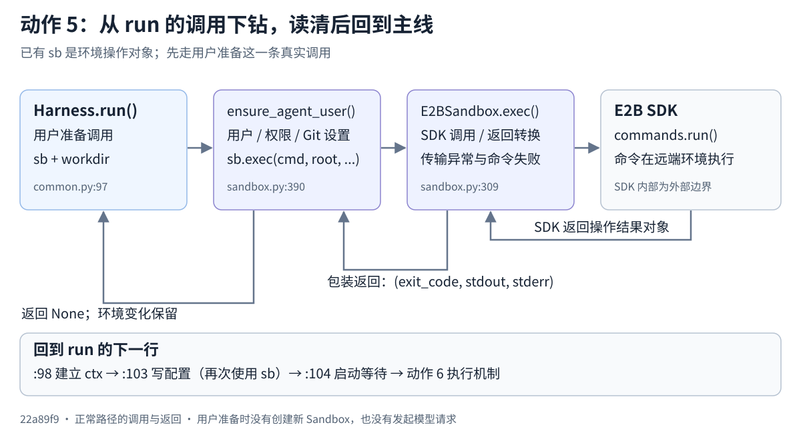

<!-- Derived from 5.Manage Sandbox/README.md. -->

本章以已经准备好的 `sb` 为前提，从 `BaseHarness.run()` 的真实调用进入环境能力：用户准备 → 命令落实 → 回 run → 配置写入 → 回 run → 委派 CLI 执行。创建和释放放在主线走通后的回看中。源码固定在 `22a89f96835969a47055a659c588f46151f8b07a`，旧核心实现与本次快照没有差异。

## 在任务生命周期中的位置

[](/images/slime-lifecycle/action-5.svg)

[返回任务生命周期总览](/projects/slime/#agent-lifecycle)

环境能力贯穿安装、题目准备、配置、运行、结果收集与回收。`run()` 接收已有环境；动作 5 解释这些操作如何由接口进入具体后端。

## 调用与返回总览

[](run-sandbox.svg)

先看上方从调用者到环境后端的交接，再沿返回线回到 run 的下一行。图以一次用户准备为例，后面的配置与执行继续使用同一个 sb。



## 先从 run 的第一步进入

```text
BaseHarness.run()
  -> ensure_agent_user(sb, workdir)
       -> sb.exec(...)
            -> E2BSandbox.exec()
                 -> E2B SDK commands.run()
            <- (exit_code, stdout, stderr)
       <- None; environment changes retained
  -> HarnessContext(...)
  -> ClaudeCodeHarness.write_config(...)
       -> sb.exec(...)
       <- None; configuration files retained
  -> launch_and_wait(...) -> run_agent(...)
       -> environment operations -> action 6 execution/wait
```

## 六步读法：进入、结果、返回位置

| 步骤 | 当前主线 → 环境实现 | 本次读清什么 | 看完返回哪里 |
| --- | --- | --- | --- |
| 1 | run:97 → [ensure_agent_user](https://github.com/THUDM/slime/blob/22a89f96835969a47055a659c588f46151f8b07a/slime/agent/sandbox.py#L390)（`slime/agent/sandbox.py:390`） | root 命令检查/按需创建 agent 用户，调整权限与 Git 目录设置 | run:98 建立 ctx |
| 2 | sb.exec → [E2BSandbox.exec](https://github.com/THUDM/slime/blob/22a89f96835969a47055a659c588f46151f8b07a/slime/agent/sandbox.py#L309)（`slime/agent/sandbox.py:309`） → SDK | cmd/user/env/timeout 如何传递；SDK 结果怎样成为三元组 | ensure_agent_user 返回 None，再回 run |
| 3 | run:103 → [ClaudeCodeHarness.write_config](https://github.com/THUDM/slime/blob/22a89f96835969a47055a659c588f46151f8b07a/slime/agent/harness/claude_code.py#L44)（`slime/agent/harness/claude_code.py:44`） → sb.exec | 两个静态 Claude 设置怎样写入环境；模型地址/token 尚未在这里写入 | run:104 启动等待 |
| 4 | [Sandbox](https://github.com/THUDM/slime/blob/22a89f96835969a47055a659c588f46151f8b07a/slime/agent/sandbox.py#L28)（`slime/agent/sandbox.py:28`）、[E2BSandbox.write_file](https://github.com/THUDM/slime/blob/22a89f96835969a47055a659c588f46151f8b07a/slime/agent/sandbox.py#L342)（`slime/agent/sandbox.py:342`）、[E2BSandbox.read_file](https://github.com/THUDM/slime/blob/22a89f96835969a47055a659c588f46151f8b07a/slime/agent/sandbox.py#L380)（`slime/agent/sandbox.py:380`） | 同一个 sb 还怎样写文件、上传宿主文件、读回文本；接上 run_agent 的下一次环境操作 | 回 launch_and_wait/run_agent，交动作 6 |
| 5 回看创建 | [boot_agent_sandbox](https://github.com/THUDM/slime/blob/22a89f96835969a47055a659c588f46151f8b07a/examples/coding_agent_rl/generate.py#L96)（`examples/coding_agent_rl/generate.py:96`） → [E2BSandbox.__aenter__](https://github.com/THUDM/slime/blob/22a89f96835969a47055a659c588f46151f8b07a/slime/agent/sandbox.py#L281)（`slime/agent/sandbox.py:281`） | 构造包装对象、创建环境、安装 CLI、yield sb；不是此时重新创建 | 回到当前已经持有 sb 的 run |
| 6 回看收尾 | run 退出 → generate 的 git_diff → [E2BSandbox.__aexit__](https://github.com/THUDM/slime/blob/22a89f96835969a47055a659c588f46151f8b07a/slime/agent/sandbox.py#L302)（`slime/agent/sandbox.py:302`） | 同一工作环境收集 diff 后退出；安装失败或任务异常的回收尝试 | 外层独立评分与 Session 收尾 |

## 1．用户准备：环境里实际发生什么

`BaseHarness.run:97` 调用 ensure_agent_user。第一遍直接看这个函数的真实命令：

```python
async def ensure_agent_user(sb: Sandbox, workdir: str) -> None:
    """Create the unprivileged 'agent' user that owns workdir + can git diff."""
    await sb.exec(
        f"id agent >/dev/null 2>&1 || useradd -m -s /bin/bash agent && "
        f"chown -R agent:agent /home/agent {workdir} && "
        f"git config --system --add safe.directory '*' && id agent",
        user="root",
        check=True,
        timeout=60,
    )
```


示意 workdir 为 `/workspace/demo`。命令在沙箱里检查/按需创建 `agent` 用户，设置该目录与用户目录的所有权，并设置 Git 安全目录。`check=True` 表达调用方要求在 SDK 报告命令失败时抛错；这一步成功返回 None，成果是环境状态。

Pre-4 的 prepare_workspace 已经调用过这个 helper，run 中再确认一次。用户检查和目录权限设置可以再次执行；其中 Git `--add` 仍会重复追加条目，所以不能把整个命令概括成完全没有重复副作用的幂等操作。

**返回书签：** run:98。环境中的用户/权限准备好，继续构造 ctx。

## 2．Sandbox 接口怎样落实到 E2B

`Sandbox` 是 Protocol，描述调用方依赖的能力：异步上下文、exec、write_file、read_file。实际传入 `E2BSandbox`；它提供相同方法而无需继承 Protocol。

| 对象 | 处在什么位置 | 管什么 |
| --- | --- | --- |
| Harness | Slime 的组织代码 | 产生操作要求与接收结果 |
| sb / E2BSandbox | Slime 的后端包装对象 | 将要求转换为 SDK 操作，统一返回与失败边界 |
| sb._sb | E2B SDK 的操作句柄 | 向远端环境发送命令/文件操作 |
| 远端环境 | CLI 和任务目录所在位置 | 实际执行命令、保存文件和运行 CLI |

进入 E2BSandbox.exec，先读 SDK 调用与成功返回：

```python
            res = await self._rpc_retry(
                f"exec({cmd[:60]!r})",
                lambda: self._sb.commands.run(
                    cmd,
                    user=user,
                    envs=env,
                    timeout=timeout,
                    on_stdout=lambda s: None,
                    on_stderr=lambda s: None,
                ),
                idempotent=idempotent,
            )
            return res.exit_code, res.stdout or "", res.stderr or ""
```


cmd、user、timeout 原样进入 SDK，`env` 在 SDK 参数中名为 `envs`。成功结果整理为 `(exit_code, stdout, stderr)`，两个输出空值转成字符串。调用方这次忽略了三元组，但操作已经作用在环境中。

SDK 抛 `CommandExitException` 时，`check=False` 返回退出结果，`check=True` 转为 RuntimeError；普通命令失败不因此重跑整条命令。传输重试由 [E2BSandbox._rpc_retry](https://github.com/THUDM/slime/blob/22a89f96835969a47055a659c588f46151f8b07a/slime/agent/sandbox.py#L237)（`slime/agent/sandbox.py:237`） 单独处理：只重放被识别为瞬时异常且允许重放的操作，默认最多 6 次尝试，耗尽或不允许时抛错。第一遍定位这个分支即可，具体异常识别与退避作为第二遍问题。

**返回书签：** exec → ensure_agent_user → run:98。不要把 SDK 调用误读成在 Slime 宿主机直接执行 shell。

## 3．回到 run，再看配置写入

run 建立 ctx 后调用 Claude write_config，当前对象的子类实现如下：

```python
    async def write_config(self, sb: Sandbox, ctx: HarnessContext) -> None:
        """Pre-ack bypass-permissions so claude-code starts headless."""
        settings = json.dumps({"hasCompletedOnboarding": True, "bypassPermissionsModeAccepted": True})
        await sb.exec(
            "mkdir -p /home/agent/.claude && "
            f"echo {shlex.quote(settings)} "
            "| tee /home/agent/.claude.json /home/agent/.claude/settings.json > /dev/null && "
            "chown -R agent:agent /home/agent/.claude /home/agent/.claude.json",
            user="root",
            check=True,
            timeout=60,
        )
```


它通过 sb.exec 的 shell 命令写 `/home/agent/.claude.json` 与 `.claude/settings.json`，并调整所有权。本实现没有读取 ctx；两个设置用于无交互启动确认。地址、会话身份和模型标签后来在 launch_and_wait 的 env 中使用。

**返回书签：** run:104。配置动作返回 None，继续准备启动命令；本章在 sb.exec 接口与结果上完成这一段下钻。

## 4．同一个 sb 还提供哪些能力

| 接口 | 输入 | 成功结果 / 副作用 | 本例用在哪里 |
| --- | --- | --- | --- |
| exec | cmd、用户、环境变量、操作超时、check/重放提示 | 三元组退出状态和输出；环境命令的副作用 | 用户/配置、目录准备、启动与标记检查 |
| write_file | 沙箱路径 + 文本/bytes/宿主 Path + 用户 | 成功返回 None，文件在环境中写入；上传异常继续抛出 | Node/CLI 安装包、题目文件、启动脚本 |
| read_file | 沙箱路径 + 用户 | 成功得到文本；最终普通异常被转换成空字符串 | 需要回读完整输出等内容时 |

write_file 接受 Path 时，每次上传尝试重新打开宿主文件；bytes 每次重新构造流。read_file 的空字符串可能表示空文件，也可能表示读取失败，不能据此断定远端文件一定为空。

继续回到 launch_and_wait → run_agent：先通过 sb.exec 创建 `.harness` 输出目录，再把 cmd、env、agent 用户、workdir、预算交给 exec_and_wait。**动作 5 到这里交出环境接口，动作 6 展开脚本、后台进程和退出标记的机制。**

## 5．回看：sb 先前从哪里来

Pre-4 在 generate:203 进入 boot_agent_sandbox。`E2BSandbox(image)` 先保存配置，__aenter__ 才用 metadata 与生命周期参数调用 AsyncSandbox.create，得到 SDK 句柄和 sandbox_id。

创建后，所选 Harness.install_cli 准备 Node 与 CLI，成功 yield sb。外层先 prepare_workspace，再在 generate:205 调 run。这个回看解释已有对象的来源，读完仍回当前 run 的书签。

第一次可以只读 __aenter__、安装的接口交接与 yield；创建重试、SDK 的网络与实际镜像路由按问题再深入。外部 E2B 网关/SDK 的内部实现不是本仓库里的完整组件。

## 6．回看：返回和释放分别由谁完成

```text
E2BSandbox.exec -> (exit_code, stdout, stderr)
exec_and_wait  -> (exit_code, output)
run_agent/run  -> exit_code
generate       -> git_diff in same environment
context exit   -> __aexit__ -> kill attempt
generate       -> independent evaluation
```

安装异常在创建成功之后先尝试退出候选环境；yield 之后正常、异常或取消都经过上下文 finally。__aexit__ 调用 SDK kill，普通异常仅记 warning，不使用 _rpc_retry；执行了回收函数不等于远端销毁已被运行验证。

等待预算耗尽会返回 `-1`，等待函数不自行杀掉 CLI；外层还会先收集 diff，再退出工作环境。动作 7 则发生在 CLI 运行/等待期间：CLI 回连 Adapter，请求模型并执行自己的工具循环。Harness 不主动调用 Adapter，Sandbox 的退出标记轮询也不是模型请求循环。

## 当前应能连续说明什么

从 run 的用户准备进 sb.exec，读到 SDK 与返回合同；回 run，进 write_config，再次使用同一环境；回 run，接到启动/等待。最后能指出已有环境的创建者，以及结束后的结果收集和回收者。如此走完职责，再选择一条命令失败/传输异常分支解释即可。

## 补充材料与章节边界

- [命令和文件操作](https://github.com/dextermayhewjd/dextermayhewjd.github.io/blob/main/slime_photo/4.Slime%20Core%20Components%20and%20Orchestration/4.1.Agent%20Rollout%20Adapters%20and%20Harnesses/5.Manage%20Sandbox/1.%E5%91%BD%E4%BB%A4%E5%92%8C%E6%96%87%E4%BB%B6%E6%93%8D%E4%BD%9C.md)：具体输入输出例子。
- [主路径和源码函数](https://github.com/dextermayhewjd/dextermayhewjd.github.io/blob/main/slime_photo/4.Slime%20Core%20Components%20and%20Orchestration/4.1.Agent%20Rollout%20Adapters%20and%20Harnesses/5.Manage%20Sandbox/2.%E4%B8%BB%E8%B7%AF%E5%BE%84%E5%92%8C%E6%BA%90%E7%A0%81%E5%87%BD%E6%95%B0.md)：接口/调用位置索引。
- [创建入口和生命周期](https://github.com/dextermayhewjd/dextermayhewjd.github.io/blob/main/slime_photo/4.Slime%20Core%20Components%20and%20Orchestration/4.1.Agent%20Rollout%20Adapters%20and%20Harnesses/5.Manage%20Sandbox/3.%E5%88%9B%E5%BB%BA%E5%85%A5%E5%8F%A3%E5%92%8C%E7%94%9F%E5%91%BD%E5%91%A8%E6%9C%9F.md)：安装、重试、超时与回收补读。
- [旧纵向数据流](https://github.com/dextermayhewjd/dextermayhewjd.github.io/blob/main/slime_photo/4.Slime%20Core%20Components%20and%20Orchestration/4.1.Agent%20Rollout%20Adapters%20and%20Harnesses/5.Manage%20Sandbox/%E7%BA%B5%E5%90%91%E6%95%B0%E6%8D%AE%E6%B5%81/README.md)：保留同一任务参数的图文材料，按本章调用书签定位。

本篇静态核对本地固定源码与旧材料的一致性；源码测试可先读 tests/test_agent/test_sandbox_exec_and_wait.py/test_harness.py 的 fake 与断言。真实 E2B、CLI、模型与源码仓库测试未在本轮执行。

保留 CodeWiki 原图用于组件定位：



[本节 README 完整存档](https://github.com/dextermayhewjd/dextermayhewjd.github.io/blob/main/slime_photo/4.Slime%20Core%20Components%20and%20Orchestration/4.1.Agent%20Rollout%20Adapters%20and%20Harnesses/5.Manage%20Sandbox/README.md)
