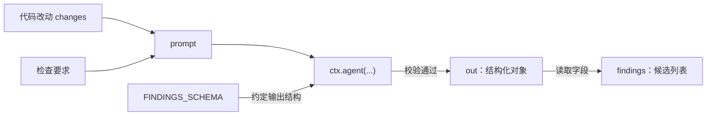
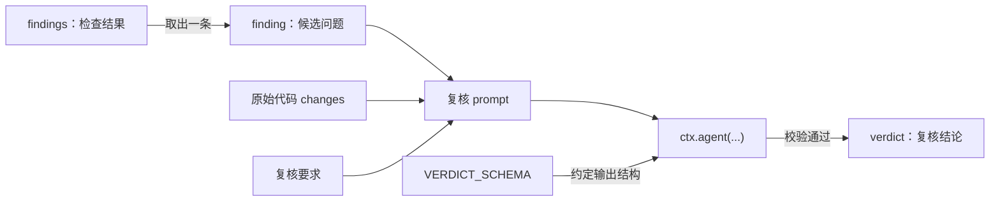
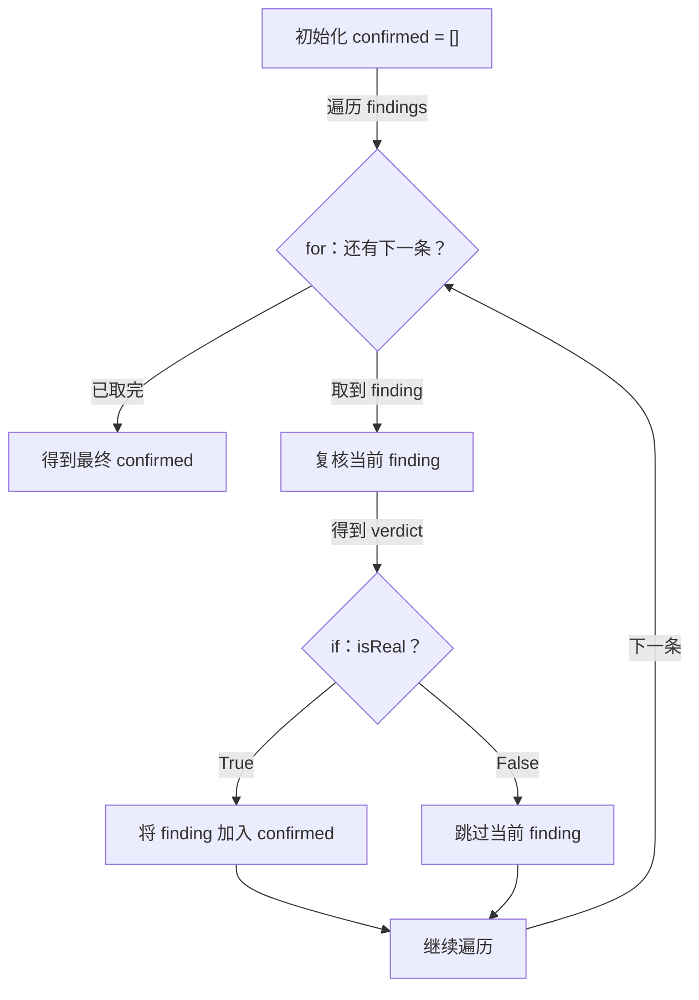



## 我想弄清楚的问题 {#workflow-question}

从 S01 到 S15，模型每轮选择工具，工具结果进入 `messages[]`，模型再决定下一步。这适合需要根据执行结果不断调整路径的任务。

另一些任务的步骤关系可以提前确定。例如代码审查：

1. **并行检查**：从多个维度检查代码。
2. **逐项复核**：验证检查中发现的问题。
3. **汇总排序**：汇总问题，并按严重程度排序。

每次发现的问题可以不同，但处理流程保持一致。

执行这样的流程，需要三种能力：

- **并行**：独立步骤可以同时执行。
- **结构稳定**：返回内容可以变化，但字段与格式需要约定，方便后续步骤读取。
- **可恢复**：中断后能复用已完成调用的结果，减少重复执行。

Workflow 将步骤关系写入代码，并用执行记录（journal）保存已完成调用的结果。

**模型负责每一步的具体判断，代码负责组织这些步骤；执行过程需要支持并行、结构化结果和结果复用。**

<details>
<summary>本章目录与源码版本</summary>



文中的 `ctx`、编排原语和 runtime 均来自 [learn-claude-code 的 S16 教学实现](https://github.com/shareAI-lab/learn-claude-code/blob/ce8f9f186058939da54c9d6fead78dfb5d0fd6c3/s16_workflow_runtime/code.py)，源码固定为 `ce8f9f186058939da54c9d6fead78dfb5d0fd6c3`。从第 1 节的单次调用逐步拼出完整流程；教学裁剪与源码节选在各处注明。图中源码详情展示固定版本的完整方法。

源码与上游图遵循 MIT 许可，见[来源与许可说明](/examples/s16-repo/NOTICE.txt)。

</details>

## 整体过程 {#workflow-map}

先用总图定位三层关系：主 Agent 决定何时调用 Workflow，脚本组织固定步骤，runtime 执行各步调用并记录结果。下面从一次模型调用开始，逐步解释图里的组件。

{{< architecture-explorer id="s16-overview-explorer" modules="workflow-overview-explorer.json" roles="function-roles.json" width="1400" src="images/workflow-runtime-overview.svg" legend="workflow" label="Workflow 完整总图：原 Agent 循环调用工作流，脚本通过 ctx.agent 使用单步模型和 journal；成功或失败都收尾并返回，恢复需要外层再次发起调用。" caption="蓝色是原有 Agent 工具循环，紫色是工作流和单步执行，灰色是记录与收尾，橙色标出恢复、修正重试和失败分支。实线表示调用、结果返回或步骤先后关系；紫色虚线框划分脚本与单步执行，橙色虚线表示异常向外传播。脚本可反复调用 ctx.agent()，每步结果先回到脚本；整次运行收尾后，才通过一个 tool_result 回到外层对话。图中失败分支展示脚本执行期间的异常；预算、次数、运行锁和启动前检查仍按第 19–20、23 节处理。" >}}

[打开总图查看细节](images/workflow-runtime-overview.svg)（SVG，可放大查看）

入口、脚本、单步执行、缓存与收尾可点击查看实现，悬停节点可追踪连线。详情窗口支持放大、恢复尺寸和键盘关闭。

**阅读顺序：** 第 1–5 节搭出基础流程，第 6–14 节加入并行、进度和恢复，第 15–23 节再看运行时怎样组织执行并接回 Agent。

<span id="workflow-position"></span>

## 1. `ctx.agent()`：把代码改动交给模型检查 {#workflow-first-call}

这一节介绍编排原语 `ctx.agent()`：通过它让模型完成当前这一步任务。

先完成一次安全检查。输入是待审查的代码文本，这里沿用[官方演示中的代码改动](https://github.com/shareAI-lab/learn-claude-code/blob/ce8f9f186058939da54c9d6fead78dfb5d0fd6c3/s16_workflow_runtime/code.py#L674)，用 `changes` 保存：

```python
changes = """def load_user(user_id):
    query = f"SELECT * FROM users WHERE id = {user_id}"
    return db.execute(query).fetchone()
"""
```

在工作流脚本里，把检查要求和这段代码一起交给模型：

```python
out = await ctx.agent(
    f"检查以下代码改动中的安全问题，只报告有依据的问题：\n{changes}"
)
```



`ctx` 是[原仓库运行时创建并传入的 `ExecutionState` 对象](https://github.com/shareAI-lab/learn-claude-code/blob/ce8f9f186058939da54c9d6fead78dfb5d0fd6c3/s16_workflow_runtime/code.py#L595)；这里通过它的 `agent()` 调用模型，`out` 接收返回的审查文字。以上沿用原仓库的调用接口，缩短了提示词，并暂时省略原示例中的输出格式约定。

模型可能给出这样的回答，下面仅为输出示意：

```text
候选问题：SQL 查询直接拼入了 user_id。
如果 user_id 可被外部控制，可能存在 SQL 注入风险。
建议使用参数化查询。
```

这一步完成了“代码改动和检查要求 → 模型检查 → 审查文字”。

接下来要逐条复核候选问题，但当前返回的只是一段文字，模型也可能换一种写法。下一步需要把候选问题组织成程序能稳定读取的列表，再交给复核。

<span id="workflow-values"></span>

## 2. `schema` 参数：让检查结果可被程序读取 {#workflow-schema}

这一节继续使用 `ctx.agent()`，重点是它的 `schema` 参数：约定本次调用的输出结构。

为了逐条复核，我们先约定检查结果的结构。仍以上一节的问题为例，期望得到的结果可以是这样（内容仅为示意）：

```json
{
  "findings": [
    {"title": "user_id 直接拼接进 SQL，可能引入注入风险", "severity": "high"}
  ]
}
```

`findings` 是候选问题列表，每条问题包含标题 `title` 和严重程度 `severity`；严重程度取 `high`、`medium`、`low` 之一。模型发现的问题可以不同，但这些字段及其类型保持一致。

这次传入的 `schema`，就是官方定义的 [`FINDINGS_SCHEMA`](https://github.com/shareAI-lab/learn-claude-code/blob/ce8f9f186058939da54c9d6fead78dfb5d0fd6c3/s16_workflow_runtime/code.py#L650)。**它是一个用 JSON Schema 关键字描述输出结构的 Python 字典**。上面的示例填着具体问题，下面这份字典写的是这些值必须遵守的规则。

以下保留原定义的字段和值，展开缩进并添加注释，方便逐层对应：

```python
FINDINGS_SCHEMA = {
    "type": "object",                  # 整个回答是对象，对应 Python 字典
    "required": ["findings"],           # 必须包含 findings 字段
    "properties": {
        "findings": {
            "type": "array",           # findings 是列表
            "items": {                 # 列表中每一项的规则
                "type": "object",
                "required": ["title", "severity"],
                "properties": {
                    "title": {"type": "string"},
                    "severity": {
                        "type": "string",
                        "enum": ["high", "medium", "low"],
                    },
                },
            },
        },
    },
}
```

`properties` 描述每个字段的规则，`required` 列出必填字段；`items` 约束列表里的每一项，`enum` 列出允许的取值。因此，每条候选问题都要有字符串类型的 `title` 和 `severity`，后者只能取三个约定值。没有候选问题时，可以返回 `{"findings": []}`。

给上一节的调用增加 `schema=FINDINGS_SCHEMA`，就是把这份规则交给 `ctx.agent()`：

```python
out = await ctx.agent(
    f"检查以下代码改动中的安全问题，只报告有依据的问题：\n{changes}",
    schema=FINDINGS_SCHEMA,
)
```



<details>
<summary>查看这张图的 Mermaid 源码</summary>



</details>

`schema` 指定本次调用期望的输出结构。运行时会要求模型返回相应的 JSON，并解析、校验结果；不符合约定时重试一次，仍不符合则报错。

校验通过后，`out` 是可供 Python 读取的对象。后续代码可以直接取出候选问题列表：

```python
findings = out["findings"]
```

这份 schema 检查返回格式；候选问题是否成立，还需要下一步的复核来判断。

这一步让同一次安全检查得到结构明确的候选问题列表。下一步就可以取出其中一条问题，连同原始代码一起交给模型复核。

<span id="workflow-one-finding"></span>

## 3. 再次调用 `ctx.agent()`：复核一条候选问题 {#workflow-verify-one}

这一节复用 `ctx.agent()` 和 `schema`，让模型核对一条候选问题是否有依据。

先取上一节示意列表中的第一条问题：

```python
finding = findings[0]
```

复核需要两份材料：原始代码 `changes`，以及这条候选问题 `finding`。这次模型调用不会自动带入上一次检查的对话，因此要把两份材料一起写进提示词。

复核结果也约定为固定结构：`isReal` 记录模型判断问题是否成立，`reason` 记录判断理由。官方将这份约定定义为 [`VERDICT_SCHEMA`](https://github.com/shareAI-lab/learn-claude-code/blob/ce8f9f186058939da54c9d6fead78dfb5d0fd6c3/s16_workflow_runtime/code.py#L662)。

下面沿用原定义，展开缩进并添加注释。这次要求返回的是一条复核结论：

```python
VERDICT_SCHEMA = {
    "type": "object",
    "required": ["isReal", "reason"],   # 两个字段都必须提供
    "properties": {
        "isReal": {"type": "boolean"}, # 是否成立：布尔值
        "reason": {"type": "string"},  # 判断理由：字符串
    },
}
```

将复核材料和这份结构约定一起交给 `ctx.agent()`：

```python
import json

verdict = await ctx.agent(
    f"根据代码改动，复核这条候选问题是否成立。\n"
    f"代码改动：\n{changes}\n"
    f"候选问题：\n{json.dumps(finding, ensure_ascii=False)}",
    schema=VERDICT_SCHEMA,
)
```



<details>
<summary>查看这张图的 Mermaid 源码</summary>



</details>

`json.dumps` 将候选问题转换为提示词中的 JSON 文本。这里沿用官方 [`verify()`](https://github.com/shareAI-lab/learn-claude-code/blob/ce8f9f186058939da54c9d6fead78dfb5d0fd6c3/s16_workflow_runtime/code.py#L698) 的输入材料和返回字段，先取一条问题单独调用，提示词已缩短。

返回结果可能如下，内容仅为示意：

```json
{
  "isReal": true,
  "reason": "代码将 user_id 直接拼入 SQL；若它来自外部输入，可能改变查询语义。"
}
```

现在，`finding` 保存候选问题，`verdict` 保存这条问题的复核结论。下一步可以根据 `verdict["isReal"]` 决定是否保留它，再把同样的处理应用到其余候选问题。

## 4. `for` 与 `if`：复核全部候选问题并筛选 {#workflow-loop-filter}

这一节使用普通 Python 的循环和条件判断，把已经会做的单条复核应用到整个列表。

先看一条问题：上一节已经拿到了 `verdict`，现在根据其中的 `isReal` 决定是否保留原来的 `finding`：

```python
confirmed = []
if verdict["isReal"]:
    confirmed.append(finding)
```

`confirmed` 用来收集保留的问题。复核结论为 `true` 时，把原候选问题加入列表；为 `false` 时跳过。复核结论决定去留，列表里保存的仍是候选问题本身。

候选问题可能有多条，因此把上一节的复核调用和这段筛选一起放进循环：

```python
confirmed = []
for finding in findings:
    verdict = await ctx.agent(
        f"根据代码改动，复核这条候选问题是否成立。\n"
        f"代码改动：\n{changes}\n"
        f"候选问题：\n{json.dumps(finding, ensure_ascii=False)}",
        schema=VERDICT_SCHEMA,
    )
    if verdict["isReal"]:
        confirmed.append(finding)
```



<details>
<summary>查看这张图的 Mermaid 源码</summary>



</details>

每轮循环取出一条候选问题，等待它的复核结果，再决定是否加入 `confirmed`。例如，三条问题的复核结论依次为 `true`、`false`、`true`，最终就保留第一条和第三条。

这里先按顺序执行，沿用[官方实现](https://github.com/shareAI-lab/learn-claude-code/blob/ce8f9f186058939da54c9d6fead78dfb5d0fd6c3/s16_workflow_runtime/code.py#L709) 根据 `isReal` 筛选原候选问题的规则；并发执行留到后续展开。

现在，单个审查维度的数据处理已经接起来：**检查得到 `findings` → 逐条复核得到 `verdict` → 筛选形成 `confirmed`**。下一步可以把已经讲过的片段合成一份 workflow 脚本。

<span id="workflow-example"></span>

<span id="workflow-script-limit"></span>

## 5. `sample_workflow()`：合成基础工作流 {#workflow-basic}

现在把这些片段按执行顺序放进一个函数，使用官方的函数名 `sample_workflow(ctx, args)`。下面是只检查安全性、按顺序复核的教学版本，沿用原文件中的 `FINDINGS_SCHEMA` 和 `VERDICT_SCHEMA` 定义：

```python
import json


async def sample_workflow(ctx, args):
    changes = args.get("changes", "")

    # 检查：得到候选问题列表
    out = await ctx.agent(
        f"检查以下代码改动中的安全问题，只报告有依据的问题：\n{changes}",
        schema=FINDINGS_SCHEMA,
    )
    findings = out["findings"]

    # 逐条复核，并保留被判定成立的问题
    confirmed = []
    for finding in findings:
        verdict = await ctx.agent(
            f"根据代码改动，复核这条候选问题是否成立。\n"
            f"代码改动：\n{changes}\n"
            f"候选问题：\n{json.dumps(finding, ensure_ascii=False)}",
            schema=VERDICT_SCHEMA,
        )
        if verdict["isReal"]:
            confirmed.append(finding)

    return {"confirmed": confirmed}
```

假设检查得到 A、B 两条候选问题，当前版本按这个顺序执行：

```text
检查 → 复核 A → 筛选 A → 复核 B → 筛选 B → 返回结果
```

**图注：** 每条问题完成复核和筛选后，才处理下一条。图中的 A、B 是本次检查产生的两个示例问题。

函数里的检查、复核和筛选都是前面已经讲过的代码。合起来只需补上入口、读取输入和返回结果：

- **`sample_workflow(ctx, args)`** 是整套流程的函数入口，`ctx` 提供已经使用过的模型调用接口。
- **`args`** 带入本次运行的参数，其中 `changes` 是待审查的代码文本。
- **`return`** 交出最终结果，`confirmed` 中保存复核后保留的问题。

这份基础工作流已经能够完成：**接收代码改动 → 检查 → 逐条复核 → 筛选 → 返回结果**。步骤的先后关系写在函数里，模型负责每次检查和复核的具体判断。

<span id="workflow-concurrency"></span>

<span id="workflow-primitives"></span>

## 6. `ctx.parallel()`：让独立的复核并发执行 {#workflow-parallel}

基础工作流已经能处理全部候选问题。但上一版每次都要等一条复核完成，才开始下一条。

每条复核只需要原始代码和它对应的候选问题，不依赖其他复核的结论。因此，这些任务可以并发执行。本节加入 `ctx.parallel()`，一起执行这组复核，再等齐结果。

先为每条候选问题准备一个待执行的任务，里面仍然是上一节的模型调用：

```python
tasks = [
    lambda f=f: ctx.agent(
        f"根据代码改动，复核这条候选问题是否成立。\n"
        f"代码改动：\n{changes}\n"
        f"候选问题：\n{json.dumps(f, ensure_ascii=False)}",
        schema=VERDICT_SCHEMA,
    )
    for f in findings
]
```

这里沿用[官方的任务包装写法](https://github.com/shareAI-lab/learn-claude-code/blob/ce8f9f186058939da54c9d6fead78dfb5d0fd6c3/s16_workflow_runtime/code.py#L701)：`lambda` 把模型调用放进一个待调用的函数，`f=f` 为这个任务保留对应的候选问题。准备列表时，复核还没有开始。

现在把任务列表放回第 5 节的 `sample_workflow()`，替换原来逐条等待的复核循环。检查调用沿用前文；下面是结构节选，注释和 `...` 省略检查调用及刚才的 `tasks` 定义，保留它们与等待、筛选、返回之间的连接：

```python
async def sample_workflow(ctx, args):
    changes = args.get("changes", "")
    # ...沿用第 5 节的检查调用，得到 out...
    ...
    findings = out["findings"]

    # ...使用上面的代码，为 findings 中每条问题准备 tasks...
    ...
    verdicts = await ctx.parallel(tasks)

    confirmed = []
    for finding, verdict in zip(findings, verdicts):
        if verdict["isReal"]:
            confirmed.append(finding)

    return {"confirmed": confirmed}
```

仍假设检查得到 A、B 两条候选问题。与第 5 节相比，复核任务现在可以同时进行，等齐结果后再配对筛选。下面展示两条复核均成功返回的路径：

```text
检查 → 得到 A、B → 准备 tasks
                         ↓
                 ctx.parallel(tasks)
                   ├→ 复核 A ─┐
                   └→ 复核 B ─┴→ 等齐 verdicts
                                      ↓
                        与 findings 按位置配对
                                      ↓
                             筛选 → 返回结果
```

**图注：** 分叉表示 A、B 的复核可以并发进行，汇合处表示等齐成功结果后才继续筛选。`parallel` 返回的 `verdicts` 与传入任务顺序一致；即使 B 先完成，`verdicts[0]` 仍然对应 A。

`zip` 将候选问题与复核结论按相同位置配成一对，继续使用已经讲过的筛选规则。这样，每条候选问题都使用自己的复核结论决定去留。

这里的 `for` 仍然用于准备任务和筛选结果；并发执行的是交给 `ctx.parallel()` 的复核调用。

变化集中在原来的复核循环位置：**先检查得到 `findings` → 准备复核任务 → 并发执行并等齐 `verdicts` → 配对筛选得到 `confirmed` → 返回结果**。

## 7. `ctx.pipeline()`：让多个审查维度各自推进 {#workflow-pipeline}

上一节已经能从安全性角度检查代码，并同时复核这个维度发现的多条问题。现在增加正确性、性能和风格检查，沿用[官方的维度列表](https://github.com/shareAI-lab/learn-claude-code/blob/ce8f9f186058939da54c9d6fead78dfb5d0fd6c3/s16_workflow_runtime/code.py#L673)：

```python
DIMENSIONS = ["correctness", "security", "performance", "style"]
```

每个维度都检查同一份代码，也都要经过已经讲过的“检查 → 复核”。但各维度的处理时间可以不同：安全性检查先完成，就可以先复核安全问题，不必等待正确性检查。

这就是本节引入 `ctx.pipeline()` 的原因：每个条目按顺序经过相同的阶段，不同条目可以各自推进。这里的“条目”就是一个审查维度。

先把已有代码放进官方的两个阶段函数 `audit` 和 `verify`。它们都定义在 `sample_workflow()` 内部，使用已有的 `ctx` 和 `changes`。

`pipeline` 会向每个阶段传入三个参数：**当前结果、原始条目、条目的序号**。第一次调用时，当前结果就是条目本身；之后则是上一步的返回值。本例的原始条目是 `dimension`；下划线开头的参数表示这一步没有用到它。

先看检查阶段：检查逻辑沿用前面的代码，只把固定的安全性改为传入的 `dimension`，再返回这个维度的候选问题。

```python
async def audit(_value, dimension, _idx):
    out = await ctx.agent(
        f"检查以下代码改动中的 {dimension} 问题，只报告有依据的问题：\n{changes}",
        schema=FINDINGS_SCHEMA,
    )
    return {"dimension": dimension, "findings": out["findings"]}
```

再看复核阶段：`audited` 接收刚才 `audit` 的返回值，从中取出候选问题，执行第 6 节已经讲过的并发复核和筛选。

```python
async def verify(audited, dimension, _idx):
    tasks = [
        lambda f=f: ctx.agent(
            f"根据代码改动，复核这条 {dimension} 候选问题是否成立。\n"
            f"代码改动：\n{changes}\n"
            f"候选问题：\n{json.dumps(f, ensure_ascii=False)}",
            schema=VERDICT_SCHEMA,
        )
        for f in audited["findings"]
    ]
    verdicts = await ctx.parallel(tasks)

    confirmed = []
    for finding, verdict in zip(audited["findings"], verdicts):
        if verdict["isReal"]:
            confirmed.append(finding)
    return {"dimension": dimension, "confirmed": confirmed}
```

两个阶段接好以后，将维度列表交给 `pipeline`。下面把它们放回同一个工作流函数，保留两个阶段的输入、输出与连接位置。两个函数的处理细节就是上面的代码，这里用注释和 `...` 概括；此结构节选暂时停在各维度的结果，汇总和最终返回在下一节补上。

```python
async def sample_workflow(ctx, args):
    changes = args.get("changes", "")

    async def audit(_value, dimension, _idx):
        # ...上面的检查代码：使用 changes 和 dimension，得到 out...
        ...
        return {"dimension": dimension, "findings": out["findings"]}

    async def verify(audited, dimension, _idx):
        # ...上面的复核代码：读取 audited["findings"]，得到 confirmed...
        ...
        return {"dimension": dimension, "confirmed": confirmed}

    results = await ctx.pipeline(DIMENSIONS, audit, verify)
    # 下一节在这里接上汇总、排序和最终返回。
```

下面只画安全性与性能两个维度，其他维度按同样的方式执行：

```text
ctx.pipeline(DIMENSIONS, audit, verify)

安全性：audit → audited → verify → 该维度结果 ─┐
性能：  audit → audited → verify → 该维度结果 ─┴→ 等齐 → results
```

**图注：** 同一行里，`audited` 就是该维度 `audit` 返回的对象，包含 `dimension` 和 `findings`。`verify` 从中取出候选问题，执行第 6 节的并行复核与筛选；两个阶段都继续读取外层的同一份原始代码 `changes`。

不同行独立推进：安全性检查一结束，就能进入自己的 `verify`，不必等性能检查完成。末端才等齐所有维度的结果；`results` 按 `DIMENSIONS` 的顺序保存它们，每项包含 `dimension` 和 `confirmed`。

此时两层关系分别是：**`pipeline` 让不同维度各自走完检查和复核；每个维度里的 `parallel` 同时复核多条候选问题。**

下一步再把这些分属各维度的结果合成一份审查报告。

## 8. 汇总与排序：返回一份完整的审查结果 {#workflow-aggregate}

上一节得到的 `results` 按维度分组，每一组都有自己的 `confirmed`。要交出一份审查结果，需要把这些问题合成一个列表，并保留它们来自哪个维度。

先逐个取出各维度保留的问题，补上维度信息：

```python
confirmed = []
for result in results:
    for finding in result["confirmed"]:
        confirmed.append({"dimension": result["dimension"], **finding})
```

这里的 `**finding` 展开原问题的字段，因此汇总后的每条记录同时包含 `dimension`、`title` 和 `severity`。这一步与[官方的汇总逻辑](https://github.com/shareAI-lab/learn-claude-code/blob/ce8f9f186058939da54c9d6fead78dfb5d0fd6c3/s16_workflow_runtime/code.py#L714)对应，这里把列表推导展开成循环，便于观察数据怎样合并。

合并后，问题暂时按各维度的结果顺序排列。为了优先看到严重的问题，再按 `high`、`medium`、`low` 排序，然后返回这份列表。

把这些步骤接回上一节的函数尾部，就能看到 `results` 从哪里来，以及最终返回哪份结果。已讲清楚的输入读取和两个阶段函数用注释与 `...` 省略，以下是结构节选：

```python
async def sample_workflow(ctx, args):
    # ...读取 changes，定义上一节的 audit 和 verify...
    ...
    results = await ctx.pipeline(DIMENSIONS, audit, verify)

    confirmed = []
    for result in results:
        for finding in result["confirmed"]:
            confirmed.append({"dimension": result["dimension"], **finding})

    severity_order = {"high": 0, "medium": 1, "low": 2}
    confirmed.sort(key=lambda finding: severity_order.get(finding["severity"], 3))
    return {"confirmed": confirmed}
```

```text
results：按维度分组的确认项
          ↓ 展开各组，为每条问题补上 dimension
confirmed：合并后的问题列表
          ↓ 按 high → medium → low 排序
返回 {"confirmed": confirmed}
```

**图注：** `results` 是第 7 节返回的各维度结果；合并时保留问题来源，排序改变的是问题在列表中的位置。返回对象包含合并、排序后的 `confirmed`。

排序依据是严重程度对应的数字，数字越小越靠前。

结果结构示意如下：

```json
{
  "confirmed": [
    {
      "dimension": "security",
      "title": "user_id 直接拼接进 SQL，可能引入注入风险",
      "severity": "high"
    }
  ]
}
```

到这里，整条流程已经能够完成：**接收代码改动 → 各维度独立检查与复核 → 合并保留的问题 → 按严重程度排序 → 返回结果**。

多个维度并发运行后，检查和复核会交错发生。流程能够正常执行，但我们还需要看清每条记录对应哪次调用、哪个阶段，以及最终确认了多少条问题。

下面依次补上**调用名称、阶段标签和具体日志**，让人能观察这套流程的执行过程。步骤之间的执行关系继续由已有的脚本、`pipeline` 和 `parallel` 决定。这些接口来自 [learn-claude-code 自己实现的 `ExecutionState`](https://github.com/shareAI-lab/learn-claude-code/blob/ce8f9f186058939da54c9d6fead78dfb5d0fd6c3/s16_workflow_runtime/code.py#L437)。

## 9. `label` 参数：给每次模型调用命名 {#workflow-label}

先解决第一个问题：这条进度记录对应哪一次检查或复核？可以用 `ctx.agent()` 的 `label` 参数给调用命名。

前面没有指定标签时，运行时会取提示词的开头作为调用名称。现在有多个维度、每个维度又有多条复核，名称可能很相似，需要更直接地看出每次调用在做什么。

先给 `audit` 中的检查调用加上参数。下面仍是 `sample_workflow()` 内的检查函数，保留提示词、维度变量和返回值，用注释标明新增处：

```python
async def audit(_value, dimension, _idx):
    out = await ctx.agent(
        f"检查以下代码改动中的 {dimension} 问题，只报告有依据的问题：\n{changes}",
        schema=FINDINGS_SCHEMA,
        label=f"audit:{dimension}",  # 本节新增：为这次检查命名
    )
    return {"dimension": dimension, "findings": out["findings"]}
```

例如 `dimension` 是 `security` 时，标签就是 `audit:security`，表示安全性检查。

在同一个工作流的 `verify` 中，为每条复核任务同样加上标签。名称用到了 `dimension` 和候选问题 `f`，因此保留函数入口与任务列表；已讲过的等待和筛选用注释概括，以下是结构节选：

```python
async def verify(audited, dimension, _idx):
    tasks = [
        lambda f=f: ctx.agent(
            f"根据代码改动，复核这条 {dimension} 候选问题是否成立。\n"
            f"代码改动：\n{changes}\n"
            f"候选问题：\n{json.dumps(f, ensure_ascii=False)}",
            schema=VERDICT_SCHEMA,
            label=f"verify:{dimension}:{f['title']}",  # 本节新增
        )
        for f in audited["findings"]
    ]
    # ...await ctx.parallel(tasks)，再配对筛选得到 confirmed...
    ...
    return {"dimension": dimension, "confirmed": confirmed}
```

沿用前面的例子，可以得到这样的标签：

```text
audit:security
verify:security:user_id 直接拼接进 SQL，可能引入注入风险
```

这些标签沿用[仓库示例的命名方式](https://github.com/shareAI-lab/learn-claude-code/blob/ce8f9f186058939da54c9d6fead78dfb5d0fd6c3/s16_workflow_runtime/code.py#L690)，会出现在运行时记录的调用进度中。看到标签，就能辨认这是哪个维度的检查，或者哪条候选问题的复核。

`label` 还会参与执行记录的匹配，恢复执行时再展开。这里先用它识别调用，下一步再用 `phase` 标记调用所属的阶段。

## 10. `phase` 参数与 `ctx.phase()`：标记调用所属阶段 {#workflow-phase}

上一节的 `label` 回答“这是哪一次调用”。现在再回答：这次调用属于检查还是复核？这里的 `phase` 就是进度记录上的阶段标签。

在上一节的同一份 `sample_workflow()` 中补上阶段信息。下面保留两个调用的位置，以及它们与 `pipeline` 的关系；已讲过的提示词、复核筛选和最终汇总用注释与 `...` 概括。这是结构节选，不能单独运行，四处“本节新增”都是阶段标记：

```python
async def sample_workflow(ctx, args):
    ctx.phase("Review")  # 本节新增：记录检查阶段
    changes = args.get("changes", "")

    async def audit(_value, dimension, _idx):
        out = await ctx.agent(
            ...,  # 沿用第 9 节的检查提示词，包含 changes
            schema=FINDINGS_SCHEMA,
            label=f"audit:{dimension}",
            phase="Review",  # 本节新增：这次调用属于检查
        )
        return {"dimension": dimension, "findings": out["findings"]}

    async def verify(audited, dimension, _idx):
        ctx.phase("Verify")  # 本节新增：记录复核阶段
        tasks = [
            lambda f=f: ctx.agent(
                ...,  # 沿用第 9 节的复核提示词，包含 changes 和 f
                schema=VERDICT_SCHEMA,
                label=f"verify:{dimension}:{f['title']}",
                phase="Verify",  # 本节新增：这次调用属于复核
            )
            for f in audited["findings"]
        ]
        # ...并发执行 tasks，再配对筛选得到 confirmed...
        ...
        return {"dimension": dimension, "confirmed": confirmed}

    results = await ctx.pipeline(DIMENSIONS, audit, verify)
    # ...沿用第 8 节：合并、排序，得到总的 confirmed...
    ...
    return {"confirmed": confirmed}
```

先看两处 `phase=` 参数：`audit` 的调用增加 `phase="Review"`，`verify` 的调用增加 `phase="Verify"`，标明各自属于哪个阶段。进度记录里的关键信息就可以读成：

```text
label=audit:security          phase=Review
label=verify:security:某条问题  phase=Verify
```

再看两处 `ctx.phase()`：沿用[仓库示例的位置](https://github.com/shareAI-lab/learn-claude-code/blob/ce8f9f186058939da54c9d6fead78dfb5d0fd6c3/s16_workflow_runtime/code.py#L681)，在整个工作流开始时记录 `Review`，在每个维度进入 `verify` 时记录 `Verify`。它们位于函数入口，负责单独记录阶段进度。

`ctx.phase()` 会记录阶段进度，并为没有显式填写 `phase` 的后续调用提供默认阶段。同名阶段重复声明时，只记录一次阶段出现。

两种用法各有作用：**`ctx.phase("Verify")` 发出复核阶段的进度记录；`phase="Verify"` 明确这一次模型调用属于复核。**

这里需要结合第 7 节的并发关系理解：安全性可能已经进入复核，而正确性仍在检查。因此，出现 `Verify` 阶段记录，并不表示所有 `Review` 调用都已结束。调用上显式填写阶段，才能让尚在执行的检查仍归到 `Review`。

**阶段标签用于观察进度，执行先后仍由脚本、`pipeline` 和 `parallel` 决定。**

## 11. `ctx.log()`：记录具体的进度信息 {#workflow-log}

名称和阶段能说明是哪次调用、在做哪类工作，但还没有告诉我们最终确认了多少条问题。这类信息可以由业务代码算出来，再用 `ctx.log()` 写入进度记录。

第 8 节已经得到汇总并排序后的 `confirmed`。沿用[仓库示例的日志语句](https://github.com/shareAI-lab/learn-claude-code/blob/ce8f9f186058939da54c9d6fead78dfb5d0fd6c3/s16_workflow_runtime/code.py#L717)，在返回结果前加入一行。下面保留 `confirmed` 的来源和日志所在的函数尾部；输入准备与阶段函数用注释概括，以下是结构节选：

```python
async def sample_workflow(ctx, args):
    # ...沿用上一节的输入读取、阶段标记，以及 audit、verify 定义...
    ...
    results = await ctx.pipeline(DIMENSIONS, audit, verify)

    confirmed = []
    for result in results:
        for finding in result["confirmed"]:
            confirmed.append({"dimension": result["dimension"], **finding})

    severity_order = {"high": 0, "medium": 1, "low": 2}
    confirmed.sort(key=lambda finding: severity_order.get(finding["severity"], 3))

    ctx.log(f"confirmed {len(confirmed)} real finding(s)")  # 本节新增
    return {"confirmed": confirmed}
```

如果 `confirmed` 中有 3 条问题，这条日志的消息文字就是：

```text
confirmed 3 real finding(s)
```

`len(confirmed)` 负责计数，`ctx.log()` 负责将这条消息写入本次运行的进度记录；最终的问题列表仍由 `return` 返回。

这里的日志保存的是供人阅读的消息，例如问题数量。恢复执行需要各次检查、复核返回的完整对象，这些对象由下一节的 journal 保存。`ctx.log()` 的消息不会写入 journal。

现在可以对照完整的业务函数，检查前面几节的片段怎样拼在一起：读取输入 → 定义 `audit` 和 `verify` → 并行推进各维度 → 汇总排序 → 记录日志并返回。

<p id="workflow-complete-script" data-function-explorer="s16-overview-explorer"><a class="diagram-function-link" href="https://github.com/shareAI-lab/learn-claude-code/blob/ce8f9f186058939da54c9d6fead78dfb5d0fd6c3/s16_workflow_runtime/code.py#L681-L718" data-function="sample_workflow" data-function-card="script">查看完整 sample_workflow() 源码</a>（点击在当前页打开；包含输入校验与完整提示词。）</p>

这个函数展示脚本如何使用已经讲过的原语；它需要运行时提供 `ctx`。可直接执行的演示入口放在[文末的“试运行”](#workflow-try)。

到这里，流程既能执行，也能通过名称、阶段和日志观察执行过程。下一步再考虑另一个问题：运行到一半中断，怎样复用已经完成的调用结果？

<span id="workflow-storage"></span>

## 12. `journal`：保存已经完成的调用结果 {#workflow-journal}

先只跟踪安全性这个维度。假设检查已经返回两条候选问题，其中一条复核成功，另一条复核时请求失败：

```text
安全性检查：已完成，得到两条候选问题
问题 A 复核：已完成，得到复核结论
问题 B 复核：请求失败，没有取得复核结论
```

本次工作流因此没能交出最终报告，但前两次调用已经做出了结果。如果重新运行时再次请求这些结果，就会重复已经完成的工作。

前面的进度记录可以帮助我们知道哪些调用完成了。要复用这些调用，还需要保存它们返回的内容：检查产生的候选问题，以及复核产生的判断。

这就是 `journal` 的作用：**把已经完成的调用结果逐条写入本次运行的记录文件，为后续复用留下依据。**

先回到前面已经讲过的调用过程：`ctx.agent()` 取得并校验模型结果，再把结果返回给业务脚本。本节就在这条路径中补上保存步骤：

```text
此前讲到：取得结果 → 校验结果 → 返回给业务脚本
本节补上：取得结果 → 校验结果 →【保存到 journal】→ 返回给业务脚本
```

**图注：** 保存发生在一次调用的结果通过校验之后、返回业务脚本之前。每次成功调用分别留下记录，不需要等待整个工作流结束。

先定位到代码：前面业务脚本中的 `out = await ctx.agent(...)`，调用的是 [`ExecutionState.agent()`](https://github.com/shareAI-lab/learn-claude-code/blob/ce8f9f186058939da54c9d6fead78dfb5d0fd6c3/s16_workflow_runtime/code.py#L463)。方法里的 `self` 与业务脚本里的 `ctx` 指向同一个执行对象，保存动作就放在这个方法里面。

下面保留原方法中生成调用标识、取得结果、校验、记录进度和返回的位置，用注释和 `...` 折叠暂不展开的部分。这是用于定位的结构节选，不能单独运行；“本节展开”标出的动作已经存在于仓库源码中。

```python
class ExecutionState:
    async def agent(self, prompt, schema=None, label=None, phase=None):
        label = label or (prompt[:24] + "...")
        # ...检查调用次数与预算...

        # 本节展开：请求模型前，用调用参数生成标识
        key = self.journal.key("agent", label, prompt, schema)
        # ...按 key 查询已保存的结果，复用流程后面展开...

        # 1. 调用模型，取得结果
        async with self._limits.semaphore:
            run = await asyncio.to_thread(
                self.runner.run, prompt, schema, label
            )
            result = run.value
            tokens = run.tokens

        # 2. 已讲过的结构校验：不符合 schema 时重试一次
        if schema is not None:
            ...

        # ...记录本次用量...

        # 3. 本节展开：返回之前，把这次调用的结果保存下来
        self.journal.record(key, result)

        # 4. 记录这次调用已经完成
        self.task.progress_event("workflow_agent", label=label,
                                 phase=phase or self._phase, status="done")

        # 5. 返回业务脚本，成为 out 的值
        return result
```

这样就能看清保存的位置：**模型结果已经取得并通过校验，随后写入 journal，再记录调用完成并返回给业务脚本。** 业务脚本原来的调用方式保持不变。

这里要分开看两个东西：**`key` 来自本次调用的参数，`result` 来自模型的返回。**

调用模型之前，`self.journal.key("agent", label, prompt, schema)` 用以下四项计算出一个字符串标识：

| 参与生成 key 的内容 | 本例中的含义 |
|---|---|
| `"agent"` | 调用类型，这里固定为模型调用 |
| `label` | 调用名称，例如 `audit:security` |
| `prompt` | 本次发送的完整提示词，包括代码改动；复核时也包括候选问题 |
| `schema` | 本次要求的输出结构，例如 `FINDINGS_SCHEMA` |

```text
"agent" + label + 完整 prompt + schema → key ─┐
模型返回值 → 通过结构校验 → result ────────────┴→ journal：{"key": key, "value": result}
```

**图注：** 上行在请求模型之前生成调用标识，下行在调用成功后取得返回值；写入记录时将两者配对。四项参数用于计算 key，记录本身保存的是 `key` 和 `value`。

`phase` 和 `ctx.log()` 的消息不参与 key 的计算。

成功取得并校验结果后，`self.journal.record(key, result)` 将这个标识与返回对象一起保存。文件中每条记录是一行 JSON，顶层字段是 `key` 和 `value`，其中 `value` 就是这里传入的 `result`。

例如，使用第 1 节的代码改动、第 9 节的安全检查提示词和 `audit:security` 标签，可以得到下面这个 key。展开后的记录如下；两条候选问题的内容仅为结果示意：

```json
{
  "key": "agent-2419530705",
  "value": {
    "findings": [
      {"title": "候选问题 A", "severity": "high"},
      {"title": "候选问题 B", "severity": "medium"}
    ]
  }
}
```

因此，保存的是“这次调用的标识 → 这次调用的完整返回对象”。这里的标识字符串由那四项参数计算得到；记录的顶层并不逐项存放提示词、标签和 schema。

对应上面的例子，保存下来的内容是：

| 调用 | journal 中保存的结果 |
|---|---|
| 安全性检查 | 包含两条候选问题的 `findings` |
| 问题 A 复核 | 包含 `isReal` 和 `reason` 的复核结论 |
| 问题 B 复核 | 请求失败，没有结果记录 |

记录按每次调用保存，因此即使整个工作流失败，已经写入的结果仍然保留。

现在已经明确 key 来自哪些参数、journal 保存什么。下一步再看：重新执行时怎样计算并匹配 key，以及 `resume` 怎样使用匹配到的结果。

<span id="workflow-agent"></span>

## 13. 按 key 查找：复用已经完成的调用结果 {#workflow-cache}

上一节保存了安全性检查和问题 A 的复核结果。现在先假定这些记录已经加载好：当脚本再次执行相同的调用时，怎样取回它们？加载记录的过程放到下一节解释。

需要在调用模型之前增加一次查找。仍然使用这次调用的参数计算 key，再检查是否已有对应结果：

```text
                 ┌─ 有记录 → 校验已有结果 → 返回给脚本
计算 key → 查找 ─┤
                 └─ 无记录 → 调用模型 → 校验、保存 → 返回给脚本
```

**图注：** 两条成功路径都返回本次调用的结果。命中后直接复用已有值，未命中才请求模型并保存；这里仍假定旧记录已加载，加载过程在下一节补上。

下面把查找分支放回同一个 [`ExecutionState.agent()`](https://github.com/shareAI-lab/learn-claude-code/blob/ce8f9f186058939da54c9d6fead78dfb5d0fd6c3/s16_workflow_runtime/code.py#L463)。模型调用、校验和用量统计已经讲过，用注释与 `...` 概括；保留两条路径各自的返回位置。这是结构节选，不能单独运行。

```python
class ExecutionState:
    async def agent(self, prompt, schema=None, label=None, phase=None):
        label = label or (prompt[:24] + "...")
        # ...检查调用次数与预算...
        key = self.journal.key("agent", label, prompt, schema)

        # 本节展开：先按 key 查找已保存的结果
        cached = self.journal.cached(key)
        if cached is not MISS:
            # ...如果指定了 schema，就校验 cached；不合格则报错...
            ...
            self.task.progress_event("workflow_agent", label=label,
                                     phase=phase or self._phase, status="cached")
            return cached

        # 没有记录才走这里：调用模型，校验结果并统计用量
        ...
        self.journal.record(key, result)
        self.task.progress_event("workflow_agent", label=label,
                                 phase=phase or self._phase, status="done")
        return result
```

`cached` 接收按 key 查到的结果，`MISS` 是源码中专门表示“没有找到记录”的标记。查到记录后，仍会按本次 `schema` 检查其结构；通过后就从 `return cached` 返回，后面的模型调用和保存步骤都不会执行。进度记录中的 `status="cached"` 表示这次使用了已有结果。

没有找到记录时，才继续走上一节的路径：调用模型、校验结果、写入 journal，再从 `return result` 返回。对业务脚本来说，两条路径都会给出这次调用的结果，原来的 `out = await ctx.agent(...)` 不需要增加分支。

同一份脚本、同样的调用参数下，前面的例子会这样继续：

| 再次执行到的调用 | 查找情况 | 接下来做什么 |
|---|---|---|
| 安全性检查 | 已有记录 | 返回原来的两条候选问题 |
| 问题 A 复核 | 已有记录 | 返回原来的复核结论 |
| 问题 B 复核 | 没有记录 | 再请求模型，成功后保存结果 |

这里按调用参数生成的 key 匹配，而不是按“第几个完成”匹配，因此并发任务的完成顺序变化不会改变这套查找依据。

现在已经接好单次调用的两条路径。下一步再补上前提：怎样加载上一次运行的记录，并让工作流重新执行到这些调用？

<span id="workflow-replay"></span>

## 14. `resume`：加载原记录，重新执行工作流脚本 {#workflow-resume}

上一节假定旧记录已经加载好。实际发起恢复时，需要先指明要恢复的是哪一次运行，这就是 `runId` 的作用：它定位那次运行保存的输入和 journal。

先看仓库提供的入口 [`run_workflow()`](https://github.com/shareAI-lab/learn-claude-code/blob/ce8f9f186058939da54c9d6fead78dfb5d0fd6c3/s16_workflow_runtime/code.py#L752)。`review-changes` 是仓库为原版 `sample_workflow()` 注册的名字；注册和工具接入稍后再展开。下面两段在异步调用环境中执行，`changes` 仍使用第 1 节的代码文本。

初次运行时传入代码改动，并从返回结果中保留这次运行的标识：

```python
first = await run_workflow(
    name="review-changes",
    args={"changes": changes},
)
run_id = first["launched"]["runId"]
```

之后需要恢复这次运行时，把这个标识传给同一个入口：

```python
resumed = await run_workflow(
    name="review-changes",
    resume_from_run_id=run_id,
)
```

这里省略 `args`，运行时会读取那次运行保存的原输入。显式传入 `args` 时，必须与原输入一致。以下仍讨论脚本和调用参数保持不变的情况。

恢复入口会使用 `run_id` 打开原 journal，并把其中的记录读入内存中的 `cache`。下面是 [`WorkflowJournal`](https://github.com/shareAI-lab/learn-claude-code/blob/ce8f9f186058939da54c9d6fead78dfb5d0fd6c3/s16_workflow_runtime/code.py#L329) 的结构节选，保留文件定位、加载与查找的连接；目录准备和记录合法性检查用注释省略，不能单独运行：

```python
class WorkflowJournal:
    def __init__(self, run_id, resume, store=None):
        # ...确定并创建记录目录 store...
        self.path = store / f"{run_id}.journal.jsonl"
        self.cache = {}

        if resume:
            # ...检查记录文件存在...
            for line_number, line in enumerate(
                self.path.read_text(encoding="utf-8").splitlines(), start=1
            ):
                rec = json.loads(line)
                # ...检查这条记录包含合法的 key 和 value...
                self.cache[rec["key"]] = rec["value"]
            self._f = self.path.open("a", encoding="utf-8")
        else:
            self._f = self.path.open("w", encoding="utf-8")

    def cached(self, key):
        return self.cache.get(key, MISS)
```

加载时，每条记录里的 `key` 对应它的 `value`；第 13 节的 `cached(key)` 就是从这个映射中取结果。恢复模式以追加方式打开原文件，后续成功的新调用会继续写入同一份 journal。

随后，运行时把这个 journal 交给新的 `ctx`，并[重新调用工作流脚本](https://github.com/shareAI-lab/learn-claude-code/blob/ce8f9f186058939da54c9d6fead78dfb5d0fd6c3/s16_workflow_runtime/code.py#L595)。整个恢复过程就连起来了：

```text
原 runId → 读取原输入与 journal → 从头执行 sample_workflow(ctx, args)
                                      ↓
                          每次 ctx.agent() 按 key 查找
                            ├─ 命中：复用已有结果
                            └─ 未命中：调用模型，保存新结果
```

**图注：** 恢复时 Python 脚本会从头执行，循环、筛选和汇总也会重新计算；已经记录且匹配的模型调用会直接返回已有结果。**复用的是调用结果，脚本并没有恢复到上次停下时的某一行。**

还需要注意两点：**脚本中的其他操作不会因为 journal 命中而自动跳过。** 如果另外加入写文件等动作，它们也会随脚本重新执行。调用 key 不包含模型名称或脚本版本；更换模型或修改逻辑后，若希望所有模型结果重新计算，应发起不带 `resume_from_run_id` 的新运行。

到这里，检查、复核、汇总、进度记录和中断后的结果复用已经连成一条完整路径。后面再展开流程复用与运行管理。

## 15. `WORKFLOWS`：通过名字找到工作流函数 {#workflow-registry}

上一节用 `run_workflow(name="review-changes", ...)` 启动了审查。现在补上其中的一步：`review-changes` 是一个字符串，它怎样找到前面写好的 `sample_workflow()`？

先给这个工作流一份说明。仓库将它保存在 [`SAMPLE_META`](https://github.com/shareAI-lab/learn-claude-code/blob/ce8f9f186058939da54c9d6fead78dfb5d0fd6c3/s16_workflow_runtime/code.py#L667) 中：

```python
SAMPLE_META = {
    "name": "review-changes",
    "description": "Review changed files across dimensions, verify each finding",
    "phases": ["Review", "Verify"],
}
```

这里的 `name` 是调用时使用的名字，`description` 说明用途，`phases` 声明展示用的阶段名称。检查和复核的执行关系仍然写在前面的脚本中。

然后，用这个名字把说明和函数一起放进[注册表](https://github.com/shareAI-lab/learn-claude-code/blob/ce8f9f186058939da54c9d6fead78dfb5d0fd6c3/s16_workflow_runtime/code.py#L722)：

```python
WORKFLOWS = {SAMPLE_META["name"]: (SAMPLE_META, sample_workflow)}
```

`WORKFLOWS` 是一个字典。它将 `"review-changes"` 对应到两项内容：工作流说明 `SAMPLE_META`，以及已经定义好的函数 `sample_workflow`。这里保存函数对象，注册时还没有执行审查。

接下来，沿着第 14 节的调用进入 [`run_workflow()`](https://github.com/shareAI-lab/learn-claude-code/blob/ce8f9f186058939da54c9d6fead78dfb5d0fd6c3/s16_workflow_runtime/code.py#L752)。下面保留完整入口，以便看到名字、参数、函数和返回值怎样连接：

```python
async def run_workflow(name, args=None, resume_from_run_id=None):
    if not isinstance(name, str):
        raise WorkflowInputError("workflow name must be a string")
    if name not in WORKFLOWS:
        raise WorkflowInputError(f"unknown workflow '{name}'")
    if args is not None and not isinstance(args, dict):
        raise WorkflowInputError("workflow args must be an object")

    meta, script_fn = WORKFLOWS[name]
    out = await WorkflowTool().call(
        meta,
        script_fn,
        args=args,
        resume_from_run_id=resume_from_run_id,
    )
    return {
        "launched": out["launched"],
        "result": out["result"],
        "task": serialize_task(out["task"]),
    }
```

当 `name` 是 `"review-changes"` 时，`meta, script_fn = WORKFLOWS[name]` 取出的就是 `SAMPLE_META` 和 `sample_workflow`。名字未注册时，入口会报错。

查到函数后，`WorkflowTool().call(...)` 接收这两个对象，以及原来的 `args` 和恢复标识。它负责准备运行环境，最终在内部调用这个函数。下面只定位到执行点，准备和收尾用注释与 `...` 省略，是不能独立运行的结构节选：

```python
class WorkflowTool:
    async def _call_locked(self, meta, script_fn, args, run_id, resuming):
        # ...准备本次运行需要的 ctx...
        ...
        result = await script_fn(ctx, args)
        # ...记录运行状态，保存并返回 result...
```

此时 `script_fn` 就是 `sample_workflow`，因此这一行实际执行前面写好的审查脚本；脚本返回的内容最终放入入口返回值的 `result` 中。`launched` 提供运行标识，`task` 提供任务状态等信息，后面再展开它们的管理过程。

```text
run_workflow(name="review-changes", args=...)
                    ↓ 用 name 查找
       WORKFLOWS[name] → meta + script_fn
                    ↓
       WorkflowTool().call(meta, script_fn, args=...)
                    ↓ 准备 ctx，执行 script_fn(ctx, args)
       run_workflow 整理并返回 launched / result / task
```

**图注：** 名字用来选择宿主已注册的函数，`args` 作为运行输入继续传入。这里的 `script_fn` 就是 `sample_workflow`；完整运行结束后，入口再整理返回数据。

现在已经能按名字启动这套流程。下一步再看：如果另一个工作流想复用它，怎样在脚本里面调用已注册的工作流？

## 16. `ctx.workflow()`：在一个工作流中复用另一个工作流 {#workflow-nesting}

现在，另一个业务流程也需要使用这套审查：先得到确认的问题，再把问题列表和数量一起返回。审查步骤已经写在 `sample_workflow()` 中，并注册为 `review-changes`，外层流程可以直接调用它。

下面的 `review_and_count()` 是本节新增的演示业务函数，原仓库没有这个外层例子；它使用的 `ctx.workflow()` 接口和被调用的 `review-changes` 都来自原仓库。保留完整外层函数，观察输入、子流程调用和后续处理怎样衔接：

```python
async def review_and_count(ctx, args):
    changes = args.get("changes", "")

    review = await ctx.workflow(
        "review-changes",
        {"changes": changes},
    )

    return {
        "confirmed": review["confirmed"],
        "count": len(review["confirmed"]),
    }
```

`ctx.workflow()` 的第一个参数是已注册的名字，第二个参数是交给子流程的输入。这里把 `changes` 传给原来的审查脚本，等待它完成后，再读取它返回的 `confirmed`。

`review` 直接接收子流程的返回值 `{"confirmed": ...}`。例如子流程确认了两条问题，外层返回的 `count` 就是 `2`，并保留同一份问题列表。

```text
review_and_count(ctx, args)
          ↓ 等待 ctx.workflow("review-changes", {"changes": changes})
      子流程 sample_workflow(child, 子流程参数)
          ↓ 返回 {"confirmed": ...}
      父流程中的 review 接收结果
          ↓ 计算 count
      父流程返回 {"confirmed": ..., "count": ...}
```

**图注：** 父流程等待子流程完成后才继续计算数量。此处的 `review` 是子脚本的直接返回值；与从外部调用 `run_workflow()` 得到的整次运行信息不同。父子属于同一次运行，子流程的调用结果仍写入同一份 journal。

按照上一节的注册方式，将这个演示函数也加入已有的 `WORKFLOWS`：

```python
REVIEW_AND_COUNT_META = {
    "name": "review-and-count",
    "description": "Run the saved review and count confirmed findings",
}
WORKFLOWS[REVIEW_AND_COUNT_META["name"]] = (
    REVIEW_AND_COUNT_META,
    review_and_count,
)
```

这样，在脚本外启动外层流程时，就可以继续使用已经讲过的入口；以下在异步环境中执行，`changes` 仍是前面的代码改动：

```python
out = await run_workflow(
    name="review-and-count",
    args={"changes": changes},
)
```

外层调用的业务结果在 `out["result"]` 中，包含 `confirmed` 和 `count`。这里区分两个位置：**`run_workflow()` 从外部启动一次运行，`ctx.workflow()` 在这次运行内部执行子流程。**

再看 [`ExecutionState.workflow()` 的实现](https://github.com/shareAI-lab/learn-claude-code/blob/ce8f9f186058939da54c9d6fead78dfb5d0fd6c3/s16_workflow_runtime/code.py#L529)。下面保留完整方法，和前一节一样先按名字查找，随后创建子流程使用的执行对象并调用函数：

```python
class ExecutionState:
    async def workflow(self, name, args=None):
        if self._depth >= 1:
            raise WorkflowInputError("workflow() nesting is one level only")
        if name not in WORKFLOWS:
            raise WorkflowInputError(f"unknown workflow '{name}'")
        meta, fn = WORKFLOWS[name]
        child = ExecutionState(self.task, self.journal, self.runner, self.budget,
                               args or {}, depth=self._depth + 1,
                               limits=self._limits)
        return await fn(child, args or {})
```

`child` 是一个新的执行对象，带有子流程的参数和嵌套层数；它沿用父流程的 `task`、`journal`、`runner`、`budget` 和 `limits`。因此，子流程的调用结果写入同一份 journal，也计入本次运行的用量与限制。预算和并发限制后面再具体展开。

这里支持的是“外层流程 → 一层子流程”。子流程可以继续调用模型、并发处理任务，但再次调用 `ctx.workflow()` 会触发嵌套层数检查并报错。

现在，已经写好的流程能够按名字被外层流程复用。下一步再回到运行入口，展开是谁创建最外层的 `ctx`，以及它怎样拿到任务状态、journal 和模型调用能力。

<span id="workflow-launch"></span>

## 17. `WorkflowTool`：准备执行对象，再把 `ctx` 交给脚本 {#workflow-prepare}

前面的业务脚本接收 `ctx`，通过它调用模型、安排并发、记录进度。现在再往前看一步：一次运行还没开始时，谁为这个 `ctx` 准备 journal、任务记录和模型 runner？

第 15 节已经沿着名字找到了 `script_fn`，并把它交给 `WorkflowTool().call(...)`。运行准备发生在后续的 [`_call_locked()`](https://github.com/shareAI-lab/learn-claude-code/blob/ce8f9f186058939da54c9d6fead78dfb5d0fd6c3/s16_workflow_runtime/code.py#L563) 中。这里收到的 `meta` 是工作流说明，`script_fn` 是选中的函数，`run_id` 标识本次运行。

下面展开第 15 节省略的准备部分。已讲过的恢复输入校验、启动事件与快照用注释概括；包围脚本调用的异常处理和结束处理留到下一节。因此这是用于定位的结构节选，不能单独运行：

```python
class WorkflowTool:
    async def _call_locked(self, meta, script_fn, args, run_id, resuming):
        if resuming:
            # ...校验原运行信息，并恢复或核对 args（第 14 节）...
            ...
            journal = WorkflowJournal(run_id, resume=True)
        else:
            args = args or {}
            journal = WorkflowJournal(run_id, resume=False)

        task_id = create_task_id(run_id)
        task = LocalWorkflowTask(task_id, run_id, meta)
        # ...发出启动事件，保存本次运行的初始快照...

        ctx = ExecutionState(
            task, journal, RUNNER_FACTORY(), Budget(args.get("budget")), args
        )
        result = await script_fn(ctx, args)
        # ...处理成功或失败，关闭 journal，保存并返回结果...
```

先准备本次运行需要的对象，再把它们一起交给 `ExecutionState`：

| 传入的对象 | 在前面流程中的作用 |
|---|---|
| `task` | 保存本次任务的状态、用量和进度记录 |
| `journal` | 保存或读取已经完成的模型调用结果 |
| `RUNNER_FACTORY()` 创建的 runner | 实际执行模型请求，取得返回内容 |
| `Budget(args.get("budget"))` | 记录并检查本次运行的 token 预算，具体规则后面展开 |
| `args` | 本次运行的输入参数，例如代码改动 `changes` |

接着看 [`ExecutionState` 的构造函数](https://github.com/shareAI-lab/learn-claude-code/blob/ce8f9f186058939da54c9d6fead78dfb5d0fd6c3/s16_workflow_runtime/code.py#L440)。它把这些对象保存在实例上，供之前已经讲过的方法使用：

```python
class ExecutionState:
    def __init__(self, task, journal, runner, budget, args, depth=0, limits=None):
        self.task = task
        self.journal = journal
        self.runner = runner
        self.budget = budget
        self.args = args
        self._depth = depth
        self._phase = None
        self._phases_seen = set()
        self._limits = limits or ExecutionLimits()
```

现在可以把前面的调用对应起来：`ctx.agent()` 通过 `self.runner` 请求模型，通过 `self.journal` 保存或查找结果；`ctx.phase()` 和 `ctx.log()` 把进度交给 `self.task`。最外层还会初始化阶段状态、嵌套层数和执行限制，第 16 节的子流程会复用其中的任务记录、journal、runner、预算和限制。

最后，`result = await script_fn(ctx, args)` 才真正进入业务脚本。以 `review-changes` 为例，这相当于调用 `sample_workflow(ctx, args)`：脚本从 `args` 取出代码改动，通过 `ctx` 使用执行能力，最终返回审查结果。

```text
WorkflowTool 准备本次运行的对象
                ↓
        创建 ExecutionState，得到 ctx
                ↓
        调用 sample_workflow(ctx, args)
                ↓
           取得脚本返回的 result
```

**图注：** `ctx` 在进入脚本前创建；`task`、journal、runner 等对象已在准备阶段交给它。脚本收到的是这一个执行对象，并通过其方法使用模型调用和记录能力。

这就接上了业务脚本之前的准备过程：**脚本决定要执行哪些步骤，运行时准备这些步骤需要的执行对象，并把它们交给脚本。** 下一步再看脚本返回结果或抛出异常之后，运行时怎样更新状态、关闭文件并完成收尾。

## 18. `WorkflowTool`：处理成功或失败，完成收尾 {#workflow-lifecycle}

上一节已经创建 `ctx`，并执行了 `await script_fn(ctx, args)`。这一步可能正常返回审查结果，也可能像第 12 节那样，在某次复核请求中抛出异常。运行时需要说明本次执行的结局，并关闭已经打开的 journal 文件。

先把包围脚本调用的处理补回来。下面仍是 [`WorkflowTool._call_locked()`](https://github.com/shareAI-lab/learn-claude-code/blob/ce8f9f186058939da54c9d6fead78dfb5d0fd6c3/s16_workflow_runtime/code.py#L563) 的结构节选；前面的准备过程沿用第 17 节，后面的文件保存稍后展开：

```python
class WorkflowTool:
    async def _call_locked(self, meta, script_fn, args, run_id, resuming):
        # ...准备 journal、task 和启动信息 launched（第 17 节）...
        ...

        try:
            ctx = ExecutionState(
                task, journal, RUNNER_FACTORY(), Budget(args.get("budget")), args
            )
            result = await script_fn(ctx, args)
            task.status = "completed"
        except Exception as e:
            task.status = "failed"
            result = {"error": str(e)}
        finally:
            journal.close()

        # 接下来保存最终状态与输出，再返回。
```

`task` 创建时的状态是 `running`。脚本正常返回后，`result` 接收返回值，状态改为 `completed`；执行块中抛出的 `Exception` 会被捕获，状态改为 `failed`，`result` 改为错误说明。

| 脚本执行情况 | `task.status` | `result` 的内容 |
|---|---|---|
| 审查正常完成 | `completed` | 脚本返回的审查结果 |
| 问题 B 复核请求失败并抛出异常 | `failed` | 例如 `{"error": "问题 B 复核请求失败"}` |

两条路径都会执行这里的 `finally`，关闭 journal 的文件句柄。关闭不会删除已经写入的记录，所以第 12 节中成功的检查和复核仍可供后续恢复使用。

确定执行结果后，同一个方法继续保存文件并返回。下面省略刚才的准备与异常处理，保留它们之后的完整收尾顺序：

```python
class WorkflowTool:
    async def _call_locked(self, meta, script_fn, args, run_id, resuming):
        # ...上面的准备与 try/except/finally，得到 task 和 result...
        ...

        _write_json(STORE / f"{run_id}.output.json", result)
        _write_json(STORE / f"{run_id}.json", {
            "runId": run_id,
            "workflowName": meta["name"],
            "args": args,
            "task": serialize_task(task),
        })
        _save_last_run(run_id)
        task.event("task_notification", status=task.status,
                   agents=task.usage["agents"], tokens=task.usage["tokens"],
                   outputFile=f".runtime/{run_id}.output.json")
        return {"launched": launched, "result": result, "task": task}
```

`STORE` 是保存本地运行文件的目录，`_write_json()` 将传入对象写成 JSON。同一 `runId` 下，三种文件承担不同职责：

| 文件 | 保存什么 | 什么时候使用 |
|---|---|---|
| `<runId>.journal.jsonl` | 已完成的模型调用 key 与返回值 | 恢复时按 key 复用单次调用结果 |
| `<runId>.json` | 工作流名字、原始输入和任务状态等 | 查看本次运行；恢复时取回原输入 |
| `<runId>.output.json` | 整个脚本的返回结果或错误说明 | 读取本次执行的最终输出 |

开始执行前已经写过一份初始状态；这里用最终状态更新 `<runId>.json`。`_save_last_run()` 记录最近一次运行的编号，供演示命令查找；`task_notification` 则通知这次执行以什么状态结束。

最后，方法将 `launched`、`result` 和 `task` 一起返回。`launched` 是启动时准备的标识信息；整个调用要等脚本执行和上述收尾完成后才返回。第 15 节的 `run_workflow()` 再把 `task` 转成字典，外部就能同时读取 `out["task"]["status"]` 和 `out["result"]`。

```text
执行 script_fn(ctx, args)
    ├─ 正常返回 ──────→ completed + 脚本结果 ─┐
    └─ 抛出 Exception → failed + 错误说明 ────┤
                                             ↓
                                  finally：关闭 journal
                                             ↓
                                  保存最终状态与输出
                                             ↓
                                  返回 launched / result / task
```

**图注：** 分支对应上面的 `try/except`，共同汇入 `finally` 和后续保存步骤。关闭 journal 不会删除已写入的记录；图中展示的是脚本执行块的收尾路径，返回发生在收尾完成之后。

### 18.1 失败后怎样重试或恢复 {#workflow-retry}

这里需要区分两件事：**单次调用的自动修正重试**，以及**整个工作流失败后的再次调用**。

| 发生什么 | 当前实现怎样处理 | 接下来怎样继续 |
|---|---|---|
| 模型返回值不符合 `schema` | `ctx.agent()` 补充修正要求，再请求一次 | 修正后通过就继续；仍不通过则抛错 |
| 请求异常、脚本异常等导致本次运行失败 | 工作流记为 `failed`，返回错误说明和运行标识 | 运行时没有整次工作流的自动重试循环 |
| 调用方决定继续这次失败的运行 | 再调用入口，并传入原 `runId` | 从头执行脚本，复用 journal 中匹配的成功结果 |

例如，`out` 是一次失败的 `run_workflow(...)` 返回值。调用方确认要再次尝试后，可以显式发起恢复：

```python
resumed = await run_workflow(
    name="review-changes",
    resume_from_run_id=out["task"]["runId"],
)
```

这是调用方新发起的一次请求，失败处理分支本身不会自动执行这段代码。省略 `args` 时使用原来保存的输入；显式传入时必须与原输入一致。

沿用前面的例子：检查和问题 A 的复核已经写入 journal，问题 B 失败。恢复时，前两项命中记录并直接返回，问题 B 重新调用模型。**能复用的是已经成功写入 journal 的结果，尚未保存的调用仍需重新执行。**

`resume` 提供的是结果复用；如果错误原因仍然存在，再次运行仍可能失败。模型请求客户端自身的重试属于另一层，这里的 workflow runtime 没有为任意请求异常增加统一重试。

一次运行的准备、执行和结束已经接起来。下一步开始看执行约束，先说明 token 预算怎样计入和检查。

## 19. `Budget`：检查剩余额度，按调用用量记账 {#workflow-budget}

代码审查包含多个维度，每个维度还可能发现多条问题。流程虽然固定，需要发起的模型调用数量和 token 用量仍可能变化。因此，启动时可以为这次执行指定 token 预算。

沿用前面的入口，只在 `args` 中增加 `budget`。下面仍在异步环境中执行，`changes` 使用之前的代码改动：

```python
out = await run_workflow(
    name="review-changes",
    args={"changes": changes, "budget": 1000},
)
```

第 17 节创建 `ctx` 时已经用到了 `Budget(args.get("budget"))`，这里就把 `1000` 交给预算对象。没有提供 `budget` 时，取得的是 `None`，这个对象不设置 token 总额限制。

主线先记住它的作用：调用前检查剩余额度，得到结果后按用量记账；超额会进入上一节的失败处理。当前实现是在请求返回后检查新增用量，因此检测到超额时，请求可能已经发生。

<details>
<summary>深入源码：预算检查、记账与恢复边界</summary>

先看 [`Budget` 的实现](https://github.com/shareAI-lab/learn-claude-code/blob/ce8f9f186058939da54c9d6fead78dfb5d0fd6c3/s16_workflow_runtime/code.py#L379)：`total` 保存额度，`_spent` 保存已经记入的用量，`remaining()` 返回剩余额度。

```python
class Budget:
    def __init__(self, total=None):
        self.total = total
        self._spent = 0

    def add(self, n):
        if self.total is not None and self._spent + n > self.total:
            raise WorkflowInputError(
                f"token budget exceeded ({self._spent + n} > {self.total})"
            )
        self._spent += n

    def spent(self):
        return self._spent

    def remaining(self):
        return float("inf") if self.total is None else max(0, self.total - self._spent)
```

接下来，把预算检查放回 `ExecutionState.agent()`。前面的调用次数检查、缓存校验和模型结果校验用注释与 `...` 概括，保留预算检查相对于缓存、模型请求和结果保存的位置。这是结构节选，不能单独运行：

```python
class ExecutionState:
    async def agent(self, prompt, schema=None, label=None, phase=None):
        label = label or (prompt[:24] + "...")
        # ...调用次数检查，下一节展开...

        # 1. 先检查已经记账后的剩余额度
        if self.budget.remaining() <= 0:
            raise WorkflowInputError("token budget exceeded")

        key = self.journal.key("agent", label, prompt, schema)
        cached = self.journal.cached(key)
        if cached is not MISS:
            # ...校验已有结果、记录 cached 进度...
            ...
            return cached

        # 2. 请求模型后，取得返回结果和这次用量
        async with self._limits.semaphore:
            run = await asyncio.to_thread(
                self.runner.run, prompt, schema, label
            )
            result = run.value
            tokens = run.tokens

        # ...按 schema 校验；若重试成功，tokens 合并两次用量...
        ...

        # 3. 检查本次用量能否计入预算，再更新统计并保存结果
        self.budget.add(tokens)
        self.task.usage["agents"] += 1
        self.task.usage["tokens"] += tokens
        self.journal.record(key, result)
        # ...记录调用完成进度...
        return result
```

这里有两次检查：请求前通过 `remaining()` 查看是否还有额度；得到结果后，通过 `add(tokens)` 检查加入本次用量是否会超过总额。`tokens` 来自 runner 报告的用量，真实 runner 会合计输入与输出 token；结果校验触发重试且最终通过时，两次请求的用量一起记账。

用顺序调用举例：总额度是 `1000`，前面的调用已经记入 `800`，现在还剩 `200`：

| 时点 | 发生什么 |
|---|---|
| 发起下一次调用前 | 剩余 `200`，允许继续请求 |
| 模型返回后 | runner 报告这次使用了 `300` |
| 执行 `add(300)` | 加入后会达到 `1100`，抛出预算超额异常 |
| 异常交回运行时 | 第 18 节的处理将任务记为 `failed`，返回错误说明 |

这次请求已经发生，但 `add()` 在超额时先抛出异常，所以这次用量没有加入 `_spent` 和任务用量统计，结果也没有写入 journal。这里实现的是**请求前检查剩余额度、返回后检查并记账**，没有预先为每个请求分配可消费的 token。

预算对象位于本次执行的 `ctx` 上，第 16 节的子流程沿用同一个对象，因此父子流程共同使用这份额度。还有两处位置关系需要保留：

- 剩余额度检查位于缓存查找之前，因此额度已经为零时，即使调用原本能命中缓存，也会先被拒绝。
- 第 14 节的恢复会重新创建 `Budget`，从零开始记账；命中缓存的调用直接返回，不重复记入 token。这里的额度不是跨多次恢复累计的总费用上限。

</details>

除了 token 预算，还有调用次数、并发数量和同一次运行的互斥保护。下面只说明它们在整条流程中的作用。

## 20. 运行保护：次数、并发与同一次运行的互斥 {#workflow-limits}

前面的章节已经说明审查步骤怎样执行。这些保护处理的是执行规模和共享记录的问题：

| 遇到的问题 | 运行时提供的保护 | 当前示例的行为 |
|---|---|---|
| 脚本反复调用 `ctx.agent()` | 调用次数上限 | 一次执行最多允许 1000 次；命中缓存也计入，超出时报错 |
| 同时发起大量检查或复核 | 并发控制 | 初次模型请求经过信号量排队，当前有 8 个名额 |
| 两处同时运行或恢复同一个 `runId` | 运行锁 | 同一次运行只能由一处持有锁，另一处会收到错误 |

前两项由 [`ExecutionLimits`](https://github.com/shareAI-lab/learn-claude-code/blob/ce8f9f186058939da54c9d6fead78dfb5d0fd6c3/s16_workflow_runtime/code.py#L424) 提供，父子工作流共享这份限制；运行锁由 [`workflow_run_lock()`](https://github.com/shareAI-lab/learn-claude-code/blob/ce8f9f186058939da54c9d6fead78dfb5d0fd6c3/s16_workflow_runtime/code.py#L97) 保护，避免同时写同一次运行的记录文件。

<details>
<summary>实现边界与源码位置</summary>

- 次数检查位于 `ctx.agent()` 的入口、缓存查找之前。它统计进入该方法的调用次数，不等同于真正发送的 API 请求数量；结构校验触发的内部重试不会再经过这个入口。
- 信号量包围初次 `runner.run()`；当前结构校验重试位于信号量之外，因此不能把 8 个名额理解成覆盖所有重试请求的严格并发保证。
- 运行锁按 `runId` 区分，覆盖脚本执行与最终保存过程。同一进程内使用线程锁，跨进程使用文件锁；不同 `runId` 不因这把锁而互相排队。

</details>

这些保护帮助已有流程受控运行，不增加新的审查步骤。接下来回到模型调用本身：同一份工作流怎样使用 Mock runner 演示，又怎样接到真实模型？

## 21. Agent runner：同一份工作流怎样切换演示与真实调用 {#workflow-runner}

前面的审查脚本一直通过 `ctx.agent()` 取得检查与复核结果。演示时可以生成模拟回答，实际使用时则需要请求模型。怎样切换这两种执行方式，同时保留已经写好的审查流程？

`ExecutionState` 把单步调用交给 **runner**。两种 runner 都提供 `run(prompt, schema, label)`，返回带有 `value` 和 `tokens` 的 `RunnerOutput`：前者是这一步的结果，后者是这次调用的 token 用量。

下面回到已有的 `ExecutionState.agent()`，只保留它与 runner 交接的部分。省略处仍包含前面讲过的处理；这是结构节选，不能单独运行：

```python
class ExecutionState:
    async def agent(self, prompt, schema=None, label=None, phase=None):
        # ...次数与预算检查；若命中 journal 缓存，直接返回已有结果...
        ...

        async with self._limits.semaphore:
            run = await asyncio.to_thread(
                self.runner.run, prompt, schema, label
            )
            result = run.value
            tokens = run.tokens

        # ...按 schema 校验，必要时重试；记账、保存 journal、更新进度...
        ...
        return result
```

因此，脚本拿到的仍然是 `result`，可以继续读取 `out["findings"]` 或 `verdict["isReal"]`。runner 返回的 `tokens` 留给运行时记账，不需要混入业务结果。

| runner | 这一步怎样得到结果 | 用途 |
|---|---|---|
| [`MockAgentRunner`](https://github.com/shareAI-lab/learn-claude-code/blob/ce8f9f186058939da54c9d6fead78dfb5d0fd6c3/s16_workflow_runtime/code.py#L225) | 根据输入和 schema 生成可重复的模拟结果，估算 token 用量 | 演示流程、检查事件与恢复行为；结果不代表真实审查结论 |
| [`AnthropicAgentRunner`](https://github.com/shareAI-lab/learn-claude-code/blob/ce8f9f186058939da54c9d6fead78dfb5d0fd6c3/s16_workflow_runtime/code.py#L285) | 使用宿主的 API client 和模型发起请求，读取回答与 API 返回的用量 | 实际执行检查与复核 |

第 17 节创建执行对象时，通过 `RUNNER_FACTORY()` 创建 runner。源码默认使用 Mock；交互模式启动时调用 `install_workflow_tool(host)`，将这个工厂切换为真实 runner。下面保留切换位置，工具注册部分留到下一节：

```python
RUNNER_FACTORY = MockAgentRunner


def install_workflow_tool(host):
    global RUNNER_FACTORY
    RUNNER_FACTORY = lambda: AnthropicAgentRunner(host.client, host.MODEL)
    # ...将 Workflow 工具注册到宿主...
    ...
```

这里复用的是宿主的 **API client 和模型配置**。真实 runner 为当前步骤单独构造请求：固定的系统指令，加上一条包含本次 `prompt` 的用户消息；有 `schema` 时，再追加输出格式要求。它不会自动带上宿主的 `messages[]`，也没有给这次请求配置文件或 shell 工具。因此，检查需要的代码改动、复核需要的候选问题，仍要像前文一样由脚本明确放进 `prompt`。

runner 负责请求和解析回答；schema 校验及其一次重试、保存结果等处理，仍由 `ctx.agent()` 完成。这样就接上了同一条调用链：**审查脚本 → `ctx.agent()` → runner → 结果回到脚本**。

单步调用已经能够接到真实模型。下一步再看宿主怎样通过一个 `Workflow` 工具启动整份脚本，并把最终结果交回原来的 Agent Loop。

<span id="workflow-install"></span>

<span id="workflow-host"></span>

<span id="workflow-architecture"></span>

<span id="workflow-loop"></span>

## 22. `Workflow` 工具：将整份工作流接回 S15 {#workflow-adapter}

前面已经能通过 `run_workflow()` 执行审查。现在补上最后一段连接：让 S15 的模型能够选择这个流程，并在执行后读到结果。

整个接入只沿着一条已有路径展开：

```text
S15 模型选择 Workflow(name="review-changes", args=...)
    ↓
run_workflow_sync() → run_workflow() → sample_workflow(ctx, args)
    ↓
返回 launched / result / task
    ↓
S15 写入 tool_result → messages[] → 下一轮模型调用
```

**图注：** 箭头表示一次工具调用从宿主进入工作流、完成后再回到宿主。工具会等待整次工作流结束，`launched`、`result`、`task` 一起组成最终返回信息；内部进度事件不会让这次调用提前返回。

**1. 注册工具：把说明交给模型，把处理函数交给宿主。**

S15 的 `assemble_tool_pool()` 返回两份内容：`tools` 是发给模型的工具说明，`handlers` 是宿主按工具名查找的处理函数表。S16 在这两处分别加入同一个名字 `Workflow`。

其中，[`WORKFLOW_TOOL`](https://github.com/shareAI-lab/learn-claude-code/blob/ce8f9f186058939da54c9d6fead78dfb5d0fd6c3/s16_workflow_runtime/code.py#L724) 说明这是“按名字运行已保存工作流”的工具，并声明三个输入：

| 输入 | 用途 |
|---|---|
| `name` | 必填，例如 `"review-changes"`，用于第 15 节的注册表查找 |
| `args` | 工作流输入，例如 `{"changes": changes}` |
| `resume_from_run_id` | 可选，恢复某次已有运行 |

**`Workflow` 是工具名，`review-changes` 是它要执行的脚本名。** `args` 中的具体字段由脚本约定。工具说明本身不会自动把所有已注册脚本的说明列给模型；选择具体脚本所需的信息还要由调用上下文提供。

上一节省略的注册动作，就在 [`install_workflow_tool(host)`](https://github.com/shareAI-lab/learn-claude-code/blob/ce8f9f186058939da54c9d6fead78dfb5d0fd6c3/s16_workflow_runtime/code.py#L786) 中。下面保留原实现，省略说明字符串：

```python
def install_workflow_tool(host):
    global RUNNER_FACTORY
    RUNNER_FACTORY = lambda: AnthropicAgentRunner(host.client, host.MODEL)
    if getattr(host, "_workflow_tool_installed", False):
        return
    base_assemble = host.assemble_tool_pool

    def assemble_with_workflow():
        tools, handlers = base_assemble()
        if not any(tool.get("name") == "Workflow" for tool in tools):
            tools.append(WORKFLOW_TOOL)
        handlers["Workflow"] = run_workflow_sync
        return tools, handlers

    host.assemble_tool_pool = assemble_with_workflow
    host._workflow_tool_installed = True
```

`base_assemble()` 先取得原有工具，再追加 `WORKFLOW_TOOL` 和对应处理函数。交互入口加载 S15 后调用这个安装函数，因此 S15 下一次组装工具池时就能取得扩展后的结果。

**2. 执行流程：同步处理函数调用异步工作流入口。**

模型选择 `Workflow` 后，宿主从 `handlers` 找到 [`run_workflow_sync()`](https://github.com/shareAI-lab/learn-claude-code/blob/ce8f9f186058939da54c9d6fead78dfb5d0fd6c3/s16_workflow_runtime/code.py#L778)：

```python
def run_workflow_sync(**tool_input):
    try:
        return json.dumps(asyncio.run(run_workflow(**tool_input)), default=str)
    except WorkflowInputError as exc:
        return f"Error: {exc}"
```

`tool_input` 就是模型传入的 `name`、`args` 等参数。这个函数运行第 15 节的异步入口 `run_workflow()`，等待它完成，再将返回值转成 JSON 字符串交给宿主。后面的注册表查找、创建 `ctx`、执行脚本和收尾，都沿用前面已经讲过的路径。

工作流内部仍可以并发执行检查与复核；外层这次工具调用会等待整份流程结束。第 18 节的 `launched` 是返回数据的一部分，不表示工具已经提前返回。

**3. 交回结果：沿用 S15 的工具结果回路。**

处理函数返回后，[S15 原来的 `agent_loop()`](https://github.com/shareAI-lab/learn-claude-code/blob/ce8f9f186058939da54c9d6fead78dfb5d0fd6c3/s15_integrated_harness/code.py#L3243) 执行 `PostToolUse`，将输出包装成带有对应 `tool_use_id` 的 `tool_result`，再加入 `messages[]`。下一轮模型调用便能读取其中的审查结果和任务状态，继续回答用户或选择其他工具。

到这里，两层职责就接起来了：**外层 Agent 决定何时调用工作流；工作流内部按代码组织检查、复核和汇总；最终结果回到外层对话。**

<span id="workflow-runtime-boundary"></span>

<span id="workflow-comparison"></span>

<span id="workflow-execution"></span>

## 23. 回到整体：runtime 到底负责什么？ {#workflow-overview}

前面的局部图分别回答了一步怎样调用、怎样并行、怎样复用结果。现在把它们放回完整系统：上层仍然通过 `messages` 决定下一次工具调用，下层由保存好的脚本组织固定流程。

总图保留原 Agent 的“消息 → 模型 → 工具 → 结果”回路，再展开 Workflow 内部。已有 hooks 等细节沿用前章，不在这里重复展开。

对照[开篇总图](#workflow-map)，可以沿三条路径回顾：

1. **正常完成**：主模型选择 Workflow → 找到脚本并准备 `ctx` → 各维度独立推进，每个维度内并行复核 → 汇总排序 → 收尾并回传。右侧的单步执行服务供所有检查与复核调用；它们可以同时使用这一套机制。
2. **单步修正**：新调用返回值不符合 `schema` → 自动修正重试一次 → 通过后保存并继续；请求异常或再次校验失败进入整次运行的失败处理。
3. **失败后恢复**：`failed` 和 `runId` 先回到外层 → 用户或主模型决定再次调用 Workflow，并带上原 `runId` → 加载 journal → 已完成调用复用，未完成调用再次执行。图中没有从失败直接跳到恢复的自动连线。

它解决的仍是开篇的问题：**把重复任务的步骤关系保存在代码里，用统一执行能力支持并行和结构化结果，并让中断后的再次尝试能够复用已完成的调用。** 外层对话不需要保存每个子调用的中间结果来维持这套固定流程。

现在回看同一次代码审查，可以把已经讲过的内容放回各自的位置：

| 谁在工作 | 负责什么 | 在审查例子中怎样体现 |
|---|---|---|
| 外层 Agent | 根据用户任务选择工具并提供输入 | 调用 `Workflow`，选择 `review-changes` 并传入代码改动 |
| 工作流脚本 `sample_workflow(ctx, args)` | 写明步骤关系和数据处理规则 | 每个维度先检查再复核，保留确认项，最后汇总排序 |
| runtime 的执行组件 | 执行脚本请求，管理整次运行 | 提供 `ctx`、并发执行、结果校验、进度、journal 和运行状态 |
| runner 调用的模型 | 判断当前这一步的具体内容 | 找出候选问题，或判断某条候选问题是否成立 |

本文说的 **runtime**，具体就是 `WorkflowTool`、`ExecutionState`、runner、journal 和任务记录等组件协作提供的执行能力。`WorkflowTool` 准备和结束一次运行，`ExecutionState` 让脚本通过 `ctx` 使用这些能力；脚本仍然负责决定在哪一步调用它们、怎样处理返回值。

再对照开篇提出的三个需求：

1. **并行**：脚本用 `parallel` 或 `pipeline` 表达哪些任务可以同时推进，运行时负责执行这些任务。
2. **结构稳定**：脚本给出 `schema`，runner 解析回答，`ctx.agent()` 校验并在需要时重试，让下一步按约定字段读取结果。
3. **可恢复**：journal 保存已完成调用的结果；恢复时重新执行脚本，`ctx.agent()` 按 key 复用匹配的记录。

因此，写新的工作流时，主要需要写清楚**输入、每步任务、步骤关系和最终返回值**；调用执行、结果复用和运行记录可以继续使用同一套 runtime。这就是把这些公共处理放进运行时的作用。

### 23.1 与前面几种机制怎样区分 {#workflow-related-mechanisms}

这些机制处理的问题不同，可以按“当前缺少什么能力”来区分：

| 机制 | 主要解决的问题 | 与本章的区别 |
|---|---|---|
| [S06 Subagent](/projects/learn-claude-code/s06/#subagent-core) | 给子任务独立上下文，由子 Agent 使用工具探索并返回结论 | S16 的真实 runner 只请求当前这一步，没有 S06 的工具循环 |
| [S10 Task System](/projects/learn-claude-code/s10/#task-question) | 记录工作项、状态与依赖，供 Agent 查看和认领 | S16 的 `LocalWorkflowTask` 记录本次 workflow 运行，不是 S10 的任务条目 |
| S16 Workflow | 用代码固定步骤，管理并发、结果校验和调用结果复用 | 一次 Workflow 工具调用内部可以协调多次模型调用 |
| [S17 Goal Loop](/projects/learn-claude-code/s17/#goal-question) | 在准备停止时判断目标是否达成、是否需要继续 | 关注结束条件，不负责写出每一步业务流程 |

这里比较的是职责；S17 的教学代码是独立实现，没有直接导入 S16。

<details>
<summary>源码补充：启动前检查与脚本执行边界</summary>

这些检查位于 [`WorkflowTool.call()`](https://github.com/shareAI-lab/learn-claude-code/blob/ce8f9f186058939da54c9d6fead78dfb5d0fd6c3/s16_workflow_runtime/code.py#L550)，在创建或恢复运行、执行脚本之前进行。

- **元数据校验**：[`validate_meta()`](https://github.com/shareAI-lab/learn-claude-code/blob/ce8f9f186058939da54c9d6fead78dfb5d0fd6c3/s16_workflow_runtime/code.py#L128) 检查宿主注册的 `name`、`description` 和可选 `phases`，包括名字能否用于运行产物命名。它检查的是第 15 节的 `SAMPLE_META`；模型只传脚本名和参数。
- **本地权限检查**：[`check_permission()`](https://github.com/shareAI-lab/learn-claude-code/blob/ce8f9f186058939da54c9d6fead78dfb5d0fd6c3/s16_workflow_runtime/code.py#L148) 支持拒绝 `settings["deny"]` 中的工作流。当前调用 `check_permission(meta)` 没有传入设置，因此这处检查默认允许执行。第 22 节所述的 S15 工具调用仍经过宿主原有的 hooks。
- **脚本执行边界**：注册表保存的是宿主信任的 Python 函数，模型按名字选择它。`ctx` 提供少量编排接口，并不将 Python 脚本隔离成沙箱。第 21 节中未配置文件和 shell 工具的是 runner 发起的模型请求；宿主脚本本身仍是普通 Python 代码。

</details>

### 23.2 试运行：观察同一次运行怎样复用结果 {#workflow-try}

在本文对应版本的 **learn-claude-code 教学仓库根目录**执行下面两条命令。`demo` 使用 `MockAgentRunner`，无需 API key；它运行原版 `review-changes`，让我们观察编排、进度和持久化行为，输出不代表真实的代码审查结论。

```bash
python3 s16_workflow_runtime/code.py demo
python3 s16_workflow_runtime/code.py resume
```

先运行 `demo`，再紧接着运行 `resume`。第二条命令读取上次的 `runId`，沿用同一份演示输入。对比两次输出：

| 观察什么 | 首次 `demo` | 随后的 `resume` |
|---|---|---|
| 最终状态 | `status=completed` | `status=completed` |
| 调用结果从哪里来 | Mock runner 产生结果，写入 journal | 按 key 复用已有结果，进度显示 `cached` |
| 末尾用量 | `agents` 和 `tokens` 大于零 | `agents=0 tokens=0` |
| 运行标识 | 生成新的 `runId` | 沿用上次的 `runId` |

第二次的零用量表示没有再次请求 runner；Python 脚本仍从头执行，筛选和汇总仍会重新计算。可以打开 `s16_workflow_runtime/.runtime/`，对照第 18 节的文件说明查看同一个 `runId` 的快照、输出与 journal。

这组命令展示已经完成的运行如何复用结果。中途失败后怎样显式恢复，仍按[第 18.1 节](#workflow-retry)的流程处理。

<div hidden aria-hidden="true" data-workflow-detail-template>



</div>
