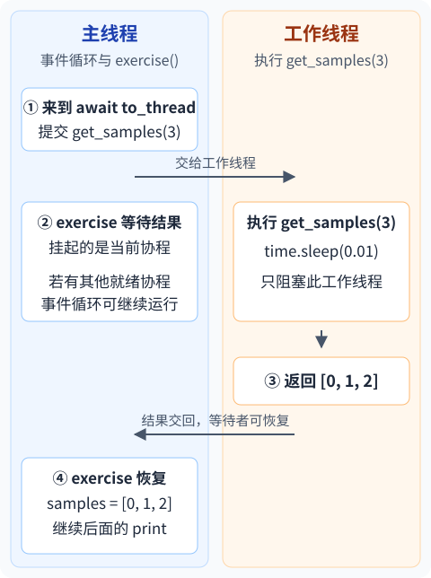

> **与已学内容的连接**
>
> **复用的旧知识：** [第 02 课](../02-await/)用 `await` 等待协程；[第 09 课](../09-task-cancellation/)区分取消请求与真正结束。
>
> **本课新增的问题：** 已有函数使用同步阻塞操作，怎样调用它，又不让等待占住事件循环线程？

## 1. time.sleep / to_thread：同步函数仍然可以复用

普通 `get_samples()` 可以返回样本列表，但如果内部使用阻塞式读取，直接调用期间，事件循环所在的线程也会被占住。把外层写成 `async def` 不会改变这一点。

本例沿用旧材料中的 `get_samples(num_samples)` 名称，用 `time.sleep(0.01)` 模拟阻塞读取。`time.sleep` 暂停调用它的线程；`asyncio.sleep` 才是协程使用的异步等待。这里的时间只模拟阻塞，不用于证明调度先后。

## 2. asyncio.to_thread：传入函数和参数，再 await 结果

[下载 example.py](example.py)，运行 `python3 example.py`。

<div class="async-coordination-code">

```python
import asyncio
import time


def get_samples(num_samples):
    time.sleep(0.01)
    return list(range(num_samples))


async def exercise():
    print("before await")
    samples = await asyncio.to_thread(get_samples, 3)
    print("samples", samples)
    print("after await")


if __name__ == "__main__":
    asyncio.run(exercise())
```

</div>

实际输出：

```text
before await
samples [0, 1, 2]
after await
```

## 3. to_thread / await：谁执行，谁等待？

### 3.1. to_thread：交出去的是一次函数调用

1. `asyncio.to_thread(get_samples, 3)` 接收函数本身和参数，产生可等待的协程；这里没有写 `get_samples(3)` 提前运行函数。
2. `await` 推进这次调用，标准库在线程中执行 `get_samples(3)`。它不要求 `get_samples` 改成异步函数。
3. 工作线程在 `time.sleep` 处阻塞时，事件循环线程可以继续处理其他已就绪的工作。
4. 函数返回 `[0, 1, 2]`，等待者拿到这个列表，再执行 `after await`。

**本例中，事件循环运行在主线程。交出去的是 `get_samples(3)` 这次调用；`exercise()` 留在主线程，结果未就绪时停在 `await`，结果就绪后再恢复。**



图中“其他协程”表示事件循环此时可以做的事；本例没有创建其他 Task。两条线程的具体交错顺序不固定。

这三行输出只说明返回关系；线程与事件循环的执行位置按标准库接口核对，不靠几毫秒的时间差猜测。

### 3.2. to_thread：按阻塞行为分工，仍要协调共享数据

可以把这种结构理解成“主线程运行事件循环，工作线程执行交出去的同步函数”。但主线程也会执行协程中的普通代码；工作线程拿到的函数可以简单，也可以复杂。这里分工的理由是：**让可能阻塞的调用在工作线程里执行，事件循环就能继续运转。**

这不代表它们互不影响。如果两个线程共同修改同一份数据，仍可能发生竞争，需要在线程之间保护共享操作。它与[第 19 课的共享计数问题](../19-async-lock/)相似；线程之间使用的 `threading.Lock` 会在[第 28 课](../28-thread-lock/)展开。

当前例子的 `get_samples()` 只创建并返回自己的列表，没有与主线程一起修改同一份数据，所以这里不需要额外加锁。

这两种写法不能替代主例子：

```python
samples = get_samples(3)        # 在当前线程直接运行
samples = await get_samples(3)  # 先同步运行，再尝试 await 返回的列表，会报 TypeError
```

## 4. to_thread：先记住两个边界

`to_thread` 适合已有的阻塞 I/O 函数；不能只凭“使用线程”就保证普通 Python 计算会多核加速。函数内部异常会在等待处重新抛出。

取消等待者也不会强制杀掉已经开始的工作线程。这一点在第 32 课用正在运行与仍在排队的工作作对照。上下文变量的传播留到第 24 课，本课不以它为前置。

<span id="5-to_thread带走两条结论"></span>

## 5. to_thread：带走三条结论

1. 把同步函数本身和参数交给 `to_thread`，由线程运行它。
2. 结果未就绪时，`await` 挂起当前协程，事件循环可以运行其他就绪工作；函数返回后，当前协程恢复并取得结果。
3. 分开线程执行不等于共享数据自动安全；共同修改数据时，仍需要协调。

自查：为什么传 `get_samples`，而不是传 `get_samples(3)`？

<details><summary>查看解释</summary>

后者会先在当前线程调用函数。`to_thread` 需要拿到函数和参数，才能把这次调用交给线程。

</details>

<details><summary>按需阅读：项目对照与标准库依据</summary>

主例子是独立标准库实验。[旧版阻塞读取与 Slime QueueReader 对照](../08-executors/#thread-offload)保留已核对的项目材料；这里先学原生机制，再按需回看调用位置。

语义按 [Python 3.12 官方文档：to_thread](https://docs.python.org/3.12/library/asyncio-task.html#asyncio.to_thread)、[事件循环与多线程](https://docs.python.org/3.12/library/asyncio-dev.html#concurrency-and-multithreading)和本机 Python 3.12.3 标准库核对，示例使用 Python 3.11 及以上版本。

</details>

---

[上一节：22 · async for / 异步生成器](../22-async-iteration/) · [下一节：27 · threading.Thread：创建、启动并等待线程](../27-thread-lifecycle/) · [返回学习路线](../learning-route/)
