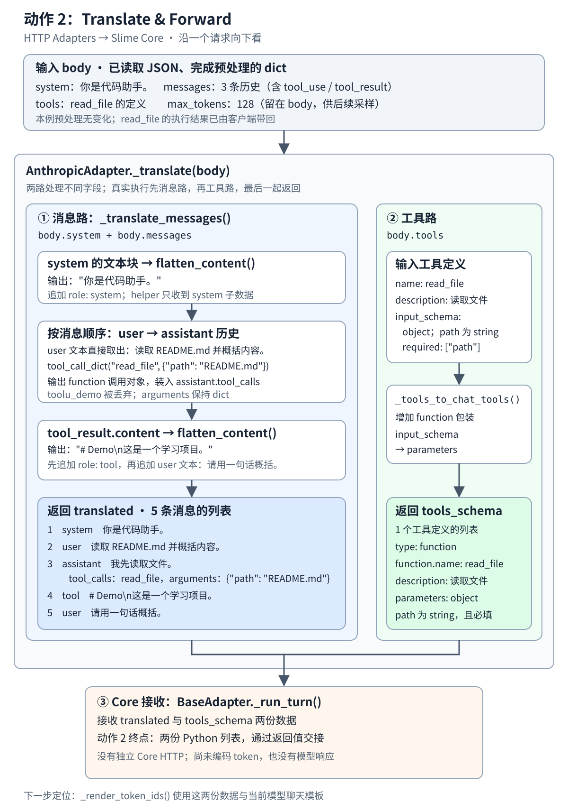

# Translate & Forward 纵向数据流

**读完本章，你应能说明：一份 Anthropic 请求怎样变成消息列表与工具定义，并交回 Slime 的共享处理流程。**

<div class="reading-navigation" data-reading-navigation="action-2">

以下是**阅读伪代码**：简写前后步骤，标出本节入口；缩进表示阅读层次，各层实现仍在不同函数中。

```python
generate:
    ...  # Pre-4：模型入口、任务、会话、环境与题目准备
    HARNESS_CLS().run:  # Action 4 组织启动；Action 6 执行并等待 CLI
        # Action 7：CLI 运行期间，经 HTTP 回连 Adapter
        BaseAdapter._run_turn:
            # 当前 Action 2：消息与工具定义转换
            translated, tools_schema = self._translate(...)
            ...  # Action 3：编码、采样与模型生成
            ...  # Action 3.5：协议响应、本轮轨迹与请求收尾
    ...  # CLI 结束后：收集 diff、评估、导出结果与清理
# Action 5：环境的创建、命令、文件与回收能力，贯穿上述阶段
```

</div>

## 本节局部数据流

[](flow.svg)

本页沿用现有 Action 2 材料中的同一个请求示例。阅读范围从已经取得的 `body` 开始，到 `_run_turn()` 接收到两份转换结果为止；模型生成接到下一章。

这张图和下面的输入、输出使用[同一个完整示例](示例.json)。

沿图从输入 `body` 向下看：先转换消息，再转换工具定义，最后把 `translated` 和 `tools_schema` 交回共享流程。图中的两路表示职责分工。

<details class="reading-extra">
<summary>查看这一步在完整任务中的位置</summary>

[](/images/slime-lifecycle/action-2.svg)

先看紫色框：它位于 `Adapter._run_turn()` 内，负责转换消息与工具定义。周围灰色步骤用于定位，下面只展开当前转换步骤。

[返回任务生命周期总览](/projects/slime/#agent-lifecycle)

</details>

## 把图接到真实调用

共享流程用下面这句调用当前适配器，并接收两份转换结果：

```python
translated, tools_schema = self._translate(body)
```

<details class="reading-source" id="source-c01" data-source-check="c01">
<summary>查看源码出处与行号</summary>

| 定位内容 | 文件与行号 |
| --- | --- |
| _run_turn 定义 | [`slime/agent/adapters/common.py:318`](https://github.com/THUDM/slime/blob/8c17b676cb57af1d17ee4402e91e9209af84b60b/slime/agent/adapters/common.py#L318) |
| 调用 _translate 并接收返回值 | [`slime/agent/adapters/common.py:341`](https://github.com/THUDM/slime/blob/8c17b676cb57af1d17ee4402e91e9209af84b60b/slime/agent/adapters/common.py#L341) |

</details>

`AnthropicAdapter._translate()` 的实现很短，可以直接看出执行顺序：

```python
def _translate(self, body: dict) -> tuple[list[dict], list[dict] | None]:
    translated = _translate_messages(body.get("messages") or [], body.get("system"))
    tools_schema = _tools_to_chat_tools(body.get("tools"))
    return translated, tools_schema
```

<details class="reading-source" id="source-c02" data-source-check="c02">
<summary>查看源码出处与行号</summary>

| 定位内容 | 文件与行号 |
| --- | --- |
| _translate 定义 | [`slime/agent/adapters/anthropic.py:58`](https://github.com/THUDM/slime/blob/8c17b676cb57af1d17ee4402e91e9209af84b60b/slime/agent/adapters/anthropic.py#L58) |
| 消息转换 | [`slime/agent/adapters/anthropic.py:59`](https://github.com/THUDM/slime/blob/8c17b676cb57af1d17ee4402e91e9209af84b60b/slime/agent/adapters/anthropic.py#L59) |
| 工具定义转换 | [`slime/agent/adapters/anthropic.py:60`](https://github.com/THUDM/slime/blob/8c17b676cb57af1d17ee4402e91e9209af84b60b/slime/agent/adapters/anthropic.py#L60) |
| 返回二元组 | [`slime/agent/adapters/anthropic.py:61`](https://github.com/THUDM/slime/blob/8c17b676cb57af1d17ee4402e91e9209af84b60b/slime/agent/adapters/anthropic.py#L61) |

</details>

这里的 `self` 是当前适配器对象，`body` 是请求字典。实际顺序是**先消息转换，再工具转换，最后一起返回**；图中的两路表达职责分工。

## 1．入口数据：body 包含什么

下面一直沿用同一份输入，完整请求可以展开或[打开 JSON 示例](示例.json)。

此时 `BaseAdapter._run_turn()` 已读取请求 JSON 并完成预处理，`body` 是 Python `dict`。本例没有消息列表中途插入的 system 消息，预处理没有改变它。

| body 中的字段 | 这一步的去向 |
| --- | --- |
| `body["system"]` + `body["messages"]` | 系统指令与对话历史；进入 `_translate_messages()`，成为 `translated` |
| `body["tools"]` | 可用工具定义；进入 `_tools_to_chat_tools()`，成为 `tools_schema` |
| `body["max_tokens"]` | 本例为 `128`，表示生成长度限制；留在 `body` 中，供后续采样参数使用 |

<details class="reading-source" id="source-c03" data-source-check="c03">
<summary>查看源码出处与行号</summary>

| 定位内容 | 文件与行号 |
| --- | --- |
| 读取请求 JSON | [`slime/agent/adapters/common.py:325`](https://github.com/THUDM/slime/blob/8c17b676cb57af1d17ee4402e91e9209af84b60b/slime/agent/adapters/common.py#L325) |
| 预处理 | [`slime/agent/adapters/common.py:326`](https://github.com/THUDM/slime/blob/8c17b676cb57af1d17ee4402e91e9209af84b60b/slime/agent/adapters/common.py#L326) |
| 本例预处理入口 | [`slime/agent/adapters/anthropic.py:55`](https://github.com/THUDM/slime/blob/8c17b676cb57af1d17ee4402e91e9209af84b60b/slime/agent/adapters/anthropic.py#L55) |
| 中途 system 消息处理 | [`slime/agent/adapters/anthropic.py:291`](https://github.com/THUDM/slime/blob/8c17b676cb57af1d17ee4402e91e9209af84b60b/slime/agent/adapters/anthropic.py#L291) |
| 生成长度字段配置 | [`slime/agent/adapters/anthropic.py:45`](https://github.com/THUDM/slime/blob/8c17b676cb57af1d17ee4402e91e9209af84b60b/slime/agent/adapters/anthropic.py#L45) |
| 后续采样读取 | [`slime/agent/adapters/common.py:425`](https://github.com/THUDM/slime/blob/8c17b676cb57af1d17ee4402e91e9209af84b60b/slime/agent/adapters/common.py#L425) |

</details>

<details>
<summary>展开完整输入 body：下面各步骤一直使用这一份请求</summary>

```json
{
  "system": [
    {
      "type": "text",
      "text": "你是代码助手。"
    }
  ],
  "messages": [
    {
      "role": "user",
      "content": [
        {
          "type": "text",
          "text": "读取 README.md 并概括内容。"
        }
      ]
    },
    {
      "role": "assistant",
      "content": [
        {
          "type": "text",
          "text": "我先读取文件。"
        },
        {
          "type": "tool_use",
          "id": "toolu_demo",
          "name": "read_file",
          "input": {
            "path": "README.md"
          }
        }
      ]
    },
    {
      "role": "user",
      "content": [
        {
          "type": "tool_result",
          "tool_use_id": "toolu_demo",
          "content": [
            {
              "type": "text",
              "text": "# Demo\n这是一个学习项目。"
            }
          ]
        },
        {
          "type": "text",
          "text": "请用一句话概括。"
        }
      ]
    }
  ],
  "tools": [
    {
      "name": "read_file",
      "description": "读取文件",
      "input_schema": {
        "type": "object",
        "properties": {
          "path": {
            "type": "string"
          }
        },
        "required": [
          "path"
        ]
      }
    }
  ],
  "max_tokens": 128
}
```

</details>

`read_file` 已经在客户端执行过。本次请求把历史 `tool_use` 和对应 `tool_result` 一起带回来；这里做的是历史记录规范化。工具定义则告诉后续模型：本轮仍然可以选择调用 `read_file`。

## 2．消息路：按历史顺序转换消息

**这一步做什么：** `_translate()` 先把对话历史交给 `_translate_messages()`，整理角色、文本和历史工具记录。

<details class="reading-source" id="source-c04" data-source-check="c04">
<summary>查看源码出处与行号</summary>

| 定位内容 | 文件与行号 |
| --- | --- |
| _translate_messages 定义 | [`slime/agent/adapters/anthropic.py:81`](https://github.com/THUDM/slime/blob/8c17b676cb57af1d17ee4402e91e9209af84b60b/slime/agent/adapters/anthropic.py#L81) |
| 返回消息列表 | [`slime/agent/adapters/anthropic.py:120`](https://github.com/THUDM/slime/blob/8c17b676cb57af1d17ee4402e91e9209af84b60b/slime/agent/adapters/anthropic.py#L120) |

</details>

它收到上面 `body["messages"]` 的三条消息，以及 `body["system"]`。辅助函数处理的是其中的局部值，不会让整个 `body` 依次穿过所有 helper。

### 2.1 system 文本块 → 一条 system 消息

**这一步做什么：** 将系统文本块整理为字符串，放入一条系统消息。

<details class="reading-source" id="source-c05" data-source-check="c05">
<summary>查看源码出处与行号</summary>

| 定位内容 | 文件与行号 |
| --- | --- |
| flatten_content 定义 | [`slime/agent/adapters/common.py:76`](https://github.com/THUDM/slime/blob/8c17b676cb57af1d17ee4402e91e9209af84b60b/slime/agent/adapters/common.py#L76) |
| 处理系统指令 | [`slime/agent/adapters/anthropic.py:84`](https://github.com/THUDM/slime/blob/8c17b676cb57af1d17ee4402e91e9209af84b60b/slime/agent/adapters/anthropic.py#L84) |
| 展开系统文本 | [`slime/agent/adapters/anthropic.py:85`](https://github.com/THUDM/slime/blob/8c17b676cb57af1d17ee4402e91e9209af84b60b/slime/agent/adapters/anthropic.py#L85) |

</details>

`flatten_content()` 收到的是 `body["system"]`：

```json
[
  {
    "type": "text",
    "text": "你是代码助手。"
  }
]
```

实际输出是一段字符串：

```json
"你是代码助手。"
```

`_translate_messages()` 把这段输出放进第一条消息：

```json
{
  "role": "system",
  "content": "你是代码助手。"
}
```

### 2.2 第一条 user 文本块 → 一条 user 消息

**这一步做什么：** 保留用户角色，提取文本块中的内容。

<details class="reading-source" id="source-c06" data-source-check="c06">
<summary>查看源码出处与行号</summary>

| 定位内容 | 文件与行号 |
| --- | --- |
| user 分支 | [`slime/agent/adapters/anthropic.py:90`](https://github.com/THUDM/slime/blob/8c17b676cb57af1d17ee4402e91e9209af84b60b/slime/agent/adapters/anthropic.py#L90) |
| 普通文本处理 | [`slime/agent/adapters/anthropic.py:95`](https://github.com/THUDM/slime/blob/8c17b676cb57af1d17ee4402e91e9209af84b60b/slime/agent/adapters/anthropic.py#L95) |

</details>

输入：

```json
{
  "role": "user",
  "content": [
    {
      "type": "text",
      "text": "读取 README.md 并概括内容。"
    }
  ]
}
```

实际输出：

```json
{
  "role": "user",
  "content": "读取 README.md 并概括内容。"
}
```

本例的 `content` 已经是文本块列表，转换函数直接取块中的 `text`。这里没有调用 `flatten_content()`。

### 2.3 assistant 历史 → 文本 + tool_calls

**这一步做什么：** 分别收集助手正文和历史工具调用，把工具名称和参数整理到 `tool_calls` 中。

<details class="reading-source" id="source-c07" data-source-check="c07">
<summary>查看源码出处与行号</summary>

| 定位内容 | 文件与行号 |
| --- | --- |
| assistant 分支 | [`slime/agent/adapters/anthropic.py:99`](https://github.com/THUDM/slime/blob/8c17b676cb57af1d17ee4402e91e9209af84b60b/slime/agent/adapters/anthropic.py#L99) |
| tool_call_dict 定义 | [`slime/agent/adapters/common.py:110`](https://github.com/THUDM/slime/blob/8c17b676cb57af1d17ee4402e91e9209af84b60b/slime/agent/adapters/common.py#L110) |
| 转换历史工具调用 | [`slime/agent/adapters/anthropic.py:111`](https://github.com/THUDM/slime/blob/8c17b676cb57af1d17ee4402e91e9209af84b60b/slime/agent/adapters/anthropic.py#L111) |
| 构造助手消息 | [`slime/agent/adapters/anthropic.py:112`](https://github.com/THUDM/slime/blob/8c17b676cb57af1d17ee4402e91e9209af84b60b/slime/agent/adapters/anthropic.py#L112) |

</details>

这一条消息的输入：

```json
{
  "role": "assistant",
  "content": [
    {
      "type": "text",
      "text": "我先读取文件。"
    },
    {
      "type": "tool_use",
      "id": "toolu_demo",
      "name": "read_file",
      "input": {
        "path": "README.md"
      }
    }
  ]
}
```

文本块提供 `content: "我先读取文件。"`。处理 `tool_use` 块时，转换函数只把工具名和输入参数交给 `tool_call_dict()`：

```json
{
  "name": "read_file",
  "arguments": {
    "path": "README.md"
  }
}
```

上面两项对应实际调用的两个参数：`name = "read_file"`，`arguments = {"path": "README.md"}`。helper 的实际输出是：

```json
{
  "type": "function",
  "function": {
    "name": "read_file",
    "arguments": {
      "path": "README.md"
    }
  }
}
```

这个对象装入 `tool_calls` 列表后，整条 assistant 消息成为：

```json
{
  "role": "assistant",
  "content": "我先读取文件。",
  "tool_calls": [
    {
      "type": "function",
      "function": {
        "name": "read_file",
        "arguments": {
          "path": "README.md"
        }
      }
    }
  ]
}
```

注意两个具体变化：`id: "toolu_demo"` 被丢弃；`input` 改为 `arguments`，其值仍然是 Python `dict`，没有变成 JSON 字符串。

### 2.4 第二条 user 历史 → 一条 tool + 一条 user

**这一步做什么：** 区分工具结果和继续发给助手的用户文本，分别生成对应角色的消息。

<details class="reading-source" id="source-c08" data-source-check="c08">
<summary>查看源码出处与行号</summary>

| 定位内容 | 文件与行号 |
| --- | --- |
| 工具结果分支 | [`slime/agent/adapters/anthropic.py:93`](https://github.com/THUDM/slime/blob/8c17b676cb57af1d17ee4402e91e9209af84b60b/slime/agent/adapters/anthropic.py#L93) |
| 调用 flatten_content | [`slime/agent/adapters/anthropic.py:94`](https://github.com/THUDM/slime/blob/8c17b676cb57af1d17ee4402e91e9209af84b60b/slime/agent/adapters/anthropic.py#L94) |
| flatten_content 定义 | [`slime/agent/adapters/common.py:76`](https://github.com/THUDM/slime/blob/8c17b676cb57af1d17ee4402e91e9209af84b60b/slime/agent/adapters/common.py#L76) |

</details>

这一条输入消息同时带了工具结果和后续文本：

```json
{
  "role": "user",
  "content": [
    {
      "type": "tool_result",
      "tool_use_id": "toolu_demo",
      "content": [
        {
          "type": "text",
          "text": "# Demo\n这是一个学习项目。"
        }
      ]
    },
    {
      "type": "text",
      "text": "请用一句话概括。"
    }
  ]
}
```

遇到 `tool_result` 时，`flatten_content()` 收到的是 **该块的 content**：

```json
[
  {
    "type": "text",
    "text": "# Demo\n这是一个学习项目。"
  }
]
```

实际输出：

```json
"# Demo\n这是一个学习项目。"
```

转换函数先追加一条 `role: tool` 消息，再把紧接着的文本块追加成 `role: user` 消息：

```json
[
  {
    "role": "tool",
    "content": "# Demo\n这是一个学习项目。"
  },
  {
    "role": "user",
    "content": "请用一句话概括。"
  }
]
```

因此，一条 Anthropic `user` 消息在这里拆成了两条内部消息。`tool_use_id: "toolu_demo"` 也没有进入输出。

### 2.5 消息路的完整返回值：translated

到这里，`_translate_messages()` 已按原来的历史顺序组装出 **5 条消息**。这是它返回的完整 Python 列表，用 JSON 形式展示：

<details class="reading-extra">
<summary>展开完整的 5 条 translated 消息</summary>

```json
[
  {
    "role": "system",
    "content": "你是代码助手。"
  },
  {
    "role": "user",
    "content": "读取 README.md 并概括内容。"
  },
  {
    "role": "assistant",
    "content": "我先读取文件。",
    "tool_calls": [
      {
        "type": "function",
        "function": {
          "name": "read_file",
          "arguments": {
            "path": "README.md"
          }
        }
      }
    ]
  },
  {
    "role": "tool",
    "content": "# Demo\n这是一个学习项目。"
  },
  {
    "role": "user",
    "content": "请用一句话概括。"
  }
]
```

</details>

## 3．工具路：转换可用工具的定义

**这一步做什么：** 消息转换结束后，再转换可用工具的定义；历史工具调用已经在上一节处理。

<details class="reading-source" id="source-c09" data-source-check="c09">
<summary>查看源码出处与行号</summary>

| 定位内容 | 文件与行号 |
| --- | --- |
| _tools_to_chat_tools 定义 | [`slime/agent/adapters/anthropic.py:123`](https://github.com/THUDM/slime/blob/8c17b676cb57af1d17ee4402e91e9209af84b60b/slime/agent/adapters/anthropic.py#L123) |
| 组装 function 工具定义 | [`slime/agent/adapters/anthropic.py:137`](https://github.com/THUDM/slime/blob/8c17b676cb57af1d17ee4402e91e9209af84b60b/slime/agent/adapters/anthropic.py#L137) |
| 调用工具定义转换 | [`slime/agent/adapters/anthropic.py:60`](https://github.com/THUDM/slime/blob/8c17b676cb57af1d17ee4402e91e9209af84b60b/slime/agent/adapters/anthropic.py#L60) |

</details>

消息路返回后，`_translate()` 再把 `body["tools"]` 交给 `_tools_to_chat_tools()`。这一支不经过上面的历史消息 helper。

完整输入：

```json
[
  {
    "name": "read_file",
    "description": "读取文件",
    "input_schema": {
      "type": "object",
      "properties": {
        "path": {
          "type": "string"
        }
      },
      "required": [
        "path"
      ]
    }
  }
]
```

实际输出 `tools_schema`：

```json
[
  {
    "type": "function",
    "function": {
      "name": "read_file",
      "description": "读取文件",
      "parameters": {
        "type": "object",
        "properties": {
          "path": {
            "type": "string"
          }
        },
        "required": [
          "path"
        ]
      }
    }
  }
]
```

`name`、`description` 和参数内容保留下来；外面增加 `type: "function"` 与 `function` 包装，`input_schema` 改名为 `parameters`。这份定义与 assistant 历史里的 `tool_calls` 是两种数据：前者声明可用工具，后者记录已经发生的调用。

## 4．交回共享流程：两份数据怎样继续使用

**这一步做什么：** 把消息列表和工具定义一起交回共享流程，让后面的模型输入准备继续进行。

<details class="reading-source" id="source-c10" data-source-check="c10">
<summary>查看源码出处与行号</summary>

| 定位内容 | 文件与行号 |
| --- | --- |
| 返回两份结果 | [`slime/agent/adapters/anthropic.py:61`](https://github.com/THUDM/slime/blob/8c17b676cb57af1d17ee4402e91e9209af84b60b/slime/agent/adapters/anthropic.py#L61) |
| 共享流程接收 | [`slime/agent/adapters/common.py:341`](https://github.com/THUDM/slime/blob/8c17b676cb57af1d17ee4402e91e9209af84b60b/slime/agent/adapters/common.py#L341) |
| 调用 token 渲染 | [`slime/agent/adapters/common.py:342`](https://github.com/THUDM/slime/blob/8c17b676cb57af1d17ee4402e91e9209af84b60b/slime/agent/adapters/common.py#L342) |
| _render_token_ids 定义 | [`slime/agent/adapters/common.py:58`](https://github.com/THUDM/slime/blob/8c17b676cb57af1d17ee4402e91e9209af84b60b/slime/agent/adapters/common.py#L58) |

</details>

`AnthropicAdapter._translate(body)` 的完整输入就是第 1 步的 `body`。它返回一个二元组：

```python
(translated, tools_schema)
```

两个元素分别是上面完整展示的 **5 条消息列表** 和 **1 个工具定义列表**。本例两者都是 Python `list`；没有有效工具时，第二项才会是 `None`。

`AnthropicAdapter` 继承 `BaseAdapter`。共享的 `_run_turn()` 在同一个适配器实例上调用 `self._translate(body)`，把返回值接收到 `translated` 和 `tools_schema` 两个变量中。这就是图中“Forward”的实际交接方式：Python 函数调用与返回值，没有独立的 Core HTTP 请求。

**动作 2 到这里完成。**它的成果是两份规范化数据；此时尚未生成 token，也没有模型响应。`body["max_tokens"]` 仍为 `128`，并未塞进消息或工具定义里。

下一步定位到 `_render_token_ids()`：它使用两份列表和当前模型的聊天模板准备 token IDs；具体数值取决于 tokenizer 和模板，本例不虚构。

## 回到局部图，检查是否能独立解释

1. `body["messages"]` 与 `body["tools"]` 分别交给哪个函数？为什么历史 `tool_calls` 与可用工具定义要分开？
2. 一条包含工具结果的 user 历史，为什么在例子里变成两条内部消息？
3. `translated` 与 `tools_schema` 最后由谁接收？这里是否又发起了一次 HTTP 请求？

说不清哪一步，就回到对应的输入和输出核对。随后进入 [Action 3：Generate Tokens](/projects/slime/4-slime-core-components-and-orchestration/4-1-agent-rollout-adapters-and-harnesses/3-generate-tokens/)，继续看共享流程如何把这些数据变成模型输入。

<details class="reading-extra">
<summary>补充：原始组件关系图与更多阅读入口</summary>

<figure class="slime-diagram"></figure>

原图保留组件之间的关系；本页正文按一次请求的处理顺序阅读。

- [Action 2 章节入口](/projects/slime/4-slime-core-components-and-orchestration/4-1-agent-rollout-adapters-and-harnesses/2-translate-forward/)
- [纵向数据流阅读地址](/projects/slime/4-slime-core-components-and-orchestration/4-1-agent-rollout-adapters-and-harnesses/2-translate-forward/data-flow/)
- [消息和工具转换](https://github.com/dextermayhewjd/dextermayhewjd.github.io/blob/main/slime_photo/4.Slime%20Core%20Components%20and%20Orchestration/4.1.Agent%20Rollout%20Adapters%20and%20Harnesses/2.Translate%20%26%20Forward/1.%E6%B6%88%E6%81%AF%E5%92%8C%E5%B7%A5%E5%85%B7%E8%BD%AC%E6%8D%A2.md)
- [请求入口和特殊分支](https://github.com/dextermayhewjd/dextermayhewjd.github.io/blob/main/slime_photo/4.Slime%20Core%20Components%20and%20Orchestration/4.1.Agent%20Rollout%20Adapters%20and%20Harnesses/2.Translate%20%26%20Forward/3.%E8%AF%B7%E6%B1%82%E5%85%A5%E5%8F%A3%E5%92%8C%E7%89%B9%E6%AE%8A%E5%88%86%E6%94%AF.md)

</details>

本页复用原有图、示例和固定源码入口。完整示例沿用原阅读材料记录的输出；本次页面整理没有重新执行 Agent 或模型服务。

<details class="reading-source">
<summary>集中查看源码校验清单</summary>

[源码出处与校验清单](SOURCE-CHECK.md) 汇总本章的固定源码位置、核对要点及校验方法。

</details>
