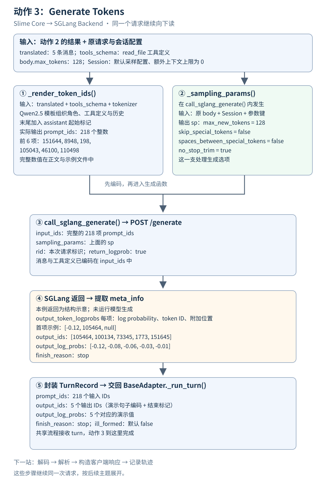

# Generate Tokens

**读完本章，你应能解释：动作 2 交出的消息与工具定义，怎样变成模型输入，并把生成结果交回共享流程。**

<div class="reading-navigation" data-reading-navigation="action-3">

以下是**阅读伪代码**：简写前后步骤，标出本节入口；缩进表示阅读层次，各层实现仍在不同函数中。

```python
generate:
    ...  # Pre-4：模型入口、任务、会话、环境与题目准备
    HARNESS_CLS().run:  # Action 4 组织启动；Action 6 执行并等待 CLI
        # Action 7：CLI 经 HTTP 回连 Adapter
        BaseAdapter._run_turn:
            ...  # Action 2：消息与工具定义转换
            # 当前 Action 3：编码、采样、请求生成并封装 TurnRecord
            prompt_ids = _render_token_ids(...)
            turn = await call_sglang_generate(...)
            ...  # Action 3.5：响应、本轮轨迹与请求收尾
    ...  # CLI 结束后的任务收尾
# Action 5：提供准备、运行与回收所用的环境能力
```

</div>

## 本节局部数据流

[](flow.svg)

仍沿用“读取 README.md，再用一句话概括”的请求。本章从 `translated` 和 `tools_schema` 开始，到 `_run_turn()` 收到 `TurnRecord` 为止。

图中两路表示数据分工：消息与工具定义用于编码，原请求与会话配置用于采样。实际执行先编码，再进入生成函数整理参数，随后发出请求。

本例继续使用原材料保存的 218 个输入 token。**响应与 log probability 是构造的示例，未运行真实模型生成。**完整数据仍在 [原示例文件](示例.json) 中。

<details class="reading-extra">
<summary>查看这一步在完整任务中的位置</summary>

[](/images/slime-lifecycle/action-3.svg)

本章位于 CLI 发起模型请求之后、共享流程解码与解析之前。它发生在一次模型请求内部。

[返回任务生命周期总览](/projects/slime/#agent-lifecycle)

</details>

## 把图接到真实调用

上一章结束时，`BaseAdapter._run_turn()` 已取得两份转换结果。接下来在同一个适配器对象里继续执行：

```python
translated, tools_schema = self._translate(body)
prompt_ids = _render_token_ids(translated, tok, tools=tools_schema, add_generation_prompt=True)

turn = await call_sglang_generate(prompt_ids, s, body, adapter=self, session_id=sid)
```

<details class="reading-source" id="source-c01" data-source-check="c01">
<summary>查看源码出处与行号</summary>

| 定位内容 | 文件与行号 |
| --- | --- |
| 共享流程与输入准备 | [`slime/agent/adapters/common.py:318`](https://github.com/THUDM/slime/blob/22a89f96835969a47055a659c588f46151f8b07a/slime/agent/adapters/common.py#L318-L344) |
| 下一步解码与解析 | [`slime/agent/adapters/common.py:346`](https://github.com/THUDM/slime/blob/22a89f96835969a47055a659c588f46151f8b07a/slime/agent/adapters/common.py#L346-L354) |

</details>

这里的 `self` 是当前适配器对象，`tok` 来自 `self.tokenizer`，`sid` 是本次模型请求所属 Agent 会话的标识，`s` 是对应的 `Session` 对象。`call_sglang_generate()` 是模块级函数，通过参数 `adapter=self` 使用适配器配置。

先沿这两次调用向下读，最后回到接收结果的 `turn`。

## 1．接住动作 2：现在哪些数据已经准备好

**输入：** 消息列表、工具定义、原始请求，以及当前会话。

| 此时的数据 | 下一步交给谁 | 最小理解 |
| --- | --- | --- |
| `translated` | `_render_token_ids()` | 5 条按历史顺序排列的消息 |
| `tools_schema` | `_render_token_ids()` | 1 个本轮仍可使用的 `read_file` 工具定义 |
| 原始请求 `body` | `call_sglang_generate()`，再交给 `_sampling_params()` | 保留本次请求的生成选项；本例从中读取 `max_tokens: 128` |
| 当前 `Session`（`s`） | `call_sglang_generate()` | 提供本会话的默认采样参数和额外上下文预算 |

消息里的工具调用记录说明已经发生了什么；`tools_schema` 说明模型这一轮仍可使用什么工具。本例把这两种信息一并交给模板，让模型在已有结果之上继续响应最后一句要求。

`translated` 和 `tools_schema` 是共享流程中的局部变量；`body` 是原请求字典，`s` 是会话对象。这几项不是同一个嵌套 JSON。`max_tokens` 留在原请求中，没有被塞进消息列表。图中 `body.max_tokens` 是简写，真实代码通过字典键读取；会话的具体成员留到第 3 步展开。

<details class="reading-source" id="source-c02" data-source-check="c02">
<summary>查看源码出处与行号</summary>

| 定位内容 | 文件与行号 |
| --- | --- |
| 当前 tokenizer 与 Session | [`slime/agent/adapters/common.py:335`](https://github.com/THUDM/slime/blob/22a89f96835969a47055a659c588f46151f8b07a/slime/agent/adapters/common.py#L335-L338) |
| Session 字段 | [`slime/agent/adapters/common.py:33`](https://github.com/THUDM/slime/blob/22a89f96835969a47055a659c588f46151f8b07a/slime/agent/adapters/common.py#L33-L42) |
| Anthropic 的采样字段名 | [`slime/agent/adapters/anthropic.py:45`](https://github.com/THUDM/slime/blob/22a89f96835969a47055a659c588f46151f8b07a/slime/agent/adapters/anthropic.py#L45-L46) |

</details>

<details class="reading-extra">
<summary>展开本例的消息列表与工具定义</summary>

`translated`：

```json
[
  {
    "role": "system",
    "content": "你是代码助手。"
  },
  {
    "role": "user",
    "content": "读取 README.md 并概括内容。"
  },
  {
    "role": "assistant",
    "content": "我先读取文件。",
    "tool_calls": [
      {
        "type": "function",
        "function": {
          "name": "read_file",
          "arguments": {
            "path": "README.md"
          }
        }
      }
    ]
  },
  {
    "role": "tool",
    "content": "# Demo\n这是一个学习项目。"
  },
  {
    "role": "user",
    "content": "请用一句话概括。"
  }
]
```

`tools_schema`：

```json
[
  {
    "type": "function",
    "function": {
      "name": "read_file",
      "description": "读取文件",
      "parameters": {
        "type": "object",
        "properties": {
          "path": {
            "type": "string"
          }
        },
        "required": [
          "path"
        ]
      }
    }
  }
]
```

</details>

**交出：** `_render_token_ids()` 先接收完整消息列表和工具定义，保留消息的历史顺序来组织输入。随后 `call_sglang_generate()` 接收编码结果、完整 `body` 和当前 `Session`，在第 3 步读取生成选项与会话约束。

## 2．模板编码：消息与工具怎样成为 prompt_ids

**为什么到这里：** 模型后端接收 token IDs，需要先把消息角色、正文和工具信息组织成当前模型的输入。

调用时，`translated` 对应函数参数 `messages`，`tools_schema` 对应 `tools`，`tok` 对应 `tokenizer`。本例要把“读取文件的请求 → 已发生的调用 → 文件内容 → 最后一句概括要求”按原顺序交给模型，并带上仍可使用的工具定义。

`_render_token_ids()` 的实现可以整体看完：

```python
def _render_token_ids(
    messages: list[dict],
    tokenizer,
    *,
    tools: list[dict] | None,
    add_generation_prompt: bool = True,
) -> list[int]:
    """Render a chat-message list to token ids with the served chat template."""
    enc = tokenizer.apply_chat_template(
        messages,
        tools=tools,
        tokenize=True,
        add_generation_prompt=add_generation_prompt,
    )
    ids = enc["input_ids"] if hasattr(enc, "__getitem__") and "input_ids" in enc else enc
    return list(ids)
```

<details class="reading-source" id="source-c03" data-source-check="c03">
<summary>查看源码出处与行号</summary>

| 定位内容 | 文件与行号 |
| --- | --- |
| 模板编码函数 | [`slime/agent/adapters/common.py:58`](https://github.com/THUDM/slime/blob/22a89f96835969a47055a659c588f46151f8b07a/slime/agent/adapters/common.py#L58-L73) |

</details>

`tokenize=True` 表示直接得到编码结果；`add_generation_prompt=True` 让输入停在下一条 assistant 内容的起点。

本例原材料使用 Qwen2.5 的 tokenizer，模板中对应关系如下：

| 输入内容 | 在本例模板中的位置 |
| --- | --- |
| system 指令 | system 角色的文本 |
| `tools_schema` | system 部分的 `<tools>` 定义 |
| assistant 历史中的 `tool_calls` | `<tool_call>` 中的名称和参数 |
| 工具返回内容 | `<tool_response>` 包装的结果 |
| 下一次 assistant 回复 | 输入末尾的 assistant 起始标记 |

这些标记属于本例模型模板，不能套用到所有 tokenizer。为观察模板而额外调用的 `tokenize=False` 只生成展示文本；真实主线用上面的 `tokenize=True`。

<details class="reading-extra">
<summary>展开原示例的完整模型输入文本</summary>

```text
<|im_start|>system
你是代码助手。

# Tools

You may call one or more functions to assist with the user query.

You are provided with function signatures within <tools></tools> XML tags:
<tools>
{"type": "function", "function": {"name": "read_file", "description": "读取文件", "parameters": {"type": "object", "properties": {"path": {"type": "string"}}, "required": ["path"]}}}
</tools>

For each function call, return a json object with function name and arguments within <tool_call></tool_call> XML tags:
<tool_call>
{"name": <function-name>, "arguments": <args-json-object>}
</tool_call><|im_end|>
<|im_start|>user
读取 README.md 并概括内容。<|im_end|>
<|im_start|>assistant
我先读取文件。
<tool_call>
{"name": "read_file", "arguments": {"path": "README.md"}}
</tool_call><|im_end|>
<|im_start|>user
<tool_response>
# Demo
这是一个学习项目。
</tool_response><|im_end|>
<|im_start|>user
请用一句话概括。<|im_end|>
<|im_start|>assistant
```

[打开模型输入原文件](模型输入.txt)

</details>

**输出：** 局部变量 `prompt_ids`，类型为 `list[int]`。本例有 **218 项**，前 6 项是 `[151644, 8948, 198, 105043, 46100, 110498]`。

<details class="reading-extra">
<summary>展开全部 218 个输入 token IDs</summary>

```json
[
  151644, 8948, 198, 105043, 46100, 110498, 3407, 2, 13852, 271, 2610, 1231, 1618, 825, 476, 803,
  5746, 311, 7789, 448, 279, 1196, 3239, 382, 2610, 525, 3897, 448, 729, 32628, 2878, 366,
  15918, 1472, 15918, 29, 11874, 9492, 510, 27, 15918, 397, 4913, 1313, 788, 330, 1688, 497,
  330, 1688, 788, 5212, 606, 788, 330, 878, 2458, 497, 330, 4684, 788, 330, 57553, 18158,
  26898, 497, 330, 13786, 788, 5212, 1313, 788, 330, 1700, 497, 330, 13193, 788, 5212, 2343,
  788, 5212, 1313, 788, 330, 917, 9207, 2137, 330, 6279, 788, 4383, 2343, 1341, 3417, 532,
  522, 15918, 1339, 2461, 1817, 729, 1618, 11, 470, 264, 2951, 1633, 448, 729, 829, 323,
  5977, 2878, 220, 151657, 151658, 11874, 9492, 510, 151657, 198, 4913, 606, 788, 366, 1688, 11494,
  8066, 330, 16370, 788, 366, 2116, 56080, 40432, 31296, 151658, 151645, 198, 151644, 872, 198, 57553,
  18158, 61945, 21324, 74577, 114, 109193, 43815, 1773, 151645, 198, 151644, 77091, 198, 35946, 60726, 57553,
  18158, 26898, 8997, 151657, 198, 4913, 606, 788, 330, 878, 2458, 497, 330, 16370, 788, 5212,
  2343, 788, 330, 54675, 21324, 95642, 151658, 151645, 198, 151644, 872, 198, 27, 14172, 9655, 397,
  2, 28523, 198, 105464, 100134, 73345, 8997, 522, 14172, 9655, 29, 151645, 198, 151644, 872, 198,
  14880, 11622, 105321, 109193, 1773, 151645, 198, 151644, 77091, 198
]
```

</details>

**交出：** `_run_turn()` 把返回的列表记为 `prompt_ids`，再传给 `call_sglang_generate()`。这 218 项已经包含消息顺序、文件内容和工具定义，随后会成为请求的 `input_ids`；它们决定模型看到什么，下一步的采样参数决定怎样继续生成。

## 3．进入生成函数：先确定本轮采样参数

**为什么到这里：** 218 个输入 token 已经确定了模型看到的内容，还要确定本轮最多新生成多少 token，以及使用哪些生成选项。

**输入：** 完整原请求 `body`、当前会话 `s`，以及适配器配置的字段名。进入 `call_sglang_generate()` 后，参数名 `session` 指向传入的 `s`；本步相关内容如下：

| 来源 | 本例值 | 本步怎样使用 |
| --- | --- | --- |
| 原请求的 `body["max_tokens"]` | `128` | `_sampling_params()` 读取请求上限，与已有生成上限取较小值 |
| 会话的 `session.sampling_defaults` | 空字典 `{}` | `_sampling_params()` 用它补充或覆盖基础采样默认值；本例保持基础默认值 |
| 会话的 `session.max_context_tokens` | `0` | `call_sglang_generate()` 据此不启用额外上下文预算；大于 `0` 时还需扣除已有输入长度 |

这里才拆开查看会话成员：同一个 `Session` 同时提供采样默认值和上下文约束，两个成员分别参与生成准备的不同位置。

从本节开始，采样、请求、提取和第 6 节的封装，都在同一次 `call_sglang_generate()` 调用中完成。它先调用：

```python
sp = _sampling_params(session, body, max_token_keys=adapter.max_token_keys, stop_keys=adapter.stop_keys)
```

`_sampling_params()` 按顺序做四件事：

1. 建立基础默认值，再合并 `session.sampling_defaults`。
2. 找到请求里的长度字段，把已有生成上限与请求上限取较小值。
3. 将请求中的 `temperature`、`top_p`、`top_k` 写入对应选项。
4. 将适配器指定的停止字段映射为后端使用的 `stop`。

以下是长度上限对应的原始代码片段：

```python
sp: dict[str, Any] = {
    "skip_special_tokens": False,
    "spaces_between_special_tokens": False,
    "no_stop_trim": True,
    "max_new_tokens": 4096,
    **(session.sampling_defaults or {}),
}

for key in max_token_keys:
    if body.get(key) is not None:
        sp["max_new_tokens"] = min(int(sp.get("max_new_tokens", body[key])), int(body[key]))
        break
```

<details class="reading-source" id="source-c04" data-source-check="c04">
<summary>查看源码出处与行号</summary>

| 定位内容 | 文件与行号 |
| --- | --- |
| 采样参数整理 | [`slime/agent/adapters/common.py:416`](https://github.com/THUDM/slime/blob/22a89f96835969a47055a659c588f46151f8b07a/slime/agent/adapters/common.py#L416-L439) |
| 调用位置 | [`slime/agent/adapters/common.py:455`](https://github.com/THUDM/slime/blob/22a89f96835969a47055a659c588f46151f8b07a/slime/agent/adapters/common.py#L455) |
| 协议字段配置 | [`slime/agent/adapters/anthropic.py:45`](https://github.com/THUDM/slime/blob/22a89f96835969a47055a659c588f46151f8b07a/slime/agent/adapters/anthropic.py#L45-L46) |

</details>

**本例输出：** `sp` 是一个 Python 字典。空的会话默认值没有修改基础配置，请求的 `128` 比基础上限 `4096` 更小：

```json
{
  "skip_special_tokens": false,
  "spaces_between_special_tokens": false,
  "no_stop_trim": true,
  "max_new_tokens": 128
}
```

因此本例得到 `max_new_tokens=128`。如果会话默认上限已经是 `64`，相同请求会得到 `64`；不能把这一步理解为请求总能无条件覆盖上限。

其余三个布尔值属于返回文本对特殊 token 和停止标记的处理选项，第一遍认出其用途即可。

<details class="reading-extra">
<summary>补充：启用额外上下文上限时，怎样继续限制生成长度</summary>

如果 `session.max_context_tokens > 0`，生成函数计算：

```python
remaining_context = session.max_context_tokens - len(prompt_ids)
```

剩余空间小于或等于 0 时，直接返回空输出、结束原因是 `"length"` 的记录，不发送 `/generate` 请求。仍有空间时，用剩余空间继续限制 `sp["max_new_tokens"]`。

本例 `s.max_context_tokens=0`，因此没有进入这条额外限制分支。

</details>

<details class="reading-source" id="source-c05" data-source-check="c05">
<summary>查看源码出处与行号</summary>

| 定位内容 | 文件与行号 |
| --- | --- |
| 额外上下文预算 | [`slime/agent/adapters/common.py:457`](https://github.com/THUDM/slime/blob/22a89f96835969a47055a659c588f46151f8b07a/slime/agent/adapters/common.py#L457-L468) |

</details>

**交出：** `call_sglang_generate()` 现在持有第 2 步的 `prompt_ids` 和最终的 `sp`。下一步由这个函数把前者放进请求的 `input_ids`，把后者放进 `sampling_params`；本例就是带着 218 个输入 token，请求最多续写 128 个新 token。

## 4．发出请求：把模型输入和生成选项交给 SGLang

**输入：** `prompt_ids`、`sp`、适配器中的后端地址，以及本次会话标识。

下面摘出请求组装，省略外层 `try` 及后续响应检查；完整错误去向在本章末尾补充：

```python
sglang_url = adapter.sglang_url
rid = uuid.uuid4().hex
headers = {"X-SMG-Routing-Key": session_id} if session_id and session_id != "default" else None
timeout = aiohttp.ClientTimeout(total=None, sock_read=900)

async with aiohttp.ClientSession(timeout=timeout) as sess, sess.post(
    f"{sglang_url}/generate",
    json={
        "rid": rid,
        "input_ids": prompt_ids,
        "sampling_params": sp,
        "return_logprob": True,
    },
    headers=headers,
) as r:
    ...  # 此处省略响应检查与读取，下一步继续。
```

<details class="reading-source" id="source-c06" data-source-check="c06">
<summary>查看源码出处与行号</summary>

| 定位内容 | 文件与行号 |
| --- | --- |
| 请求组装与发送 | [`slime/agent/adapters/common.py:470`](https://github.com/THUDM/slime/blob/22a89f96835969a47055a659c588f46151f8b07a/slime/agent/adapters/common.py#L470-L496) |

</details>

| 请求中的内容 | 具体作用 |
| --- | --- |
| `input_ids` | 模型本轮看到的输入，本例是完整 218 项 |
| `sampling_params` | 本轮生成选项，本例最多生成 128 个新 token |
| `return_logprob=True` | 要求后端返回输出 token 的 log probability |
| `rid` | 标识这一次 `/generate` 请求；取消时也用它定位要中止的生成 |
| `X-SMG-Routing-Key` | 承载本次 Agent 会话的标识，帮助路由关联同一会话的多次请求 |

`rid` 和会话标识不是同一个东西：一个 Agent 会话可以发出多次模型请求，每次生成都有自己的 `rid`。会话标识非空且不等于 `"default"` 时，代码才加入上述路由头。

这里的 `sess` 是一次 HTTP 客户端对象；它与第 1 步存采样默认值的 `Session` 不是同一个对象。

<details class="reading-extra">
<summary>展开原示例的完整请求 JSON 和请求头</summary>

```json
{
  "url": "http://sglang.example.invalid:30000/generate",
  "json": {
    "rid": "0123456789abcdef0123456789abcdef",
    "input_ids": [
      151644,
      8948,
      198,
      105043,
      46100,
      110498,
      3407,
      2,
      13852,
      271,
      2610,
      1231,
      1618,
      825,
      476,
      803,
      5746,
      311,
      7789,
      448,
      279,
      1196,
      3239,
      382,
      2610,
      525,
      3897,
      448,
      729,
      32628,
      2878,
      366,
      15918,
      1472,
      15918,
      29,
      11874,
      9492,
      510,
      27,
      15918,
      397,
      4913,
      1313,
      788,
      330,
      1688,
      497,
      330,
      1688,
      788,
      5212,
      606,
      788,
      330,
      878,
      2458,
      497,
      330,
      4684,
      788,
      330,
      57553,
      18158,
      26898,
      497,
      330,
      13786,
      788,
      5212,
      1313,
      788,
      330,
      1700,
      497,
      330,
      13193,
      788,
      5212,
      2343,
      788,
      5212,
      1313,
      788,
      330,
      917,
      9207,
      2137,
      330,
      6279,
      788,
      4383,
      2343,
      1341,
      3417,
      532,
      522,
      15918,
      1339,
      2461,
      1817,
      729,
      1618,
      11,
      470,
      264,
      2951,
      1633,
      448,
      729,
      829,
      323,
      5977,
      2878,
      220,
      151657,
      151658,
      11874,
      9492,
      510,
      151657,
      198,
      4913,
      606,
      788,
      366,
      1688,
      11494,
      8066,
      330,
      16370,
      788,
      366,
      2116,
      56080,
      40432,
      31296,
      151658,
      151645,
      198,
      151644,
      872,
      198,
      57553,
      18158,
      61945,
      21324,
      74577,
      114,
      109193,
      43815,
      1773,
      151645,
      198,
      151644,
      77091,
      198,
      35946,
      60726,
      57553,
      18158,
      26898,
      8997,
      151657,
      198,
      4913,
      606,
      788,
      330,
      878,
      2458,
      497,
      330,
      16370,
      788,
      5212,
      2343,
      788,
      330,
      54675,
      21324,
      95642,
      151658,
      151645,
      198,
      151644,
      872,
      198,
      27,
      14172,
      9655,
      397,
      2,
      28523,
      198,
      105464,
      100134,
      73345,
      8997,
      522,
      14172,
      9655,
      29,
      151645,
      198,
      151644,
      872,
      198,
      14880,
      11622,
      105321,
      109193,
      1773,
      151645,
      198,
      151644,
      77091,
      198
    ],
    "sampling_params": {
      "skip_special_tokens": false,
      "spaces_between_special_tokens": false,
      "no_stop_trim": true,
      "max_new_tokens": 128
    },
    "return_logprob": true
  },
  "headers": {
    "X-SMG-Routing-Key": "demo-session"
  }
}
```

</details>

**交出：** `/generate` 的响应进入同一个生成函数。SGLang 内部调度、KV cache 和模型执行不在本章展开。

## 5．提取响应：把 token 和 log probability 对齐

**输入：** 后端返回的响应字典。下面沿用原材料构造的响应；数值只是演示，不代表模型实测概率。

```json
{
  "meta_info": {
    "output_token_logprobs": [
      [-0.12, 105464, null],
      [-0.08, 100134, null],
      [-0.06, 73345, null],
      [-0.03, 1773, null],
      [-0.01, 151645, null]
    ],
    "finish_reason": {"type": "stop"}
  }
}
```

实际提取步骤很短，可以与上面的数据一一对应：

```python
data = await r.json(content_type=None)
# 离开 HTTP 上下文后继续：
meta = data.get("meta_info") or {}
output_token_logprobs = meta.get("output_token_logprobs") or []
output_ids = [x[1] for x in output_token_logprobs]
output_log_probs = [float(x[0]) for x in output_token_logprobs]
finish = (meta.get("finish_reason") or {}).get("type", "stop") or "stop"
```

<details class="reading-source" id="source-c07" data-source-check="c07">
<summary>查看源码出处与行号</summary>

| 定位内容 | 文件与行号 |
| --- | --- |
| 响应读取与提取 | [`slime/agent/adapters/common.py:496`](https://github.com/THUDM/slime/blob/22a89f96835969a47055a659c588f46151f8b07a/slime/agent/adapters/common.py#L496-L501) |

</details>

每项中，`x[0]` 是 log probability，`x[1]` 是 token ID。本实现没有读取第三项，本例用 `null` 占位；不需要为它假设额外含义。

**输出：** 三个局部变量：

| 变量 | 本例值 |
| --- | --- |
| `output_ids` | `[105464, 100134, 73345, 1773, 151645]` |
| `output_log_probs` | `[-0.12, -0.08, -0.06, -0.03, -0.01]` |
| `finish` | `"stop"` |

两份列表按位置对应：第一个输出 token 是 `105464`，对应的 log probability 是 `-0.12`。本例输出 ID 来自演示句子“这是一个学习项目。”的编码，并附结束标记。

**交出：** 输入 token 与以上三个变量一起进入 `TurnRecord`。这时还没有解码文本，也没有解析本轮工具调用。

## 6．封装 TurnRecord：带着本轮结果回到主线

`TurnRecord` 是保存一次生成结果的 Python dataclass。先看它具体包含什么：

```python
@dataclasses.dataclass(frozen=True)
class TurnRecord:
    # 省略原始类文档字符串，以下字段保持原样。
    prompt_ids: list[int]
    output_ids: list[int]
    finish_reason: str
    output_log_probs: list[float] = dataclasses.field(default_factory=list)
    ill_formed: bool = False
```

上面保留字段与装饰器，省略原始类文档字符串。生成函数用已有变量构造并返回记录：

```python
return TurnRecord(
    prompt_ids=list(prompt_ids),
    output_ids=output_ids,
    finish_reason=finish,
    output_log_probs=output_log_probs,
)
```

<details class="reading-source" id="source-c08" data-source-check="c08">
<summary>查看源码出处与行号</summary>

| 定位内容 | 文件与行号 |
| --- | --- |
| TurnRecord 定义 | [`slime/agent/trajectory.py:28`](https://github.com/THUDM/slime/blob/22a89f96835969a47055a659c588f46151f8b07a/slime/agent/trajectory.py#L28-L38) |
| 封装返回 | [`slime/agent/adapters/common.py:509`](https://github.com/THUDM/slime/blob/22a89f96835969a47055a659c588f46151f8b07a/slime/agent/adapters/common.py#L509-L514) |
| 接收记录与后续解析 | [`slime/agent/adapters/common.py:344`](https://github.com/THUDM/slime/blob/22a89f96835969a47055a659c588f46151f8b07a/slime/agent/adapters/common.py#L344-L354) |

</details>

| 记录字段 | 留下来供后续使用的内容 |
| --- | --- |
| `turn.prompt_ids` | 本轮模型看到的输入，本例 218 个 token |
| `turn.output_ids` | 本轮输出，本例 5 个 token |
| `turn.output_log_probs` | 与输出位置一一对应的概率记录，后续训练轨迹会使用 |
| `turn.finish_reason` | 本轮生成结束的原因，本例为 `"stop"` |
| `turn.ill_formed` | 格式异常标记，生成时默认为 `False`，后续解析才判断 |

`frozen=True` 限制给字段重新赋值，但不会把内部列表也变成不可修改。这里 `prompt_ids=list(prompt_ids)` 复制了输入列表，两个输出列表则直接传入记录。后续解析用 `dataclasses.replace()` 产生带格式判断的记录，不是原地修改这个字段。

<details class="reading-extra">
<summary>展开原示例中完整的 TurnRecord 字段</summary>

以下 JSON 只是展示 dataclass 的字段；真实返回值是 Python 对象。

```json
{
  "prompt_ids": [
    151644,
    8948,
    198,
    105043,
    46100,
    110498,
    3407,
    2,
    13852,
    271,
    2610,
    1231,
    1618,
    825,
    476,
    803,
    5746,
    311,
    7789,
    448,
    279,
    1196,
    3239,
    382,
    2610,
    525,
    3897,
    448,
    729,
    32628,
    2878,
    366,
    15918,
    1472,
    15918,
    29,
    11874,
    9492,
    510,
    27,
    15918,
    397,
    4913,
    1313,
    788,
    330,
    1688,
    497,
    330,
    1688,
    788,
    5212,
    606,
    788,
    330,
    878,
    2458,
    497,
    330,
    4684,
    788,
    330,
    57553,
    18158,
    26898,
    497,
    330,
    13786,
    788,
    5212,
    1313,
    788,
    330,
    1700,
    497,
    330,
    13193,
    788,
    5212,
    2343,
    788,
    5212,
    1313,
    788,
    330,
    917,
    9207,
    2137,
    330,
    6279,
    788,
    4383,
    2343,
    1341,
    3417,
    532,
    522,
    15918,
    1339,
    2461,
    1817,
    729,
    1618,
    11,
    470,
    264,
    2951,
    1633,
    448,
    729,
    829,
    323,
    5977,
    2878,
    220,
    151657,
    151658,
    11874,
    9492,
    510,
    151657,
    198,
    4913,
    606,
    788,
    366,
    1688,
    11494,
    8066,
    330,
    16370,
    788,
    366,
    2116,
    56080,
    40432,
    31296,
    151658,
    151645,
    198,
    151644,
    872,
    198,
    57553,
    18158,
    61945,
    21324,
    74577,
    114,
    109193,
    43815,
    1773,
    151645,
    198,
    151644,
    77091,
    198,
    35946,
    60726,
    57553,
    18158,
    26898,
    8997,
    151657,
    198,
    4913,
    606,
    788,
    330,
    878,
    2458,
    497,
    330,
    16370,
    788,
    5212,
    2343,
    788,
    330,
    54675,
    21324,
    95642,
    151658,
    151645,
    198,
    151644,
    872,
    198,
    27,
    14172,
    9655,
    397,
    2,
    28523,
    198,
    105464,
    100134,
    73345,
    8997,
    522,
    14172,
    9655,
    29,
    151645,
    198,
    151644,
    872,
    198,
    14880,
    11622,
    105321,
    109193,
    1773,
    151645,
    198,
    151644,
    77091,
    198
  ],
  "output_ids": [
    105464,
    100134,
    73345,
    1773,
    151645
  ],
  "finish_reason": "stop",
  "output_log_probs": [
    -0.12,
    -0.08,
    -0.06,
    -0.03,
    -0.01
  ],
  "ill_formed": false
}
```

</details>

**交回主线：** 开头那句 `turn = await call_sglang_generate(...)` 接收记录。现在 `_run_turn()` 的 `turn` 持有本轮的输入、输出、结束原因和输出的 log probability，动作 3 到这里完成。

下一步共享流程以 `turn.output_ids` 为输入解码成文本，再解析正文与工具调用、构造协议响应、记录轨迹。此前作为模型输入的 218 个 token 和本轮生成的 5 个 token 都留在同一份记录中，供后续流程使用。继续阅读 [3.5 完成一次模型请求](/projects/slime/4-slime-core-components-and-orchestration/4-1-agent-rollout-adapters-and-harnesses/3-5/)。

<details class="reading-extra">
<summary>补充：请求未成功时，哪些分支需要认识</summary>

| 情况 | 当前代码怎样处理 |
| --- | --- |
| 启用额外上下文预算后已无剩余空间 | 不发请求，返回空输出且结束原因为 `"length"` 的记录 |
| 后端 HTTP 状态码大于或等于 400 | 记录日志并抛出 `RuntimeError` |
| 生成等待被取消、发生 aiohttp 客户端错误或超时 | 尝试用本次 `rid` 中止后端生成，然后重新抛出异常 |
| 共享流程离开本轮处理 | `finally` 从该会话的在途任务集合移除当前任务 |

这里没有“遇到任何错误就自动重试”的逻辑。第一次阅读先分清成功返回、提前返回和抛出异常三种去向。

</details>

<details class="reading-source" id="source-c09" data-source-check="c09">
<summary>查看源码出处与行号</summary>

| 定位内容 | 文件与行号 |
| --- | --- |
| 上下文用尽 | [`slime/agent/adapters/common.py:457`](https://github.com/THUDM/slime/blob/22a89f96835969a47055a659c588f46151f8b07a/slime/agent/adapters/common.py#L457-L468) |
| HTTP 错误 | [`slime/agent/adapters/common.py:485`](https://github.com/THUDM/slime/blob/22a89f96835969a47055a659c588f46151f8b07a/slime/agent/adapters/common.py#L485-L495) |
| 取消与网络错误 | [`slime/agent/adapters/common.py:502`](https://github.com/THUDM/slime/blob/22a89f96835969a47055a659c588f46151f8b07a/slime/agent/adapters/common.py#L502-L507) |
| 中止请求函数 | [`slime/agent/adapters/common.py:517`](https://github.com/THUDM/slime/blob/22a89f96835969a47055a659c588f46151f8b07a/slime/agent/adapters/common.py#L517-L554) |
| 共享流程的 finally | [`slime/agent/adapters/common.py:392`](https://github.com/THUDM/slime/blob/22a89f96835969a47055a659c588f46151f8b07a/slime/agent/adapters/common.py#L392-L393) |

</details>

## 回到局部图，检查是否能独立解释

1. 这 5 条历史消息与本轮可用的工具定义分别告诉模型什么，又怎样进入同一份 `prompt_ids`？展示模板文本的调用与真实编码有什么不同？
2. 为什么第 3 步接收完整 `body` 和 `Session` 后才读取其中的字段？请求给出 `max_tokens=128`、会话默认上限为 `64` 时，本轮上限是多少？如果额外上下文预算已耗尽，会不会发请求？
3. `rid` 与会话标识分别标识什么？取消一次生成时需要哪个？
4. `TurnRecord` 保留了哪些后续还要用的数据？为什么拿到它还不等于客户端已经收到回复？

说不清哪一步，就回看对应的输入、代码与输出；先把本章串起来，再进入下一章。

<details class="reading-extra">
<summary>补充：原始组件关系图与完整材料</summary>

<figure class="slime-diagram"></figure>

[完整原示例](示例.json) · [模型输入原文件](模型输入.txt) · [原始阅读记录](<https://github.com/dextermayhewjd/dextermayhewjd.github.io/blob/main/slime_photo/4.Slime%20Core%20Components%20and%20Orchestration/4.1.Agent%20Rollout%20Adapters%20and%20Harnesses/3.Generate%20Tokens/README.md>)

</details>

<details class="reading-extra">
<summary>查看示例来源与验证边界</summary>

本页沿用原材料记录的 tokenizer 编码与构造响应；本轮没有重新运行 tokenizer、SGLang 或 Agent。示例中模型输入已保存，响应与概率仍明确视为演示数据。

源码快照、原文件校验值、逐步核对事实与验证结果集中在 [源码校验清单](SOURCE-CHECK.md)。

</details>
