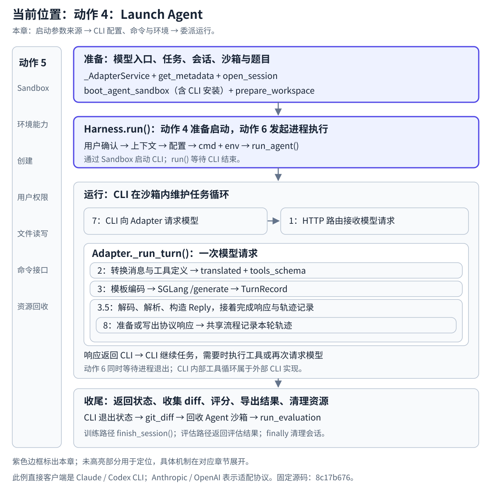

# 动作 4 Launch Agent 渐进阅读

本节开始前，先读 [Pre-4：启动前准备](../../../code-reading/chapters/01-task-execution/pre-4-preparation.md)，把调用方准备与 Harness 本体分开；本节再从准备好的条件进入 `run()`。

**本轮先读：[Harness.run 调用与职责](4.Harness.run调用与职责.md)。** 先读公共骨架，遇到用户准备进入动作 5，返回后继续 ctx、配置与启动。

## 在任务生命周期中的位置

本章：启动参数来源 → CLI 配置、命令与环境 → 委派运行。

[](../../../../static/images/slime-lifecycle/action-4.svg)

[返回生命周期总览](../README.md#任务生命周期与原图的用途) · [放大当前位置图](../../../../static/images/slime-lifecycle/action-4.svg)

## 先分清任务组装与 Launch Agent

CodeWiki 图展示组件之间的关系，阅读顺序沿实际任务执行。`_AdapterService` 位于 `examples/coding_agent_rl/generate.py`，是这个示例的组装代码：加载 tokenizer，选择并构造 Adapter，连接已有 SGLang 地址，启动 Adapter HTTP 服务，得到供 CLI 回连的 `adapter_url`。通过 `SingletonMeta` 可复用进程内的这份服务，模型请求处理时不再重新启动它。图中有这些组件，但没有单独画出它们的创建与启动过程；源码所在目录也不决定它是否需要在本次任务中阅读。

因此先从 `generate()` 的骨架进入，遇到 `state = _AdapterService(args)` 时下钻其初始化，再返回外层继续。第一遍读到“谁被创建、服务在哪里运行、返回什么地址”即可；上游训练、资源调度和 SGLang 服务部署作为既有前提。

| 层次 | 本次要走一遍的内容 | 职责边界 |
| --- | --- | --- |
| 调用方准备 | Adapter 服务、任务元数据、Session、执行环境、CLI 安装与工作区/题目准备 | 在 `generate()` 与示例辅助函数中，准备交给 Harness 的条件 |
| Launch Agent 本体 | `BaseHarness.run()` → 用户准备、HarnessContext、write_config、launch_and_wait | Harness 接住已准备的参数，将它们变成 CLI 配置、命令与启动行为 |
| 环境与执行实现 | Sandbox 命令/文件操作、后台 CLI 启动、退出标记与等待 | 分别沿动作 5、6 展开，读完返回 Harness/外层任务 |

**动作 4 的阅读入口应覆盖“准备好启动条件 → 进入 run → 配置并委派启动”。** 但 `run()` 前的准备仍属于调用方；`run()` 内也有配置与启动准备，所以不能把 Launch Agent 理解成仅仅 `generate()` 到 `run()` 调用之前。

## 应该看哪些 Python 文件

```text
generate()
  -> _AdapterService.__init__()
  -> task metadata + open_session()
  -> Sandbox + install_cli + prepare_workspace()
  -> BaseHarness.run()
       -> write_config()
       -> launch_and_wait()
            -> run_agent()
```

下面的路径相对于 Slime 源码仓库根目录，既有链接指向固定版本 `8c17b676`；本轮本地 `22a89f9` 中相关源码与行号已核对一致。按表中顺序阅读；本轮先选 Claude Code，Codex 留作后续实现对照。

| 顺序 | Python 文件与入口 | 本章重点 |
| --- | --- | --- |
| 1 | [examples/coding_agent_rl/generate.py:182](https://github.com/dextermayhewjd/slime/blob/8c17b676cb57af1d17ee4402e91e9209af84b60b/examples/coding_agent_rl/generate.py#L182) — `generate()` | 找到 `:205` 的 `HARNESS_CLS().run(...)`；向上追踪六项启动输入，确认调用前已经准备了什么 |
| 1A | [examples/coding_agent_rl/generate.py:138](https://github.com/THUDM/slime/blob/22a89f96835969a47055a659c588f46151f8b07a/examples/coding_agent_rl/generate.py#L138) — `_AdapterService.__init__()` | 从 `generate:184` 进入：tokenizer、Adapter、SGLang 地址、HTTP 服务与 adapter_url；看完回到外层任务与会话准备 |
| 2 | [slime/agent/harness/common.py:81](https://github.com/dextermayhewjd/slime/blob/8c17b676cb57af1d17ee4402e91e9209af84b60b/slime/agent/harness/common.py#L81) — `BaseHarness.run()` | 先读用户准备 → `HarnessContext` → 写配置 → 启动等待的骨架；再下钻 Claude 子类，之后返回 `:107` 的 run_agent |
| 3A | [slime/agent/harness/claude_code.py:44](https://github.com/dextermayhewjd/slime/blob/8c17b676cb57af1d17ee4402e91e9209af84b60b/slime/agent/harness/claude_code.py#L44) — `write_config()`、`:57` 的 `launch_and_wait()` | Claude Code 分支：静态启动配置怎样写入；上下文怎样形成启动命令与环境变量 |
| 3B | [slime/agent/harness/codex.py:56](https://github.com/dextermayhewjd/slime/blob/8c17b676cb57af1d17ee4402e91e9209af84b60b/slime/agent/harness/codex.py#L56) — `write_config()`、`:69` 的 `launch_and_wait()` | Codex 分支：同样的输入怎样形成另一套 CLI 启动方式 |
| 按需 | [examples/coding_agent_rl/swe.py:77](https://github.com/dextermayhewjd/slime/blob/8c17b676cb57af1d17ee4402e91e9209af84b60b/examples/coding_agent_rl/swe.py#L77) — `get_metadata()`、`:177` 的 `prepare_workspace()` | 不清楚题目、镜像、工作目录和 `PROBLEM_STATEMENT.md` 的来源时，补读这两个函数 |
| 接下章 | [slime/agent/sandbox.py:390](https://github.com/dextermayhewjd/slime/blob/8c17b676cb57af1d17ee4402e91e9209af84b60b/slime/agent/sandbox.py#L390) — `ensure_agent_user()`、`:82` 的 `exec_and_wait()` | 找到 Harness 委派环境操作和执行的接缝；沙箱实现沿 Manage Sandbox 深入，进程启动与等待沿 Exec Commands 深入 |

当前阅读路线：`generate()` 骨架 → `_AdapterService` 与任务/会话准备 → 已有沙箱与工作区 → `BaseHarness.run()` → 所选 CLI 的 Harness → `run_agent()`。环境操作与 CLI 等待再沿动作 5、6 展开。

**前面的动作 2、3、3.5 展开一次模型请求；本章回到外层，看是谁准备并启动了发起这些请求的 Agent。** 动作编号用于定位职责；实际运行时，先启动 Agent CLI，它再请求 Adapter，多次进入 `_run_turn()`。

完整任务顺序由[项目生命周期总览](../README.md#任务生命周期与原图的用途)统一定位。本章聚焦其中的启动交接：

```text
外层 generate() 准备启动输入
  → sb + workdir + session_id + adapter_url + prompt + budget
  → Harness.run()
      → 确认用户、建立上下文
      → write_config()：准备 CLI 配置
      → launch_and_wait()：形成 cmd + env
      → run_agent()：将运行要求交给执行接口
```

外层 `generate()` 是一次样本任务的编排入口；动作 3 中的 `call_sglang_generate()` 负责一次 token 生成。本章沿参数来源读到启动委派；沙箱操作、进程执行和运行后的模型请求分别在动作 5、6、7 展开。


[返回架构图与源码文件对应](../README.md) · [纵向交接数据](纵向数据流/README.md) · [图文预览](纵向数据流/index.html)

本章展开原图 **Slime Core → Agent Harnesses**：从外层 `generate()` 的启动准备进入 `run()`，读清参数来源，以及 Harness 怎样组织用户准备、配置和启动信息。跨到 Sandbox 的操作由动作 5 深入；真正执行 CLI 的接缝归动作 6。

## 先理解动作 4 为了什么

**动作 4 的目的是将一个样本的任务信息组织成可运行的 Agent 启动，并把启动责任交给选定的 Harness。** 需要先解释任务、会话和模型入口怎样准备，再解释这些信息如何交给负责 Agent 运行的组件。

例如，Slime 侧要启动一次代码任务。它把已准备的执行环境、工作目录、任务指令、会话 ID、模型入口和时间预算一起交给 Harness。调用者通过同一个 `run()` 接口，可以选择 Claude Code Harness 或 Codex Harness。

| 问题 | 答案 |
| --- | --- |
| 谁发起？ | 本地示例的外层 `generate()` |
| 接收者是谁？ | 选定的 `ClaudeCodeHarness` / `CodexHarness` 对象，其公共入口为继承的 `BaseHarness.run()` |
| 交接什么？ | 已有沙箱对象和五项启动参数 |
| 交接形式是什么？ | Python 异步函数调用 `await HARNESS_CLS().run(...)` |

## 图中的 Core 怎样对应到实际调用者

图把 Slime 侧组织 Agent 的职责画在 Core → Harness 这条边上。这个版本的实际组装入口是 `examples/coding_agent_rl/generate.py` 中的 `generate()`：它同时连接 Adapter 与 Harness。

**`BaseAdapter._run_turn()` 和 `TrajectoryManager` 不直接调用 Harness**。前者负责模型请求，后者负责轨迹；本章追踪外层任务入口怎样把启动责任交给 Harness，不能从图中推导出不存在的 `BaseAdapter → Harness.run()` 调用。

## 先建立最小心智模型

```text
Slime task side
    generate()
        → select HARNESS_CLS + ADAPTER_CLS
        → prepare model endpoint + task metadata
        → open session with sampling defaults
        → boot sandbox + install CLI + prepare workspace
        → pass sb + launch parameters
        → BaseHarness.run(...)
            → ensure_agent_user(sb, workdir)
            → create HarnessContext
            → write_config(sb, ctx)
            → launch_and_wait(sb, ctx, prompt, budget)
                → assemble command + environment
                → run_agent(sb, ...)
                    [Sandbox operations: action 5]
                    [CLI execution: action 6]
```

`run()` 是完整调度骨架。动作 4 要理解其中每一步的目的、输入和成果，包括 `write_config()` 和 `launch_and_wait()`；当它们调用 `sb` 时，动作 5 从同一调用处继续解释环境如何落实操作。

## 用一份启动信息看交接

以下为教学值；地址、目录和会话 ID 均为示意值。

```python
await HARNESS_CLS().run(
    sb,
    workdir="/workspace/demo",
    session_id="cagent-demo-0-0",
    adapter_url="http://192.0.2.10:18001",
    time_budget_sec=1800,
    prompt="Read PROBLEM_STATEMENT.md and resolve the issue.",
)
```

| 数据 | 在动作 4 中的含义 |
| --- | --- |
| `sb` | 已准备的执行环境对象，作为参数交给 Harness |
| `workdir` | 本次任务使用的工作目录 |
| `prompt` | 本次任务的启动指令 |
| `session_id` | 本次任务的会话标识 |
| `adapter_url` | 已准备的模型请求入口地址 |
| `time_budget_sec` | 本次运行的时间预算 |

动作 2 交接消息与工具定义；**动作 4 交接任务的运行上下文与启动责任**。

## 按这个顺序继续阅读

| 顺序 | 文档 | 看清什么 |
| --- | --- | --- |
| 1 | [启动参数与配置、命令](1.启动参数和模型入口.md) | 参数从哪里来，怎样进入上下文，再形成配置与启动信息 |
| 2 | [主路径和源码函数](2.主路径和源码函数.md) | 完整 `run()` 骨架、子类实现及沙箱调用位置 |
| 3 | [入口准备和动作边界](3.会话入口和生命周期.md) | 哪些条件已准备，哪些机制留给其他动作 |
| 图文 | [纵向交接数据](纵向数据流/README.md) · [预览](纵向数据流/index.html) | 样本、部署配置与采样设置怎样连接到 CLI 启动和后续模型请求 |

## 在哪里停下

**本章读到 Harness 将配置与准备好的启动信息交给 Sandbox 的接口**。`write_config()`、`launch_and_wait()` 都展开 Harness 侧的工作；环境如何执行这些准备操作接动作 5，CLI 进程真正开始运行接动作 6。

这些动作按跨组件职责划分，同一函数可以连接多条边。运行时 `run()` 会等待下游完成；阅读时可以先读调度，再下钻[动作 5 Manage Sandbox](<../5.Manage Sandbox/README.md>)，最后进入动作 6 CLI 执行、动作 7 模型请求。不能把箭头编号当作互不重叠的函数清单。

固定源码：`8c17b676cb57af1d17ee4402e91e9209af84b60b`。源码路径相对于 Slime 仓库根目录；本章按固定源码追踪启动准备，示例捕获 Harness 参数计算与沙箱操作请求，没有运行真实 Agent。
