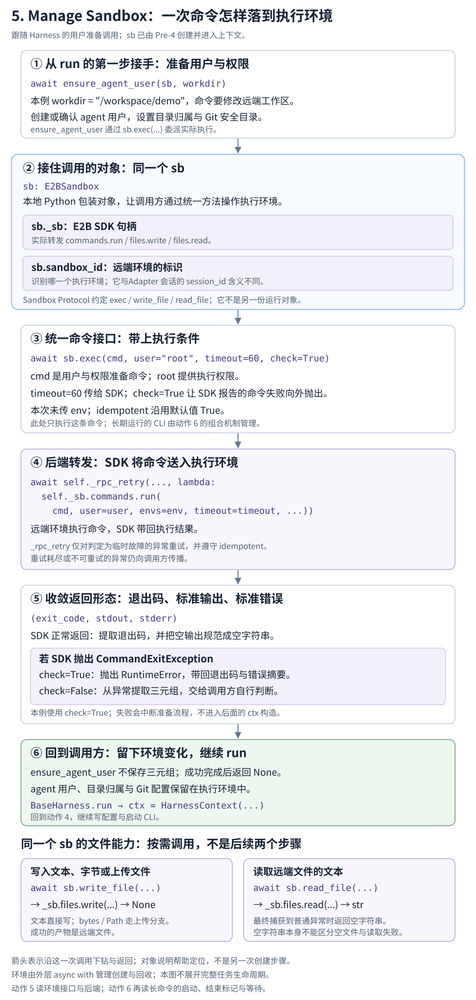

# Manage Sandbox：把一次环境操作做完，再回到调用者

**读完本章，你应能说明：`run()` 请求的一次环境操作，怎样进入远端沙箱、返回结果，并让调用者继续执行？**

<div class="reading-navigation" data-reading-navigation="action-5">

以下是**阅读伪代码**：简写前后步骤，标出本节入口；缩进表示阅读层次，各层实现仍在不同函数中。

```python
generate:
    ...  # Pre-4：模型、会话、环境与题目准备；同样使用 Action 5
    HARNESS_CLS().run:  # Action 4：用户、配置、cmd/env 与启动委派
        ensure_agent_user:
            sb.exec:  # 当前 Action 5：下钻一次环境命令
                self._sb.commands.run(...)
                return exit_code, stdout, stderr
        ...  # 回到 Action 4，接入 Action 6 的执行与等待
        # CLI 运行期间：7 回连；2/3/3.5 处理模型请求
    ...  # 返回后收集 diff、评估与清理
# Action 5 的完整范围：创建、命令、文件、回收；并非单独的一阶段
```

</div>

## 本节局部数据流

[](flow.svg)

沿用工作区 `/workspace/demo`。此时 `sb` 已经可用；我们从准备 `agent` 用户的一次命令进入，先读完命令的正常路径，再补文件操作和环境的来去。

<details class="reading-extra">
<summary>查看这一步在完整任务中的位置</summary>

[](/images/slime-lifecycle/action-5.svg)

Pre-4 已创建环境并安装 CLI。Action 4 的 Harness 使用这个环境；本章展开它调用的一项能力。环境操作也会出现在题目准备、输出收集等位置。

[返回任务生命周期总览](/projects/slime/#agent-lifecycle)

</details>

## 把图接到真实调用

`BaseHarness.run()` 先把 `sb` 和工作区交给用户准备函数。下面摘出实际调用及紧接着的代码；完整启动流程在 Action 4。

```python
await _sandbox.ensure_agent_user(sb, workdir)
ctx = HarnessContext(
    workdir=workdir,
    session_id=session_id,
    adapter_url=adapter_url,
)
await self.write_config(sb, ctx)
return await self.launch_and_wait(sb, ctx, prompt, time_budget_sec)
```

这里的第一个 `await` 完成后，才会创建 `ctx`。因此本章的返回位置是 `ctx = HarnessContext(...)`，而不是另启动一个 Agent。

<details class="reading-source" id="source-c01" data-source-check="c01">
<summary>查看源码出处与行号</summary>

- 公共调用骨架：[slime/agent/harness/common.py:81](https://github.com/THUDM/slime/blob/22a89f96835969a47055a659c588f46151f8b07a/slime/agent/harness/common.py#L81-L104)

</details>

## 1．先认清交出去的对象，再形成命令

| 此时的数据 | 下一步交给谁 | 最小理解 |
| --- | --- | --- |
| `sb` | `ensure_agent_user()`，随后调用其 `exec()` | 指向已经创建的同一个执行环境；后续配置和 CLI 也使用它 |
| `workdir = "/workspace/demo"` | `ensure_agent_user()` | 远端任务目录；本次要把这个目录的所有权交给 `agent` 用户 |

`sb` 在不同位置只是同一对象的参数名。本例中，它指向一个 `E2BSandbox` 包装对象。本章涉及的组成只有这些：

- **`sandbox_id`：远端执行环境的标识。** 用来识别这个沙箱，不是任务的 `instance_id`，也不是 Adapter 会话的 `session_id`。
- **`_sb`：E2B SDK 操作句柄。** 后面用它的 `commands.run` 发命令、用 `files` 读写文件。
- **`exec()`、`write_file()`、`read_file()`：调用方使用的方法。** 它们把 SDK 操作封装成稳定的输入输出。

`Sandbox` 是这些能力的 `Protocol` 约定，不是又一层运行实例。`E2BSandbox` 提供相应方法，调用方就可以按这个约定使用它，无须继承 `Sandbox`。

<details class="reading-source" id="source-c02" data-source-check="c02">
<summary>查看源码出处与行号</summary>

- 公共能力约定：[slime/agent/sandbox.py:23](https://github.com/THUDM/slime/blob/22a89f96835969a47055a659c588f46151f8b07a/slime/agent/sandbox.py#L23-L59)
- 包装对象与字段：[slime/agent/sandbox.py:160](https://github.com/THUDM/slime/blob/22a89f96835969a47055a659c588f46151f8b07a/slime/agent/sandbox.py#L160-L189)
- 句柄与环境标识赋值：[slime/agent/sandbox.py:294](https://github.com/THUDM/slime/blob/22a89f96835969a47055a659c588f46151f8b07a/slime/agent/sandbox.py#L294-L300)

</details>

`ensure_agent_user()` 把本次要求变成一条 shell 命令：

```python
async def ensure_agent_user(sb: Sandbox, workdir: str) -> None:
    """Create the unprivileged 'agent' user that owns workdir + can git diff."""
    await sb.exec(
        f"id agent >/dev/null 2>&1 || useradd -m -s /bin/bash agent && "
        f"chown -R agent:agent /home/agent {workdir} && "
        f"git config --system --add safe.directory '*' && id agent",
        user="root",
        check=True,
        timeout=60,
    )
```

本例请求以 `root` 身份执行，操作超时为 60 秒。命令检查或创建 `agent` 用户，设置用户目录及工作区的所有权，并添加 Git 安全目录配置。

调用没有传 `env`，因此使用默认的 `None`；没有传 `idempotent`，因此使用默认的 `True`。这两个参数下一步会进入后端。

<details class="reading-source" id="source-c03" data-source-check="c03">
<summary>查看源码出处与行号</summary>

- 调用处：[slime/agent/harness/common.py:97](https://github.com/THUDM/slime/blob/22a89f96835969a47055a659c588f46151f8b07a/slime/agent/harness/common.py#L97-L97)
- 完整用户准备函数：[slime/agent/sandbox.py:390](https://github.com/THUDM/slime/blob/22a89f96835969a47055a659c588f46151f8b07a/slime/agent/sandbox.py#L390-L399)
- exec 参数默认值：[slime/agent/sandbox.py:309](https://github.com/THUDM/slime/blob/22a89f96835969a47055a659c588f46151f8b07a/slime/agent/sandbox.py#L309-L319)

</details>

## 2．同一条命令怎样进入远端环境

调用来到 `E2BSandbox.exec()`。先只看发送和正常返回这一段：

```python
res = await self._rpc_retry(
    f"exec({cmd[:60]!r})",
    lambda: self._sb.commands.run(
        cmd,
        user=user,
        envs=env,
        timeout=timeout,
        on_stdout=lambda s: None,
        on_stderr=lambda s: None,
    ),
    idempotent=idempotent,
)
return res.exit_code, res.stdout or "", res.stderr or ""
```

这里有两个连续交接：

1. `exec()` 把一次 SDK 调用交给 `_rpc_retry()` 执行。传入的是 `lambda`，需要重试时才会重新发起这一调用。
2. SDK 句柄的 `commands.run()` 把命令交给远端环境执行。`cmd`、`user` 和 `timeout` 继续传下去；Slime 的 `env` 在 SDK 参数中改名为 `envs`。

`on_stdout`、`on_stderr` 在这里不做实时处理；成功后，从 SDK 结果对象读取退出状态和输出，组成：

```text
(exit_code, stdout, stderr)
```

假设 SDK 报告成功，并返回下面的教学示意值：

```json
{
  "exit_code": 0,
  "stdout": "uid=1000(agent) gid=1000(agent) groups=1000(agent)\n",
  "stderr": ""
}
```

那么 `exec()` 返回对应的三元组。这里的用户编号和输出仅用于说明结构，**没有真实执行远端命令**；SDK 的空输出会由 `or ""` 统一成空字符串。完整教学输入与响应见[示例数据](示例.json)。

<details class="reading-source" id="source-c04" data-source-check="c04">
<summary>查看源码出处与行号</summary>

- 发送与正常返回：[slime/agent/sandbox.py:320](https://github.com/THUDM/slime/blob/22a89f96835969a47055a659c588f46151f8b07a/slime/agent/sandbox.py#L320-L334)
- SDK 句柄来源：[slime/agent/sandbox.py:298](https://github.com/THUDM/slime/blob/22a89f96835969a47055a659c588f46151f8b07a/slime/agent/sandbox.py#L298-L300)

</details>

## 3．结果回来了，调用者留下什么

再看用户准备函数的调用形式：它只是 `await sb.exec(...)`，没有把返回三元组赋给变量。

因此，这次正常返回有两类成果：

| 留下什么 | 谁接着使用 |
| --- | --- |
| `ensure_agent_user()` 正常返回 `None` | `run()` 继续构造 `HarnessContext` |
| 环境中的用户、目录所有权与 Git 配置 | 后续在同一 `sb` 中写配置、启动 CLI 的操作 |

**返回 `None` 不等于没有做事。** 本次主要成果是远端环境状态改变；三元组是底层接口的结果，用户准备函数在正常路径中不需要保存它。

随后 `run()` 调用 `write_config(sb, ctx)`，会再次使用同一个环境接口。Claude 配置的具体内容已经在 Action 4 展开，这里读到“同一 `sb` 被继续使用”即可。

<details class="reading-source" id="source-c06" data-source-check="c06">
<summary>查看源码出处与行号</summary>

- 用户准备完整函数：[slime/agent/sandbox.py:390](https://github.com/THUDM/slime/blob/22a89f96835969a47055a659c588f46151f8b07a/slime/agent/sandbox.py#L390-L399)
- 返回后继续：[slime/agent/harness/common.py:97](https://github.com/THUDM/slime/blob/22a89f96835969a47055a659c588f46151f8b07a/slime/agent/harness/common.py#L97-L104)
- 后续配置仍使用 sb：[slime/agent/harness/claude_code.py:44](https://github.com/THUDM/slime/blob/22a89f96835969a47055a659c588f46151f8b07a/slime/agent/harness/claude_code.py#L44-L55)

</details>

## 4．失败时，先分清两个问题

正常路径已经返回 `run()`。这一节先记住两个开关各自负责什么，具体分支可以在第二遍展开。

| 开关 | 回答的问题 | 本例的含义 |
| --- | --- | --- |
| `check` | SDK 报告命令失败时，怎样交给调用者？ | SDK 抛出 `CommandExitException` 时，`check=True` 把它转成 `RuntimeError`，停止这次正常准备流程 |
| `idempotent` | 传输中断后，是否允许重发操作？ | 本例沿用 `True`；还需要异常被判定为瞬时错误，才会重试 |

允许重发是调用者的提示，不会自动证明命令没有重复副作用。

<details class="reading-extra" id="sandbox-failure-details">
<summary>第二遍：展开命令异常、重放条件与退避代码</summary>

**命令失败怎样交给调用方：** SDK 抛出 `CommandExitException` 时，`check` 决定返回形式。

```python
except CommandExitException as e:
    if check:
        raise RuntimeError(
            f"e2b exec failed (exit={e.exit_code}): {cmd[:120]}\n{(e.stderr or '')[:400]}"
        ) from None
    return e.exit_code, e.stdout or "", e.stderr or ""
```

- `check=False`：把这次失败的退出状态、标准输出和错误输出交还调用者，由调用者判断。
- `check=True`：转成 `RuntimeError` 抛出。本例用户准备使用这个选项，失败时不会正常进入后面的 `ctx` 构造。

这个分支处理的是指定的 SDK 异常；代码没有另外对所有正常返回的 `res.exit_code` 做一次检查。

**传输失败能不能再发：** `_rpc_retry()` 同时检查异常种类与重放提示。下面摘出判断片段，后续退避代码省略。

```python
for attempt in range(self.rpc_retries):
    try:
        return await coro_factory()
    except Exception as e:
        if not self._is_transient_rpc_error(e):
            raise
        if not idempotent:
            raise
```

只有被识别为瞬时错误、且 `idempotent=True`，才进入后面的重试。默认最多尝试 6 次，包含第一次；重试前尝试关闭旧连接池，使下次请求重新连接，再等待带随机抖动的退避时间。其他异常、禁止重放或次数耗尽，继续向外抛出。

`check` 管命令失败的表达方式，`idempotent` 管传输失败后是否允许重放，它们不是同一个开关。后者是调用方的提示，不会自动证明命令没有重复副作用：本例的 Git `--add` 再次执行时仍会追加配置。响应中断时，远端命令也可能已经执行过。

<details class="reading-source" id="source-c05" data-source-check="c05">
<summary>查看源码出处与行号</summary>

- 命令异常：[slime/agent/sandbox.py:335](https://github.com/THUDM/slime/blob/22a89f96835969a47055a659c588f46151f8b07a/slime/agent/sandbox.py#L335-L340)
- 默认重试次数：[slime/agent/sandbox.py:168](https://github.com/THUDM/slime/blob/22a89f96835969a47055a659c588f46151f8b07a/slime/agent/sandbox.py#L168-L172)
- 瞬时异常识别：[slime/agent/sandbox.py:211](https://github.com/THUDM/slime/blob/22a89f96835969a47055a659c588f46151f8b07a/slime/agent/sandbox.py#L211-L235)
- 重试与退避：[slime/agent/sandbox.py:237](https://github.com/THUDM/slime/blob/22a89f96835969a47055a659c588f46151f8b07a/slime/agent/sandbox.py#L237-L279)
- 本例重复Git追加：[slime/agent/sandbox.py:394](https://github.com/THUDM/slime/blob/22a89f96835969a47055a659c588f46151f8b07a/slime/agent/sandbox.py#L394-L396)

</details>

</details>

## 5．同一个环境，文件操作怎样使用

命令路径读完，再认识另外两项能力。下面是 Pre-4 准备题目时的真实调用片段；它发生在进入当前 `run()` 之前，用来说明同一个接口还怎样被使用。

```python
await sb.write_file(
    f"{workdir}/PROBLEM_STATEMENT.md",
    md.get("problem_statement") or "",
    user="agent",
)
```

`workdir` 仍可取 `/workspace/demo`。调用把题目文本写到远端 `PROBLEM_STATEMENT.md`，供稍后的 CLI 阅读；成功返回 `None`，成果是文件本身。

| 方法 | 输入应怎样理解 | 成功结果与需要注意的边界 |
| --- | --- | --- |
| `write_file(path, content)` | `path` 是远端路径；`content` 为文本、字节或宿主机的 `Path` 对象 | 写入成功返回 `None`；普通字符串始终是内容，只有 `Path` 对象表示读取宿主文件再上传 |
| `read_file(path)` | 从远端路径读取文本 | 返回字符串；最终向 `read_file()` 抛出普通异常时会返回 `""`，因此空字符串也可能表示读取失败 |

读取实现很短，但它决定了调用方能否分辨失败：

```python
async def read_file(self, sandbox_path: str, *, user: str = "root") -> str:
    try:
        return await self._rpc_retry(
            f"read_file({sandbox_path})",
            lambda: self._sb.files.read(sandbox_path, user=user),
        )
    except Exception:
        return ""
```

这里捕获的是普通 `Exception`，不能概括成吞掉一切取消与失败。读取结果为空时，调用者如果需要区分“空文件”和“读取失败”，还需要其他证据。

<details class="reading-extra">
<summary>为什么上传文件时，每次重试都重新打开它？</summary>

`write_file()` 收到 `Path` 后，在交给重试器的协程内部打开宿主文件；收到 `bytes` 时，也在每次调用里重新创建 `BytesIO`。这样再次发送时获得新的读取流，不会直接复用上次已经读过的流位置。最终上传仍失败时，异常继续抛出。

</details>

<details class="reading-source" id="source-c07" data-source-check="c07">
<summary>查看源码出处与行号</summary>

- 题目写入调用：[examples/coding_agent_rl/swe.py:177](https://github.com/THUDM/slime/blob/22a89f96835969a47055a659c588f46151f8b07a/examples/coding_agent_rl/swe.py#L177-L198)
- 写入实现：[slime/agent/sandbox.py:342](https://github.com/THUDM/slime/blob/22a89f96835969a47055a659c588f46151f8b07a/slime/agent/sandbox.py#L342-L378)
- 读取实现：[slime/agent/sandbox.py:380](https://github.com/THUDM/slime/blob/22a89f96835969a47055a659c588f46151f8b07a/slime/agent/sandbox.py#L380-L387)

</details>

## 6．补齐这个对象的来去，再返回当前任务

到这里已经能解释一次操作。最后只补足 `sb` 的来源和回收责任：

| 时点 | 谁负责 | 留下什么 |
| --- | --- | --- |
| 进入工作环境 | `boot_agent_sandbox()` 调用 `E2BSandbox.__aenter__()` | 通过 SDK 创建远端环境，保存 `_sb` 和 `sandbox_id`；安装 CLI 后交出 `sb` |
| 使用环境 | 工作区准备、Harness 和结果收集代码 | 反复调用这个对象的命令、文件能力 |
| 离开工作环境 | 外层上下文的 `finally` 调用 `__aexit__()` | 尝试调用 SDK 的 `kill()` 回收环境 |

构造 `E2BSandbox(image)` 本身只保存配置，创建发生在 `__aenter__()`。`image` 通过配置的 metadata 键交给 SDK，具体镜像路由由外部环境服务处理。

回收中的普通异常只记 warning，没有在这里重试 `kill()`。因此“已进入回收函数”和“已确认远端销毁”仍是两回事。

<details class="reading-source" id="source-c08" data-source-check="c08">
<summary>查看源码出处与行号</summary>

- 构造配置：[slime/agent/sandbox.py:174](https://github.com/THUDM/slime/blob/22a89f96835969a47055a659c588f46151f8b07a/slime/agent/sandbox.py#L174-L189)
- 创建与回收：[slime/agent/sandbox.py:281](https://github.com/THUDM/slime/blob/22a89f96835969a47055a659c588f46151f8b07a/slime/agent/sandbox.py#L281-L307)
- 外层上下文与安装：[examples/coding_agent_rl/generate.py:95](https://github.com/THUDM/slime/blob/22a89f96835969a47055a659c588f46151f8b07a/examples/coding_agent_rl/generate.py#L95-L134)
- 使用和结果收集：[examples/coding_agent_rl/generate.py:200](https://github.com/THUDM/slime/blob/22a89f96835969a47055a659c588f46151f8b07a/examples/coding_agent_rl/generate.py#L200-L219)

</details>

## 出口：接回 Action 4，再下钻 Action 6

现在可以回到开头那个 `await`：用户准备结束，`run()` 继续建立上下文、写配置，并组织 CLI 启动。

之后 `run_agent()` 也会先用 `sb.exec()` 准备输出目录，再把长命令交给 `exec_and_wait()`。到这里，动作 5 已解释了底层环境接口；**启动脚本、后台进程、完成标记与等待预算，接着在动作 6 读。**

两种返回合同也要分清：本章 `exec()` 返回三元组；`exec_and_wait()` 返回 `(exit_code, output)`，`run_agent()` 再向上返回整数状态。等待预算耗尽返回 `-1` 本身不杀掉 CLI，环境回收仍由外层上下文负责。

<details class="reading-source" id="source-c09" data-source-check="c09">
<summary>查看源码出处与行号</summary>

- run_agent 调用与整数返回：[slime/agent/harness/common.py:107](https://github.com/THUDM/slime/blob/22a89f96835969a47055a659c588f46151f8b07a/slime/agent/harness/common.py#L107-L122)
- 长命令入口和返回：[slime/agent/sandbox.py:82](https://github.com/THUDM/slime/blob/22a89f96835969a47055a659c588f46151f8b07a/slime/agent/sandbox.py#L82-L145)
- 预算状态：[slime/agent/sandbox.py:62](https://github.com/THUDM/slime/blob/22a89f96835969a47055a659c588f46151f8b07a/slime/agent/sandbox.py#L62-L79)
- 退出环境前收集结果：[examples/coding_agent_rl/generate.py:203](https://github.com/THUDM/slime/blob/22a89f96835969a47055a659c588f46151f8b07a/examples/coding_agent_rl/generate.py#L203-L219)

</details>

## 回到局部图，检查是否能独立解释

1. `sb`、`sb._sb` 和远端环境分别是什么？谁实际执行了 shell 命令？
2. 为什么 `exec()` 返回三元组，而用户准备函数返回 `None`，下一步仍可以继续？
3. `check=True` 与 `idempotent=True` 各管什么？为什么读取到 `""` 不能直接断定文件为空？
4. 如果要换一种沙箱后端，哪些命令／文件合同需要保留？长命令的等待逻辑位于哪一层？

[回到 Action 4：Launch Agent](/projects/slime/4-slime-core-components-and-orchestration/4-1-agent-rollout-adapters-and-harnesses/4-launch-agent/) · [继续 Action 6：Exec Commands](/projects/slime/4-slime-core-components-and-orchestration/4-1-agent-rollout-adapters-and-harnesses/6-exec-commands/)

<details class="reading-source">
<summary>集中查看源码校验清单与完整示例</summary>

[源码出处与校验清单](SOURCE-CHECK.md) · [教学输入与响应](示例.json)

[旧版章节材料](https://github.com/dextermayhewjd/dextermayhewjd.github.io/blob/main/slime_photo/4.Slime%20Core%20Components%20and%20Orchestration/4.1.Agent%20Rollout%20Adapters%20and%20Harnesses/5.Manage%20Sandbox/README.md)

本稿按固定本地源码静态核对。图为本章职责重绘，教学响应为构造值；本轮没有运行远端环境、CLI 或模型服务。

</details>
