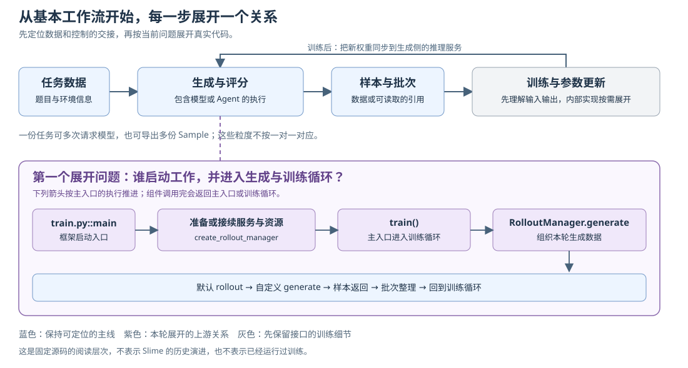

# 全局职责：从基本工作流逐步展开

[本章入口](README.md) · [阅读路线](../../repo-reading-route.md) · [入口核对清单](../../source-map.json)

这份 Walkthrough 持续整理已经讨论过的问题、建立关系所需的解释与源码依据。下面的解释模型仍可随反馈修订，不把读过、记住和实际运行当成同一件事。新增框架入口与保留材料的版本边界见 [源码核对记录](SOURCE-CHECK.md)；本篇没有运行模型、Agent CLI、沙箱、训练或集群。

## 从基本工作流建立起点

先回答：系统接收什么任务与配置，组织哪些工作，最终把什么结果交给谁？从这条完整但简短的主线定位每个模块，再决定本次深入哪个交接。

全景的起点不依赖此前是否读过某个函数。已经看过的 `generate()` 仍属于可回顾的局部材料，重遇时提醒职责和输入输出即可；它不会代替基本框架，也不会成为理解全景的前置条件。

每一步保留前一步的整体模型，只展开当前问题需要的一层。讲完局部代码后，记录模型新增或修正了什么，再由尚未解释的交接引出下一步。这套通用方法与认知步骤保存在仓库根目录 `00-repo-reading/`。

## 保持整体骨架，按问题展开

先保留能够连接生成和训练的骨架：

```text
任务数据
  → 组织模型或 Agent 生成，并对结果评分
  → 整理样本与训练批次
  → 训练更新模型参数
  → 同步推理权重，供后续生成使用
```



[单独打开全景图](framework-map.svg)

图的上层是数据交接，下层展开任务上游。紫色表示本轮要看清的关系；灰色训练框仍保留职责与输入输出，其内部可以在后续需要时展开。SGLang 在任务执行期间已经提供模型推理，训练完成后再接收新权重。

这里采用“基础骨架 → 新需求 → 展开一层机制”的阅读方式。它描述固定版本代码的理解层次；只有核对 Git 历史后，才能讨论项目实际如何演进。

## 新需求怎样决定读深哪一层

有了基本框架，新的问题决定下一次下钻位置。下表是展开依据，不是另一套章节编号或逐项必做的开发任务。

| 新增的问题 | 在原骨架上展开什么 | 这一轮理解到哪里 |
| --- | --- | --- |
| 谁启动服务，又怎样进入生成与训练循环？ | main、服务准备、RolloutManager 和默认 rollout | 连续说明调用者、输入、返回值和下一交接 |
| 接入另一种任务、Agent 策略或评分方法，应改哪层？ | custom generate、RM、hook 与评测配置 | 读清扩展合同及验证，不把所有示例都通读一遍 |
| 一份任务慢、失败或需要取消，会怎样影响其他任务？ | 并发预算、任务池、队列、取消和清理 | 能跟踪相关任务与结果，再按问题深入恢复 |
| 结果为什么不对，或者耗时在哪里？ | Trace、指标、测试与复现配置 | 从当前主线关联各阶段；观察与验证从最初就配合使用 |
| 轨迹怎样用于训练，更新后的模型怎样继续生成？ | Sample、批次转换、策略版本与权重同步 | 先读数据合同与交接；算法及底层并行实现按需展开 |
| 任务换到容器或集群后，环境和资源由谁管理？ | Sandbox、服务生命周期、Ray 与容器部署边界 | 先分清归属，再用对应环境验证部署和排障 |

完整的学习主线需要讲通每次交接。暂未深入的模块保留可定位的职责、输入输出与运行边界；深入范围以当前需要解决的问题为准。

## 第一个展开问题：谁启动工作并进入循环

以下是当前固定源码的阅读导航，省略了配置校验、恢复与清理分支，不是可直接运行的替代实现：

```text
train.py::main(args, restore_plan)
  create_rollout_manager(...) → startup
  train(startup 的配置、资源布局、manager 等)
    准备训练组件，完成初始权重同步
    每轮请求 RolloutManager.generate(...)
      取得本轮 rollout 数据
      默认 rollout 经 generate_and_rm 选择自定义生成函数
        coding_agent_rl.generate(...) → Sample / Sample 列表
      结果回到 manager，整理并交回训练所需数据或引用
    训练组消费本轮数据
    确认进度，按配置保存，再更新推理权重
```

`create_rollout_manager()` 返回后，主入口再调用 `train()`；并非工厂函数直接负责后面的全部训练。它可能准备新组件，也可能接续已有服务，具体分支后续沿实现展开。

同样叫 generate 的几个入口承担不同范围：

| 真实入口 | 负责的范围 | 在主线中的交接 |
| --- | --- | --- |
| RolloutManager.generate | 一轮生成数据的编排 | 在框架上层接收请求，再取得生成数据 |
| sglang_rollout.generate_and_rm | 默认流水线中生成、hook 与评分的组合 | 按配置选择自定义生成函数，处理结果交接 |
| coding_agent_rl.generate | 一份代码任务的执行与收尾 | 将具体任务的结果交回外层生成流程 |

一份任务可以多次请求模型，也可以导出多个 Sample。批次还要按训练合同整理，不能把一次任务结束直接画成一次参数更新。

<details>
<summary>按需阅读：本轮新增关系的源码证据</summary>

调用处与定义处对应 [C01–C04 源码核对记录](SOURCE-CHECK.md)。记录包含固定提交、入口行号、图的身份和未执行范围。已有单任务细节继续回查[任务导览](../01-task-execution/walkthrough.md)。

</details>

## 再遇到 generate 时先提醒什么

读过这个局部，也不要求随时能够独立背出。沿主线遇到它时，可以用下面四项唤起关系；此前没有读过，则在进入该模块时逐步展开。

| 回顾点 | 本例需要记住的关系 |
| --- | --- |
| 接到什么 | 配置 args、任务样本 base_sample、采样参数 sampling_params；evaluation 决定评测或训练导出分支 |
| 组织什么 | 准备并启动 Agent，收集 diff，独立评分，导出结果和清理会话 |
| 内部谁反复运行 | CLI 推进模型与工具循环；Adapter 处理各次模型请求，SGLang 提供模型推理 |
| 交回什么 | 评测模式返回结果样本；训练模式返回符合导出合同的 Sample 列表，供外层继续处理 |

如果仍有具体环节接不上，就在该交接补一段提醒或回查。这个回顾不假定已经忘了某个组件，也不要求重新走完整任务。

## 讨论中澄清过的关系

**“全景是否应该以已经读过 generate 为起点？”** 之前的开头混合了整体模型与阅读历史，现按这次纠正分开：先从基本工作流建立框架，旧阅读只用于遇到具体模块时减轻回顾负担。后续每一步继承整体理解，而不是重新从某个熟悉的函数搭起另一套全景。

**“已经看过 generate，为什么还要建立全局？”** 单任务内部解释如何完成一份任务；全局需要把它放回调用者与数据消费者之间。保留内部已读事实，再补谁提供配置、谁组织批次、谁消费结果。

**“00–07 和官网目录是什么关系？”** 00–07 是本地按职责组织的阅读分组；源码索引和既有 4.1 材料各有自己的编号。它们用于定位，不共同组成一条按数字执行的程序。

**“应该从 Agent Get Started 还是本地材料开始？”** 官方 Agent 页面说明工作流的接入点；本地职责表帮助定位组件；实际调用从固定源码核对。当前问题是框架入口，就沿 main 向下追，调用到单任务时再回查已有导览。

**“复杂框架是否需要全部同等深入？”** 先保持完整的职责和数据关系。随后由具体新增问题决定展开哪块：策略接入、评分、观察验证和运行稳定性可以深入；训练内核等部分先保留清楚的消费合同，再按需要进入实现。

这些解释保留了问题如何引出下一层关系。后续明确的疑问、修正和例子应补进相应位置；未获得反馈的解释保留为可修订模型，不代写成阅读者已经掌握的事实。

## 职责速查与已有源码骨架

下面保留原有职责表与单任务骨架，作为对应交接的查阅材料。可以从上面的当前问题选择所需位置，不要求先逐项记住整仓目录。

## 用代码任务检验职责图

有了上面的整体工作流，再把一个代码任务放进去：题目与仓库信息属于输入，Agent 执行和独立评分属于生成侧，diff、评分与轨迹属于结果；样本整理后交到训练侧。下面的职责表和单任务骨架用于定位这些交接。

第一遍只需要能指出责任和入口，暂时不逐行阅读全部实现。对哪个模块展开，由当前模型里的问题决定。

## 每个部分具体做什么

以下路径相对于 Slime 源码仓库根目录。

| 部分 | 做什么 | 主要交接 | 第一遍找哪里 | 后续单元 |
| --- | --- | --- | --- | --- |
| `examples/coding_agent_rl/` | 将通用组件组装成代码任务，准备题目、工作区、补丁与独立评估 | 输入 `Sample` 与任务元数据；训练模式返回样本片段，评测模式返回评分结果样本 | `generate.py::generate`、`swe.py::run_evaluation` | 01、03 |
| `agent/harness/` | 安装和配置 CLI，准备模型入口与会话身份，启动并等待 Agent | `Sandbox`、工作目录、配置与 prompt → CLI 进程及退出码 | `BaseHarness.run`、两个具体 Harness | 01 |
| `agent/sandbox.py` | 提供环境创建/释放、命令、文件与长命令等待操作 | 上层 Harness/SWE 调用合同 → E2B 实现 | `Sandbox`、`exec_and_wait` | 01、06 |
| `agent/adapters/` | 接收 CLI 模型请求，转换协议消息与工具定义，调用模型并返回兼容响应 | HTTP 请求与 Session → 模型生成 → 协议响应与本轮记录 | `BaseAdapter._run_turn`、`call_sglang_generate` | 02 |
| `agent/parsing.py`、`trajectory.py` | 解析模型输出，记录多轮上下文与采样，导出训练样本 | token 与消息分支 → 工具调用表示、`TurnRecord`、带 mask/logprob 的 `Sample` | `parse_model_output`、`TrajectoryManager` | 02 |
| `rollout/` | 组织单样本/组/批次生成、评分、过滤、评测与异步收集 | 数据源与生成策略 → 已评分的样本组、批次输出或数据引用 | `generate_and_rm`、`generate_rollout_async`、`base_types.py` | 03、05 |
| `utils/eval_config.py`、`rollout/rm_hub/` | 定义评测数据集和采样配置，分发本地或远端评分 | 数据字段/样本 → 评测调用与 reward | `EvalDatasetConfig`、`async_rm` | 03 |
| `data/` | 处理数据源、任务队列、结果传输与归档、批次组织和恢复计划 | prompt/任务身份 → 生成结果/数据引用 → 训练批次与数据进度 | `data_source.py`、`queue_data_source.py`、`transport.py`、`checkpoint.py` | 05、07 |
| `observability/` | 组织日志、实验跟踪、Trace、指标和数据调试信息 | 跨调用身份与事件 → 可关联的记录与统计 | `trace_utils.py`、`logging_utils.py`、`metric_utils.py` | 04 |
| `ray/` | 分配进程/GPU 资源，组装训练与生成服务，协调批次与服务控制 | 配置与资源布局 → actor、RolloutManager 与训练消费 | `placement_group.py`、`rollout.py` | 06、07 |
| `ray/serving.py`、`backends/sglang_utils/`、`utils/health_monitor.py` | 管理模型服务状态、部署、路由、健康恢复和相关引擎操作 | ServingCluster 持有服务与队列，RolloutManager 借用引擎并组织批次 | `ServingCluster`、`deployment.py`、`external.py`、健康检查入口 | 06 |
| `backends/megatron_utils/` | 将生成数据用于训练，计算相关统计/损失，保存并发布模型状态 | token、mask、reward 等 → 训练更新、checkpoint、推理权重 | `actor.py::train_actor`、`update_weights` | 07 |
| `utils/` 的其他文件 | 提供配置、动态加载、HTTP、并发、清理与数据辅助能力 | 各主链调用需要的共用合同 | 只在主链碰到时进入 `arguments.py`、`async_utils.py`、`cleanup.py` 等 | 03–07 |
| `slime_plugins/` | 补充模型适配及独立 Rollout Buffer 等扩展 | 与原生主链或外部 Agent 框架连接的特定接口 | 第一遍只辨认 `models/` 与 `rollout_buffer/` 不同职责 | 05 对照；模型细节后置 |
| `tests/`、`.github/` | 验证组件、插件合同、恢复行为和训练/推理集成，组织 CI | fake/fixture 或实际环境 → 行为断言与回归证据 | `tests/test_agent/`、`plugin_contracts/`、相关恢复测试 | 04、05 |
| `tools/`、`scripts/`、`docker/`、`docs/` | 提供轨迹查看、模型转换、启动配置、镜像依赖和使用/开发材料 | 配置与产物 → 启动、分析、部署和维护入口 | Trace Viewer、示例启动脚本、镜像与复现文档 | 04、06、07 |

不要把目录名直接当成运行中的独立服务。一个进程可以组合多个 Python 模块；实际进程、HTTP 服务、Ray actor 与沙箱边界要沿启动代码核对。

## 三种粒度分别看

| 粒度 | 组织入口 | 负责什么 | 包含关系 |
| --- | --- | --- | --- |
| 一次 Agent 任务 | `examples/coding_agent_rl/generate.py::generate` | 环境、Agent 启动、工作产物、独立评分、样本导出与清理 | 包含 CLI 的多轮工作与多次模型请求 |
| 一次模型请求 | `BaseAdapter._run_turn` | 消息转换、模板编码、模型生成、响应与本轮轨迹 | 属于一个 Session；单轮结束不代表任务结束 |
| 一次训练迭代 | `train.py::train` | 获取 rollout 数据，训练、确认数据进度、保存与更新权重 | 可以消费多个任务，并与持续生成中的任务协调 |

一个任务可以包含多次模型请求；上下文变化或分支还可能将一份任务轨迹导出为多份训练 Sample。按任务统计结果、按请求统计延迟、按训练片段计算损失，三者需要明确关联身份。

## 沿一个代码任务读骨架

先打开 `generate.py::generate`，把实际调用按职责压缩成下面的阅读骨架。它是源码的职责摘要，不是可以直接执行的替代实现。

```text
generate(args, base_sample, sampling_params, evaluation)
  prepare adapter + task metadata
  open_session(session_id)
  with task timeout:
    with agent sandbox:
      prepare_workspace(...)
      Harness.run(...)          -> exit_code
      git_diff(...)             -> diff_text
    run_evaluation(diff_text)   -> reward
    if evaluation:
      return evaluation result
    finish_session(...)        -> training samples
    return samples
  on timeout/error:
    return aborted result
  finally:
    drop_session(...)
```

`Harness.run()` 等待期间，CLI 已在沙箱中工作，可以多次请求模型并执行工具。Slime 启动 CLI 的命令执行链与 CLI 内部的工具循环是两个边界。模型请求经 Adapter 的协议入口进入共享流程，实际生成交给 SGLang。

Agent 工作环境退出后，SWE 评分在新的评估环境中应用 diff 并运行测试。`exit_code` 描述 CLI 进程状态，reward 描述题目评测结果；不能将二者当成同一个成功标记。训练分支随后导出轨迹，评测分支返回评测结果样本，最终清理 Session。

再到 `rollout/sglang_rollout.py::generate_and_rm`，只定位 custom generate 如何加载并等待、hook 在哪里执行、group_rm 与样本评分在哪里分开、返回 Sample 或列表如何交回上层。

最后扫 `train.py::main` 与 `train`：外层先准备服务和资源，训练循环接收 rollout 数据，然后训练、记录数据进度、checkpoint、暂停相关生成并更新权重，再进入下一轮。具体恢复与权重实现留在 05、07。

固定来源：[任务组装](https://github.com/THUDM/slime/blob/22a89f96835969a47055a659c588f46151f8b07a/examples/coding_agent_rl/generate.py#L182)、[共享模型请求](https://github.com/THUDM/slime/blob/22a89f96835969a47055a659c588f46151f8b07a/slime/agent/adapters/common.py#L318)、[单样本生成接入](https://github.com/THUDM/slime/blob/22a89f96835969a47055a659c588f46151f8b07a/slime/rollout/sglang_rollout.py#L289)、[训练入口](https://github.com/THUDM/slime/blob/22a89f96835969a47055a659c588f46151f8b07a/train.py)。

## 看到需求时先定位哪层

| 需求 | 首先进入 | 要保持的边界 |
| --- | --- | --- |
| 换 Agent CLI 或执行环境 | Harness / Sandbox | 配置、命令、文件、超时、取消、回连与清理语义 |
| 增加模型协议、工具格式或上下文处理 | Adapter / parsing / trajectory | 响应兼容与真实 token 轨迹；解析工具和执行工具分别定位 |
| 新增策略、环境交互或评分方法 | custom generate / RM / hooks / eval config | 输入输出、任务身份、样本扇出、分组与评测配置 |
| 任务慢、积压、重复执行或重启丢结果 | rollout / data / ray/serving.py，结合 Trace 与恢复测试 | 并发、租约、结果接受、数据消费与 checkpoint 状态 |
| 引入新训练流程 | Sample → actor/loss → 权重与 checkpoint | 生成时数据、训练时计算、策略版本与模型服务协调 |

需要回查单任务时，进入 [01 完整任务、Harness 与执行环境](../01-task-execution/README.md)。已走过该任务链时，接回上面的框架入口；具体接续与阅读范围由[唯一阅读路线](../../repo-reading-route.md)维护。
