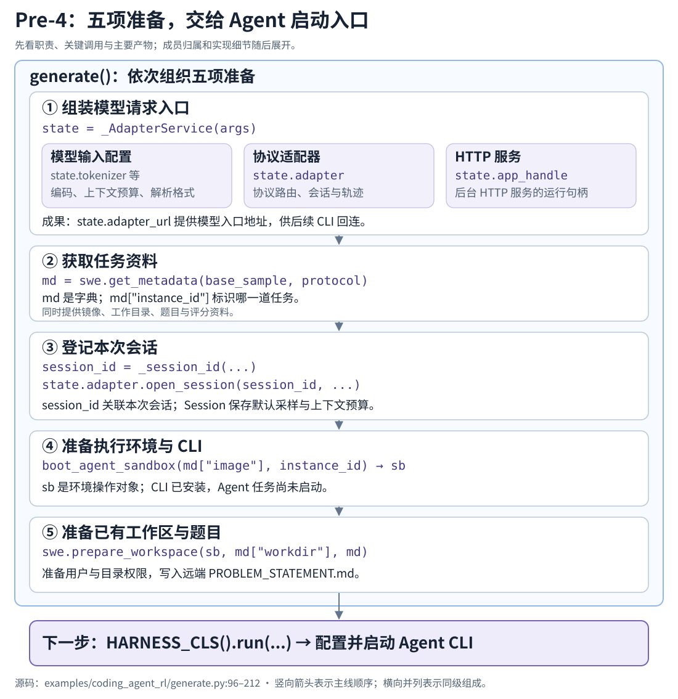
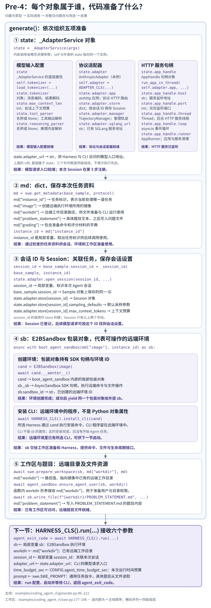

# Pre-4：启动前准备

**读完本章，你应能沿着 `generate()` 说明：进入 `Harness.run()` 前准备了什么，每个组件负责什么，以及这些准备怎样交给下一步使用。**

<div class="reading-navigation" data-reading-navigation="pre-4">

以下是**阅读伪代码**：简写前后步骤，标出本节入口；缩进表示阅读层次，各层实现仍在不同函数中。

```python
generate:
    # 当前 Pre-4：把模型入口、任务与运行条件准备好
    state = _AdapterService(...)
    md = swe.get_metadata(...)
    state.adapter.open_session(...)
    boot_agent_sandbox:  # 使用 Action 5 的创建、文件和命令能力
        await swe.prepare_workspace(...)
        HARNESS_CLS().run:  # 接入 Action 4 的启动组织
            ...  # Action 6：CLI 的执行与等待
            ...  # 运行期间：7 回连；2/3/3.5 处理模型请求
        ...  # 返回后收集 diff，再退出工作环境
    ...  # 评估、结果导出与会话收尾
```

</div>

[完整任务主线](walkthrough.md) · [唯一阅读路线](../../repo-reading-route.md#当前优先沿-generate-读完-41)

本章读到调用 `HARNESS_CLS().run(...)` 为止。目录把 Pre-4 放在 3.5 与 4 之间；运行时则先准备，再启动 CLI，随后才发生模型请求。本章沿 Claude Code / Anthropic 和 scaleswe 分支阅读。

## 启动准备总览图

[](../../../../static/images/slime-lifecycle/pre-4-preparation.svg)

先顺着五步看清“做什么 → 调用谁 → 留下什么”，再进入下面的代码骨架。`state` 的三个同级组成并排展示；其他步骤只保留关键调用和产物，成员的具体含义在对应源码段中展开。点击图片可放大查看。

<details class="reading-extra" data-reading-layer="detail-map">
<summary>需要逐项对照时，再展开完整代码归属图</summary>

这张详图保留对象类型、完整成员路径和每项用途，适合配合下方源码查阅。图中区分对象属性、字典值、局部变量和远端资源；它与上面的总览图描述同一条准备主线。

[](../../../../static/images/slime-lifecycle/pre-4-code-ownership.svg)

</details>

<span id="主线中的五次交接"></span>

## 主线代码骨架

把图与下面的调用逐项对上。这里省略详细参数、校验、预算和异常分支，用来定位阅读；后文保留真实源码及文件、行号。

```text
generate()
  state = _AdapterService(args)
  md = swe.get_metadata(base_sample, protocol)
  session_id = _session_id(base_sample, md["instance_id"])
  state.adapter.open_session(session_id, ...)
  async with boot_agent_sandbox(md["image"], md["instance_id"]) as sb:
    await swe.prepare_workspace(sb, md["workdir"], md)
    await HARNESS_CLS().run(sb, ...)
```

按顺序进入 [① 模型入口](#1adapter-service让模型请求入口就位) → [② 任务信息](#2任务信息把样本整理成任务合同) → [③ 会话](#3会话和默认采样让请求属于这次任务) → [④ 执行环境](#4执行环境与-cli交出能运行-agent-的-sb) → [⑤ 工作区](#5工作区与题目把任务放到-cli-能读取的位置)，最后对上 [run 的参数](#6接入-run显式参数和隐含条件逐项对上)。

下面每一步都按“从哪里进入、需要什么 → 组成与职责 → 源码怎样实现 → 交给下一步什么”阅读。贯穿示例使用任务 `demo`、镜像 `demo-image` 和工作目录 `/workspace/demo`；这些是示意值，不是运行记录。

## 1．Adapter Service：让模型请求入口就位

为后续 CLI 建立可以回连的模型请求入口；输入来自 args 与本例 CONFIG。

**从主线进入：** [generate](https://github.com/THUDM/slime/blob/22a89f96835969a47055a659c588f46151f8b07a/examples/coding_agent_rl/generate.py#L182)（`examples/coding_agent_rl/generate.py:182`） 的第 184 行调用 [`_AdapterService.__init__`](https://github.com/THUDM/slime/blob/22a89f96835969a47055a659c588f46151f8b07a/examples/coding_agent_rl/generate.py#L138)（`examples/coding_agent_rl/generate.py:138`）。这段组装代码在 `examples/`，具体 Adapter 与轨迹组件在 `slime/agent/`。

调用结束后，外层变量 `state` 引用这份服务对象。因此构造方法里的 `self.tokenizer`、`self.adapter`，对应外层访问的 `state.tokenizer`、`state.adapter`；这是同一个对象在不同位置的写法。

<span id="阅读点组件由哪些部分组成各部分负责什么"></span>

### 组成与职责

<!-- object-tree:adapter-service -->
<figure class="reading-object-tree" id="pre4-adapter-service" data-object="adapter-service" aria-label="state : _AdapterService 的组成">
<figcaption><span class="reading-object-tree__kind">Python 对象</span><code>state : _AdapterService</code></figcaption>
<p class="reading-object-tree__hint">直接成员共 7 个；点击三角展开内部对象。树线表示成员包含关系，共享引用会单独说明。</p>
<ul>
<li><div class="reading-object-tree__member"><code>tokenizer</code><span class="reading-object-tree__role">负责消息编码与生成结果解码；与 Adapter 共享，在同一进程内复用。</span></div></li>
<li><div class="reading-object-tree__member"><code>max_context_len</code><span class="reading-object-tree__role">上下文预算来源；注册每次任务的 Session 时使用。</span></div></li>
<li><div class="reading-object-tree__member"><code>tool_parser</code><span class="reading-object-tree__role">工具解析配置；创建 Adapter 时传入。</span></div></li>
<li><div class="reading-object-tree__member"><code>reasoning_parser</code><span class="reading-object-tree__role">推理解析配置；创建 Adapter 时传入。</span></div></li>
<li><details><summary><code>adapter : AnthropicAdapter</code><span class="reading-object-tree__role">模型协议入口、会话状态与轨迹管理；展开看成员。</span></summary><ul>
<li><div class="reading-object-tree__member"><code>tokenizer</code><span class="reading-object-tree__role">共享 state.tokenizer；请求编码与输出解码使用。</span></div></li>
<li><div class="reading-object-tree__member"><code>sglang_url</code><span class="reading-object-tree__role">模型服务地址；后续请求转发到这里。</span></div></li>
<li><div class="reading-object-tree__member"><code>tool_parser</code><span class="reading-object-tree__role">工具输出解析配置；处理模型响应时使用。</span></div></li>
<li><div class="reading-object-tree__member"><code>reasoning_parser</code><span class="reading-object-tree__role">推理文本解析配置；处理模型响应时使用。</span></div></li>
<li><div class="reading-object-tree__member"><code>store : dict[sid, Session]</code><span class="reading-object-tree__role">按 sid 保存会话设置；第 3 部分注册后才有本次任务。</span></div></li>
<li><div class="reading-object-tree__member"><code>inflight : dict[sid, set[Task]]</code><span class="reading-object-tree__role">记录正在处理的请求，供等待与取消使用。</span></div></li>
<li><div class="reading-object-tree__member"><code>closed : set[sid]</code><span class="reading-object-tree__role">记录已关闭的会话，阻止继续接收请求。</span></div></li>
<li><div class="reading-object-tree__member"><code>app : aiohttp.web.Application</code><span class="reading-object-tree__role">持有协议路由；由 app_handle 对应的 HTTP 服务运行。</span></div></li>
<li><div class="reading-object-tree__member"><code>manager : TrajectoryManager</code><span class="reading-object-tree__role">按 sid 管理轨迹树，供后续导出训练样本。</span></div></li>
<li><div class="reading-object-tree__member"><code>debug_callback</code><span class="reading-object-tree__role">请求调试回调；本入口未传入，默认为 None。</span></div></li>
<li><div class="reading-object-tree__member"><code>max_turns_per_sid</code><span class="reading-object-tree__role">可选的请求轮数上限；本入口默认为 None。</span></div></li>
<li><div class="reading-object-tree__member"><code>_sid_turn_count</code><span class="reading-object-tree__role">启用轮数上限时，按 sid 记录已接纳的请求轮数。</span></div></li>
</ul></details></li>
<li><details><summary><code>app_handle : AppHandle</code><span class="reading-object-tree__role">已经启动的 HTTP 服务句柄；展开看成员。</span></summary><ul>
<li><div class="reading-object-tree__member"><code>host</code><span class="reading-object-tree__role">HTTP 服务绑定的监听地址。</span></div></li>
<li><div class="reading-object-tree__member"><code>port</code><span class="reading-object-tree__role">实际监听端口；用于组成 adapter_url。</span></div></li>
<li><div class="reading-object-tree__member"><code>thread</code><span class="reading-object-tree__role">运行 HTTP 服务的后台线程。</span></div></li>
<li><div class="reading-object-tree__member"><code>loop</code><span class="reading-object-tree__role">后台线程中的 Asyncio 事件循环。</span></div></li>
<li><div class="reading-object-tree__member"><code>runner</code><span class="reading-object-tree__role">aiohttp AppRunner；管理 HTTP 服务的运行与关闭。</span></div></li>
</ul></details></li>
<li><div class="reading-object-tree__member"><code>adapter_url</code><span class="reading-object-tree__role">供沙箱 CLI 回连的地址；随后传给 Harness.run。</span></div></li>
</ul>
<p class="reading-object-tree__hint">源码：<a href="https://github.com/THUDM/slime/blob/22a89f96835969a47055a659c588f46151f8b07a/examples/coding_agent_rl/generate.py#L138"><code>examples/coding_agent_rl/generate.py:138</code></a> · <a href="https://github.com/THUDM/slime/blob/22a89f96835969a47055a659c588f46151f8b07a/slime/agent/adapters/common.py#L141"><code>slime/agent/adapters/common.py:141</code></a> · <a href="https://github.com/THUDM/slime/blob/22a89f96835969a47055a659c588f46151f8b07a/slime/agent/aiohttp_threaded.py#L26"><code>slime/agent/aiohttp_threaded.py:26</code></a></p>
</figure>
<!-- /object-tree:adapter-service -->

### 1.1 先选一对能接起来的 Harness 和 Adapter

模块加载时，`SWE_AGENT` 选择组件配对：Claude Code 对应 Anthropic Adapter，Codex 对应 OpenAI Adapter。前者的 CLI 发送 Anthropic 形状请求，后者发送本例配置的 OpenAI 形状请求。不能只替换启动 CLI 而忘记相应的协议入口。

```python
_AGENTS = {
    "claude_code": (ClaudeCodeHarness, AnthropicAdapter),
    "codex": (CodexHarness, OpenAIAdapter),
}
AGENT_NAME = os.environ.get("SWE_AGENT", "claude_code")
if AGENT_NAME not in _AGENTS:
    raise ValueError(f"SWE_AGENT={AGENT_NAME!r} not in {sorted(_AGENTS)}")
HARNESS_CLS, ADAPTER_CLS = _AGENTS[AGENT_NAME]
```

本节先选 Claude Code / Anthropic，后续继续使用同一条具体实现。

### 1.2 读取 tokenizer、上下文和解析配置

```python
        self.tokenizer = load_tokenizer(args.hf_checkpoint, trust_remote_code=True)
        self.max_context_len = int(getattr(args, "rollout_max_context_len", 0) or 0)
        self.tool_parser = getattr(args, "sglang_tool_call_parser", None) or None
        self.reasoning_parser = getattr(args, "sglang_reasoning_parser", None) or None
        sglang_url = f"http://{args.sglang_router_ip}:{args.sglang_router_port}"
```

- `hf_checkpoint` 用于加载 tokenizer，后续消息通过聊天模板变成 token，生成 token 也靠它解码；这里加载 tokenizer，不负责启动模型权重服务。
- `rollout_max_context_len` 保存为 `state.max_context_len`，随后注册每个 Session 时会传进去。
- tool/reasoning parser 配置决定后续怎样理解模型输出，Pre-4 只追配置怎样交给 Adapter，解析算法留到模型请求段。

**当前成果：** 请求处理需要的 tokenizer、上下文设置与解析配置已有来源。

### 1.3 区分两个网络地址

`sglang_url` 来自 `args.sglang_router_ip/port`，指向上游已经提供的 SGLang 服务。`adapter_url` 是之后交给 CLI 的回连地址，它们服务于不同一段请求链。

```text
CLI -> adapter_url -> Adapter -> sglang_url -> SGLang
```

用示意地址理解：CLI 请求 `http://192.0.2.10:18001/v1/messages`，Adapter 再向 `http://192.0.2.20:30000/generate` 请求生成。

HTTP 服务的 `adapter_bind_host` 决定监听哪块本机接口；`adapter_public_host` 决定告诉沙箱 CLI 用哪个地址回连。配置端口可由服务实际监听结果确定，因而最终 `adapter_url` 使用 `app_handle.port`。源码会检查 public host 已配置；实际连通性仍需运行验证。

### 1.4 构造 Adapter，它内部接住什么

```python
        self.adapter = ADAPTER_CLS(
            tokenizer=self.tokenizer,
            sglang_url=sglang_url,
            tool_parser=self.tool_parser,
            reasoning_parser=self.reasoning_parser,
            fork_threshold_tokens=CONFIG.fork_merge_threshold,
        )
```

进入 [`BaseAdapter.__init__`](https://github.com/THUDM/slime/blob/22a89f96835969a47055a659c588f46151f8b07a/slime/agent/adapters/common.py#L141)（`slime/agent/adapters/common.py:141`），对照上面的 `adapter` 分支看成员如何建立：配置交给请求处理，`app` 注册路由，`store` 等容器保存会话与请求状态，`manager` 管理轨迹。

`fork_threshold_tokens` 把本例的轨迹组织阈值交给 TrajectoryManager；Pre-4 先看配置来源和接收者，具体分段行为留到轨迹部分。

此时已经有接收请求和管理会话的组件，但具体任务的 Session 要到第 3 部分才注册。Session 保存默认设置；token/消息轨迹在 TrajectoryManager 中，两者职责分开。

### 1.5 把 Adapter App 运行起来

```python
        self.app_handle = run_app_in_thread(
            self.adapter.app,
            host=CONFIG.adapter_bind_host,
            port=CONFIG.adapter_port,
            thread_name="anthropic-adapter",
            runner_kwargs={
                "handler_cancellation": True,
                "access_log_class": FilteredAccessLogger,
            },
        )
        self.adapter_url = f"http://{CONFIG.adapter_public_host}:{self.app_handle.port}"
```

进入 [run_app_in_thread](https://github.com/THUDM/slime/blob/22a89f96835969a47055a659c588f46151f8b07a/slime/agent/aiohttp_threaded.py#L46)（`slime/agent/aiohttp_threaded.py:46`），只走“创建后台线程 → 独立事件循环 → AppRunner/TCPSite 监听 → 返回 AppHandle”。这解释了后面外层等待 CLI 时，Adapter 仍可以处理它发来的模型请求。

`AppHandle` 保存线程、事件循环、runner、监听 host/port；`state.adapter_url` 根据可回连 host 和实际端口形成。

<details class="reading-extra">
<summary>补读：请求取消与访问日志配置</summary>

`handler_cancellation=True` 是请求取消处理的一项配置，具体 abort 行为留到模型请求或失败链路展开。`access_log_class` 指定 FilteredAccessLogger，控制 HTTP 访问日志：略过 HEAD 请求与不超过 120 秒的成功请求，错误或慢请求继续记录。

</details>

### 1.6 回到 generate：复用服务，继续准备任务

[SingletonMeta](https://github.com/THUDM/slime/blob/22a89f96835969a47055a659c588f46151f8b07a/slime/utils/misc.py#L62)（`slime/utils/misc.py:62`） 让同一进程后续使用 `_AdapterService(args)` 时复用已有实例。不同进程不能因此自动共享一个 Python 对象，也不能把新任务的 md、Session 或 Sandbox 当成这份公共入口的一部分。

**返回主线：** `generate:185`。现在模型请求入口就位，下一步读这次任务本身。

## 2．任务信息：把样本整理成任务合同

模型入口就位后，读取本次样本；输入是 base_sample 和本次选用的任务协议。

**从主线进入：** [get_metadata](https://github.com/THUDM/slime/blob/22a89f96835969a47055a659c588f46151f8b07a/examples/coding_agent_rl/swe.py#L77)（`examples/coding_agent_rl/swe.py:77`）。`evaluation` 先选择 `CONFIG.eval_protocol` 或 `train_protocol`；具体协议再选择对应的元数据解析。

### 组成与职责

<!-- object-tree:metadata -->
<figure class="reading-object-tree" data-object="metadata" aria-label="md : dict 的组成">
<figcaption><span class="reading-object-tree__kind">Python 字典 · scaleswe 分支</span><code>md : dict</code></figcaption>
<p class="reading-object-tree__hint">每次 generate 整理本次任务的数据；它是独立的局部变量。以下列出 scaleswe 返回的键。</p>
<ul>
<li><div class="reading-object-tree__member"><code>protocol</code><span class="reading-object-tree__role">选择本任务采用的准备、检查和评分协议。</span></div></li>
<li><div class="reading-object-tree__member"><code>instance_id</code><span class="reading-object-tree__role">标识当前是哪一道任务；用于构造会话 ID、关联日志和结果。</span></div></li>
<li><div class="reading-object-tree__member"><code>image</code><span class="reading-object-tree__role">环境镜像；创建 Sandbox 时使用。</span></div></li>
<li><div class="reading-object-tree__member"><code>workdir</code><span class="reading-object-tree__role">远端工作目录路径；准备文件和启动 CLI 时使用。</span></div></li>
<li><div class="reading-object-tree__member"><code>problem_statement</code><span class="reading-object-tree__role">具体题目文本；随后写入远端问题文件。</span></div></li>
<li><div class="reading-object-tree__member"><code>looks_swebench</code><span class="reading-object-tree__role">识别数据与所选协议可能不匹配的形态；供任务检查使用。</span></div></li>
<li><details><summary><code>grading : dict</code><span class="reading-object-tree__role">准备命令与后续独立评分需要的材料；展开看键。</span></summary><ul>
<li><div class="reading-object-tree__member"><code>swepro</code><span class="reading-object-tree__role">SWE 评分相关元数据。</span></div></li>
<li><div class="reading-object-tree__member"><code>eval_cmd</code><span class="reading-object-tree__role">评估命令，供后续评分执行。</span></div></li>
<li><div class="reading-object-tree__member"><code>f2p_script</code><span class="reading-object-tree__role">fail-to-pass 测试脚本材料，供后续评分使用。</span></div></li>
<li><div class="reading-object-tree__member"><code>pre_commands</code><span class="reading-object-tree__role">可选准备命令，供工作区准备使用。</span></div></li>
</ul></details></li>
</ul>
<p class="reading-object-tree__hint">源码：<a href="https://github.com/THUDM/slime/blob/22a89f96835969a47055a659c588f46151f8b07a/examples/coding_agent_rl/swe.py#L83"><code>examples/coding_agent_rl/swe.py:83</code></a></p>
</figure>
<!-- /object-tree:metadata -->

### 沿源码走一遍

`md` 是 Python 字典，`"instance_id"` 是字典的一个键，实际取值写成 `md["instance_id"]`。例如示意任务的值是 `"demo"`，表示当前处理哪一道任务；源码中的 `instance_id = md["instance_id"]` 将它取到同名局部变量。`session_id` 则标识本次 Agent 会话，后面的第 3 步需要新建会话标识时，会用任务标识等信息构造它。这里应区分字典键、局部变量和对象属性：`base_sample.session_id` 才是对样本对象属性的访问。

第一遍选 scaleswe 分支，进入 [_metadata_scaleswe](https://github.com/THUDM/slime/blob/22a89f96835969a47055a659c588f46151f8b07a/examples/coding_agent_rl/swe.py#L83)（`examples/coding_agent_rl/swe.py:83`）。它从 `base_sample.metadata`、部分 `remote_env_info` 回退字段、label/prompt 中整理一份 md；字段的作用与下游用途见上面的组成树。

示意任务的关键值是 `instance_id=demo`、`image=demo-image`、`workdir=/workspace/demo`，题目为“修复一个函数并通过测试”，评分材料可以含 `eval_cmd=python -m pytest -q`。这里是规范化任务信息示意，不要求读者在第一遍记住所有数据集字段与回退优先级。

```python
    protocol = CONFIG.eval_protocol if evaluation else CONFIG.train_protocol
    md = swe.get_metadata(base_sample, protocol)
    instance_id = md["instance_id"]
    if not md["image"] or not md["workdir"]:
        return _abort_result(base_sample, "missing_image_or_workdir", instance_id)
    reason = swe.evaluability_check(md)
    if reason:
        return _abort_result(base_sample, f"unevaluatable:{reason}", instance_id)
```

源码先检查镜像与目录，再由 [evaluability_check](https://github.com/THUDM/slime/blob/22a89f96835969a47055a659c588f46151f8b07a/examples/coding_agent_rl/swe.py#L151)（`examples/coding_agent_rl/swe.py:151`） 做协议相关检查。条件不满足就返回 ABORTED 结果，尚未到 Session/沙箱准备。md 描述任务，但读取 md 不会创建环境，也不会执行题目。

**返回主线：** `generate:194`。任务身份、执行环境要求与题目材料已有来源，下一步给它注册模型会话。

## 3．会话和默认采样：让请求属于这次任务

任务检查通过后，为它关联模型请求；输入是任务身份、采样参数和上下文预算。

**从主线进入：** [_session_id](https://github.com/THUDM/slime/blob/22a89f96835969a47055a659c588f46151f8b07a/examples/coding_agent_rl/generate.py#L308)（`examples/coding_agent_rl/generate.py:308`） 与 [BaseAdapter.open_session](https://github.com/THUDM/slime/blob/22a89f96835969a47055a659c588f46151f8b07a/slime/agent/adapters/common.py#L210)（`slime/agent/adapters/common.py:210`）。

### 组成与职责

<!-- object-tree:session -->
<figure class="reading-object-tree" data-object="session" aria-label="state.adapter.store[sid] : Session 的组成">
<figcaption><span class="reading-object-tree__kind">Python 对象 · open_session 之后</span><code>state.adapter.store[sid] : Session</code></figcaption>
<p class="reading-object-tree__hint">sid 是 store 的字典键。Session 只有下面两个字段；消息与 token 轨迹由 adapter.manager 管理。</p>
<ul>
<li><div class="reading-object-tree__member"><code>sampling_defaults : dict</code><span class="reading-object-tree__role">默认采样参数的浅拷贝；后续结合请求参数生成采样设置。</span></div></li>
<li><div class="reading-object-tree__member"><code>max_context_tokens : int</code><span class="reading-object-tree__role">本会话的上下文预算；来自 state.max_context_len。</span></div></li>
</ul>
<p class="reading-object-tree__hint">源码：<a href="https://github.com/THUDM/slime/blob/22a89f96835969a47055a659c588f46151f8b07a/slime/agent/adapters/common.py#L34"><code>slime/agent/adapters/common.py:34</code></a> · <a href="https://github.com/THUDM/slime/blob/22a89f96835969a47055a659c588f46151f8b07a/slime/agent/adapters/common.py#L210"><code>slime/agent/adapters/common.py:210</code></a></p>
</figure>
<!-- /object-tree:session -->

### 沿源码走一遍

```python
    session_id = base_sample.session_id = _session_id(base_sample, instance_id)
    state.adapter.open_session(
        session_id,
        sampling_defaults=sampling_params,
        max_context_tokens=state.max_context_len,
    )
```

sid 的来源依次是：复用 `base_sample.session_id`；样本有 index/group_index 时按任务身份构造；否则生成带随机后缀的 ID。示意样本 `index=0/group_index=0/instance_id=demo` 得到 `cagent-demo-0-0`，并写回样本。

进入 open_session：

```python
        """Register a fresh per-sid Session; sids must be unique."""
        if sid in self.store:
            raise ValueError(f"session_id {sid!r} already exists; sids must be unique per agent run")
        self.store[sid] = Session(
            sampling_defaults=dict(sampling_defaults or {}),
            max_context_tokens=int(max_context_tokens or 0),
        )
```

它要求 sid 未占用，在 `adapter.store` 注册 [Session](https://github.com/THUDM/slime/blob/22a89f96835969a47055a659c588f46151f8b07a/slime/agent/adapters/common.py#L34)（`slime/agent/adapters/common.py:34`）；保存默认采样字典的浅拷贝和上下文预算。此时没有发模型请求，也没有训练轨迹。

例如 `sampling_params` 含 `temperature=0.7/max_new_tokens=1024`，这些值保存在 Session。后面的 CLI 请求携带 sid，Adapter 才能从 Session 取出基础设置。[_sampling_params](https://github.com/THUDM/slime/blob/22a89f96835969a47055a659c588f46151f8b07a/slime/agent/adapters/common.py#L416)（`slime/agent/adapters/common.py:416`） 随后还会结合请求 body：温度等可由 body 覆盖，生成长度则受到默认长度与请求长度的共同限制。本节记住“先存默认设置，后续处理请求时消费”即可。

sid 最后会由 Harness 写进 CLI 请求凭据；采样字典并未直接作为 Harness.run 的参数。Session 是任务级设置，Adapter HTTP 服务是进程内可复用入口，两者生命周期不同。

**返回主线：** `generate:202`。会话已注册，接下来进入任务预算与环境上下文。

## 4．执行环境与 CLI：交出能运行 Agent 的 sb

会话已注册，现在需要承载 CLI 的远端环境；输入是任务镜像与环境配置。

**从主线进入：** [boot_agent_sandbox](https://github.com/THUDM/slime/blob/22a89f96835969a47055a659c588f46151f8b07a/examples/coding_agent_rl/generate.py#L96)（`examples/coding_agent_rl/generate.py:96`）。

### 组成与职责

<!-- object-tree:sandbox -->
<figure class="reading-object-tree" data-object="sandbox" aria-label="sb : E2BSandbox 的组成">
<figcaption><span class="reading-object-tree__kind">Python 对象 · 进入环境上下文之后</span><code>sb : E2BSandbox</code></figcaption>
<p class="reading-object-tree__hint">构造时 _sb 为 None、sandbox_id 为空；__aenter__ 创建远端环境后填入。CLI 安装在远端环境中。</p>
<ul>
<li><div class="reading-object-tree__member"><code>image</code><span class="reading-object-tree__role">任务要求的环境镜像；创建远端环境时传递。</span></div></li>
<li><div class="reading-object-tree__member"><code>timeout</code><span class="reading-object-tree__role">远端环境的生命周期时长；创建时传给 SDK，默认 3600 秒。</span></div></li>
<li><div class="reading-object-tree__member"><code>image_metadata_key</code><span class="reading-object-tree__role">向环境网关传递镜像信息时使用的 metadata 键。</span></div></li>
<li><div class="reading-object-tree__member"><code>rpc_retries</code><span class="reading-object-tree__role">底层 RPC 操作的最大尝试次数，包含首次调用。</span></div></li>
<li><div class="reading-object-tree__member"><code>size</code><span class="reading-object-tree__role">环境规格配置；创建时传递，默认字符串为 &quot;md&quot;。</span></div></li>
<li><div class="reading-object-tree__member"><code>_sb : AsyncSandbox</code><span class="reading-object-tree__role">E2B SDK 句柄；通过它执行命令、读写远端文件。</span></div></li>
<li><div class="reading-object-tree__member"><code>sandbox_id</code><span class="reading-object-tree__role">远端环境 ID；供环境识别与日志关联使用。</span></div></li>
</ul>
<p class="reading-object-tree__hint">源码：<a href="https://github.com/THUDM/slime/blob/22a89f96835969a47055a659c588f46151f8b07a/slime/agent/sandbox.py#L174"><code>slime/agent/sandbox.py:174</code></a> · <a href="https://github.com/THUDM/slime/blob/22a89f96835969a47055a659c588f46151f8b07a/slime/agent/sandbox.py#L281"><code>slime/agent/sandbox.py:281</code></a></p>
</figure>
<!-- /object-tree:sandbox -->

### 沿源码走一遍

```text
task image
  -> E2BSandbox wrapper
  -> __aenter__: create remote environment
  -> selected Harness.install_cli
  -> yield sb
  -> caller uses sb
  -> __aexit__: cleanup attempt
```

构造 `E2BSandbox(image)` 先得到包装对象，进入 [E2BSandbox.__aenter__](https://github.com/THUDM/slime/blob/22a89f96835969a47055a659c588f46151f8b07a/slime/agent/sandbox.py#L281)（`slime/agent/sandbox.py:281`） 才通过 E2B SDK 创建远端环境。镜像通过网关使用的 metadata key 传递；这一步的具体集群/网关实现是外部边界。

然后执行 [ClaudeCodeHarness.install_cli](https://github.com/THUDM/slime/blob/22a89f96835969a47055a659c588f46151f8b07a/slime/agent/harness/claude_code.py#L36)（`slime/agent/harness/claude_code.py:36`） → [install_npm_cli](https://github.com/THUDM/slime/blob/22a89f96835969a47055a659c588f46151f8b07a/slime/agent/harness/common.py#L125)（`slime/agent/harness/common.py:125`）：从宿主配置的安装包准备 Node 运行时、把 CLI 包写到环境中、安装并执行 CLI 自检。第一遍走通每层的输入和成果，安装重试与底层 SDK 细节按故障再深入。

创建/安装由 `_BOOT_SEM` 限制启动并发；失败时有重试，安装出错会尝试退出候选环境。成功后 `yield sb` 交给 generate；调用方离开上下文时执行 [E2BSandbox.__aexit__](https://github.com/THUDM/slime/blob/22a89f96835969a47055a659c588f46151f8b07a/slime/agent/sandbox.py#L302)（`slime/agent/sandbox.py:302`） 的回收尝试。

**当前成果：** 有可操作的执行环境，所选 CLI 已安装；还没有启动这次 Agent 任务。**返回主线：** `generate:204`，准备仓库目录与题目。这里使用 E2B，Kubernetes 后端的操作语义与真实运行还需另行适配和验证。

## 5．工作区与题目：把任务放到 CLI 能读取的位置

环境与 CLI 已就位，现在落实用户权限和具体题目；输入是 sb、工作目录与 md。

**从主线进入：** [prepare_workspace](https://github.com/THUDM/slime/blob/22a89f96835969a47055a659c588f46151f8b07a/examples/coding_agent_rl/swe.py#L177)（`examples/coding_agent_rl/swe.py:177`），输入是 `sb/workdir/md`。

### 组成与职责

<!-- object-tree:workspace -->
<figure class="reading-object-tree" data-object="workspace" aria-label="workdir → /workspace/demo/ 的组成">
<figcaption><span class="reading-object-tree__kind">远端文件目录 · 示意路径</span><code>workdir → /workspace/demo/</code></figcaption>
<p class="reading-object-tree__hint">这里展示文件位置。md["workdir"] 保存路径字符串，sb 提供访问远端目录的操作。</p>
<ul>
<li><div class="reading-object-tree__member"><code>PROBLEM_STATEMENT.md</code><span class="reading-object-tree__role">prepare_workspace 写入具体题目；CLI 运行后按 prompt 读取。</span></div></li>
<li><div class="reading-object-tree__member"><code>仓库原有文件</code><span class="reading-object-tree__role">由任务镜像和工作目录提供；本节不预设具体文件名。</span></div></li>
</ul>
<p class="reading-object-tree__hint">源码：<a href="https://github.com/THUDM/slime/blob/22a89f96835969a47055a659c588f46151f8b07a/examples/coding_agent_rl/swe.py#L177"><code>examples/coding_agent_rl/swe.py:177</code></a></p>
</figure>
<!-- /object-tree:workspace -->

### 沿源码走一遍

它先调用 [ensure_agent_user](https://github.com/THUDM/slime/blob/22a89f96835969a47055a659c588f46151f8b07a/slime/agent/sandbox.py#L390)（`slime/agent/sandbox.py:390`），准备 agent 用户和工作目录权限；scaleswe 分支再依次处理 `grading.swepro.before_repo_set_cmd` 与 `grading.pre_commands` 中的可选准备命令，最后写题目文件：

```python
    await sb.write_file(
        f"{workdir}/PROBLEM_STATEMENT.md",
        md.get("problem_statement") or "",
        user="agent",
    )
```

用前面的示意值，此时 `/workspace/demo/PROBLEM_STATEMENT.md` 内已有具体题目。Claude Code 的通用任务 prompt 会指示它读取问题文件并完成任务；具体题目不是通过额外的 run 参数传递。

工作区来自镜像与任务目录，这个函数不意味着对每个任务重新 clone 一份仓库。它负责落实本例需要的用户、准备命令和问题文件。`BaseHarness.run()` 随后也会确保用户，操作设计为可以重复调用，不能把两次调用解释成创建了两份工作区。

**返回主线：** `generate:205`。模型入口、任务、会话、环境与题目五项条件已经连到一起，现在可以进入 Harness。

## 6．接入 run：显式参数和隐含条件逐项对上

```python
                agent_exit_code = await HARNESS_CLS().run(
                    sb,
                    workdir=md["workdir"],
                    session_id=session_id,
                    adapter_url=state.adapter_url,
                    time_budget_sec=CONFIG.agent_time_budget_sec,
                    prompt=swe.SWE_PROMPT,
                )
```

| run 接收到的参数 | Pre-4 的来源 | run 内怎样接着使用 |
| --- | --- | --- |
| `sb` | boot_agent_sandbox 创建并安装 CLI 后交出 | 通过环境接口落实用户、配置与命令操作 |
| `workdir` | md 中的目录，prepare_workspace 已处理 | 填入 HarnessContext，作为 CLI 工作目录 |
| `session_id` | _session_id + open_session | 填入 HarnessContext，供 CLI 请求关联本次会话 |
| `adapter_url` | state 中已运行的 HTTP 入口地址 | 填入 HarnessContext，再形成 CLI 模型请求地址 |
| `time_budget_sec` | CONFIG.agent_time_budget_sec | 交给启动/等待逻辑的 Agent 运行预算 |
| `prompt` | swe.SWE_PROMPT | 交给 CLI 的通用任务指令，具体题目从文件读取 |

还有三项隐含条件：所选 CLI 已安装，工作区题目文件已存在，Adapter 中已有对应 sid 的默认采样与上下文设置。这些不需要变成额外的 run 参数。

预算也要区分：外层 `rollout_guard_sec` 包住任务处理范围，`agent_time_budget_sec` 是 Harness 的运行等待预算，`eval_timeout_sec` 之后交给评分。Pre-4 中配置已就位，它们由不同阶段消费。

## 下一步：Launch Agent 继续准备什么

进入 [BaseHarness.run](https://github.com/THUDM/slime/blob/22a89f96835969a47055a659c588f46151f8b07a/slime/agent/harness/common.py#L81)（`slime/agent/harness/common.py:81`） 后，继续确保用户，建立 `HarnessContext`，调用 `write_config()` 和 `launch_and_wait()`。其中 `HarnessContext` 只接住 workdir、sid、adapter_url 和模型标签；sb、prompt 与时间预算继续以独立参数参与调用。

所以 Pre-4 将启动条件准备好，动作 4 再把这些条件变成 CLI 的具体配置、命令、环境变量和启动等待行为。模型消息转换、token 生成、响应与轨迹记录仍发生在 CLI 启动后的请求循环中。

## 回到总览图：试着自己串起来

回到 [开头的五步图](#启动准备总览图)，暂不翻看源码和成员细节，试着回答：

1. 从模型入口到题目文件，五步各留下了什么？哪一步创建环境、哪一步安装 CLI、哪一步才开始运行任务？
2. `state` 与 Session 为什么分开？默认采样和轨迹各保存在什么地方？
3. `run` 的六个参数分别来自哪个对象、配置或常量？除了参数，还需要哪三个已经成立的条件？

回答后再对照 [主线代码骨架](#主线代码骨架) 和 [run 参数来源](#6接入-run显式参数和隐含条件逐项对上) 核对。说不清哪次交接，就只回到那一步补读；能连起来之后，再进入 Launch Agent。

以上为静态源码讲解，示意参数不是运行证据。本轮没有执行真实 CLI、E2B、SGLang 或源码仓库测试；网络连通、环境回收和性能效果仍需实际验证。代码片段来自 [THUDM/slime 源码](https://github.com/THUDM/slime/tree/22a89f96835969a47055a659c588f46151f8b07a)，许可见 [Apache 2.0](https://github.com/THUDM/slime/blob/22a89f96835969a47055a659c588f46151f8b07a/LICENSE)。

**下一步：[4. Launch Agent](/projects/slime/4-slime-core-components-and-orchestration/4-1-agent-rollout-adapters-and-harnesses/4-launch-agent/)。**
