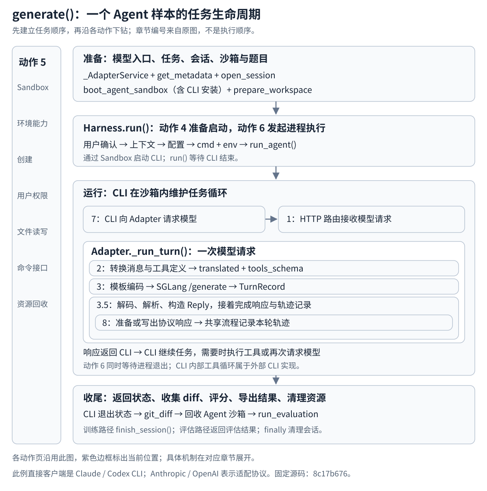

# 沿 generate 走完 4.1：一次 Agent 任务

[本章入口](README.md) · [当前阅读主线](../../repo-reading-route.md#当前优先沿-generate-读完-41) · [需求对照](../../job-alignment.md)

本轮先完成 **Agent Rollout Adapters and Harnesses**：以 `generate()` 为书签，沿一份任务进入各组件，读清职责和输入输出后返回主线。第一遍走通正常路径，再补一条失败清理路径；实现细节按问题继续深入。

本地仓库根目录已确认是 `/home/fredkeira/projects/slime`。源码固定在 `22a89f96835969a47055a659c588f46151f8b07a`。本篇选择 **Claude Code Harness / Anthropic Adapter**，与已有 4.1 图文一致；Codex/OpenAI 留作完整链读通后的实现对照。本轮已核对：这些核心源码与旧 `8c17b676` 资料版本没有差异，原有动作讲解可以继续使用。

## 为什么从 generate 进入

CodeWiki 原图展示组件关系；本篇按任务执行读它们的组装和交接。`_AdapterService` 在示例的 `generate.py` 中，负责准备图内的 Adapter/模型连接和 HTTP 服务。它不是单轮请求处理，也不是 Harness 的启动逻辑。先扫 generate 骨架，到 state 初始化处下钻，再回外层继续；上游训练、调度和模型服务部署先视为已提供的前提。

动作 4 的前置阅读包括调用方的 Adapter、任务、Session、环境和题目准备；Launch Agent 本体继续进入 run 内部的用户、配置、命令与启动。两层串起来阅读，职责仍各自保留。

## 先把整体顺序看清



```text
generate()
  prepare adapter + task metadata + session
  with agent sandbox:
    prepare workspace
    await Harness.run()
      CLI runs and requests the model
        HTTP -> translate -> generate -> reply + record
        tools -> another request -> ...
    collect diff
  evaluate diff in a fresh sandbox
  return eval result OR export training samples
  finally: drop session
```

`generate()` 组织的是整次任务，`_run_turn()` 组织一次模型请求。**外层等待 Harness 时，CLI 在独立环境中工作，Adapter 的 HTTP 服务也在接收请求。** CLI 内的工具调用与模型请求可能重复多轮；等 CLI 整体结束，外层才继续收集 diff。Sandbox 的操作贯穿安装、题目准备、CLI 运行与 diff 收集。

## 一份用于贯穿阅读的任务

下面只是假设的阅读参数，不是运行记录：规范化任务信息包含 `instance_id=demo`、`image=demo-image`、`workdir=/workspace/demo`，题目是“修复一个函数并通过测试”。样本 `index=0`、`group_index=0`，没有已有 Session；代码据此构造 `cagent-demo-0-0`。假设 Adapter 地址为 `http://192.0.2.10:18001`，SGLang 地址为 `http://192.0.2.20:30000`。

CLI 使用 Adapter 地址；Adapter 使用 SGLang 地址。题目、环境、会话、生成结果、diff 与 reward 会在不同层交接，不必一次理解所有字段。

## 连续阅读顺序

| 步骤 | 主线停在哪里 | 下钻职责 | 看完回到哪里 | 原有图文 |
| --- | --- | --- | --- | --- |
| 1 | generate 准备任务与 Session | 模型入口、任务元数据、会话注册 | generate 的任务预算/环境入口 | Launch Agent 的参数来源 |
| 2 | 进入 Agent 沙箱上下文 | 创建环境、安装 CLI、准备题目和工作区 | generate 的 Harness.run 调用 | Manage Sandbox |
| 3 | await Harness.run，暂时停在等待 | 用户与配置、CLI 命令/环境、后台进程与退出标记 | 留在 CLI 运行期间，转看请求端 | Launch Agent → Exec Commands |
| 4 | 外层仍等待 CLI | CLI 回连 Adapter、HTTP 路由、Session 身份 | _run_turn 的输入处理 | Make API Calls |
| 5 | _run_turn 处理模型输入 | 协议转换、模板 token、采样预算、SGLang 生成 | _run_turn 接回 TurnRecord | Translate & Forward → Generate Tokens |
| 6 | _run_turn 接回生成记录 | 解码、解析、协议响应、本轮轨迹 | HTTP 结果回 CLI，重复 4–6 或结束 | 3.5 完成一次模型请求 |
| 7 | CLI 结束后回 generate | 收集 diff、退出工作环境、独立评分 | generate 的模式分支 | 7.1 任务组装，先只看收尾 |
| 8 | generate 返回结果并退出 | 评测结果或训练轨迹导出、Session 清理 | generate 结束，完成一次任务 | 会话结束与轨迹导出 |

原图动作编号用于定位职责。沿上述主线读：**任务准备 → 5 创建与准备环境 → 4 组织启动（继续使用 5 的环境操作）→ 6 CLI 执行与等待 → 7 回连 → 2/3/3.5 请求循环 → 回到 generate 收尾**。步骤 7、8 只补齐 4.1 组件如何接回外层，不在这里展开全部 SWE 数据集与训练框架。

## 1．准备 Adapter、任务和 Session

**从主线进入：** [generate](https://github.com/THUDM/slime/blob/22a89f96835969a47055a659c588f46151f8b07a/examples/coding_agent_rl/generate.py#L182)（`examples/coding_agent_rl/generate.py:182`） 的第 184 行调用 [_AdapterService](https://github.com/THUDM/slime/blob/22a89f96835969a47055a659c588f46151f8b07a/examples/coding_agent_rl/generate.py#L137)（`examples/coding_agent_rl/generate.py:137`）；随后 [get_metadata](https://github.com/THUDM/slime/blob/22a89f96835969a47055a659c588f46151f8b07a/examples/coding_agent_rl/swe.py#L77)（`examples/coding_agent_rl/swe.py:77`） 从样本中整理任务信息。

`_AdapterService` 准备 tokenizer 与 Adapter，并通过 [run_app_in_thread](https://github.com/THUDM/slime/blob/22a89f96835969a47055a659c588f46151f8b07a/slime/agent/aiohttp_threaded.py#L46)（`slime/agent/aiohttp_threaded.py:46`） 在后台线程的事件循环中运行 HTTP 服务，得到 `adapter_url`。因此后面等待 CLI 时，模型请求仍有处理入口。第一遍定位启动与运行位置即可，线程实现无需逐行展开。

任务信息检查后，[_session_id](https://github.com/THUDM/slime/blob/22a89f96835969a47055a659c588f46151f8b07a/examples/coding_agent_rl/generate.py#L308)（`examples/coding_agent_rl/generate.py:308`） 决定 sid，[BaseAdapter.open_session](https://github.com/THUDM/slime/blob/22a89f96835969a47055a659c588f46151f8b07a/slime/agent/adapters/common.py#L210)（`slime/agent/adapters/common.py:210`） 注册默认采样参数与上下文预算：

```python
    session_id = base_sample.session_id = _session_id(base_sample, instance_id)
    state.adapter.open_session(
        session_id,
        sampling_defaults=sampling_params,
        max_context_tokens=state.max_context_len,
    )
```


**交接：** `args/base_sample/sampling_params` → 可用 Adapter 地址、规范化 `md`、sid 与 Session 默认设置。**返回主线：** `generate:202–203`，准备进入任务预算和沙箱上下文。

第一遍停止标准：知道模型入口和会话身份从哪来，能说明为什么一次模型请求可以找到这次任务。这里的准备在外层 `try` 前；不要把它的所有失败都当作已进入后面的统一清理分支。

## 2．创建执行环境，准备工作区

**从主线进入：** `generate:203` → [boot_agent_sandbox](https://github.com/THUDM/slime/blob/22a89f96835969a47055a659c588f46151f8b07a/examples/coding_agent_rl/generate.py#L96)（`examples/coding_agent_rl/generate.py:96`）；环境交出后，`generate:204` → [prepare_workspace](https://github.com/THUDM/slime/blob/22a89f96835969a47055a659c588f46151f8b07a/examples/coding_agent_rl/swe.py#L177)（`examples/coding_agent_rl/swe.py:177`）。

```python
            async with boot_agent_sandbox(md["image"], instance_id) as sb:
                await swe.prepare_workspace(sb, md["workdir"], md)
                agent_exit_code = await HARNESS_CLS().run(
                    sb,
                    workdir=md["workdir"],
                    session_id=session_id,
                    adapter_url=state.adapter_url,
                    time_budget_sec=CONFIG.agent_time_budget_sec,
                    prompt=swe.SWE_PROMPT,
                )
                diff_text = await swe.git_diff(sb, md["workdir"])
```


先看 [Sandbox](https://github.com/THUDM/slime/blob/22a89f96835969a47055a659c588f46151f8b07a/slime/agent/sandbox.py#L28)（`slime/agent/sandbox.py:28`） 的命令、文件和上下文操作合同，再看 [E2BSandbox.__aenter__](https://github.com/THUDM/slime/blob/22a89f96835969a47055a659c588f46151f8b07a/slime/agent/sandbox.py#L281)（`slime/agent/sandbox.py:281`）。构造包装对象尚未创建远端环境；`__aenter__` 才执行创建。随后安装所选 Harness 的 CLI。`prepare_workspace` 准备用户权限、数据集需要的命令和 `PROBLEM_STATEMENT.md`。

**交接：** 镜像、目录、题目与 `sb` → 已有工具链和题目材料的工作区。**返回主线：** `generate:205` 的 `await HARNESS_CLS().run(...)`。

本步第一遍只走创建、安装、文件/命令操作与退出位置；启动重试和 E2B SDK 内部后读。这个 `async with` 一直包住后面的 Agent 运行和 diff 收集。

## 3．Harness 配置并启动 CLI，然后等待

**从主线进入：** `generate:205` → [BaseHarness.run](https://github.com/THUDM/slime/blob/22a89f96835969a47055a659c588f46151f8b07a/slime/agent/harness/common.py#L81)（`slime/agent/harness/common.py:81`）。它先确保 Agent 用户，建立 `HarnessContext`，再委派所选子类的配置与启动。

进入 [ClaudeCodeHarness.write_config](https://github.com/THUDM/slime/blob/22a89f96835969a47055a659c588f46151f8b07a/slime/agent/harness/claude_code.py#L44)（`slime/agent/harness/claude_code.py:44`） 看 CLI 配置，进入 [ClaudeCodeHarness.launch_and_wait](https://github.com/THUDM/slime/blob/22a89f96835969a47055a659c588f46151f8b07a/slime/agent/harness/claude_code.py#L57)（`slime/agent/harness/claude_code.py:57`） 看命令与模型地址/会话身份：

```python
        env = {
            "ANTHROPIC_BASE_URL": ctx.adapter_url,
            "ANTHROPIC_AUTH_TOKEN": ctx.session_id,
            "ANTHROPIC_MODEL": ctx.model_label,
            **self.static_env,
        }
        extra_envs = os.environ.get(self.extra_envs_env, "").strip()
        if extra_envs:
            env.update(json.loads(extra_envs))
        return await run_agent(sb, workdir=ctx.workdir, start_cmd=cmd, env=env, time_budget_sec=time_budget_sec)
```


再进入 [run_agent](https://github.com/THUDM/slime/blob/22a89f96835969a47055a659c588f46151f8b07a/slime/agent/harness/common.py#L107)（`slime/agent/harness/common.py:107`） → [exec_and_wait](https://github.com/THUDM/slime/blob/22a89f96835969a47055a659c588f46151f8b07a/slime/agent/sandbox.py#L82)（`slime/agent/sandbox.py:82`） → [_await_done_marker](https://github.com/THUDM/slime/blob/22a89f96835969a47055a659c588f46151f8b07a/slime/agent/sandbox.py#L65)（`slime/agent/sandbox.py:65`）：命令在环境中后台启动，输出写入文件，完成时写退出标记；等待端读取标记得到退出码。模型 token/logprob 的训练轨迹由 Adapter 保存，CLI 输出文件不代替它。

**交接：** `sb/workdir/sid/adapter_url/prompt/budget` → CLI 配置、命令、环境变量、进程与完成标记。最终输出是 `exit_code`。

**此时先停在等待处。** `Harness.run()` 尚未返回，`generate()` 尚未到 diff。为了理解等待期间发生什么，接下来进入 CLI 发起的模型请求。配套：[动作 4](/projects/slime/4-slime-core-components-and-orchestration/4-1-agent-rollout-adapters-and-harnesses/4-launch-agent/)、[动作 5](/projects/slime/4-slime-core-components-and-orchestration/4-1-agent-rollout-adapters-and-harnesses/5-manage-sandbox/)、[动作 6](/projects/slime/4-slime-core-components-and-orchestration/4-1-agent-rollout-adapters-and-harnesses/6-exec-commands/)。

## 4．CLI 的请求进入 Adapter，找回 Session

<a id="harness-to-adapter"></a>
<a id="run-execution-order"></a>

### 从 run 开始：一句执行完，下一句去哪里

这次沿 Claude Code / Anthropic 分支，只看正常执行路径。起点是 `generate` 已经拿到沙箱 `sb`、工作目录、任务提示和 Adapter 地址，开始等待 `HARNESS_CLS().run(...)`。Adapter 的 HTTP 服务此时也已经启动。

`HARNESS_CLS` 在这个分支是 `ClaudeCodeHarness`，它继承了 `BaseHarness.run`。因此下面进入的是 `BaseHarness.run` 的函数体，`self` 仍是这个 Claude Code Harness 对象。

**1．先在 run 里面，按顺序做四件事。**

下面是函数体的源码，加了阅读注释：

```python
await _sandbox.ensure_agent_user(sb, workdir)  # ① 准备 agent 用户及目录权限；完成后继续
ctx = HarnessContext(                       # ② 把下面三个已有值放进一个上下文对象
    workdir=workdir,
    session_id=session_id,
    adapter_url=adapter_url,
)
await self.write_config(sb, ctx)             # ③ 写 Claude 的配置；完成后回到这里
return await self.launch_and_wait(sb, ctx, prompt, time_budget_sec)  # ④ 进入启动和等待
```

① 先处理运行用户。② 只是整理数据：后面需要地址时，从 `ctx.adapter_url` 取。③ 进入 `ClaudeCodeHarness.write_config`，将跳过初次引导、接受权限模式所需的设置写入沙箱，写完回到 `run`。④ 才进入 `ClaudeCodeHarness.launch_and_wait`。

**到④时，run 还没有返回。** `return await ...` 要先等右边完成、拿到结果，再把结果返回给 `generate`。接下来跟进右边的函数。

**2．进入 launch_and_wait：准备要启动的程序、任务和环境。**

下面从实际实现中裁剪，只保留本次需要的字段；其他环境变量及额外参数处理省略：

```python
cmd = f"/usr/local/bin/claude -p {shlex.quote(prompt)} {self.launch_flags}"  # 要执行的命令
env = {
    "ANTHROPIC_BASE_URL": ctx.adapter_url,     # Claude 向这个 API 地址请求模型
    "ANTHROPIC_AUTH_TOKEN": ctx.session_id,    # 本次会话凭据
}
return await run_agent(                      # 交给下一层执行，并等待它的结果
    sb, workdir=ctx.workdir, start_cmd=cmd, env=env, time_budget_sec=time_budget_sec
)
```

这里的 `/usr/local/bin/claude` 是已经安装在沙箱中的 Claude Code 命令行程序；`-p` 后面是任务提示。它相当于接下来要在沙箱的终端里执行的一条命令。

**写出 cmd 字符串、构造 env 字典时，Claude 还没有启动。** `launch_and_wait` 随后调用 `run_agent`，自己等着它返回。

**3．进入 run_agent，再进入 exec_and_wait：真正把程序启动起来。**

`run_agent` 先准备 `.harness` 输出目录，然后调用 `exec_and_wait`。这一层把 `start_cmd` 原样作为 `cmd` 传下去，也传下去环境变量和工作目录。

`exec_and_wait` 接着按顺序：

1. 把这条 Claude 命令写进一个沙箱内的启动脚本；脚本在命令退出后，会把退出码写入完成标记文件。
2. 调用 `sb.exec(...)`，在沙箱后台启动这个脚本；脚本开始执行其中的 Claude 命令。
3. 启动命令返回后，进入 `_await_done_marker`，反复检查完成标记，等待 Claude 这次运行结束。

第 2 项对应源码中的这次调用，保留实际参数与命令：

```python
await sb.exec(
    f"chmod +x {launcher}; "
    f"mkdir {lock_dir} 2>/dev/null || exit 0; "
    f"setsid bash {launcher} < /dev/null > {out_file} 2>&1 &",  # 在后台执行启动脚本
    user=user,
    env=env,                # 前面准备的 API 地址在这里交给所启动的程序
    timeout=30,
    check=True,
    idempotent=True,
)
exit_code = await _await_done_marker(        # 启动成功后，继续等整条命令退出
    sb, done_file, user=user, time_budget_sec=time_budget_sec
)
```

`sb` 是操作沙箱的接口，`sb.exec` 负责让沙箱执行命令。这里需要分清两个时刻：**后台启动命令返回了，Claude 程序还在运行。** 所以 `exec_and_wait` 还要继续等退出标记，上层的 `run_agent`、`launch_and_wait`、`run` 也都还没完成。

<a id="http-request-order"></a>

**4．现在停住 Python 主线，看看同时运行的 Claude 在做什么。**

这时 Claude 已经拿到了任务提示、工作目录和环境变量。它运行到需要模型回复的地方，会使用自己内部的 HTTP 客户端向 `ANTHROPIC_BASE_URL` 指定的地址发送模型请求，路径是 `/v1/messages`。这个地址正是前面传下来的 Adapter 地址。

所以，“下一步发送 HTTP”发生在**已经启动的 Claude 程序内部**。Slime 这边仍在等待它退出。CLI 内部构造请求、调用 HTTP 客户端的具体函数不在上述 Python 源码里；本步没有检查对应安装包，不能补写一个虚构的发送函数。

Claude Code 的[环境变量文档](https://code.claude.com/docs/en/env-vars)说明了 API 地址的配置，[网关协议文档](https://code.claude.com/docs/en/llm-gateway-protocol#api-formats)说明了 `/v1/messages` 接口；[`-p` 参数文档](https://code.claude.com/docs/en/cli-reference)说明了非交互运行方式。这里用这些接口说明连接外部程序的行为，不把它当作本次实际运行日志。

**5．Adapter 收到这个 HTTP 请求，才进入 _run_turn。**

Adapter 启动时已经执行过下面的路由注册：

```python
app.router.add_post("/v1/messages", self._run_turn)  # 收到此路径的 POST 时，交给这个处理器
```

注册只是先记下处理规则。现在请求到达，Web 服务按规则执行 `self._run_turn(request)`，实际实现来自 `BaseAdapter`。其中：

```python
body = await request.json()  # 从收到的 HTTP 请求中读取 JSON 数据
```

后面才会走到已有记录中的 `self._translate(body)`。它的输入来自收到的请求。

在 Adapter 处理这次请求时，三边的状态是：

| 执行位置 | 此刻在做什么 |
| --- | --- |
| Slime 的 `run` 调用这一侧 | 通过下层等待逻辑，等 Claude 整次运行结束 |
| 沙箱里的 Claude 程序 | 等这一轮模型请求的 HTTP 响应，收到后继续任务 |
| Adapter 服务 | 执行 `_run_turn`，处理这一个模型请求 |

Adapter 服务运行在单独的服务线程，能在主线等待期间处理请求。**收到一次 HTTP 响应，只让 Claude 继续运行；不会让 run 立刻结束。** Claude 后续需要模型回复时，还可以再次请求 Adapter。

**6．等 Claude 整体退出，才沿原来的调用层层返回。**

正常结束时，启动脚本写下退出码，`_await_done_marker` 读到标记；`exec_and_wait` 返回退出码和输出，`run_agent` 取出退出码，再经 `launch_and_wait`、`run` 返回给 `generate`：

```python
agent_exit_code = await HARNESS_CLS().run(...)  # 到这时，这一行才拿到退出码；调用参数省略
diff_text = await swe.git_diff(...)            # generate 然后继续下一句；调用参数省略
```

可以沿这个具体过程回看：`run` 准备用户和配置，逐层调用到沙箱命令启动；Claude 在沙箱里执行任务并请求模型；Adapter 收到请求后处理；Claude 整体退出后，`run` 才交回结果。当前只展开到 HTTP 处理入口与返回方向，模型生成和 CLI 工具循环仍留待对应问题。


<a id="call-sites-and-implementations"></a>
<a id="source-jump-map"></a>

### 源码导航：这一行调用谁，读完回哪里

**现在先打开 `slime/agent/harness/common.py:97`，看 `BaseHarness.run` 的函数体。** 定义从第 81 行开始。下面区分 `harness/common.py` 和 `adapters/common.py`，不把它们都简称为 `common.py`。

本篇沿用 Claude Code 分支。[`generate.py:46、52`](https://github.com/THUDM/slime/blob/2f2318653f6f794dddd321eff7c9d4b7b174643f/examples/coding_agent_rl/generate.py#L45)选出的配对是 **`ClaudeCodeHarness` + `AnthropicAdapter`**：

- **启动端：** `ClaudeCodeHarness` 继承 `BaseHarness.run`，所以 `run` 要看 `harness/common.py`；它自己实现的 `write_config` 和 `launch_and_wait` 则在 `harness/claude_code.py`。
- **接收端：** `AnthropicAdapter` 在 `adapters/anthropic.py` 注册 HTTP 路由；它继承的 `_run_turn` 在 `adapters/common.py`。这里的 Anthropic 是 Adapter 的协议实现。

#### 启动端：顺着调用行走

下面各路径相对于 `slime/agent/`。每个框列出实际执行的函数及阅读范围，每条箭头标出调用语句的位置。行号按固定提交 `2f2318653f6f794dddd321eff7c9d4b7b174643f` 核对。

```text
外层入口：examples/coding_agent_rl/generate.py:205
agent_exit_code = await HARNESS_CLS().run(...)
                  │
                  ▼
A  harness/common.py:81–104
   BaseHarness.run
   97–103：准备运行用户、上下文和配置
   104：return await self.launch_and_wait(...)
                  │ 第 104 行调用 B
                  ▼
B  harness/claude_code.py:57–71
   ClaudeCodeHarness.launch_and_wait
   58–70：准备 Claude 命令、任务提示和环境变量
   71：return await run_agent(...)
                  │ 第 71 行调用 C
                  ▼
C  harness/common.py:107–122
   run_agent
   109–110：准备输出目录
   111–121：exit_code, _ = await exec_and_wait(...)
                  │ 第 111 行开始调用 D
                  ▼
D  sandbox.py:82–145
   exec_and_wait
   107–113：写入启动脚本
   129–138：调用 sb.exec，后台启动脚本中的 Claude 命令
   139：等待 _await_done_marker（定义在 65–79）
                  │
                  └─ Claude 已运行；A、B、C 仍在等结果
```

代码入口：[A · run](https://github.com/THUDM/slime/blob/2f2318653f6f794dddd321eff7c9d4b7b174643f/slime/agent/harness/common.py#L97) · [B · launch_and_wait](https://github.com/THUDM/slime/blob/2f2318653f6f794dddd321eff7c9d4b7b174643f/slime/agent/harness/claude_code.py#L57) · [C · run_agent](https://github.com/THUDM/slime/blob/2f2318653f6f794dddd321eff7c9d4b7b174643f/slime/agent/harness/common.py#L107) · [D · exec_and_wait](https://github.com/THUDM/slime/blob/2f2318653f6f794dddd321eff7c9d4b7b174643f/slime/agent/sandbox.py#L107)。

`run` 前半段的小调用先完成，再进入上面的 B：

| 当前语句 | 实际读取位置 | 做什么，完成后回哪里 |
| --- | --- | --- |
| `harness/common.py:97` 的 `ensure_agent_user` | `sandbox.py:390–399` | 准备 agent 用户、目录权限与 Git 设置；回来继续第 98 行 |
| `harness/common.py:98–102` 的 `HarnessContext(...)` | 字段定义在 `harness/common.py:43–54` | 包装工作目录、会话和 Adapter 地址；继续第 103 行 |
| `harness/common.py:103` 的 `self.write_config(...)` | `harness/claude_code.py:44–55` | 写 Claude 启动配置；回来继续第 104 行 |

#### 接收端：这里通过 HTTP 接上

```text
沙箱中的 Claude CLI（外部安装包）
   请求地址来自 harness/claude_code.py:63
                  │ HTTP POST /v1/messages
                  ▼
已启动的 Adapter 服务
   按 adapters/anthropic.py:49 预先登记的路由分派
                  │ 路由绑定的是 self._run_turn
                  ▼
adapters/common.py:318  BaseAdapter._run_turn
   325：body = await request.json()
   341：self._translate(body)  ← 已有函数记忆的接续位置
```

[`adapters/anthropic.py:49`](https://github.com/THUDM/slime/blob/2f2318653f6f794dddd321eff7c9d4b7b174643f/slime/agent/adapters/anthropic.py#L49) 是提前执行的路由注册。请求到达时，服务使用这条规则进入 [`adapters/common.py:318`](https://github.com/THUDM/slime/blob/2f2318653f6f794dddd321eff7c9d4b7b174643f/slime/agent/adapters/common.py#L318)。它不是从 `exec_and_wait` 直接调用过来的。

CLI 内部发送 HTTP 的函数尚未检查，所以在图上标为外部程序；`sb.exec` 的具体 Sandbox 后端实现也未在本步展开。图只把已经核对的连接接起来。

#### 嵌套时保留返回位置

每次只沿当前的一条箭头读，并保留“从哪一行进来、这段要看什么、读到哪一行、完成后回哪里”。例如第一跳：

| 当前这一跳 | 具体位置与问题 |
| --- | --- |
| 从哪里进来 | `harness/common.py:104` 的 `self.launch_and_wait(...)` |
| 打开哪里 | `harness/claude_code.py:57–71` |
| 这段看什么 | 第 58 行怎样形成命令，第 62–70 行怎样形成环境；第 71 行交给谁执行 |
| 遇到下一层 | 到第 71 行，转看 C；保留“B 第 71 行在等结果”这个返回位置 |
| 最终回哪里 | C 交回退出码后，B 第 71 行把它返回给 A 第 104 行；A 直接返回外层 `generate.py:205` |

正常结束时的完整返回方向是：D 的第 141 或 145 行交回 `(exit_code, output)` → C 第 111 行接收、第 122 行返回退出码 → B 第 71 行 → A 第 104 行 → `generate.py:205` 接收退出码、随后执行第 213 行收集 diff。

一次 HTTP 响应先回到 Claude CLI；只有 CLI 整体结束并由启动脚本写下退出码，启动端才沿上述方向返回。这里只做静态源码核对，没有运行 CLI、沙箱或模型服务。


<a id="http-round-trip"></a>

### 为什么这里有 HTTP，信息怎样往返

函数调用链把我们带到了正在运行的 Claude CLI。现在只展开它与 Adapter 之间的一次模型请求：**Claude CLI 是发送方，Adapter 是接收并回复的一方。**

Claude CLI 是沙箱中的独立程序，通过模型 API 获取回复。这个实现让 Slime 提供一个兼容的 API 入口，再把 Claude 的请求地址指向它；Adapter 收到请求后可以接入 SGLang，并保存这一轮的轨迹。对应处理位置是 `adapters/common.py:344、384`，本段只把模型处理视为中间步骤。

这里的“HTTP 服务”，就是 Slime 中持续监听网络地址和端口、接收请求并回复的那部分程序。Adapter 提供处理逻辑，`aiohttp` 负责网络接收、HTTP 解析、路由和响应发送。

#### 1．Slime 先准备接收方，并开始监听

启动顺序及源码位置如下。路径以 Slime 仓库为起点：

| 先后 | 源码位置 | 这一段做什么 |
| --- | --- | --- |
| ① 创建 Web 应用 | `slime/agent/adapters/common.py:159` | `web.Application(...)` 创建保存路由等配置的应用对象 |
| ② 登记接收规则 | `slime/agent/adapters/common.py:175` → `adapters/anthropic.py:49` | 将 `POST /v1/messages` 交给 `self._run_turn` |
| ③ 启动服务 | `examples/coding_agent_rl/generate.py:161–170` | 把 `self.adapter.app` 交给 `run_app_in_thread` |
| ④ 监听地址和端口 | `slime/agent/aiohttp_threaded.py:69–72` | 创建 `TCPSite` 并启动监听，实际开始接收网络连接 |

第④处的源码是：

```python
runner = web.AppRunner(app, **(runner_kwargs or {}))  # 让运行器管理这个 Web 应用
loop.run_until_complete(runner.setup())
site = web.TCPSite(runner, host, port)              # 指定监听地址与端口
loop.run_until_complete(site.start())              # 开始监听
```

这个服务在独立线程中运行（`aiohttp_threaded.py:87–88`）。因此，外层 Harness 等待 Claude 退出时，它仍能接收请求。注册路由、开始监听是两件按顺序发生的事；只有创建应用和登记路由，还没有启动网络服务。

代码入口：[创建与启动调用](https://github.com/THUDM/slime/blob/2f2318653f6f794dddd321eff7c9d4b7b174643f/examples/coding_agent_rl/generate.py#L150) · [实际监听](https://github.com/THUDM/slime/blob/2f2318653f6f794dddd321eff7c9d4b7b174643f/slime/agent/aiohttp_threaded.py#L69)。

#### 2．Slime 把接收地址交给 Claude

`generate.py:171` 组成对外地址：

```python
self.adapter_url = f"http://{CONFIG.adapter_public_host}:{self.app_handle.port}"
```

这个地址经过已经读过的 Harness 调用链，在 `harness/claude_code.py:63` 放进 Claude 的环境变量：

```python
"ANTHROPIC_BASE_URL": ctx.adapter_url,  # Claude 的模型 API 请求使用这个地址
```

可以把请求地址分成三部分：`主机地址` 找到接收方，`端口` 找到接收服务，`/v1/messages` 选择服务内的接口。`adapter_public_host` 必须是沙箱能够访问的地址；监听时使用的 `adapter_bind_host` 与客户端访问的主机地址分别配置，不能把两者混为一个值。

Claude Code 支持用 `ANTHROPIC_BASE_URL` 改变 API 地址，见[官方环境变量说明](https://code.claude.com/docs/en/env-vars)。设置地址是在告诉客户端去哪里，真正发请求发生在 Claude 程序运行期间。

#### 3．Claude 发出请求，Adapter 把网络数据交给 Python 处理器

下面是本次信息流，HTTP 发送发生在外部 CLI 内部，具体发送函数尚未检查：

```text
Claude CLI 中的消息、工具定义等请求数据
     │ 编码为 JSON，作为 HTTP POST 的请求体发送
     ▼
Adapter 的监听地址和端口
     │ aiohttp 接收请求，并按方法和路径查路由
     │ 路由依据：adapters/anthropic.py:49
     ▼
BaseAdapter._run_turn(request)             adapters/common.py:318
     │ await request.json()               adapters/common.py:325
     ▼
Python 中的 body 字典
     │ 后续交给转换、模型调用与响应组织
```

传过来的是序列化后的数据；`await request.json()` 将请求体里的 JSON 解析成这里使用的 Python 字典。原始 CLI 数据对象和 Adapter 中的 `body` 并不是共享内存里的同一个对象。

以消息字段为例，下面只截取一小部分，省略其他请求字段：

```json
{"messages": [{"role": "user", "content": "请检查这个函数。"}]}
```

解析后，处理器就能从 `body["messages"][0]["content"]` 取得这段文字。这是教学构造的字段节选，不是实际抓包，也不是完整的 Claude 请求。

#### 4．处理器给出响应，aiohttp 将它回送给这次请求的发送方

模型处理完成后，`adapters/common.py:363` 调用 `self._respond(...)`，具体实现是 `adapters/anthropic.py:71–75`：

```python
blocks, stop_reason = reply.wire
if stream:
    return await _render_stream(request, blocks, stop_reason, in_tok, out_tok)
return web.json_response(_render_response(body, blocks, stop_reason, in_tok, out_tok))
```

两条分支的返回方向相同，表达方式不同：

- **非流式：** `web.json_response(...)` 把组织好的回复变成 JSON 响应对象；`_run_turn` 在 `adapters/common.py:391` 返回这个对象，由 aiohttp 发送。
- **流式：** `_render_stream` 在 `adapters/anthropic.py:223` 用 `out.prepare(request)` 关联这次请求，再通过 `out.write(...)` 写出事件数据。这些数据仍属于这次 HTTP 响应。

**响应沿客户端发起的这次请求连接回去。** aiohttp 保留了请求与连接的对应关系；Adapter 不需要另找 Claude 的监听地址再发一个 POST。Claude 的 HTTP 客户端读到响应，把它交回自己的任务处理逻辑。

```text
请求：Claude CLI ── HTTP 请求体 ──▶ Adapter ──▶ _run_turn
响应：Claude CLI ◀─ JSON / 事件流 ◀─ aiohttp ◀─ _respond
```

这次 HTTP 往返结束，只表示 Claude 得到了这一轮模型结果。它可以继续任务、再发下一次请求；外层 `run` 继续等待整个 CLI 退出。

代码入口：[调用响应实现](https://github.com/THUDM/slime/blob/2f2318653f6f794dddd321eff7c9d4b7b174643f/slime/agent/adapters/common.py#L363) · [JSON 与流式分支](https://github.com/THUDM/slime/blob/2f2318653f6f794dddd321eff7c9d4b7b174643f/slime/agent/adapters/anthropic.py#L71) · [向请求连接写事件](https://github.com/THUDM/slime/blob/2f2318653f6f794dddd321eff7c9d4b7b174643f/slime/agent/adapters/anthropic.py#L211)。`aiohttp` 的请求处理与响应机制见[官方入门](https://docs.aiohttp.org/en/stable/web_quickstart.html#handler)和[服务端接口](https://docs.aiohttp.org/en/stable/web_reference.html#streamresponse)。

本段按固定源码做静态核对，未运行沙箱、Claude CLI 或模型服务。网络协议的更底层实现、CLI 内部发送函数和模型生成内部过程继续留白。


CLI 用 `ANTHROPIC_BASE_URL` 回连 Adapter，用会话凭据标识此次任务。Slime 可核对配置与 HTTP 接收端；CLI 怎样完整组织请求、选择工具、执行命令和编辑文件，属于外部实现。

HTTP 请求到 `POST /v1/messages`，由 [AnthropicAdapter._register_routes](https://github.com/THUDM/slime/blob/22a89f96835969a47055a659c588f46151f8b07a/slime/agent/adapters/anthropic.py#L48)（`slime/agent/adapters/anthropic.py:48`） 接到共享处理函数：

```python
    def _register_routes(self, app: web.Application) -> None:
        app.router.add_post("/v1/messages", self._run_turn)
        app.router.add_post("/v1/messages/count_tokens", _count_tokens)
```


进入 [BaseAdapter._run_turn](https://github.com/THUDM/slime/blob/22a89f96835969a47055a659c588f46151f8b07a/slime/agent/adapters/common.py#L318)（`slime/agent/adapters/common.py:318`） 的开头，读 JSON、预处理 body、解析 sid、检查会话与轮数门禁，并把当前 handler 加入 `inflight`。sid 关联到步骤 1 已注册的 Session。

**交接：** CLI 的消息历史、工具定义、参数与身份 → handler 持有 `body/sid/Session`。**返回位置：** `_run_turn:341` 的 `_translate(body)`；外层仍停在 `generate:205`。配套：[动作 7](/projects/slime/4-slime-core-components-and-orchestration/4-1-agent-rollout-adapters-and-harnesses/7-make-api-calls/)。

<a id="run-turn-step-by-step"></a>

## 从 _run_turn 读清一次模型请求

这一节从已经到达 Adapter 的 `POST /v1/messages` 开始。上游的 Harness 正在等待 CLI 结束；CLI 此时请求一次模型回复，HTTP 路由将请求交给 `BaseAdapter._run_turn`。先把这一次请求读通，再回查影响当前理解的前置代码。

这里有两个编排层：`generate` 组织整次 Coding Agent 任务，`_run_turn` 组织其中一次模型请求。一次 `_run_turn` 返回不代表 CLI 已退出，也不代表整道代码任务已经完成。

```text
CLI 发来 HTTP 请求
  → body / sid / Session
  → translated + tools_schema
  → prompt_ids
  → turn（本轮生成记录）
  → parsed → reply
  → response → 记录轨迹 → 清理本次登记
  → HTTP 层完成响应，CLI 继续运行
```

这张图表示处理与交接顺序。`response` 在非流式分支是待框架发送的响应对象，在流式分支则对应已开始写出的响应；具体区别见第 6 段。

<details>
<summary>源码入口与本节版本</summary>

本节按提交 `2f2318653f6f794dddd321eff7c9d4b7b174643f` 静态核对；其他既有章节保留各自版本。

- HTTP 路由：[slime/agent/adapters/anthropic.py:48–49](https://github.com/THUDM/slime/blob/2f2318653f6f794dddd321eff7c9d4b7b174643f/slime/agent/adapters/anthropic.py#L48-L49)。
- 本节主线：[slime/agent/adapters/common.py:318–393](https://github.com/THUDM/slime/blob/2f2318653f6f794dddd321eff7c9d4b7b174643f/slime/agent/adapters/common.py#L318-L393)。下文未特别注明的行号均指这个文件。
- 本场景的协议实现：[AnthropicAdapter](https://github.com/THUDM/slime/blob/2f2318653f6f794dddd321eff7c9d4b7b174643f/slime/agent/adapters/anthropic.py#L39-L75)。`_run_turn` 继承自基类，协议钩子由这个子类实现。

以下代码为指定范围的摘录或明确标注的裁剪。没有运行 CLI、沙箱或模型服务；示例输入与生成结果是教学构造。

</details>

### 1．读取请求，找到它所属的会话（325–338）

先只看三行：

```python
body = await request.json()
self._preprocess_body(body)
sid = self._session_id(request, body)
```

`request` 是 HTTP 框架交进来的请求对象。第一行读出 JSON 数据，得到字典 `body`；第二行做当前协议需要的预处理；第三行确定请求属于哪个会话。这个阶段尚未调用模型。

用一份最小请求贯穿后面的阅读：

```python
# 教学构造：请求头与 JSON 请求体
headers = {"Authorization": "Bearer sid-demo"}
body = {
    "model": "slime-actor",
    "system": "你是代码助手。",
    "messages": [{"role": "user", "content": "只回答：你好。"}],
    "tools": [],
    "max_tokens": 128,
    "stream": False,
}
```

在 Anthropic 分支，`_session_id` 从请求头取得 `sid-demo`，并非从 `messages` 推导身份。本例没有需要折叠的消息中间 system 项，预处理不会改变这些消息。

会话通过关闭检查和轮数检查后，代码取得 tokenizer、取出或创建 `Session`，并登记正在处理的请求：

```python
tok = self.tokenizer
s = self.store.setdefault(sid, Session())
task = asyncio.current_task()
self.inflight.setdefault(sid, set()).add(task)
```

此后带着三个东西继续：`body` 是本次输入，`sid` 是会话标识，`s` 保存该会话的默认采样配置和上下文预算。这里的 `Session` 不是对话历史容器；这次发送的历史仍在 `body` 中，轨迹由 `manager` 管理。

### 2．把输入整理成两路数据（341）

```python
translated, tools_schema = self._translate(body)
```

在本场景，调用进入 `AnthropicAdapter._translate`：系统指令和消息历史整理到 `translated`，可用工具的参数定义整理到 `tools_schema`。本例静态推导的结果是：

```python
translated = [
    {"role": "system", "content": "你是代码助手。"},
    {"role": "user", "content": "只回答：你好。"},
]
tools_schema = None  # 本例 tools 为空
```

换成有历史工具调用的请求，`translated` 还会包含相应调用与结果，`tools_schema` 则保存当前可用工具。两者不能合并成“工具信息”后略去其中一路。这一步只转换已经收到的数据，不执行工具；原有完整转换场景仍可按需回查。

<a id="render-token-ids"></a>

### 3．把两路数据编码成模型输入（342 → 58–73）

沿上一段继续，接下来的问题是：`translated` 和 `tools_schema` 怎样变成 `prompt_ids`？这里进入 `_render_token_ids`，返回后仍接回 `_run_turn` 的第 342 行。

```python
prompt_ids = _render_token_ids(translated, tok, tools=tools_schema, add_generation_prompt=True)
```

先认清赋值两侧的方向：右边把上一段的两份结果传入函数，左边的 `prompt_ids` 接住返回值。可以顺着这一条数据流读：

```text
translated（消息）＋ tools_schema（工具定义）
    → _render_token_ids：调用 tokenizer.apply_chat_template
    → 模板按模型所需格式组织内容，并编码为 token ID
    → 返回列表，由 _run_turn 命名为 prompt_ids
    → 下一行 call_sglang_generate 接收这份模型输入
```

实际函数位于 `slime/agent/adapters/common.py:58–73`，是模块函数：

```python
def _render_token_ids(
    messages: list[dict],
    tokenizer,
    *,
    tools: list[dict] | None,
    add_generation_prompt: bool = True,
) -> list[int]:
    """Render a chat-message list to token ids with the served chat template."""
    enc = tokenizer.apply_chat_template(
        messages,
        tools=tools,
        tokenize=True,
        add_generation_prompt=add_generation_prompt,
    )
    ids = enc["input_ids"] if hasattr(enc, "__getitem__") and "input_ids" in enc else enc
    return list(ids)
```

先把调用处的名字和函数内部的名字对上：

| `_run_turn` 提供的值 | `_render_token_ids` 内的名字 | 用途 |
| --- | --- | --- |
| `translated` | `messages` | 系统指令和消息历史；历史中的工具调用及其结果也在这一路 |
| `tok` | `tokenizer` | 提供当前模型的聊天模板与编码能力 |
| `tools_schema` | `tools` | 当前可用工具的定义，单独传入 `apply_chat_template` |
| `True` | `add_generation_prompt` | 请求模板准备下一条助手回复的开头 |

函数体可以分成两个动作：

1. **第 66–71 行：调用模板并编码。** `apply_chat_template` 接收消息和工具定义；`tokenize=True` 要求得到 token ID。格式由 tokenizer 的模板决定，工具定义怎样被放入提示也由支持工具的模板处理。本函数负责把两路数据传到那里。
2. **第 72–73 行：统一返回形式。** 如果 `enc` 是带 `input_ids` 的字典类结果，就取出该项；若它已经是 token ID 序列，就直接使用。最后 `list(ids)` 返回一个列表，由调用处的 `prompt_ids` 接住。

`add_generation_prompt=True` 的作用是为下一条助手消息准备前缀，实际添加什么、是否添加，取决于模板。助手的回复正文要在后续生成阶段获得。参数语义参照 [Hugging Face 聊天模板说明](https://huggingface.co/docs/transformers/chat_templating#add_generation_prompt)，工具参数参照[工具使用说明](https://huggingface.co/docs/transformers/chat_extras#passing-tools)。这里尚未选定真实模型模板来检查其渲染结果。

<a id="chat-template-two-actions"></a>

#### 把 `apply_chat_template` 单独拆开看

这里容易产生一个疑问：是不是“按照 tokenizer 内部的训练方式，把内容翻译一下”？可以保留“转换格式”这个方向，但更准确地说，是**按照模型训练时使用的对话格式来组织输入**。tokenizer 带着相应的聊天模板和编码规则，本次调用应用这些已有规则。

`apply_chat_template` 就是“应用聊天模板”。在当前 `tokenize=True` 的调用中，可以把它拆成两个动作：

```text
消息列表 + 工具定义
    │ 套用聊天模板：标明角色、消息边界，放入工具说明
    ▼
按模型所需格式组织好的提示文本
    │ token 编码：把内容转成编号
    ▼
token ID 序列
```

例如，输入包含系统要求“你是代码助手”、用户要求“读取 README.md”，以及工具 `read_file` 的定义。模板要把这些信息组织到提示里。下面只示意组织效果，方括号不是任何模型的真实控制符，工具说明的实际位置与写法由支持工具的模板决定：

```text
[系统消息开始]
你是代码助手。
[可用工具说明]
read_file：读取文件；必填参数 path，类型为字符串。
[系统消息结束]
[用户消息开始]
读取 README.md。
[用户消息结束]
[助手消息开始]
```

这里新增的是角色与边界的表达方式，以及工具定义在提示中的呈现方式；最后的助手开头为后续生成留出位置。它还没有写出助手的回复。

要单独观察第一个动作，可以在已配置好真实 `tok`、`translated` 和 `tools_schema` 的场景中这样调用：

```python
prompt_text = tok.apply_chat_template(
    translated,
    tools=tools_schema,
    tokenize=False,
    add_generation_prompt=True,
)
```

这是观察用法，相对实际源码只把 `tokenize` 改成 `False`，用 `prompt_text` 接住可读字符串。实际 `_render_token_ids` 使用 `True`，因此同一次调用还完成编码；外层再把编码结果统一成列表。此处没有执行真实 tokenizer，示意文本不能当作这段代码的实测输出。API 行为依据 [Hugging Face 聊天模板文档](https://huggingface.co/docs/transformers/chat_templating#using-apply_chat_template)。

把它接回前一步，两个转换的目标就分开了：

| 位置 | 转换目标 |
| --- | --- |
| `_translate` | 将请求协议中的消息和工具定义整理为统一的数据结构 |
| `apply_chat_template`，当前 `tokenize=True` | 将这些结构组织成模型所需的聊天格式，再编码为 token ID |

回到调用处，`prompt_ids` 接到的是第二项的编码结果，接下来才能作为生成输入。

<details>
<summary>局部运行样例：观察传入参数和返回值（使用仓库测试 tokenizer）</summary>

下面改用一条读文件请求，给出两条消息和一个完整工具定义。`FakeTokenizer` 来自同版本 `tests/test_agent/_fakes.py`；它按空白分词并记录工具参数，不能代表真实模型如何编码工具定义。

```python
translated = [
    {"role": "system", "content": "你是代码助手。"},
    {"role": "user", "content": "读取 README.md。"},
]
tools_schema = [{
    "type": "function",
    "function": {
        "name": "read_file",
        "description": "读取文件",
        "parameters": {
            "type": "object",
            "properties": {"path": {"type": "string"}},
            "required": ["path"],
        },
    },
}]
tok = FakeTokenizer()
prompt_ids = _render_token_ids(translated, tok, tools=tools_schema, add_generation_prompt=True)

# 实际返回的 prompt_ids
[1, 100, 5, 2, 101, 102, 5, 3]
```

这些数字属于仓库测试替身：`1 / 2` 分别标记 system / user 开头，`5` 标记消息结束，`100–102` 是按空白拆分后分配的文本编号，末尾 `3` 是助手开头。局部执行已确认两条消息和完整工具定义被传入；该替身只记录 `tools`，没有把工具定义编码进 token，因此这组数字不表示真实模型如何渲染工具。

</details>

回到第 342 行，现在得到的是一份模型输入 `prompt_ids`。本次读到这里即可接上下一段；具体模型的模板内容仍是后续问题。

### 4．请求本轮生成，取得生成记录（344）

```python
turn = await call_sglang_generate(prompt_ids, s, body, adapter=self, session_id=sid)
```

`prompt_ids` 是待送入模型的内容，`s` 和 `body` 提供默认配置、上下文预算与请求参数，`self` 提供模型服务等配置，`sid` 保持本次会话关联。正常路径中，这个函数向 SGLang 请求生成，交回一个 `TurnRecord`。

`turn` 包含输入、输出 token，输出 token 的 logprob 和结束原因等。它还不是发回 CLI 的协议 JSON。为了继续观察数据形态，本例假设模型成功生成“你好。”并正常停止；这是假设的生成结果，不是实际运行输出。

先按下面的执行地图定位，再沿顺序逐段阅读。每一段都连接“进来时有哪些值、代码改变了什么、交出什么、接下来去哪”；仅知道函数总职责，还不足以跟踪内部执行。

<a id="call-sglang-internal-flow"></a>

#### 把 `call_sglang_generate` 展开成六段

以下行号属于固定版本的 `slime/agent/adapters/common.py`。这张表是代码分段，不是六个新函数；后面可逐段深入，仍返回同一条请求主线。

| 段 | 源码行 | 进入时的材料 | 这段做什么、留下什么 |
| --- | --- | --- | --- |
| 1．准备生成设置 | 454–455，调用 416–439 | 当前会话 `session`、请求 `body`、协议参数名 | `_sampling_params` 合并设置，返回字典 `sp` |
| 2．检查剩余长度 | 457–468 | `prompt_ids` 的长度、会话上下文上限、`sp` | 有上限时计算剩余空间，再限制 `sp["max_new_tokens"]`；空间已耗尽则提前返回，不发送请求 |
| 3．准备请求信息 | 470–473 | Adapter 的服务地址、会话标识 | 得到 `sglang_url`、本次请求编号 `rid`、请求头 `headers`、超时设置 `timeout` |
| 4．请求并读取响应 | 475–496 | 输入编号、`sp` 及请求信息 | 进入 HTTP 请求上下文，取得响应 `r`；检查状态，再等待读取并解析 JSON，得到 `data` |
| 5．提取生成结果 | 497–501 | 响应字典 `data` | 取出 `output_ids`、`output_log_probs`、`finish` |
| 6．返回本轮记录 | 509–514 | 原输入编号和第五段得到的三个值 | 在本地创建 `TurnRecord`，返回 `_run_turn:344`，由 `turn` 接住 |

还有一条必须标在地图上的失败路径：HTTP 错误状态在第 495 行抛出异常；取消、连接错误或超时进入第 502–507 行，请求中止上游生成后重新抛出异常。它们不会正常走到第六段。长度耗尽的提前返回也不能因为是 `if` 就从执行图中删除。

先跟随一条正常请求，可以把变量连起来：

```text
session + body → sp
                  ↓ 剩余长度检查可能继续修改 sp
prompt_ids + sp + 请求信息
                  ↓ HTTP 请求；取得响应 r，再读取 JSON
                 data
                  ↓ 提取字段
output_ids + output_log_probs + finish
                  ↓ 加上原 prompt_ids
              TurnRecord → 回到 _run_turn 的 turn
```

第四段既要讲传输的数据，也要讲等待位置。只说“发给模型”会遗漏：哪个调用启动请求、哪个对象表示响应、读取响应时何时等待、失败时去哪里。当前先把这些位置标出，逐段读到这里时再展开；网络库内部的连接实现按实际问题继续追踪。

<a id="call-sglang-sampling-first"></a>

#### 第一段先回答：`sp` 从哪里来，里面发生了什么变化？

第 455 行的真实调用，按参数换行展示：

```python
sp = _sampling_params(
    session,
    body,
    max_token_keys=adapter.max_token_keys,
    stop_keys=adapter.stop_keys,
)  # 返回本次准备发送的生成设置字典
```

这里需要继续打开 `_sampling_params`，因为“生成设置怎样得到”正是当前问题。它在第 416–439 行，先放入固定默认项及会话默认设置，再读取当前请求的生成长度、采样和停止参数。

沿用读 README 后继续概括的请求，另外构造两项生成设置来观察这一段；消息和工具内容不变，下面只展示相关字段：

```python
session.sampling_defaults = {"max_new_tokens": 256, "temperature": 0.7}
body["max_tokens"] = 128
body["temperature"] = 0.2
# 当前 AnthropicAdapter 的参数名约定：
# max_token_keys = ("max_tokens",)，stop_keys = ("stop_sequences",)
```

在此输入下，`sp` 中这两个字段的结果是：

```python
# 输出节选；固定的其他设置仍保留在 sp 中。
{"max_new_tokens": 128, "temperature": 0.2}
```

对应到源码，变化不是一句笼统的“合并”：

| 字段 | 依次发生的变化 | 依据 |
| --- | --- | --- |
| `max_new_tokens` | 固定默认值 4096 → 会话默认值 256 → 与请求的 128 取较小值，得到 128 | 421–427 |
| `temperature` | 会话默认值 0.7 → 当前请求覆盖为 0.2 | 422、430–432 |

到这里仅在本地算出了一个字典，还没有发送 HTTP。第 439 行返回后，回到第 455 行完成赋值，接下来执行第 457 行的上下文长度检查；该检查可能再次压低生成长度。

```text
455：调用 _sampling_params
    → 416–439：算出 sp 并返回
    → 455：用 sp 接住
    → 457：接着检查剩余长度
```

这就是一个阶段需要记录到的程度：能对照输入算出局部结果，也知道为什么要进入子函数，以及返回后从哪里继续。其余五段沿同一方式逐段展开。下面保留的输出编号例子属于第五段，可在读到该处时回查。

<details>
<summary>执行地图与第一段的源码、验证</summary>

- 固定提交 `2f2318653f6f794dddd321eff7c9d4b7b174643f`：[完整函数](https://github.com/THUDM/slime/blob/2f2318653f6f794dddd321eff7c9d4b7b174643f/slime/agent/adapters/common.py#L442-L514)、[生成设置合并](https://github.com/THUDM/slime/blob/2f2318653f6f794dddd321eff7c9d4b7b174643f/slime/agent/adapters/common.py#L416-L439)、[Anthropic 参数名](https://github.com/THUDM/slime/blob/2f2318653f6f794dddd321eff7c9d4b7b174643f/slime/agent/adapters/anthropic.py#L45-L46)。
- 第一段的数值为教学构造，使用该版本的原函数做局部执行核对；输入沿用 README 场景，仅增加上面列出的生成设置。仅验证 `_sampling_params`，不代表后续预算检查、HTTP、模型生成或整条函数已经运行。

</details>

<a id="call-sglang-output-ids"></a>

#### 第五段的局部例子：响应里的 token 怎样进入 `turn.output_ids`

**与前一段的连接：** `prompt_ids` 是准备好的输入 token 编号列表，`call_sglang_generate` 把它放进 HTTP 请求。现在只增加一个问题：请求返回以后，生成的 token 编号在哪里，又怎样交回 `_run_turn`？

先把函数分成三段，作为阅读定位：

```text
准备本次生成设置 → 通过 HTTP 请求 SGLang → 整理响应并返回 TurnRecord
                                           本小节只展开这里的 output_ids
```

HTTP 响应提供的是 JSON 数据；`TurnRecord` 是本函数用这些数据创建的一轮记录。先沿 `output_ids` 这一条线走，其他字段的提取随后再读。

**1．拿到响应数据（496）。**

```python
data = await r.json(content_type=None)  # 等待读取响应体，并把 JSON 解析成 Python 数据
```

`r` 是这次 HTTP 请求的响应对象，`data` 接住解析后的内容。下面用仓库测试服务采用的字段形状构造一个小响应。编号和数值只是教学数据，不对应前一段 README 场景的真实模型结果，也不表示这些编号解码成某句话。

**2．沿字段取出生成的 token（497–499）。**

下面是可以单独运行的局部例子：用构造的 `data` 代替网络响应，其余三行提取代码保留源码写法。

```python
# 教学构造：只保留本小节需要的响应字段，不发送网络请求。
data = {
    "meta_info": {
        "output_token_logprobs": [[-0.2, 701], [-0.5, 702]],
        "finish_reason": {"type": "stop"},
    }
}

meta = data.get("meta_info") or {}  # 先取到生成信息这一层
output_token_logprobs = meta.get("output_token_logprobs") or []  # 再取出逐 token 的记录
output_ids = [x[1] for x in output_token_logprobs]  # 依次保留每项的第二个值
print(output_ids)
```

输出：

```text
[701, 702]
```

本例中的每一项都有两个位置：

```text
[-0.2, 701]
   ↑     ↑
  x[0]  x[1]
 logprob token ID
```

先只看第二个位置：第一项取出 `701`，第二项取出 `702`，按原顺序组成 `output_ids`。第一项的 logprob 数值如何理解、如何保存，留到下一小段。

**3．把这一列装进返回记录（509–514）。**

```python
return TurnRecord(
    prompt_ids=list(prompt_ids),          # 保存本次送入模型的编号
    output_ids=output_ids,                # 本小节追踪的生成编号放在这里
    finish_reason=finish,                # 结束原因，提取过程随后再读
    output_log_probs=output_log_probs,    # 与输出编号对应的 logprob，随后再读
)
```

这里只需要对上一行：`output_ids=output_ids` 左侧是 `TurnRecord` 的字段名，右侧是刚刚得到的列表。返回到 `_run_turn:344` 后，调用者用 `turn` 接住这份记录，于是可以用 `turn.output_ids` 取出生成编号。下一行的 `tok.decode(...)` 再使用这些编号还原文本。

这一步的新增关系是：**响应中的逐 token 记录 → 取出编号列表 → 存入 `turn.output_ids`。** 采样参数、上下文预算、结束原因、logprob 的含义以及取消清理，都按后续问题逐项展开。

<details>
<summary>本小节的源码位置与验证范围</summary>

- 固定提交 `2f2318653f6f794dddd321eff7c9d4b7b174643f`：[请求及响应读取](https://github.com/THUDM/slime/blob/2f2318653f6f794dddd321eff7c9d4b7b174643f/slime/agent/adapters/common.py#L475-L496)、[字段提取](https://github.com/THUDM/slime/blob/2f2318653f6f794dddd321eff7c9d4b7b174643f/slime/agent/adapters/common.py#L497-L501)、[返回记录](https://github.com/THUDM/slime/blob/2f2318653f6f794dddd321eff7c9d4b7b174643f/slime/agent/adapters/common.py#L509-L514)。
- [TurnRecord 定义](https://github.com/THUDM/slime/blob/2f2318653f6f794dddd321eff7c9d4b7b174643f/slime/agent/trajectory.py#L28-L38)列出本轮记录的字段；[测试服务](https://github.com/THUDM/slime/blob/2f2318653f6f794dddd321eff7c9d4b7b174643f/tests/test_agent/_fakes.py#L156-L168)提供这里采用的响应形状。这里只用到各项的前两个位置，不假定所有真实响应都只有两个元素。
- 局部例子用 Python 3.12.3 执行核对，仅验证响应字段提取；未调用真实 tokenizer、HTTP 服务或模型。输入 token、响应中的 token 和最终文字的真实对应关系尚未取得。

</details>

### 5．把生成结果解析成回复（346–357）

```python
raw_output = tok.decode(turn.output_ids, skip_special_tokens=False) if turn.output_ids else ""
parsed = parse_model_output(
    raw_output,
    tools_schema=tools_schema,
    tool_parser_name=self.tool_parser,
    reasoning_parser_name=self.reasoning_parser,
)
reply = self._build_reply(parsed, turn.finish_reason, translated, tools_schema)
turn = dataclasses.replace(turn, ill_formed=parsed.ill_formed)
```

解码先将输出 token 还原成字符串；解析器再识别文本、推理内容和工具调用等结构；协议钩子 `_build_reply` 最后把这些结构整理成 `Reply`。

`reply.wire` 供下一段组织客户端响应，`reply.manager_message` 供最后记录轨迹。在本例的纯文本假设下，客户端内容块含有 `{"type": "text", "text": "你好。"}`，轨迹中的消息则是 `{"role": "assistant", "content": "你好。"}`。同一段回答面向两个消费者，形状不同。

随后代码统计输入和输出 token 数，并根据 `body.stream` 或请求头的 `Accept` 判断响应方式。解析出工具调用仍然不等于执行工具；执行由外部 CLI 接手。

### 6．组织 HTTP 响应（363）

```python
response = await self._respond(request, body, reply, in_tok, out_tok, stream)
```

在 Anthropic 分支，必须分清两条路径：

| 本次响应方式 | `_respond` 完成什么 | 后续交接 |
| --- | --- | --- |
| 非流式，本例采用 | 用 `web.json_response(...)` 构造 JSON 响应对象 | `_run_turn` 返回对象后，由 aiohttp 发送 |
| 流式 | 调用 `_render_stream`，准备响应并写出 SSE 数据 | 写出完成后回到 `_run_turn`，继续记录轨迹 |

所以准确的顺序是“先调用 `_respond`，它正常返回后才继续 `record_turn`”。不能把它概括成“所有情况下都先确认客户端收到回复，再记录轨迹”：非流式分支此时只是构造了响应对象。

### 7．记录轨迹，清理本次登记，回到 HTTP 层（384–393）

省略可选调试回调后，正常路径来到：

```python
self.manager.record_turn(
    sid,
    turn=turn,
    prompt_messages=translated,
    response_message=reply.manager_message,
    metadata={"sid": sid},
)
return response
```

轨迹管理器接收本轮 token 记录、规范化输入消息和助手回复，归到这个 `sid`。它没有把 HTTP 响应对象当作轨迹内容保存。

离开外层 `try` 时还会执行：

```python
finally:
    self.inflight.get(sid, set()).discard(task)
```

这只移除“本次请求正在处理”的登记，不关闭整个会话。handler 返回后，HTTP 框架继续完成响应交接；CLI 得到本次结果后可以继续发请求或执行工具。只有 CLI 整体退出，上游的 `HARNESS_CLS().run(...)` 才返回退出码，`generate` 才继续收集 diff。

### 第一遍读完，保留哪些边界

这次已经沿一条正常路径连接了请求、两路转换结果、token、生成记录、协议回复与轨迹。再标出三处会改变这条路径的检查即可：关闭的会话返回 503，超过轮数上限返回 429；`_respond` 抛出连接重置或取消时不会继续到正常的轨迹记录，进入外层 `try` 后的清理仍由 `finally` 负责。

下一次深读只选其中一个仍不清楚的交接，例如“`translated` 和 `tools_schema` 怎样参与模板编码”，再进入对应函数。无需为读懂本轮先通读所有辅助函数，也不因为现在列出了调用就视为已掌握它们的实现。

<!-- end-run-turn-step-by-step -->


## 5．翻译输入，向 SGLang 请求生成

<a id="translate-breadcrumb"></a>

### 先定位：为什么这里开始读 _translate

下面是当前局部在任务中的面包屑。它保留来路；只需知道经过这些职责，即可先读消息转换，不要求提前深入每个函数。

```text
generate()
└─ HARNESS_CLS().run(...)：启动并等待 CLI
   └─ CLI 运行期间发送 HTTP POST /v1/messages
      └─ BaseAdapter._run_turn(...)：处理一次模型请求
         └─ self._translate(body)     ← 当前局部观察点
```

`body` 是这次 HTTP 请求解析出的内容。当前问题是：模型请求里的消息和工具定义，怎样被整理成后续渲染需要的数据？`_translate` 适合承担这项局部细读；整次任务的七项骨架用于定位，消息字段与转换规则在函数层展开。

缩进表示阅读位置，其中 CLI 到 Adapter 经过 HTTP；`_translate` 是 `_run_turn` 内的调用。这里给出的定位不表示 Harness 直接调用了 `_translate`。

沿同一函数继续：

```python
            translated, tools_schema = self._translate(body)
            prompt_ids = _render_token_ids(translated, tok, tools=tools_schema, add_generation_prompt=True)

            turn = await call_sglang_generate(prompt_ids, s, body, adapter=self, session_id=sid)
```


进入 [AnthropicAdapter._translate](https://github.com/THUDM/slime/blob/22a89f96835969a47055a659c588f46151f8b07a/slime/agent/adapters/anthropic.py#L58)（`slime/agent/adapters/anthropic.py:58`），沿 Anthropic 消息与工具转换各走一次；结果是规范化 chat messages 与 tools schema。回到 `_run_turn`，进入 [_render_token_ids](https://github.com/THUDM/slime/blob/22a89f96835969a47055a659c588f46151f8b07a/slime/agent/adapters/common.py#L58)（`slime/agent/adapters/common.py:58`），由外部 tokenizer 的聊天模板编码得到 `prompt_ids`。

再进入 [call_sglang_generate](https://github.com/THUDM/slime/blob/22a89f96835969a47055a659c588f46151f8b07a/slime/agent/adapters/common.py#L442)（`slime/agent/adapters/common.py:442`）：读取 Session/body 的采样与上下文预算，将 `input_ids`、采样参数、rid、`return_logprob=True` 交给 SGLang `/generate`。收到完整 JSON 后提取真实输出 token/logprob 与结束原因，构造 [TurnRecord](https://github.com/THUDM/slime/blob/22a89f96835969a47055a659c588f46151f8b07a/slime/agent/trajectory.py#L29)（`slime/agent/trajectory.py:29`）。

**交接：** 协议消息/tools → `prompt_ids` → SGLang 请求 → 含 `prompt_ids/output_ids/output_log_probs/finish_reason` 的 `TurnRecord`。**返回位置：** `_run_turn:344` 后的解码与解析。

第一遍到“token、logprob 和结束原因从哪里来”就够；tokenizer 与 SGLang 服务内部留给后续。此路径先取得完整生成结果，再包装客户端协议响应。配套：[动作 2](/projects/slime/4-slime-core-components-and-orchestration/4-1-agent-rollout-adapters-and-harnesses/2-translate-forward/)、[动作 3](/projects/slime/4-slime-core-components-and-orchestration/4-1-agent-rollout-adapters-and-harnesses/3-generate-tokens/)。

## 6．组织响应，记录这一轮，然后回到 CLI

进入 [parse_model_output](https://github.com/THUDM/slime/blob/22a89f96835969a47055a659c588f46151f8b07a/slime/agent/parsing.py#L25)（`slime/agent/parsing.py:25`），看输出文本怎样拆成 reasoning、可见 text、tool uses 和格式状态；再看 [AnthropicAdapter._build_reply](https://github.com/THUDM/slime/blob/22a89f96835969a47055a659c588f46151f8b07a/slime/agent/adapters/anthropic.py#L63)（`slime/agent/adapters/anthropic.py:63`），将解析结果组织成客户端回复与规范化助手消息。

本轮的实际调用顺序为：

```text
decode -> parse -> build_reply
       -> _respond
       -> record_turn
       -> finally: discard inflight task
       -> handler returns response to aiohttp
```

[AnthropicAdapter._respond](https://github.com/THUDM/slime/blob/22a89f96835969a47055a659c588f46151f8b07a/slime/agent/adapters/anthropic.py#L71)（`slime/agent/adapters/anthropic.py:71`） 位于 `_run_turn:363`，[TrajectoryManager.record_turn](https://github.com/THUDM/slime/blob/22a89f96835969a47055a659c588f46151f8b07a/slime/agent/trajectory.py#L283)（`slime/agent/trajectory.py:283`） 位于调用处 `_run_turn:384`，`:391` 的 return 先确定返回值，随后 `finally:393` 移除 inflight，handler 才将 response 交回 aiohttp。记录输入是 sid、本轮 token 记录、输入消息与助手消息；副作用是更新会话轨迹树。

这里说的是函数调用顺序：非流式分支先构造 JSON response，由 HTTP 框架完成发送；流式分支写协议事件。不能把所有分支都表述成 `_respond` 返回时客户端已收到全部字节。记录中的 `TurnRecord.finish_reason` 仍来自 SGLang，不能用协议 Reply 的结束原因替代。

**交接：** 生成记录 → CLI 协议响应 + 会话轨迹更新。**返回位置：** CLI 可以执行工具、把工具结果加入下一次请求，重复步骤 4–6；这一轮 HTTP 请求结束并不表示整次任务结束。第一遍在 `record_turn` 内只追正常追加历史，消息重写、分叉和漂移细节后置。

配套：[3.5 完成一次模型请求](/projects/slime/4-slime-core-components-and-orchestration/4-1-agent-rollout-adapters-and-harnesses/3-5/)。等 CLI 最终退出，等待端得到退出码，沿 Harness 返回外层 `generate:213`。

## 7．回到 generate，收集 diff 并独立评分

**从主线进入：** `generate:213` → [git_diff](https://github.com/THUDM/slime/blob/22a89f96835969a47055a659c588f46151f8b07a/examples/coding_agent_rl/swe.py#L230)（`examples/coding_agent_rl/swe.py:230`），从 Agent 工作区收集代码改动。离开 Agent 沙箱上下文后，`generate:215` → [run_evaluation](https://github.com/THUDM/slime/blob/22a89f96835969a47055a659c588f46151f8b07a/examples/coding_agent_rl/swe.py#L239)（`examples/coding_agent_rl/swe.py:239`）：

```python
                diff_text = await swe.git_diff(sb, md["workdir"])

            reward, applied_cleanly = await swe.run_evaluation(
                md,
                diff_text=diff_text,
                timeout_sec=CONFIG.eval_timeout_sec,
            )
```


第一遍选 [_grade_scaleswe](https://github.com/THUDM/slime/blob/22a89f96835969a47055a659c588f46151f8b07a/examples/coding_agent_rl/swe.py#L253)（`examples/coding_agent_rl/swe.py:253`） 的 `eval_cmd` 分支：在一个新的评估环境中准备基线、应用 diff，再执行评测命令，得到 `reward/applied_cleanly`。工作环境与评分环境分别退出各自上下文。

**交接：** Agent 工作区 → diff；任务元数据 + diff + 评分预算 → 独立评分结果。**返回主线：** `generate:220` 的模式分支。

CLI 退出码描述进程状态，reward 描述任务评测结果；非零退出不直接等于评分失败。第一遍只走一条评分路径，把组件接回任务；SWE-bench 与全部数据集准备细节以后按需读。

<a id="swe-evaluation-contract"></a>

### 7.1 先看清评测交接：新环境、补丁状态与奖励

这一段按固定提交 `2f2318653f6f794dddd321eff7c9d4b7b174643f` 补充。当前观察点是：`run_evaluation` 接收的已经是任务信息、代码补丁和评分预算；它不接收模型的 `TurnRecord`。对话轨迹留在 manager，代码是否完成任务由评测链路判断。

<a id="two-grading-protocols"></a>

`run_evaluation` 先按协议选择评分器，一次调用只进入一个分支：

```text
run_evaluation(md, diff_text, timeout_sec)
├─ protocol == "swebench" → _grade_swebench
│  └─ 任务实例 → 评测脚本 → 测试日志 → 报告的 resolved → reward
└─ 其余值（本例 "scaleswe"）→ _grade_scaleswe
   └─ swepro / eval_cmd / f2p_script 按优先级选一种评分方式
```

- **共同接口**：两个实现都接收任务信息、补丁和时间参数，在新环境中应用补丁并评分，返回 `EvalResult`。
- **不同材料与规则**：ScaleSWE 从 `grading` 中选择一种评分材料；SWE-bench 需要 `grading["sweb_instance"]`，并根据评测报告评分。因此，不能只改主例的 `protocol` 就认为已经准备好另一分支的输入。
- **阅读取舍**：先展开 `scaleswe → eval_cmd`，因为它保留了新环境、补丁、测试与奖励的完整交接，同时只需把给定命令的退出码转为分数。SWE-bench 还需要理解任务实例如何生成测试规格与脚本，以及日志如何解析成报告并得到 `resolved`。先建立共同模型，再读这些协议差异，首轮需要处理的新概念较少。这里较简单的是选定的命令路径；如果目标是复现或排查 SWE-bench 基准，应优先读 `_grade_swebench`。

选定 `scaleswe → eval_cmd` 场景后，真正组织流程的是 `_grade_scaleswe`：

<a id="scaleswe-first-function"></a>

第一次局部展开从第 269 行的 `async with E2BSandbox(image) as ev` 开始，进入 `sandbox.py:281` 的 `E2BSandbox.__aenter__`。先只弄清 `image` 如何用于申请环境，以及 `ev` 是什么；具体代码和对象关系见 [7.2：配置怎样变成可操作的环境](#e2b-aenter)。看到创建调用的输入输出用途后返回主线，第 270 行才准备执行用户与目录权限；SDK 内部、重试算法和服务端部署在此保留边界。

```python
# 教学裁剪：只保留 eval_cmd 场景；无 swepro 和额外 pre_commands
async with E2BSandbox(image) as ev:
    await agent_sandbox.ensure_agent_user(ev, workdir)
    applied = await _apply_diff(ev, workdir, diff_text)
    if not applied:
        return EvalResult(0.0, False)
    r = await _run_eval_cmd(ev, workdir, eval_cmd, timeout_sec)
    return EvalResult(r, True)
```

- **任务镜像 → 新评测环境**：`ev` 与运行 CLI 的执行环境 `sb` 是不同实例。按照相同任务镜像及必要准备恢复基线，再将补丁应用进去。
- **补丁文本 → 工作区改动**：`_apply_diff` 先写补丁文件，再尝试应用。返回 `False` 时不执行测试，直接得到补丁失败结果。
- **测试命令 → 奖励**：本场景 `_run_eval_cmd` 执行指定命令，退出码为 `0` 时返回 `1.0`，其他正常返回的退出码得到 `0.0`。
- **两个结果 → 调用者**：`EvalResult` 的两个字段分别是 `reward` 与 `applied_cleanly`。退出环境上下文后，把结果交回 `generate`。

以“修复加法函数，然后运行测试”为教学假设：

| 条件 | 返回结果 | 能够说明什么 |
| --- | --- | --- |
| 补丁成功，测试命令退出码为 0 | `EvalResult(1.0, True)` | 命令型评分成功，补丁处理成功 |
| 补丁成功，测试命令退出码非零 | `EvalResult(0.0, True)` | 命令评分失败；尚不能仅凭分数区分断言失败和命令执行错误 |
| 补丁应用失败 | `EvalResult(0.0, False)` | 没有继续运行本次评分命令 |

这张表是静态推导，不是真实测试结果。空补丁在当前实现中也可返回应用成功；`applied_cleanly=True` 并不保证改动有效，更不表示测试通过。底层操作抛出的异常还可能直接向外传播，不能把所有故障都概括为零分。

Sandbox 在这里提供创建/回收、文件读写与命令执行能力，SWE 层决定评分规则。当前具体后端是 `E2BSandbox`；它退出时尝试回收资源，实际成功仍需运行证据。传给测试命令的 `timeout_sec` 也不是整个评测流程统一的截止时间。

<a id="grader-and-kubernetes"></a>

**选择 grader 并不决定是否使用 Kubernetes。** `_grade_scaleswe` 与 `_grade_swebench` 都创建 `E2BSandbox`，由它调用 E2B SDK 的 `AsyncSandbox.create`。当前源码展示的是“评分逻辑 → 沙箱操作接口 → E2B 或兼容服务”；服务端是否使用 Kubernetes，需要查看对应部署。不能把“会调用沙箱”直接理解为“这里实现了 Kubernetes 调度”。

<a id="sandbox-options-and-depth"></a>

<details>
<summary>补充：公开项目怎样运行，本轮需要了解多深</summary>

公开项目有多种运行方式；以下是有文档依据的例子，不是市场占比统计。

| 方式 | 公开依据 |
| --- | --- |
| 本机或服务器上的容器 | [SWE-bench 官方评测](https://www.swebench.com/SWE-bench/guides/evaluation/)使用 Docker 执行补丁测试 |
| 通过 SDK 使用托管沙箱 | [Open R1 的 E2B 案例](https://e2b.dev/customers/how-hugging-face-is-using-e2b-to-replicate-deepseek-r1)将代码题的执行结果用于奖励计算 |
| 用 Kubernetes 管理自建沙箱平台 | [OpenSandbox](https://github.com/opensandbox-group/OpenSandbox)支持 Docker 与 Kubernetes；[Kubernetes Agent Sandbox](https://kubernetes.io/blog/2026/03/20/running-agents-on-kubernetes-with-agent-sandbox/)提供环境管理与预热池 |

这些层次可以组合：应用通过 SDK 请求环境，服务端用 Kubernetes 编排任务，再由具体容器或虚拟机运行时执行。Kubernetes 编排与运行时隔离各有职责。

本轮先读清评测需要的创建、命令、文件、结果和退出接口，能解释“任务与补丁 → 新环境中的测试 → 分数与补丁状态”，并区分补丁失败、测试失败和环境故障。后续要研究部署时，再沿具体实现进入环境就绪、并发资源、网络、日志和回收；各类运行时的内部机制按问题深入。

</details>

<details>
<summary>本段源码入口与验证边界</summary>

- [统一入口与实际编排，swe.py:239–287](https://github.com/THUDM/slime/blob/2f2318653f6f794dddd321eff7c9d4b7b174643f/examples/coding_agent_rl/swe.py#L239-L287)。
- [SWE-bench 的任务材料，swe.py:113–137](https://github.com/THUDM/slime/blob/2f2318653f6f794dddd321eff7c9d4b7b174643f/examples/coding_agent_rl/swe.py#L113-L137)；[独立评测与报告评分，swe.py:440–492](https://github.com/THUDM/slime/blob/2f2318653f6f794dddd321eff7c9d4b7b174643f/examples/coding_agent_rl/swe.py#L440-L492)。
- [补丁应用，swe.py:299–313](https://github.com/THUDM/slime/blob/2f2318653f6f794dddd321eff7c9d4b7b174643f/examples/coding_agent_rl/swe.py#L299-L313)；[命令评分，swe.py:341–343](https://github.com/THUDM/slime/blob/2f2318653f6f794dddd321eff7c9d4b7b174643f/examples/coding_agent_rl/swe.py#L341-L343)。
- [Sandbox 接口，sandbox.py:28–59](https://github.com/THUDM/slime/blob/2f2318653f6f794dddd321eff7c9d4b7b174643f/slime/agent/sandbox.py#L28-L59)；[具体环境的进入与退出，sandbox.py:281–307](https://github.com/THUDM/slime/blob/2f2318653f6f794dddd321eff7c9d4b7b174643f/slime/agent/sandbox.py#L281-L307)。
- [E2B 兼容服务的环境要求，README:21–25](https://github.com/THUDM/slime/blob/2f2318653f6f794dddd321eff7c9d4b7b174643f/examples/coding_agent_rl/README.md#L21-L25)。[E2B 官方 SDK 说明](https://e2b.dev/docs/sdk-reference/python-sdk/v2.5.0/sandbox_sync)用于核对沙箱创建、命令和文件操作的能力；不作为本例服务端部署方式或本地 SDK 版本的证据。
- 仅核对静态调用与分支；未运行真实沙箱、pytest 或模型训练。其他评分协议按具体问题另行展开。

</details>

<a id="e2b-aenter"></a>

### 7.2 E2BSandbox.__aenter__：配置怎样变成可操作的环境

本节接在 `_grade_scaleswe` 的环境入口，源码仍使用固定提交 `2f2318653f6f794dddd321eff7c9d4b7b174643f`：

```python
# swe.py:269–270；只摘录进入环境后的第一句
async with E2BSandbox(image) as ev:
    await agent_sandbox.ensure_agent_user(ev, workdir)
```

<a id="async-with-entry"></a>

这里先分清语法安排与业务动作。`with` 和 `async with` 都管理“进入 → 执行代码块 → 退出”；异步版本会等待异步的进入、退出方法完成：

| 语法 | 进入时 | 退出时 |
| --- | --- | --- |
| `with` | 调用 `__enter__()` | 调用 `__exit__(...)` |
| `async with` | 等待 `__aenter__()` | 等待 `__aexit__(...)` |

本例从正常进入到第一句的顺序，可以展开为下面三行。`manager` 是展示中间对象用的名称；省略了退出与异常处理，不能作为完整替换代码。

```python
manager = E2BSandbox(image)       # ① 构造本地对象，保存配置
ev = await manager.__aenter__()  # ② 运行进入方法，等它准备好环境并返回
await agent_sandbox.ensure_agent_user(ev, workdir)  # ③ 才开始原缩进块的第一句
```

- **先完成进入，再执行代码块**：第 ② 步成功返回后，结果才赋给 `ev`，然后执行第 ③ 步；进入时抛出异常则不会开始缩进块。
- **本例的进入动作**：整理创建配置 → 请求创建沙箱并等待 → 保存 SDK 对象与 ID → 返回 `self`。下文展开的就是第 ② 步内部。
- **异步等待的作用**：本次评测流程等待创建结果，挂起期间事件循环可以运行其他任务；当前缩进块仍须等进入完成。
- **代码在哪里运行**：缩进块仍由本地 Python 进程执行；后续通过 `ev` 提交的命令才在远端沙箱中运行。

<a id="ev-is-same-object"></a>

**`ev` 是进入方法返回的本地对象。** 本例 `__aenter__` 最后执行 `return self`，因此它和教学展开中的 `manager` 指向同一个 `E2BSandbox` 对象。

```python
# 正常进入后的关系；manager 是上面教学展开中临时起的变量名
ev is manager  # True：同一个对象，并未另建一个 ev 对象
ev.image       # "teaching/calc:v1"：仍保留构造时传入的镜像标识
```

- **先构造对象**：`E2BSandbox(image)` 在调用 `__aenter__` 之前创建本地对象，并通过 `self.image = image` 保存镜像标识字符串。
- **再补充状态**：进入方法按配置创建远端环境，将返回的 SDK 对象和沙箱 ID 保存到原对象的 `_sb` 与 `sandbox_id`，没有改写 `self.image`。
- **最后交给 `ev`**：`return self` 返回原对象，`as ev` 接住它。镜像的完整文件内容没有被复制到 `ev`；后续通过这个本地对象操作环境。其他上下文管理器可返回其他对象，具体看进入方法的返回值。

**输入是已保存配置的当前对象。** 沿用 `image="teaching/calc:v1"` 的教学例子，假设环境变量 `SLIME_AGENT_SANDBOX_IMAGE_METADATA_KEY=image` 已提供，其他配置为默认值：

```python
# __aenter__ 开始时的字段示意，不是额外执行的赋值
self.image = "teaching/calc:v1"
self.image_metadata_key = "image"
self.size = "md"
self.timeout = 3600
self._sb = None
self.sandbox_id = ""
```

`timeout` 是交给创建接口的沙箱存活时间设置，单位为秒；外层测试命令的 `timeout_sec=60` 此时没有传入。镜像名为教学占位值，规格 `md` 的具体资源含义由服务端决定。

**第一段：把配置整理为创建接口的 metadata（291–296）。** 此前的 282–287 行会检查镜像键名；缺少配置时直接报错。

```python
md = {self.image_metadata_key: self.image}

if self.size:
    prefix = self.image_metadata_key.rsplit("/", 1)[0] if "/" in self.image_metadata_key else ""
    size_key = f"{prefix}/size" if prefix else "size"
    md[size_key] = self.size
```

- 先写入镜像，再补入规格，本例得到 `{"image": "teaching/calc:v1", "size": "md"}`。
- 这里的 `md` 是新建的局部字典，和评分器中保存整份任务的 `md` 不是同一个对象。它没有包含补丁、工作目录或测试命令。
- 这些键需要与所使用服务的约定匹配。若镜像键是 `sandbox/image`，规格键就使用 `sandbox/size`。

**第二段：请求创建，接住 SDK 对象（298）。** `AsyncSandbox` 来自此前第 289 行的 `from e2b import AsyncSandbox`。

```python
self._sb = await self._rpc_retry(
    "create",
    lambda: AsyncSandbox.create(timeout=self.timeout, metadata=md),
)
```

- `AsyncSandbox.create` 接收本例的 `timeout=3600` 与创建参数，通过 SDK 和配置的服务通信。
- `lambda` 把一次创建操作交给 `_rpc_retry`；重试器执行它，符合条件的失败会重试，成功时交回创建结果。本节先保留这个职责，不进入重试实现。
- 创建接口返回的是用于操作远端沙箱的本地 SDK 对象，保存在 `self._sb` 中。

**第三段：保存标识，返回当前对象（299–300）。**

```python
self.sandbox_id = self._sb.sandbox_id
return self
```

- 将 SDK 对象上的沙箱 ID 保存到当前对象。
- 返回当前 `E2BSandbox` 对象，由外层的 `as ev` 接住。于是 `ev._sb` 就是上一段取得的 SDK 对象。
- 回到 `swe.py:270`，下一句才用 `ev` 准备执行用户与目录权限；补丁应用和评分继续在同一上下文中进行。

```text
ev：本地的 E2BSandbox 对象，即这里的 self
└─ ev._sb：本地的 AsyncSandbox SDK 对象
   └─ 通过服务接口操作远端沙箱
```

> 本函数把已保存的配置交给创建接口，保存操作沙箱所需的 SDK 对象，再把当前对象交回调用方。它返回的是环境操作对象；评测分数在后续执行测试时形成。

<details>
<summary>本节源码与验证范围</summary>

- [默认配置与构造器，sandbox.py:168–205](https://github.com/THUDM/slime/blob/2f2318653f6f794dddd321eff7c9d4b7b174643f/slime/agent/sandbox.py#L168-L205)；[本函数完整实现，281–300](https://github.com/THUDM/slime/blob/2f2318653f6f794dddd321eff7c9d4b7b174643f/slime/agent/sandbox.py#L281-L300)。
- [调用处，swe.py:269–270](https://github.com/THUDM/slime/blob/2f2318653f6f794dddd321eff7c9d4b7b174643f/examples/coding_agent_rl/swe.py#L269-L270)；[配置约定，README:21–25](https://github.com/THUDM/slime/blob/2f2318653f6f794dddd321eff7c9d4b7b174643f/examples/coding_agent_rl/README.md#L21-L25)。
- 局部运行使用真实 Slime 方法与替身 SDK：核对了普通键名、带前缀键名及空规格的参数；确认返回的 `ev` 就是原对象、SDK 对象被保存、ID 被复制；缺少镜像键名时在创建前报错。
- 进入顺序用 Python 3.12.3 再作局部验证：替身创建调用等待返回期间，代码块未开始；创建返回后才执行块内第一句，正常退出时调用回收。语言机制参照《流畅的 Python》第 2 版第 21 章“异步上下文管理器”；沙箱业务行为由上述固定源码核对。
- 未请求真实服务，没有验证镜像可用、远端创建、网络重试或真实回收。SDK 的具体通信与服务端实现仍在本节边界之外。

</details>

## 8．导出结果，再清理 Session

现在沿 `generate` 分清两个返回：

- **evaluation 模式：** [_eval_result](https://github.com/THUDM/slime/blob/22a89f96835969a47055a659c588f46151f8b07a/examples/coding_agent_rl/generate.py#L336)（`examples/coding_agent_rl/generate.py:336`） 返回用于结果统计的评测 Sample，不走训练轨迹导出。
- **训练模式：** `generate:237` 调 [BaseAdapter.finish_session](https://github.com/THUDM/slime/blob/22a89f96835969a47055a659c588f46151f8b07a/slime/agent/adapters/common.py#L245)（`slime/agent/adapters/common.py:245`）；它关闭会话并等待在途请求，调用 [TrajectoryManager.get_trajectory](https://github.com/THUDM/slime/blob/22a89f96835969a47055a659c588f46151f8b07a/slime/agent/trajectory.py#L307)（`slime/agent/trajectory.py:307`） 得到 Sample 列表，再解码训练尾部填充 `response`。

轨迹导出第一遍走一条正常、没有 token 漂移的多轮链：[TrajectoryManager._chain_to_samples](https://github.com/THUDM/slime/blob/22a89f96835969a47055a659c588f46151f8b07a/slime/agent/trajectory.py#L479)（`slime/agent/trajectory.py:479`） → [TrajectoryManager._split_chain_into_builders](https://github.com/THUDM/slime/blob/22a89f96835969a47055a659c588f46151f8b07a/slime/agent/trajectory.py#L456)（`slime/agent/trajectory.py:456`） → [_SampleBuilder.append_turn](https://github.com/THUDM/slime/blob/22a89f96835969a47055a659c588f46151f8b07a/slime/agent/trajectory.py#L193)（`slime/agent/trajectory.py:193`） → [_SampleBuilder.to_sample](https://github.com/THUDM/slime/blob/22a89f96835969a47055a659c588f46151f8b07a/slime/agent/trajectory.py#L234)（`slime/agent/trajectory.py:234`）。解释完整 tokens、response_length、loss_mask、rollout_log_probs 如何对齐即可。后续工具/上下文 token 的 mask 与模型实际生成 token 的 mask 不同；每份输出 Sample 当前赋完整任务 reward。导出的 `response` 是多轮训练尾部，不一定只是最后一句回答。

**最终返回主线：** `generate` 确定返回值后，先执行 `finally` 的 [BaseAdapter.drop_session](https://github.com/THUDM/slime/blob/22a89f96835969a47055a659c588f46151f8b07a/slime/agent/adapters/common.py#L278)（`slime/agent/adapters/common.py:278`）。它等待/取消在途请求，移除会话与轨迹，是 cleanup-only，不再次导出样本。 源码接着执行 `await asyncio.sleep(10)`，完成这段等待后，函数才真正把结果返回调用方；阅读任务耗时时要把它计入。

第一遍停止标准：能区分一次 HTTP 请求结束、CLI 进程结束、Session 导出与清理、整次任务结束。环境退出调用只表示进行了回收尝试，实际远端回收成功还需要运行证据。

## 再补一条失败路径

用同一书签，假设步骤 2 的 `prepare_workspace` 在沙箱已交出后抛出 `RuntimeError`：环境上下文退出 → `generate` 的 `except Exception` 生成 ABORTED 结果 → `finally` 清理 Session。只要把异常怎样返回、谁做环境与会话清理说清，就完成第一条异常链。

随后按问题选读：等待 CLI 超时返回 `-1` 与环境回收、客户端取消与服务端 abort、上下文预算耗尽、轨迹导出为空。不要假设等待函数返回超时就已经终止 CLI。

## 什么时候算读通 4.1

拿上面的假设任务，连续回答以下问题：谁准备模型入口和 Session？谁创建环境、配置并启动 CLI？外层在哪等，模型请求怎样在等待期间发生？一轮请求怎样返回并记录？CLI 退出后 diff 和评分从哪里来？评测和训练返回有何不同？失败后环境与 Session 由谁处理？

配套先读 [tests/test_agent/test_adapters.py](https://github.com/THUDM/slime/blob/22a89f96835969a47055a659c588f46151f8b07a/tests/test_agent/test_adapters.py#L1)（`tests/test_agent/test_adapters.py:1`） 中工具调用 → 工具结果 → 再次请求 → 导出的 fixture/断言，及 [tests/test_agent/test_trajectory_manager_branching.py](https://github.com/THUDM/slime/blob/22a89f96835969a47055a659c588f46151f8b07a/tests/test_agent/test_trajectory_manager_branching.py#L1)（`tests/test_agent/test_trajectory_manager_branching.py:1`） 中正常多轮链的断言。这里的文件/符号与调用关系是静态核对；本轮没有运行真实 CLI、E2B、SGLang、训练或源码仓库测试。

代码片段来自 [THUDM/slime 的固定提交](https://github.com/THUDM/slime/tree/22a89f96835969a47055a659c588f46151f8b07a)，许可见 [Apache 2.0](https://github.com/THUDM/slime/blob/22a89f96835969a47055a659c588f46151f8b07a/LICENSE)；片段为阅读上下文中的摘录，不是独立可执行脚本。
