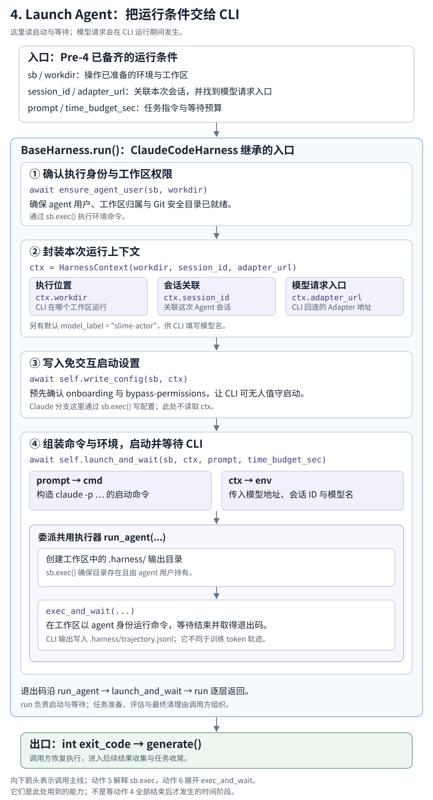

# Launch Agent · 候选阅读稿

## 本节局部数据流

[](flow.svg)

**读完本章，你应能解释：已有的任务运行条件怎样进入 Harness，变成 CLI 配置、命令和环境变量，并在运行结束后把状态交回调用者。**

从 [Pre-4：启动前准备](/projects/slime/4-slime-core-components-and-orchestration/4-1-agent-rollout-adapters-and-harnesses/pre-4/) 接过已准备的沙箱、CLI、工作区、题目文件和 Adapter 会话。本章先用 Claude Code 一条路径，从 `run()` 读到执行接口与返回值；环境操作的内部实现接动作 5，后台进程与等待机制接动作 6。

这发生在外层 Agent 任务中。前面读过的模型请求链路，是 CLI 运行期间可能发生多次的内部交互。

<details class="reading-extra">
<summary>查看这一步在完整任务中的位置</summary>

[](/images/slime-lifecycle/action-4.svg)

外层任务先准备条件、启动 CLI，再由 CLI 请求模型或调用工具。阅读顺序不等于执行顺序。

[返回完整任务主线](/projects/slime/4-slime-core-components-and-orchestration/4-1-agent-rollout-adapters-and-harnesses/task-walkthrough/)

</details>

## 把图接到真实调用

调用者 `generate()` 已在工作区准备完成之后，交出以下六项输入，并等待一个整数状态：

```python
agent_exit_code = await HARNESS_CLS().run(
    sb,
    workdir=md["workdir"],
    session_id=session_id,
    adapter_url=state.adapter_url,
    time_budget_sec=CONFIG.agent_time_budget_sec,
    prompt=swe.SWE_PROMPT,
)
```

`HARNESS_CLS` 本例选 `ClaudeCodeHarness`，它继承公共 `BaseHarness.run()`。公共主体按顺序做四件事：

```python
await _sandbox.ensure_agent_user(sb, workdir)
ctx = HarnessContext(
    workdir=workdir,
    session_id=session_id,
    adapter_url=adapter_url,
)
await self.write_config(sb, ctx)
return await self.launch_and_wait(sb, ctx, prompt, time_budget_sec)
```

<details class="reading-source" id="source-c01" data-source-check="c01">
<summary>查看源码出处与行号</summary>

| 定位内容 | 文件与行号 |
| --- | --- |
| 调用方准备完成并进入 run | [`examples/coding_agent_rl/generate.py:203`](https://github.com/THUDM/slime/blob/22a89f96835969a47055a659c588f46151f8b07a/examples/coding_agent_rl/generate.py#L203-L213) |
| 公共 run | [`slime/agent/harness/common.py:81`](https://github.com/THUDM/slime/blob/22a89f96835969a47055a659c588f46151f8b07a/slime/agent/harness/common.py#L81-L104) |
| 选择 Harness 与 Adapter | [`examples/coding_agent_rl/generate.py:45`](https://github.com/THUDM/slime/blob/22a89f96835969a47055a659c588f46151f8b07a/examples/coding_agent_rl/generate.py#L45-L52) |

</details>

这里不是 Adapter 调用 Harness。发起者是外层任务的 `generate()`；`BaseAdapter._run_turn()` 处理的是随后 CLI 发来的模型请求。

## 1．接住六项输入：先知道它们在这次运行中是什么

| 此时的数据 | 下一步交给谁 | 最小理解 |
| --- | --- | --- |
| `sb` | `ensure_agent_user()`、`write_config()`、`run_agent()` | 已经创建的执行环境；可在里面执行命令、访问文件 |
| `workdir` | `ensure_agent_user()`、`HarnessContext`，随后进入 `run_agent()` | CLI 操作这道题代码的目录，也是日志目录的父目录 |
| `session_id` | `HarnessContext` → `launch_and_wait()` | 本次 Agent 运行对应的 Adapter 会话标识，后续请求靠它关联会话状态 |
| `adapter_url` | `HarnessContext` → `launch_and_wait()` | 沙箱内 CLI 能访问的 Adapter 地址；Adapter 再转发到模型后端 |
| `prompt` | `launch_and_wait()` | 告诉 CLI 怎样开始工作，本例要求读取已准备好的题目文件 |
| `time_budget_sec` | `launch_and_wait()` → `run_agent()` → `exec_and_wait()` | 等待 CLI 完成标记的时间预算，本例 1800 秒 |

本例目录是 `/workspace/demo`，会话标识是 `cagent-demo-0-0`，Adapter 地址是 `http://192.0.2.10:18001`。这些是教学值，不是实际部署记录。

题目正文已经写入 `PROBLEM_STATEMENT.md`；`prompt` 是告诉 CLI 去读文件并完成任务的启动指令。默认采样参数仍保存在 Adapter Session 中，不是本次 `run()` 的一个参数。

<details class="reading-extra">
<summary>展开同一份启动输入</summary>

下面只展示真正传入的五个命名参数；`sb` 是已有沙箱对象，没有把它伪装成 JSON。

```json
{
  "workdir": "/workspace/demo",
  "session_id": "cagent-demo-0-0",
  "adapter_url": "http://192.0.2.10:18001",
  "time_budget_sec": 1800,
  "prompt": "Read PROBLEM_STATEMENT.md in the current directory and resolve the issue. Edit source files only (do NOT touch tests). After editing, run the relevant tests to verify your fix passes. Do NOT modify PROBLEM_STATEMENT.md and do NOT commit. When finished, print a one-line summary and exit."
}
```

</details>

**交出：** 先用 `sb` 和 `workdir` 确认运行用户，再把后续几步共用的字段整理为 `ctx`。

## 2．确认运行用户：把工作区交给 agent 用户

**输入：** 已有执行环境与工作目录。公共 run 调用 `ensure_agent_user(sb, workdir)`，其实现是：

```python
async def ensure_agent_user(sb: Sandbox, workdir: str) -> None:
    """Create the unprivileged 'agent' user that owns workdir + can git diff."""
    await sb.exec(
        f"id agent >/dev/null 2>&1 || useradd -m -s /bin/bash agent && "
        f"chown -R agent:agent /home/agent {workdir} && "
        f"git config --system --add safe.directory '*' && id agent",
        user="root",
        check=True,
        timeout=60,
    )
```

<details class="reading-source" id="source-c02" data-source-check="c02">
<summary>查看源码出处与行号</summary>

| 定位内容 | 文件与行号 |
| --- | --- |
| run 内调用 | [`slime/agent/harness/common.py:97`](https://github.com/THUDM/slime/blob/22a89f96835969a47055a659c588f46151f8b07a/slime/agent/harness/common.py#L97-L97) |
| 用户准备 helper | [`slime/agent/sandbox.py:390`](https://github.com/THUDM/slime/blob/22a89f96835969a47055a659c588f46151f8b07a/slime/agent/sandbox.py#L390-L399) |

</details>

先看三项实际作用：确认或创建 `agent` 用户；让它拥有自己的目录和工作区；设置 Git 信任目录，使后面的 Git 操作能进行。

`sb.exec` 在这里接收执行要求，如何连到远端环境留给 [Manage Sandbox](/projects/slime/4-slime-core-components-and-orchestration/4-1-agent-rollout-adapters-and-harnesses/5-manage-sandbox/)；这个 helper 不会新建沙箱，也不会安装 CLI。工作区准备阶段已经调用过它，run 仍再次确认，便于 Harness 独立使用。

**留下：** 执行环境中的用户、权限和 Git 设置。helper 返回 `None`，流程继续建立上下文。

## 3．建立 HarnessContext：保存后面几步共用的运行信息

**输入：** `workdir`、`session_id` 与 `adapter_url`。`run()` 用它们构造一个上下文：

```python
@dataclass(frozen=True)
class HarnessContext:
    """Generic run context, free of any task fields.

    model_label is the model name the harness advertises to its CLI. The slime
    adapter ignores it and serves whatever upstream sglang has loaded, so it is
    not a run() parameter.
    """

    workdir: str
    session_id: str
    adapter_url: str
    model_label: str = "slime-actor"
```

<details class="reading-source" id="source-c03" data-source-check="c03">
<summary>查看源码出处与行号</summary>

| 定位内容 | 文件与行号 |
| --- | --- |
| 上下文定义 | [`slime/agent/harness/common.py:42`](https://github.com/THUDM/slime/blob/22a89f96835969a47055a659c588f46151f8b07a/slime/agent/harness/common.py#L42-L54) |
| 构造上下文 | [`slime/agent/harness/common.py:98`](https://github.com/THUDM/slime/blob/22a89f96835969a47055a659c588f46151f8b07a/slime/agent/harness/common.py#L98-L102) |

</details>

| 成员 | 接下来谁使用 | 最小理解 |
| --- | --- | --- |
| `ctx.workdir` | `run_agent()` | CLI 的工作目录 |
| `ctx.session_id` | `launch_and_wait()` | 写入请求凭据，让 CLI 发来的模型请求关联到正确会话 |
| `ctx.adapter_url` | `launch_and_wait()` | 写入 CLI 先访问的 Adapter 服务地址 |
| `ctx.model_label` | `launch_and_wait()` | 默认 `slime-actor`，是给 CLI 的模型标签，不是在这里加载模型 |

这是 Harness 内部共用的上下文。`sb`、`prompt` 与 `time_budget_sec` 仍作为独立参数传递；构造 `ctx` 本身不会执行任何 Sandbox 操作。

**交出：** 公共 run 先将 `sb`、`ctx` 交给所选 Harness 的 `write_config()`。

## 4．写 CLI 配置：先准备无交互启动

Claude Code 分支实现了这段配置操作：

```python
async def write_config(self, sb: Sandbox, ctx: HarnessContext) -> None:
    """Pre-ack bypass-permissions so claude-code starts headless."""
    settings = json.dumps({"hasCompletedOnboarding": True, "bypassPermissionsModeAccepted": True})
    await sb.exec(
        "mkdir -p /home/agent/.claude && "
        f"echo {shlex.quote(settings)} "
        "| tee /home/agent/.claude.json /home/agent/.claude/settings.json > /dev/null && "
        "chown -R agent:agent /home/agent/.claude /home/agent/.claude.json",
        user="root",
        check=True,
        timeout=60,
    )
```

<details class="reading-source" id="source-c04" data-source-check="c04">
<summary>查看源码出处与行号</summary>

| 定位内容 | 文件与行号 |
| --- | --- |
| 公共配置调用 | [`slime/agent/harness/common.py:103`](https://github.com/THUDM/slime/blob/22a89f96835969a47055a659c588f46151f8b07a/slime/agent/harness/common.py#L103-L103) |
| Claude 配置实现 | [`slime/agent/harness/claude_code.py:44`](https://github.com/THUDM/slime/blob/22a89f96835969a47055a659c588f46151f8b07a/slime/agent/harness/claude_code.py#L44-L55) |

</details>

配置中的 `hasCompletedOnboarding` 和 `bypassPermissionsModeAccepted` 为无交互启动预先写好设置，保存到 agent 用户目录下的两份 Claude 配置文件。

这里的 `ctx` 是统一接口的参数，**当前 Claude 实现没有读取它**。模型地址、会话标识和模型标签在下一步进入启动环境，而不是由这里写入。

Harness 决定配置内容，通过 `sb.exec` 请求写文件和设置权限；环境内部怎样完成命令继续由动作 5 解释。

**留下：** CLI 启动需要的静态设置。`write_config()` 完成后，run 进入 `launch_and_wait()`。

## 5．组织启动命令和环境：把任务指令与会话接到 CLI

**输入：** `sb`、`ctx`、完整 `prompt` 与预算。Claude 分支先把 `prompt` 变为命令参数，再从上下文建立环境变量：

```python
async def launch_and_wait(self, sb: Sandbox, ctx: HarnessContext, prompt: str, time_budget_sec: int) -> int:
    cmd = f"/usr/local/bin/claude -p {shlex.quote(prompt)} {self.launch_flags}"
    extra = os.environ.get(self.extra_args_env, "").strip()
    if extra:
        cmd = f"{cmd} {extra}"
    env = {
        "ANTHROPIC_BASE_URL": ctx.adapter_url,
        "ANTHROPIC_AUTH_TOKEN": ctx.session_id,
        "ANTHROPIC_MODEL": ctx.model_label,
        **self.static_env,
    }
    extra_envs = os.environ.get(self.extra_envs_env, "").strip()
    if extra_envs:
        env.update(json.loads(extra_envs))
    return await run_agent(sb, workdir=ctx.workdir, start_cmd=cmd, env=env, time_budget_sec=time_budget_sec)
```

<details class="reading-source" id="source-c05" data-source-check="c05">
<summary>查看源码出处与行号</summary>

| 定位内容 | 文件与行号 |
| --- | --- |
| 公共启动调用 | [`slime/agent/harness/common.py:104`](https://github.com/THUDM/slime/blob/22a89f96835969a47055a659c588f46151f8b07a/slime/agent/harness/common.py#L104-L104) |
| Claude 命令和环境 | [`slime/agent/harness/claude_code.py:57`](https://github.com/THUDM/slime/blob/22a89f96835969a47055a659c588f46151f8b07a/slime/agent/harness/claude_code.py#L57-L71) |
| 固定 flags 和环境 | [`slime/agent/harness/claude_code.py:18`](https://github.com/THUDM/slime/blob/22a89f96835969a47055a659c588f46151f8b07a/slime/agent/harness/claude_code.py#L18-L34) |

</details>

| 形成的内容 | 来自哪里 | 本例的最小理解 |
| --- | --- | --- |
| `cmd` | `prompt`、固定 flags、可选额外参数 | 启动 Claude CLI，并交出本题的工作指令 |
| `ANTHROPIC_BASE_URL` | `ctx.adapter_url` | 请求发往 `http://192.0.2.10:18001` 的 Adapter |
| `ANTHROPIC_AUTH_TOKEN` | `ctx.session_id` | 携带 `cagent-demo-0-0`，让 Adapter 找到之前注册的会话 |
| `ANTHROPIC_MODEL` | `ctx.model_label` | 向 CLI 提供 `slime-actor` 这个模型标签 |

地址决定请求送到哪个 Adapter，会话标识决定关联它保存的哪份状态。实际生成模型由上游模型服务配置决定，Harness 在这里不加载模型。

`SLIME_AGENT_CC_EXTRA_ARGS` 可追加命令参数；`SLIME_AGENT_CC_EXTRA_ENVS` 是最后合并的环境覆盖项，可以覆盖前面的同名键。本例没有额外覆盖。

<details class="reading-extra">
<summary>展开本例形成的完整 cmd 与 env</summary>

```json
{
  "cmd": "/usr/local/bin/claude -p 'Read PROBLEM_STATEMENT.md in the current directory and resolve the issue. Edit source files only (do NOT touch tests). After editing, run the relevant tests to verify your fix passes. Do NOT modify PROBLEM_STATEMENT.md and do NOT commit. When finished, print a one-line summary and exit.' --permission-mode bypassPermissions --output-format stream-json --include-partial-messages --include-hook-events --verbose",
  "env": {
    "ANTHROPIC_BASE_URL": "http://192.0.2.10:18001",
    "ANTHROPIC_AUTH_TOKEN": "cagent-demo-0-0",
    "ANTHROPIC_MODEL": "slime-actor",
    "CLAUDE_CODE_DISABLE_NONESSENTIAL_TRAFFIC": "1",
    "CLAUDE_CODE_DISABLE_EXPERIMENTAL_BETAS": "1",
    "CLAUDE_CODE_ATTRIBUTION_HEADER": "0"
  }
}
```

</details>

**交出：** `launch_and_wait()` 把执行环境、工作目录、命令、环境变量和等待预算一起交给 `run_agent()`。

## 6．委派执行并等待：run_agent 怎样使用这些要求

公共 helper 的实现不长：

```python
async def run_agent(sb: Sandbox, *, workdir: str, start_cmd: str, env: dict[str, str], time_budget_sec: int) -> int:
    """Launch the agent (start_cmd) and run it to completion, returning its exit code."""
    meta_dir = f"{workdir}/.harness"
    await sb.exec(f"mkdir -p {meta_dir} && chown agent:agent {meta_dir}", user="root", check=True, timeout=30)
    exit_code, _ = await exec_and_wait(
        sb,
        cmd=start_cmd,
        user="agent",
        env=env,
        workdir=workdir,
        out_file=f"{meta_dir}/trajectory.jsonl",
        time_budget_sec=time_budget_sec,
        tag="run",
        want_output=False,
    )
    return exit_code
```

<details class="reading-source" id="source-c06" data-source-check="c06">
<summary>查看源码出处与行号</summary>

| 定位内容 | 文件与行号 |
| --- | --- |
| 运行 helper | [`slime/agent/harness/common.py:107`](https://github.com/THUDM/slime/blob/22a89f96835969a47055a659c588f46151f8b07a/slime/agent/harness/common.py#L107-L122) |
| 执行接口签名与返回约定 | [`slime/agent/sandbox.py:82`](https://github.com/THUDM/slime/blob/22a89f96835969a47055a659c588f46151f8b07a/slime/agent/sandbox.py#L82-L105) |
| 返回结果处理 | [`slime/agent/sandbox.py:139`](https://github.com/THUDM/slime/blob/22a89f96835969a47055a659c588f46151f8b07a/slime/agent/sandbox.py#L139-L145) |

</details>

| 执行要求 | 本例内容 | 作用 |
| --- | --- | --- |
| `cmd`、`env` | 上一步的 CLI 命令与环境 | `exec_and_wait()` 启动 CLI |
| `user` | `agent` | 指定运行命令的用户 |
| `workdir` | `/workspace/demo` | 指定 CLI 操作代码的目录 |
| `out_file` | `/workspace/demo/.harness/trajectory.jsonl` | 接收 CLI 标准输出和错误 |
| `time_budget_sec` | `1800` | 等待完成标记的预算 |
| `tag`、`want_output` | `run`、`False` | 标记这次执行；常规成功时不回传完整输出文本 |

虽然日志文件名叫 `trajectory.jsonl`，这里接的是 CLI 进程输出。前面模型请求链路中的 token 和训练轨迹，由 Adapter 的会话管理器另行保存，不能把两者混为一份数据。

到这里，Harness 已把启动要求交到执行接口。`exec_and_wait()` 的后台脚本、输出重定向、完成标记和轮询机制，继续读 [Exec Commands](/projects/slime/4-slime-core-components-and-orchestration/4-1-agent-rollout-adapters-and-harnesses/6-exec-commands/)。本章只跟踪它的输入和返回值。

**等待期间：** CLI 可以执行工具、回连 Adapter，并多次进入前面读过的模型请求链路。Harness 等待的是 CLI 运行状态，不会主动替 CLI 驱动每一轮模型/工具交互。

## 7．接回返回值：把运行状态交还外层任务

下层 `exec_and_wait()` 返回 `(exit_code, output)`。上面的代码以 `exit_code, _` 接收，所以 `run_agent()`、`launch_and_wait()`、`Harness.run()` 最终都只返回整数。

| 返回值或状态 | 本章最小理解 |
| --- | --- |
| 本例的 `0` | 记录器模拟的正常退出状态；不是本轮实际运行结果 |
| 正常读到的非零退出码（如 `7`） | CLI 报告的进程状态，不直接等于任务 reward |
| `-1` | 等待完成标记的预算耗尽，未拿到实际退出码；不表示 CLI 已被杀掉 |

原示例用记录器返回 `(0, "")`，没有启动真实 CLI。因此示例只能展示参数与返回契约，不证明 Agent 实际解决了任务。

`generate()` 以 `agent_exit_code` 接收返回值。普通整数返回后，外层继续收集补丁、独立评分；异常属于另一条处理路径。回到调用处，相邻步骤是：

仍在工作沙箱中时，调用者先收集代码变更：

```python
diff_text = await swe.git_diff(sb, md["workdir"])
```

退出这个工作沙箱的上下文后，再进行独立评估：

```python
reward, applied_cleanly = await swe.run_evaluation(
    md,
    diff_text=diff_text,
    timeout_sec=CONFIG.eval_timeout_sec,
)
```

<details class="reading-source" id="source-c07" data-source-check="c07">
<summary>查看源码出处与行号</summary>

| 定位内容 | 文件与行号 |
| --- | --- |
| 接收状态并收集/评估 | [`examples/coding_agent_rl/generate.py:203`](https://github.com/THUDM/slime/blob/22a89f96835969a47055a659c588f46151f8b07a/examples/coding_agent_rl/generate.py#L203-L219) |
| 等待预算耗尽 | [`slime/agent/sandbox.py:62`](https://github.com/THUDM/slime/blob/22a89f96835969a47055a659c588f46151f8b07a/slime/agent/sandbox.py#L62-L79) |
| 工作沙箱退出与回收 | [`examples/coding_agent_rl/generate.py:131`](https://github.com/THUDM/slime/blob/22a89f96835969a47055a659c588f46151f8b07a/examples/coding_agent_rl/generate.py#L131-L134) |

</details>

**交回主线：** 本章交出了运行状态，工作区中可能留下代码变更。补丁收集、评分、会话收尾和资源回收由外层任务继续组织，不是 `Harness.run()` 的返回对象。

[回到完整任务主线](/projects/slime/4-slime-core-components-and-orchestration/4-1-agent-rollout-adapters-and-harnesses/task-walkthrough/) 可以继续看这些步骤如何接上。

<details class="reading-extra">
<summary>补充：预算、异常与日志的边界</summary>

- `time_budget_sec` 是等待 CLI 完成标记的预算；各次 `sb.exec` 的 RPC 超时、外层整个 rollout 的时间保护是不同限制。
- 等待预算耗尽的 `-1` 不表示底层主动终止了 CLI；工作环境由外层退出上下文时尝试回收。
- 用户或配置操作失败时，`sb.exec(..., check=True)` 会使异常向上传播，后面的启动不会正常继续。
- `want_output=False` 下，成功通常返回空输出；非零状态时下层仍读取日志尾部。但 `run_agent()` 丢弃了这个返回文本，排查时还需查看输出文件。

这一层没有把 CLI 状态自动转换成 reward，也没有在 `run()` 中创建或销毁沙箱。

</details>

<details class="reading-source" id="source-c08" data-source-check="c08">
<summary>查看源码出处与行号</summary>

| 定位内容 | 文件与行号 |
| --- | --- |
| 等待预算返回 | [`slime/agent/sandbox.py:62`](https://github.com/THUDM/slime/blob/22a89f96835969a47055a659c588f46151f8b07a/slime/agent/sandbox.py#L62-L79) |
| 运行输出处理 | [`slime/agent/sandbox.py:139`](https://github.com/THUDM/slime/blob/22a89f96835969a47055a659c588f46151f8b07a/slime/agent/sandbox.py#L139-L145) |
| 外层工作沙箱生命周期 | [`examples/coding_agent_rl/generate.py:95`](https://github.com/THUDM/slime/blob/22a89f96835969a47055a659c588f46151f8b07a/examples/coding_agent_rl/generate.py#L95-L134) |
| 外层时间保护 | [`examples/coding_agent_rl/generate.py:200`](https://github.com/THUDM/slime/blob/22a89f96835969a47055a659c588f46151f8b07a/examples/coding_agent_rl/generate.py#L200-L203) |

</details>

<details class="reading-extra">
<summary>实现对照：换成 Codex 时哪些接口保持不变</summary>

公共的 `BaseHarness.run()` 不变，仍传入同一份 `sb`、`ctx`、指令与预算。

| 接口 | Claude Code | Codex |
| --- | --- | --- |
| `write_config()` | 静态无交互设置；当前实现不读取 ctx | 用 ctx 生成模型/provider 的 TOML 配置 |
| `launch_and_wait()` | `claude -p ...` 与 Anthropic 环境 | `codex exec ...` 与 OpenAI 环境 |
| 公共运行与返回 | 交给 run_agent，返回整数 | 交给 run_agent，返回整数 |

第一遍先走通 Claude，再用 [完整原示例](示例.json) 对比另一分支，不需要同时展开两套启动流程。

</details>

<details class="reading-source" id="source-c09" data-source-check="c09">
<summary>查看源码出处与行号</summary>

| 定位内容 | 文件与行号 |
| --- | --- |
| Harness扩展接口 | [`slime/agent/harness/common.py:57`](https://github.com/THUDM/slime/blob/22a89f96835969a47055a659c588f46151f8b07a/slime/agent/harness/common.py#L57-L79) |
| Codex配置与启动 | [`slime/agent/harness/codex.py:56`](https://github.com/THUDM/slime/blob/22a89f96835969a47055a659c588f46151f8b07a/slime/agent/harness/codex.py#L56-L86) |

</details>

## 回到局部图，检查是否能独立解释

1. 为什么 `run()` 可以直接接收已有沙箱？题目文件、CLI 安装和默认采样参数分别在哪里准备或保存？
2. `ctx` 包含什么？为什么当前 Claude 的 `write_config()` 不使用 ctx，后续请求却仍能找到模型入口和会话？
3. `run_agent()` 交出哪些运行要求，返回了什么？CLI 的输出日志与 Adapter 的训练轨迹有什么区别？
4. 等待得到 `-1` 时，能否断定 CLI 已经退出？为什么 `agent_exit_code` 不能直接当作任务 reward？

下钻 [动作 5 Manage Sandbox](/projects/slime/4-slime-core-components-and-orchestration/4-1-agent-rollout-adapters-and-harnesses/5-manage-sandbox/) 时记住调用点：用户准备、配置写入和日志目录都使用了 `sb`。读清环境实现后，再回到本章继续；动作 6 解释执行等待，动作 7 解释 CLI 回连。

<details class="reading-extra">
<summary>查看原材料与完整示例</summary>

[原有 Harness.run 主线](/projects/slime/4-slime-core-components-and-orchestration/4-1-agent-rollout-adapters-and-harnesses/4-launch-agent/harness-run/) · [当前第 4 章入口](/projects/slime/4-slime-core-components-and-orchestration/4-1-agent-rollout-adapters-and-harnesses/4-launch-agent/) · [完整原示例](示例.json)

原来对 Adapter 服务、会话、工作区的准备说明仍保留在 Pre-4 与旧材料中。本章候选只重新组织 Harness 主线，不替换原材料。

</details>

<details class="reading-source">
<summary>集中查看源码校验清单</summary>

[源码出处与校验清单](SOURCE-CHECK.md)

</details>
