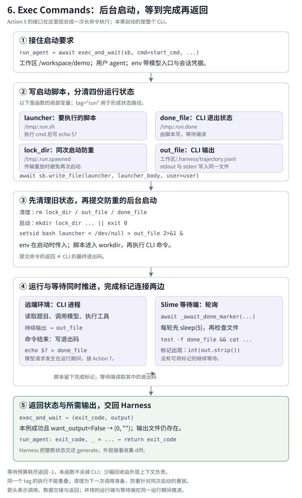

# Exec Commands：把 CLI 命令启动起来，再等到它的结果

**读完本章，你应能说明：启动请求已经返回时，CLI 为什么还在运行？Slime 又怎样知道它结束，并取得退出状态？**

<div class="reading-navigation" data-reading-navigation="action-6">

以下是**阅读伪代码**：简写前后步骤，标出本节入口；缩进表示阅读层次，各层实现仍在不同函数中。

```python
generate:
    ...  # Pre-4：模型入口、会话、环境与题目准备
    HARNESS_CLS().run:  # Action 4：组织启动与接回状态
        ...  # Action 4：用户、上下文、配置
        launch_and_wait:  # Action 4：形成 cmd 与 env
            run_agent:
                # CLI 运行期间：7 回连；2/3/3.5 处理模型请求
                exec_and_wait:  # 当前 Action 6
                    ...  # 写脚本、清理、后台启动、轮询标记、收集结果
    ...  # 返回后收集 diff、评估与结果收尾
# Action 5：本章使用它的文件与命令接口；回收由外层上下文负责
```

</div>

## 本节局部数据流

[](flow.svg)

沿用 `/workspace/demo` 的同一任务。Action 4 已准备 `start_cmd` 和 `env`，Action 5 已说明环境接口；现在下钻到 `exec_and_wait()`，读完一次 CLI 的启动与等待。

<details class="reading-extra">
<summary>查看这一步在完整任务中的位置</summary>

[](/images/slime-lifecycle/action-6.svg)

CLI 运行时可以反复向 Adapter 请求模型，接上 Action 7 → 2 → 3 → 3.5。这里跟随 Slime 的启动与等待代码；CLI 内部如何执行模型选择的工具，需另读 CLI 源码。

[返回任务生命周期总览](/projects/slime/#agent-lifecycle)

</details>

## 把图接到真实调用

`launch_and_wait()` 把形成的启动要求交给 `run_agent()`。它先准备输出目录，再调用本章的执行机制：

```python
async def run_agent(sb: Sandbox, *, workdir: str, start_cmd: str, env: dict[str, str], time_budget_sec: int) -> int:
    """Launch the agent (start_cmd) and run it to completion, returning its exit code."""
    meta_dir = f"{workdir}/.harness"
    await sb.exec(f"mkdir -p {meta_dir} && chown agent:agent {meta_dir}", user="root", check=True, timeout=30)
    exit_code, _ = await exec_and_wait(
        sb,
        cmd=start_cmd,
        user="agent",
        env=env,
        workdir=workdir,
        out_file=f"{meta_dir}/trajectory.jsonl",
        time_budget_sec=time_budget_sec,
        tag="run",
        want_output=False,
    )
    return exit_code
```

`start_cmd` 在交接时成为 `cmd`。`exit_code, _` 表明调用者只保留状态，返回的 `output` 在这里被忽略。本章先跟进这个 `await`，最后回到 `return exit_code`。

<details class="reading-source" id="source-c01" data-source-check="c01">
<summary>查看源码出处与行号</summary>

- 外层任务调用：[examples/coding_agent_rl/generate.py:205](https://github.com/THUDM/slime/blob/22a89f96835969a47055a659c588f46151f8b07a/examples/coding_agent_rl/generate.py#L205-L213)
- Harness 中间交接：[slime/agent/harness/common.py:97](https://github.com/THUDM/slime/blob/22a89f96835969a47055a659c588f46151f8b07a/slime/agent/harness/common.py#L97-L104)
- 启动调用：[slime/agent/harness/claude_code.py:57](https://github.com/THUDM/slime/blob/22a89f96835969a47055a659c588f46151f8b07a/slime/agent/harness/claude_code.py#L57-L71)
- 本章调用者：[slime/agent/harness/common.py:107](https://github.com/THUDM/slime/blob/22a89f96835969a47055a659c588f46151f8b07a/slime/agent/harness/common.py#L107-L122)

</details>

## 1．把运行要求变成脚本与状态文件

| 此时的数据 | 下一步交给谁 | 最小理解 |
| --- | --- | --- |
| 已可用的 `sb` | `exec_and_wait()` | 继续使用同一个环境，写文件与发命令的能力已在 Action 5 读过 |
| `start_cmd` | `exec_and_wait(cmd=...)` | 启动整个 Claude Code CLI 的命令；命令内容由 Action 4 形成 |
| `env` | 后台启动那一次 `sb.exec(env=...)` | CLI 使用的模型入口、会话凭据等环境变量，随启动传入 |
| `workdir` 与 `user="agent"` | 启动脚本与 Sandbox 操作 | CLI 在 `/workspace/demo` 中运行，并使用已准备好的 `agent` 身份 |
| `time_budget_sec=1800` | `_await_done_marker()` | 本例最多按这份预算等待退出标记；不是整次任务的绝对截止时间 |

调用者还固定了 `tag="run"`、输出路径和 `want_output=False`。先看它们怎样形成运行期间使用的文件：

```python
out_file = out_file or f"/tmp/.{tag}.out"
done_file = f"/tmp/.{tag}.done"
launcher = f"/tmp/.{tag}.sh"
lock_dir = f"/tmp/.{tag}.spawned"
prefix = f"cd {workdir}\nexport HOME=/home/{user}\n" if workdir else ""
launcher_body = f"#!/bin/bash\n{prefix}{cmd}\necho $? > {done_file}\n"
await sb.write_file(launcher, launcher_body, user=user)
```

以下都是 `exec_and_wait()` 的局部变量，不是 `sb` 的属性：

| 变量 | 本例路径 | 用途 |
| --- | --- | --- |
| `launcher` | `/tmp/.run.sh` | 保存 CLI 命令与写退出码的脚本 |
| `done_file` | `/tmp/.run.done` | 保存本次 CLI 命令的退出码，供等待端读取 |
| `lock_dir` | `/tmp/.run.spawned` | 防止同一次启动请求在传输重放时再次启动 |
| `out_file` | `/workspace/demo/.harness/trajectory.jsonl` | 收集 CLI 的标准输出与标准错误；这里使用调用者指定的路径 |

脚本内容是“进入工作区、设置用户目录、执行 `cmd`、把它的退出码写入 `done_file`”。`echo $?` 记录前一个命令的退出状态。

`sb.write_file()` 此时只写入脚本，还没有启动 CLI。完整生成脚本可以在[本例记录](示例.json)中查看。

<details class="reading-source" id="source-c02" data-source-check="c02">
<summary>查看源码出处与行号</summary>

- 参数合同：[slime/agent/sandbox.py:82](https://github.com/THUDM/slime/blob/22a89f96835969a47055a659c588f46151f8b07a/slime/agent/sandbox.py#L82-L105)
- 路径及脚本：[slime/agent/sandbox.py:107](https://github.com/THUDM/slime/blob/22a89f96835969a47055a659c588f46151f8b07a/slime/agent/sandbox.py#L107-L113)
- 调用方固定参数：[slime/agent/harness/common.py:111](https://github.com/THUDM/slime/blob/22a89f96835969a47055a659c588f46151f8b07a/slime/agent/harness/common.py#L111-L121)

</details>

## 2．先清理旧状态，再提交后台启动

为什么采用后台运行？源码注释指出，长命令可能超过 E2B 网关维持单条响应流的时间。这个实现让 CLI 在远端继续执行，等待端用一系列短请求检查完成标记，避免依赖同一条连接从启动一直保持到结束。

本次使用 `tag="run"`。再次运行相同 tag 时，需要清掉上一轮的防重目录、输出文件和完成标记：

```python
await sb.exec(
    f"rm -rf {lock_dir}; rm -f {out_file} {done_file}",
    user=user,
    timeout=30,
    check=True,
    idempotent=True,
)
```

清理作为一次单独的环境请求执行，然后才提交启动命令：

```python
await sb.exec(
    f"chmod +x {launcher}; "
    f"mkdir {lock_dir} 2>/dev/null || exit 0; "
    f"setsid bash {launcher} < /dev/null > {out_file} 2>&1 &",
    user=user,
    env=env,
    timeout=30,
    check=True,
    idempotent=True,
)
```

沿这条命令看各部分留下什么：

- `chmod +x`：给已写好的脚本设置执行权限。
- `mkdir lock_dir ... || exit 0`：目录创建成功才继续启动；目录已存在等创建失败情况会在这里结束这条提交命令。
- `setsid bash launcher ... &`：以后台方式启动脚本。`< /dev/null` 接管输入，`> out_file 2>&1` 把标准输出和错误写到同一文件。

**这次 `sb.exec()` 返回的是启动提交命令的结果。CLI 的最终退出码随后写入完成标记。** 提交顺利返回时，CLI 仍可能在执行任务。

`env` 正是在这次启动调用中传入。脚本与 CLI 通过进程继承使用这些环境变量；文件清理和之后的标记轮询不需要重复传入模型配置。

<details class="reading-source" id="source-c03" data-source-check="c03">
<summary>查看源码出处与行号</summary>

- 清理与防重约束：[slime/agent/sandbox.py:115](https://github.com/THUDM/slime/blob/22a89f96835969a47055a659c588f46151f8b07a/slime/agent/sandbox.py#L115-L128)
- 后台启动：[slime/agent/sandbox.py:129](https://github.com/THUDM/slime/blob/22a89f96835969a47055a659c588f46151f8b07a/slime/agent/sandbox.py#L129-L138)

</details>

## 3．CLI 在运行，等待端怎样知道它结束

后台启动后，远端 CLI 执行任务；Slime 这一侧进入 `_await_done_marker()`。两边在同一段运行时间内推进：CLI 写输出、结束时写退出码；等待端不断检查是否出现完成标记。

```python
deadline = time.time() + time_budget_sec
while time.time() < deadline:
    await asyncio.sleep(5)
    ec, out, _ = await sb.exec(f"test -f {done_file} && cat {done_file}", user=user, timeout=15, check=False)
    if ec == 0 and (out or "").strip():
        return int(out.strip())
return EXIT_TIME_BUDGET_EXCEEDED
```

先沿本例成功路径走两轮。这里的 Sandbox 响应由记录型依赖提供，用来执行原函数并观察交接，没有运行真实 CLI：

| 轮询 | `sb.exec()` 的三元组 | 等待端怎样理解 |
| --- | --- | --- |
| 第一次 | `(1, "", "")` | 完成标记尚不存在，继续等；这里的 `1` 属于标记检查命令 |
| 第二次 | `(0, "0\n", "")` | 标记检查成功；把文本 `"0\n"` 转成整数 `0`，作为 CLI 退出状态 |

因此要区分：`ec` 是这次文件检查命令的退出码，`int(out.strip())` 才是文件中保存的 CLI 退出码。文件检查返回 `0` 时，文件内容也可能是 `"7\n"`，表示 CLI 最终退出为 `7`。

源码每轮先等待 5 秒，再发一个操作超时为 15 秒的检查请求。预算从进入等待函数时开始计算；准备和启动先前已经完成。睡眠和检查也可能使实际返回时刻超过预算边界，不能把它理解成精确到点就强制终止的计时器。

<details class="reading-source" id="source-c04" data-source-check="c04">
<summary>查看源码出处与行号</summary>

- 等待标记：[slime/agent/sandbox.py:62](https://github.com/THUDM/slime/blob/22a89f96835969a47055a659c588f46151f8b07a/slime/agent/sandbox.py#L62-L79)
- 等待调用：[slime/agent/sandbox.py:139](https://github.com/THUDM/slime/blob/22a89f96835969a47055a659c588f46151f8b07a/slime/agent/sandbox.py#L139-L139)

</details>

## 4．把状态和所需输出交还调用者

等待端返回一个整数后，`exec_and_wait()` 决定是否读取输出：

```python
exit_code = await _await_done_marker(sb, done_file, user=user, time_budget_sec=time_budget_sec)
if exit_code == 0 and not want_output:
    return exit_code, ""
if want_output:
    return exit_code, await sb.read_file(out_file, user=user)
_, tail, _ = await sb.exec(f"tail -c 512 {out_file} 2>/dev/null", user=user, timeout=15, check=False)
return exit_code, tail or ""
```

| 条件 | `exec_and_wait()` 留下的返回值 |
| --- | --- |
| 退出为 `0`，`want_output=False` | `(0, "")`，无需读回输出；输出文件仍留在环境中 |
| `want_output=True` | `(exit_code, 文件文本)`，使用 `sb.read_file()` |
| 其他状态且 `want_output=False` | `(exit_code, 输出尾部)`，通过 `tail -c 512` 收集最多 512 字节作诊断 |

本例 `run_agent()` 指定 `want_output=False`。成功路径返回 `(0, "")`，再由 `exit_code, _` 接住，向 `launch_and_wait()`、`run()` 和外层 `generate()` 返回整数 `0`。

`.harness/trajectory.jsonl` 在这里是 CLI 进程输出文件，也可能含错误输出。模型 token 与训练轨迹由 Adapter 会话链路保存；这个文件本身不等于训练样本。

<details class="reading-source" id="source-c05" data-source-check="c05">
<summary>查看源码出处与行号</summary>

- 输出返回分支：[slime/agent/sandbox.py:139](https://github.com/THUDM/slime/blob/22a89f96835969a47055a659c588f46151f8b07a/slime/agent/sandbox.py#L139-L145)
- 上层只保留状态：[slime/agent/harness/common.py:111](https://github.com/THUDM/slime/blob/22a89f96835969a47055a659c588f46151f8b07a/slime/agent/harness/common.py#L111-L122)

</details>

## 5．正常路径走通后，再补防重复与失败边界

第一遍先记住两条约束：**相同 tag 的执行不能重叠；等待预算耗尽返回 `-1`，本函数不自行杀掉 CLI。**

<details class="reading-extra" id="exec-command-boundaries">
<summary>第二遍：为什么分开清理、防重和等待？</summary>

防重目录只用于同一次启动的传输重放：如果第一次已经创建目录并提交启动，再次发送同一请求时会在目录判断处退出。它不是任务唯一标识，也不是保障所有场景“恰好一次执行”的机制。

下一次逻辑调用可以继续使用相同 tag，但必须先清理旧状态。清理若与防重判断放在同一条命令里，旧目录可能让整条命令提前退出，导致清理、启动都没发生，却读到旧退出码。这也是清理和启动分别提交的原因。

`mkdir` 失败的原因也可能是权限等错误，源码会按 `|| exit 0` 提前结束；实际排障仍需结合日志和标记，不能只凭启动提交返回 `0` 宣称 CLI 已成功启动。

等待预算耗尽时，返回的是 `EXIT_TIME_BUDGET_EXCEEDED = -1`。它表示没有在预算内取得可用完成标记，不能直接当作真实进程退出码。启动失败、进程被终止、标记迟迟未写等问题也可能让等待端走到这个结果。

环境操作异常和取消可继续向调用方传播。这个函数没有自己的沙箱回收逻辑；正常任务稍后收集 diff，再退出工作环境，异常路径由外层上下文处理回收。

</details>

<details class="reading-source" id="source-c06" data-source-check="c06">
<summary>查看源码出处与行号</summary>

- 防重源码注释：[slime/agent/sandbox.py:115](https://github.com/THUDM/slime/blob/22a89f96835969a47055a659c588f46151f8b07a/slime/agent/sandbox.py#L115-L121)
- 等待预算：[slime/agent/sandbox.py:62](https://github.com/THUDM/slime/blob/22a89f96835969a47055a659c588f46151f8b07a/slime/agent/sandbox.py#L62-L79)
- 工作环境finally：[examples/coding_agent_rl/generate.py:131](https://github.com/THUDM/slime/blob/22a89f96835969a47055a659c588f46151f8b07a/examples/coding_agent_rl/generate.py#L131-L134)
- 销毁尝试：[slime/agent/sandbox.py:302](https://github.com/THUDM/slime/blob/22a89f96835969a47055a659c588f46151f8b07a/slime/agent/sandbox.py#L302-L307)
- 源码契约测试：[tests/test_agent/test_sandbox_exec_and_wait.py:147](https://github.com/THUDM/slime/blob/22a89f96835969a47055a659c588f46151f8b07a/tests/test_agent/test_sandbox_exec_and_wait.py#L147-L184)

</details>

## 出口：回到任务，连接运行中的模型请求

主线现在可以连续复述：拿到启动要求 → 写脚本 → 清理旧状态 → 提交后台启动 → 轮询完成标记 → 取得状态和输出 → 返回 `run_agent()`。

`generate()` 在正常返回后继续收集 diff、独立评估与任务收尾。Action 7 则展开 **CLI 运行期间**发生的模型 HTTP 请求；它不是等本章结束后才开始的下一阶段。

<details class="reading-source" id="source-c07" data-source-check="c07">
<summary>查看源码出处与行号</summary>

- 任务接回状态和diff：[examples/coding_agent_rl/generate.py:203](https://github.com/THUDM/slime/blob/22a89f96835969a47055a659c588f46151f8b07a/examples/coding_agent_rl/generate.py#L203-L219)
- 模型入口及调用：[slime/agent/harness/claude_code.py:57](https://github.com/THUDM/slime/blob/22a89f96835969a47055a659c588f46151f8b07a/slime/agent/harness/claude_code.py#L57-L71)

</details>

## 回到局部图，检查是否能独立解释

1. `sb.exec()` 的启动提交返回 `0`，是否等于 CLI 已成功结束？应该去哪里取得 CLI 状态？
2. `.run.sh`、`.run.done`、`.run.spawned` 和输出文件分别由谁写、由谁用？
3. 标记检查返回 `ec=0`，输出为 `"7\n"`，最终应向 Harness 返回什么？
4. 为什么下一次相同 tag 的调用要先清理？为什么 `-1` 不能证明进程已经被终止？

[回看 Action 5：Manage Sandbox](/projects/slime/4-slime-core-components-and-orchestration/4-1-agent-rollout-adapters-and-harnesses/5-manage-sandbox/) · [接入 Action 7：Make API Calls](/projects/slime/4-slime-core-components-and-orchestration/4-1-agent-rollout-adapters-and-harnesses/7-make-api-calls/)

<details class="reading-source">
<summary>集中查看源码校验清单与完整示例</summary>

[源码出处与校验清单](SOURCE-CHECK.md) · [受控依赖下的调用记录](示例.json)

本稿核对本地固定源码，并用记录型 Sandbox、模拟时钟执行原有函数，覆盖成功、非零退出、读取输出与预算耗尽。没有连接 E2B、启动 CLI 或请求模型。

</details>
